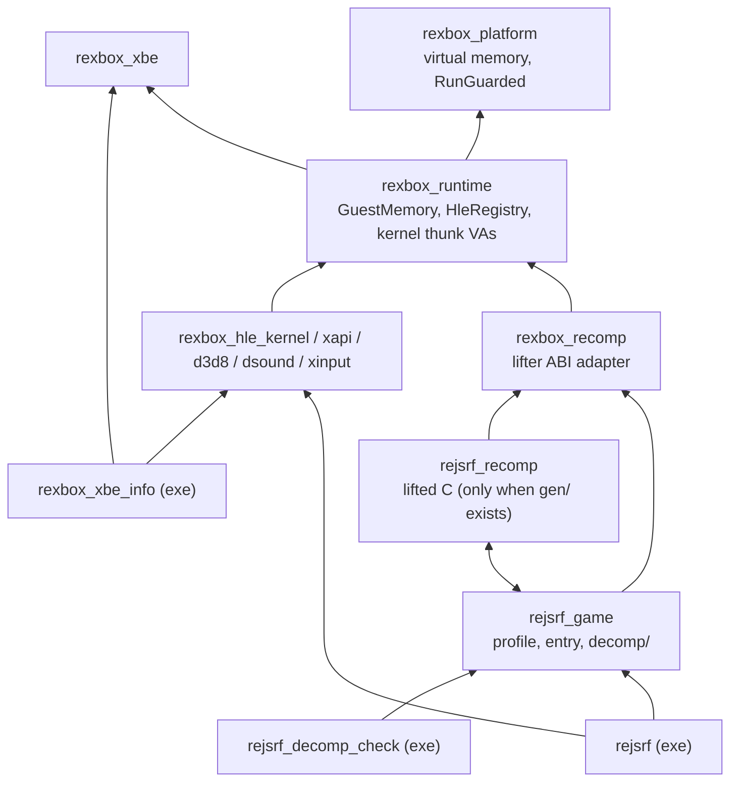
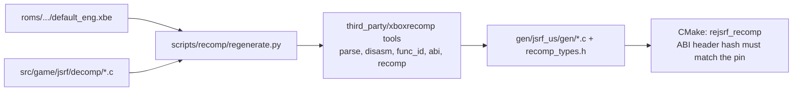
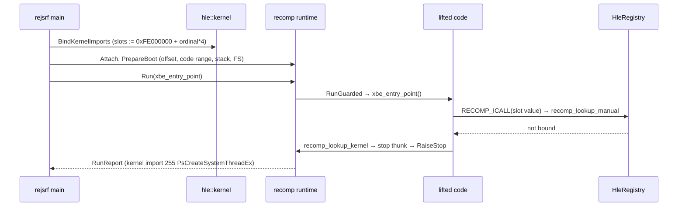

# reJSRF 아키텍처

현재 구현된 코드의 구조를 기록한다. 결정의 근거는 [설계 i001](docs/design/20261012-i001-project-bootstrap.md), [설계 i002](docs/design/20261012-i002-recomp-pipeline.md)에 있다.

## 1. 레이어와 CMake 타깃

| 타깃 | 경로 | 책임 | 상태 |
|---|---|---|---|
| `rexbox_platform` | `include/rexbox/platform/`, `src/platform/<os>/` | OS 계약: 가상 메모리, `RunGuarded`/`RaiseStop`(guarded 실행) | Win32 구현 |
| `rexbox_xbe` | `src/rexbox/xbe/` | XBE 파싱 | 구현 |
| `rexbox_runtime` | `src/rexbox/runtime/` | `GuestMemory`(based 모델), `LoadXbeIntoGuestMemory`, `HleRegistry`, 커널 thunk 합성 주소 계약(`kernel_thunks.h`) | 구현 |
| `rexbox_recomp` | `include/rexbox/recomp/`, `src/rexbox/recomp/` | 생성 코드 ABI 어댑터: 레지스터·상태 전역 정의, `recomp_lookup_manual/kernel`, 로그, 부팅 준비, guarded 실행과 정지 보고 | 구현 |
| `rexbox_hle_kernel` | `src/rexbox/hle/kernel/` | export 이름 표, thunk 슬롯에 합성 주소 쓰기와 바인딩 | 구현 0개 |
| `rexbox_hle_xapi`, `_d3d8`, `_dsound`, `_xinput` | `src/rexbox/hle/<module>/` | XDK 라이브러리 HLE | 등록 진입점만 |
| `rejsrf_game` | `include/rejsrf/`, `src/game/jsrf/` | 프로파일(변형 식별, 1차 변형), 재컴파일 진입점, 디컴파일 함수(`decomp/`) | 디컴파일 1개 |
| `rejsrf_recomp` | `gen/jsrf_us/gen/` (gitignore) | lift된 C 8,716개 함수, `/w /bigobj` | `gen/`이 있을 때만 |
| `rejsrf` | `src/app/` | 로드 → 식별 → 배치 → HLE → 부팅 준비 → 실행 → 보고 | 첫 커널 호출까지 |
| `rexbox_xbe_info` | `tools/xbe_info/` | XBE 정보 출력 | 구현 |
| `rejsrf_decomp_check` | `tools/decomp_check/` | 디컴파일 함수와 `_gen` lift 본문 비교 | 구현 |

* `rejsrf_game` ↔ `rejsrf_recomp`는 서로 심볼을 참조하는 정적 라이브러리 순환이다(생성 코드가 디컴파일 `sub_X`를 부르고, 게임이 생성된 진입점을 부른다). CMake에 양방향을 선언해 GNU ld에서도 해결되게 했다.

## 2. 재컴파일 코드 생성

* 디컴파일 파일의 `void sub_X(void)` 정의는 `--exclude-manual`로 lifter에 전달된다. `extern void sub_X_gen(void);` 선언이 있으면 lift 본문은 `sub_X_gen`으로 생성된다.
* CMake는 `gen/`의 `recomp_types.h`가 고정된 xboxrecomp 템플릿과 같은지 SHA-256으로 확인한다.

## 3. 실행 흐름

## 4. 주요 계약

* **게스트 주소**: 32비트 `GuestAddress`. 런타임 C++ 코드는 `GuestMemory::Translate`, 생성·디컴파일 C 코드는 `MEM32` 등(`addr + g_xbox_mem_offset`)을 쓴다.
* **레지스터**: 생성 코드의 TLS 전역. 그 밖의 코드는 `rexbox/recomp/recomp_abi.h`의 접근 함수로만 읽고 쓴다.
* **HLE**: `HleRegistry::AddExport` / `BindGuestAddress`. thunk는 lift 함수와 같은 `void()`.
* **커널 import**: 슬롯 값은 합성 주소 `0xFE000000 + ordinal × 4`(`rexbox/runtime/kernel_thunks.h`). 미구현이면 실행이 멈추고 ordinal이 보고된다.
* **플랫폼**: `AllocateVirtualMemory`, `RunGuarded`, `RaiseStop`. 기본 값만 받는다.

## 5. 빌드 구성

* `REJSRF_PLATFORM`/`REJSRF_ARCH`는 루트 `CMakeLists.txt`가 정한다. 현재 플랫폼 계층은 `win32`만 있다.
* MSVC: 전역 `/utf-8 /permissive-`, 우리 타깃에만 `/W4`(`rejsrf_strict_warnings`), 생성 코드는 `/w /bigobj /MP`. `rejsrf.exe`는 스택 64 MiB.
* `REJSRF_RECOMP_GEN_DIR`(기본 `gen/jsrf_us/gen`)이 없으면 `rejsrf_recomp`와 `rejsrf_decomp_check`를 만들지 않는다(CI).
* 라이선스 가드 `REJSRF_COPYLEFT_PATHS`는 모든 우리 타깃과 `rejsrf_recomp`에 적용된다.
* `third_party/xboxrecomp`(submodule)가 필요하다: `rexbox_recomp`가 `templates/runtime/recomp_types.h`로 컴파일된다.

---

# reJSRF Architecture

This records the structure of the code as implemented now. The reasons are in [design i001](docs/design/20261012-i001-project-bootstrap.md) and [design i002](docs/design/20261012-i002-recomp-pipeline.md).

## 1. Layers and CMake targets

The diagram above shows the link graph.

| Target | Path | Responsibility | State |
|---|---|---|---|
| `rexbox_platform` | `include/rexbox/platform/`, `src/platform/<os>/` | OS contracts: virtual memory, `RunGuarded`/`RaiseStop` (guarded execution) | Win32 implemented |
| `rexbox_xbe` | `src/rexbox/xbe/` | XBE parsing | Implemented |
| `rexbox_runtime` | `src/rexbox/runtime/` | `GuestMemory` (based model), `LoadXbeIntoGuestMemory`, `HleRegistry`, the kernel-thunk synthetic-address contract (`kernel_thunks.h`) | Implemented |
| `rexbox_recomp` | `include/rexbox/recomp/`, `src/rexbox/recomp/` | Generated-code ABI adapter: register and state globals, `recomp_lookup_manual/kernel`, logging, boot preparation, guarded run and stop reports | Implemented |
| `rexbox_hle_kernel` | `src/rexbox/hle/kernel/` | Export name table; writes synthetic addresses into thunk slots and binds them | 0 implementations |
| `rexbox_hle_xapi`, `_d3d8`, `_dsound`, `_xinput` | `src/rexbox/hle/<module>/` | XDK library HLE | Registration entry only |
| `rejsrf_game` | `include/rejsrf/`, `src/game/jsrf/` | Profile (variant identification, primary variant), recompiled entry point, decompiled functions (`decomp/`) | 1 decompiled function |
| `rejsrf_recomp` | `gen/jsrf_us/gen/` (gitignored) | 8,716 lifted functions in C, `/w /bigobj` | Only when `gen/` exists |
| `rejsrf` | `src/app/` | Load → identify → place → HLE → prepare boot → run → report | Up to the first kernel call |
| `rexbox_xbe_info` | `tools/xbe_info/` | XBE information | Implemented |
| `rejsrf_decomp_check` | `tools/decomp_check/` | Compares decompiled functions with their `_gen` lifted bodies | Implemented |

`rejsrf_game` ↔ `rejsrf_recomp` is a cycle between static libraries (generated code calls the decompiled `sub_X`; the game calls the generated entry point). Both directions are declared to CMake so GNU ld resolves it too.

## 2. Generating the recompiled code

See the diagram above. `void sub_X(void)` definitions in decompiled files are passed to the lifter as `--exclude-manual`; with an `extern void sub_X_gen(void);` declaration the lifted body is emitted as `sub_X_gen`. CMake checks by SHA-256 that `gen/`'s `recomp_types.h` matches the pinned xboxrecomp template.

## 3. Execution flow

See the sequence diagram above: kernel thunk slots get synthetic addresses, boot preparation sets the memory offset, code range, stack and FS block, and the guarded run of `xbe_entry_point` stops at the first unbound kernel import, which is reported (today: 255 `PsCreateSystemThreadEx`).

## 4. Key contracts

* **Guest address**: 32-bit `GuestAddress`. Runtime C++ uses `GuestMemory::Translate`; generated and decompiled C uses `MEM32` and friends (`addr + g_xbox_mem_offset`).
* **Registers**: TLS globals of the generated code; any other code reads and writes them only through the accessors in `rexbox/recomp/recomp_abi.h`.
* **HLE**: `HleRegistry::AddExport` / `BindGuestAddress`; a thunk has the lifted function's `void()` shape.
* **Kernel imports**: a slot holds the synthetic address `0xFE000000 + ordinal × 4` (`rexbox/runtime/kernel_thunks.h`); an unimplemented one stops the run and the ordinal is reported.
* **Platform**: `AllocateVirtualMemory`, `RunGuarded`, `RaiseStop`, taking plain values only.

## 5. Build configuration

* The root `CMakeLists.txt` sets `REJSRF_PLATFORM`/`REJSRF_ARCH`; only the `win32` platform layer exists now.
* MSVC: `/utf-8 /permissive-` globally, `/W4` on our targets only (`rejsrf_strict_warnings`), `/w /bigobj /MP` for generated code; `rejsrf.exe` gets a 64 MiB stack.
* Without `REJSRF_RECOMP_GEN_DIR` (default `gen/jsrf_us/gen`), `rejsrf_recomp` and `rejsrf_decomp_check` are not created (CI).
* The license guard `REJSRF_COPYLEFT_PATHS` applies to all our targets and to `rejsrf_recomp`.
* `third_party/xboxrecomp` (submodule) is required: `rexbox_recomp` compiles with its `templates/runtime/recomp_types.h`.
