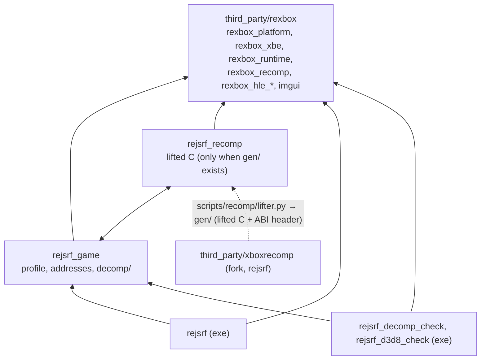
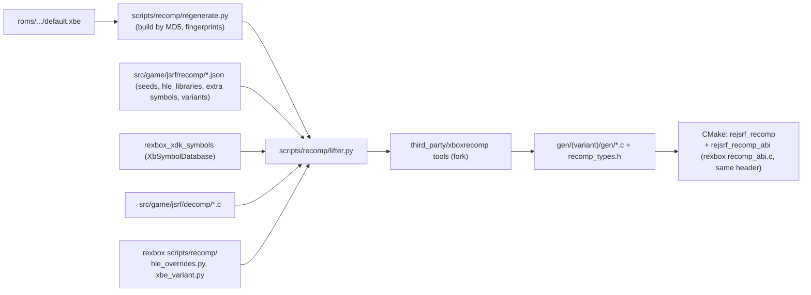
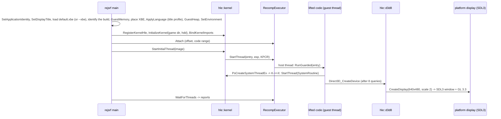

# reJSRF 아키텍처

현재 구현된 코드의 구조를 기록한다. reJSRF는 타이틀 계층(JSRF 프로파일, 디컴파일 함수, 생성 코드), 앱, 타이틀 도구만 갖는다. 타이틀을 모르는 Xbox 런타임(플랫폼 계층, XBE, 런타임, 재컴파일 ABI 어댑터, HLE 모듈, 범용 도구와 probe, lifter를 모르는 재컴파일 보조 스크립트)은 submodule [`third_party/rexbox`](https://github.com/reexec/rexbox)에 있고, 그 구조와 계약은 rexbox의 [ARCHITECTURE.md](third_party/rexbox/ARCHITECTURE.md)에 있다([설계 i102](docs/design/20261022-i102-rexbox-submodule.md)). 결정의 근거는 [설계 i001](docs/design/20261012-i001-project-bootstrap.md), [i002](docs/design/20261012-i002-recomp-pipeline.md), [i006](docs/design/20261012-i006-xdk-symbol-binding.md), [i108](docs/design/20261020-i108-japanese-variant.md)에 있다.

## 1. 레이어와 CMake 타깃

| 타깃 | 경로 | 책임 | 상태 |
|---|---|---|---|
| rexbox 타깃 | `third_party/rexbox/` | 플랫폼(SDL3 + OpenGL), XBE, 런타임, 재컴파일 ABI 어댑터, HLE(kernel, xapi, d3d8, dsound, xinput), `imgui`; 도구 `rexbox_xbe_info`, `rexbox_xdk_symbols`, probe 세 개(kernel, dsound, d3d8; CTest) | rexbox v0.0.11, [rexbox ARCHITECTURE](third_party/rexbox/ARCHITECTURE.md) |
| `rejsrf_game` | `src/game/jsrf/`, `include/rejsrf/` | 프로파일(XBE 판 식별, HLE 주소 바인딩, 언어), 판별 자료 주소(`jsrf_addresses.h`), 디컴파일 함수, 함수 탐색 seed(`recomp/seed_functions.json` 손으로 20개(실행에서 닿은 `observed` 1개 포함), `recomp/seed_pointer_targets.json` 포인터로만 참조되는 함수 162개: `scripts/recomp/find_pointer_targets.py`) | 디컴파일 22개(`decomp/mmatrix.c`: MMATRIX 행렬 스택 21개, 이식 가능한 C, i073), 호스트 어댑터 2개(`decomp/adxm_lock.c`, CRI ADXM 잠금 콜백과 SVM "모두 풀기" 루프, i068·i091·i100; `decomp/camera_frustum.c`, Hor+ 와이드에서 절두체 컬링의 가로 시야, i097; 호스트 훅은 `include/rejsrf/jsrf_host.h`) |
| `rejsrf_recomp` | `gen/<변형>/gen/`(`jsrf_us` 또는 `jsrf_jp`, gitignore) | lift된 C 9,526개 함수. rexbox의 `rexbox_add_recompiled_library`로 만든다 | `gen/`이 있을 때만 |
| `rejsrf` | `src/app/` | 게임 디렉터리의 `default.xbe`(또는 `--xbe <파일>`)를 읽어 내용으로 식별, 부팅 orchestration과 스레드 보고, 설정 오버레이 화면과 `rejsrf.ini` | 로고 시퀀스와 3D 어트랙트 데모 |
| `rejsrf_decomp_check` | `tools/decomp_check/` | 디컴파일 함수와 lift 본문 비교(범용 레지스터, XMM0~7, 게스트 메모리) | 구현(129 케이스) |
| `rejsrf_d3d8_check` | `tools/d3d8_check/` | D3D8 HLE export와 lift된 XDK 원본(`sub_X_gen`) 비교(eax, esp, 스크래치 메모리), `--dump`로 원본의 답 출력; 리소스 헤더 케이스, 디바이스 서피스 인코딩, 상태 setter가 남긴 라이브러리 전역 비교 포함 | 구현(14,018 케이스) |

## 2. 재컴파일 코드 생성

* `scripts/recomp/regenerate.py`는 XBE의 MD5로 판을 정하고(`jsrf_variant.py`, `variants.json`), 미국판이 아니면 함수 지문을 확인한 뒤(`variant_fingerprints.py`, `function_fingerprints.json`), `lifter.run(...)`을 reJSRF 경로로 부른다.
* `scripts/recomp/lifter.py`가 lifter의 모든 것을 가진다([설계 i117](docs/design/20261024-i117-lifter-pipeline.md)). fork xboxrecomp(`third_party/xboxrecomp`)의 다섯 단계(parse, disasm, func_id, abi, lift)를 실행하고, 그 출력(`disasm/functions.json`, `/* ret N */`, `recomp_dispatch.c`)을 읽고, 심볼 이름(`sub_%08X`, `sub_%08X_gen`)을 정한다. XDK 식별, HLE override 생성, 판 확인은 rexbox의 `hle_overrides.py`, `xbe_variant.py`에 평범한 데이터를 넘겨 맡긴다. rexbox는 lifter를 모른다.
* HLE 대상 라이브러리(`hle_libraries.json`, 지금은 D3D8·D3D8LTCG)의 함수마다 `rexbox_hle_overrides.c`에 override `sub_X`가 생성된다. override는 `rexbox_hle_enter(slot)`로 같은 이름의 HLE export를 부르고, 없으면 실행을 멈춰 `stopped at unimplemented XDK function <library> <name>`을 보고한다. 원본은 `sub_X_gen`으로 남는다(`REXBOX_HLE_FALLBACK=lifted`이면 원본을 실행하고 기록하는 진단 모드).
* `scripts/recomp/check_hle_pops.py`(D3D8·XInput·DSOUND export의 pop 수와 lift 원본의 `ret n` 대조)와 `find_pointer_targets.py`(데이터·즉시값으로만 참조되는 함수 시작 → seed 파일)는 `lifter.py`로 lift 결과를 읽고 rexbox의 `hle_pops.py`, `pointer_targets.py`(`xbe_variant.py`)로 비교·탐색한다.

## 3. 실행 흐름

## 4. 주요 계약

* **rexbox 소비자 계약**([rexbox ARCHITECTURE §2](third_party/rexbox/ARCHITECTURE.md)). 앱은 자기만 아는 것을 다음 계약으로 알려준다.
  * `platform::SetApplicationIdentity("reJSRF", "reJSRF")`: 사용자 설정 폴더
  * `platform::SetDisplayTitle`: `reJSRF v<버전> (<플랫폼>/<아키텍처> <구성>, <US|JP>) - Build <일시>`. 창이 GL 버전과 FPS를 붙인다
  * `platform::SetOverlayBuilder`: 설정 메뉴 화면
  * `hle::d3d8::SetDisplayDefaults`: `rejsrf.ini`의 표시 기본값
  * `platform::SetRumbleStrength`
* 게스트 주소, 레지스터, HLE 함수, 스레드, 동기화, 표시, 오디오, 입력의 계약은 rexbox의 것이다(rexbox ARCHITECTURE §4).
* **타이틀 프로파일**(`include/rejsrf/jsrf_profile.h`): 지원하는 XBE 판을 인증서로 식별하고(`BuiltVariant()`), XAPI 장치 형식 같은 XDK 변수를 생성된 `rexbox_xdk_variables[]`에서 `HleRegistry::BindVariable`로 묶고, 장치가 원본 기본 상태 루틴(`D3D_InitializeDeviceState`)을 부를 수 있게 그 주소를 묶는다.
* **타이틀 설정**: 게임 안의 값으로 정하는 설정(지금은 언어)은 프로파일이 주소와 값의 뜻을 갖고, 앱이 XBE를 올린 뒤·진입 전에 `ApplyLanguage`로 게스트 메모리에 쓴다(US판 `0x1FC724`, 일본판 `0x251F58`; 0 = 일본어, 1 = 영어). `rexbox`는 관여하지 않는다. 설정은 `rejsrf.ini`의 `[Game] Language`와 설정 메뉴의 Game 탭이며 다음 실행부터 적용된다([design i104](docs/design/20261020-i104-language-option.md)).
* **한국어**([design i113](docs/design/20261023-i113-korean-language.md)): `Language::kKorean`은 인덱스 값이 아니다. 게임 인덱스는 1(영어)이고, 앱이 디스크(D:)를 JSRF-kr-patch가 만든 한국어 폴더로 바꾸고 그 XBE를 올린다.
  * 프로파일의 `ClassifyXbeText`가 섹션 바이트의 64비트 FNV-1a 해시를 US판 값과 비교한다. 결과는 원본, 한국어 패치(코드 같음, `.rdata`·`.data` 다름), 코드가 다름(거부) 셋 중 하나다. lift된 코드는 원본 코드 섹션에서 나왔으므로 데이터만 바뀐 XBE만 실행할 수 있다.
  * 앱은 캐시 파티션(`Partition3`~`5`)을 채운 문장 세트를 `<hdd root>/rejsrf_cache_text.txt`에 적고, 세트가 바뀌면 커널을 초기화하기 전에 그 파티션을 비운다. rexbox는 바꾸지 않았다.
* **파일**: `\Device\CdRom0` → 게임 디렉터리(읽기 전용), `\Device\Harddisk0\Partition1..5` → `<hdd root>/PartitionN`(`REJSRF_HDD_ROOT`, 기본 `./hdd`).

## 5. 빌드 구성

* 루트 `CMakeLists.txt`
  * `third_party/xboxrecomp`가 있는지 경로로 확인하고, `REXBOX_BUILD_TOOLS=ON`으로 정한다.
  * `add_subdirectory(third_party/rexbox)`와 `rexbox_apply_host_flags()`를 부른다(MSVC: `/utf-8 /permissive- /EHa`, `NOMINMAX WIN32_LEAN_AND_MEAN _CRT_SECURE_NO_WARNINGS`).
  * 우리 타깃에는 `rexbox_strict_warnings`(`/W4`)를 건다. 생성 코드는 `/w /bigobj /MP`로 빌드한다. rexbox의 `recomp_abi.c`는 OBJECT 타깃 `rejsrf_recomp_abi`에서 생성 코드 옆의 `recomp_types.h`로 `/W4`로 컴파일된다. xboxrecomp의 LGPL 파일을 막는 CMake 가드는 없고, AGENTS.md의 라이선스 규칙이 이를 정한다.
* `rejsrf`는 `/LARGEADDRESSAWARE`로 링크하고 이미지 기본 스택은 1 MiB로 둔다. 기본값이 크면 크기를 지정하지 않은 모든 스레드(오디오, SDL, GL 드라이버)가 그만큼 예약해 32비트 주소 공간이 바닥난다(issue #25). 게스트 스레드의 64 MiB 스택은 rexbox의 `CreateHostThread`가 명시한다. 원본을 메인 스레드에서 실행하는 `rejsrf_d3d8_check`만 `/STACK:64MB`를 쓴다. `rejsrf.map`은 `REXBOX_SAMPLE` 결과를 함수 이름으로 묶을 때 쓴다(rexbox `scripts/perf/resolve_samples.py`).
* **빌드 변형**: `REJSRF_VARIANT=jsrf_us|jsrf_jp`(기본 `jsrf_us`)가 실행 파일이 돌릴 디스크를 정한다. 실행 파일 하나는 한 판만 돌린다. 두 판은 함수 주소가 같아 seed와 디컴파일 함수 이름을 공유하고(재생성 때 `function_fingerprints.json`으로 확인), 자료 주소만 `include/rejsrf/jsrf_addresses.h`에서 `REJSRF_VARIANT_JP`로 갈린다. 프로파일의 `BuiltVariant()`와 `NativeLanguage()`가 그 판을 알려 준다. 판은 파일 이름이 아니라 내용(앱은 인증서, 스크립트는 MD5)으로 식별한다([design i108](docs/design/20261020-i108-japanese-variant.md)).
* `REJSRF_RECOMP_GEN_DIR`(기본 `gen/<REJSRF_VARIANT>/gen`)이 없으면 `rejsrf_recomp`, `rejsrf_decomp_check`, `rejsrf_d3d8_check`를 만들지 않는다(CI). rexbox probe는 항상 빌드되고 CI에서 실행된다. 생성 코드 진단 옵션은 rexbox의 `REXBOX_RECOMP_CALL_PROFILE`(직접 호출 프로파일; `REXBOX_WATCHDOG`가 덤프)과 `REXBOX_RECOMP_ABI_CHECK`다.
* **Linux**([설계 i119](docs/design/20261025-i119-linux.md)): `CMakePresets.json`의 `linux-{x64,x86}-{debug,release}[-jp]`(Ninja, x86은 `-m32`)와 `scripts/build_linux.sh <arch> <config> [us|jp]`. 빌드 폴더는 `build/<preset>/`. 코드는 Win32와 같고 플랫폼 계층은 rexbox의 Linux 구현이다. `regenerate.py`는 자기 호스트의 빌드에서만 `rexbox_xdk_symbols`를 찾는다(WSL에서 Windows `.exe`를 집으면 `/mnt` 경로를 열지 못한다).
* 실행 시 환경 변수: 런타임의 것은 모두 `REXBOX_` 접두사이고 rexbox ARCHITECTURE §5에 있다. reJSRF 앱의 것은 `REJSRF_HDD_ROOT`(HDD 루트)와 `REJSRF_LANGUAGE`(그 실행의 언어)다.
* `third_party/rexbox`(submodule, reexec/rexbox v0.0.13 `5582630`, MIT)는 자기 submodule로 SDL3 release-3.4.18(zlib, 정적), Dear ImGui v1.93.0(MIT), SMAA(MIT), XbSymbolDatabase(MIT, 도구에만)를 가져온다. rexbox는 xboxrecomp를 갖지 않는다(rexbox issue #26).
* `third_party/xboxrecomp`는 포크 `nworkers/xboxrecomp`의 `rejsrf` 브랜치(`6acdc0c`)를 가리킨다(`THIRD_PARTY_NOTICES.md`). 이 브랜치는 upstream v0.16.0(`f0f8a46`, i093의 디스어셈블러 수정이 PR [#236](https://github.com/sp00nznet/xboxrecomp/pull/236)으로 들어 있음)에 다음을 합친 것이다.
  * i044의 성능 개선(upstream PR을 보류한 `perf/mem-base-local`, 우리 fork에만 두는 `perf/xmm-intrinsics`)
  * C4310 수정 `fix/fp-cc-cast`

  미해결 스텁 보고는 upstream 방식이다. 생성된 스텁 파일의 `RECOMP_STUB_HIT`가 환경 변수 `RECOMP_STUB_LOG`가 있을 때 스텁마다 처음 한 번 `[STUB] ...` 줄을 쓰고, 앱은 Debug 빌드에서만 이 값을 1로 넣는다([설계 i115](docs/design/20261023-i115-xboxrecomp-v0.16.md)). 이전 핀은 `rejsrf-v0.15`(v0.15.0 기반)와 `rejsrf-v0.13`(v0.13.1 기반)에 남아 있다.
* HLE 대상은 `src/game/jsrf/recomp/hle_libraries.json`의 `libraries`(라이브러리 전체)와 `functions`(개별 함수)로 고른다. 재생성은 식별된 XDK 변수 표 `rexbox_xdk_variables[]`도 생성한다.

---

# reJSRF Architecture

This records the structure of the code as implemented now. reJSRF holds only the title layer (the JSRF profile, decompiled functions, generated code), the app and the title tools. The title-agnostic Xbox runtime (platform layer, XBE, runtime, lifter ABI adapter, HLE modules, generic tools and probes, lifter-agnostic recompilation helper scripts) is the submodule [`third_party/rexbox`](https://github.com/reexec/rexbox), whose structure and contracts are in rexbox's [ARCHITECTURE.md](third_party/rexbox/ARCHITECTURE.md) ([design i102](docs/design/20261022-i102-rexbox-submodule.md)). The reasons are in [design i001](docs/design/20261012-i001-project-bootstrap.md), [i002](docs/design/20261012-i002-recomp-pipeline.md), [i006](docs/design/20261012-i006-xdk-symbol-binding.md) and [i108](docs/design/20261020-i108-japanese-variant.md).

## 1. Layers and CMake targets

The diagram and table above apply.

* **rexbox** (v0.0.11) supplies:
  * `rexbox_platform` (SDL3 + OpenGL), `rexbox_xbe`, `rexbox_runtime`, `rexbox_recomp`, the HLE modules and `imgui`
  * the tools `rexbox_xbe_info` and `rexbox_xdk_symbols`, and three probes (kernel, DSOUND, D3D8) registered with CTest
* **`rejsrf_game`** (`src/game/jsrf/`, `include/rejsrf/`) holds:
  * the profile: build identification by certificate, HLE address bindings, language
  * the per-build data addresses (`jsrf_addresses.h`)
  * the decompiled functions: `decomp/mmatrix.c` rewrites 21 MMATRIX matrix-stack functions in portable C ([design i073](docs/design/20261016-i073-mmatrix.md)). Two host adapters sit beside them:
    * `adxm_lock.c` wraps the CRI ADXM lock callbacks in rexbox's guest lock and keys the SVM "release all" loop on per-thread depth ([i068](docs/design/20261016-i068-adxm-lock.md), [i091](docs/design/20261018-i091-adxm-lock-priority.md), [i100](docs/design/20261019-i100-svm-unlock-all.md)).
    * `camera_frustum.c` widens the culling field of view for Hor+ through `include/rejsrf/jsrf_host.h` ([i097](docs/design/20261018-i097-frustum-culling.md)).
  * the function seeds: 20 by hand in `seed_functions.json`, one marked `observed`, and 162 pointer-only functions in `seed_pointer_targets.json`
* **`rejsrf_recomp`** is the generated code (9,526 functions), built with rexbox's `rexbox_add_recompiled_library`.
* **`rejsrf`** orchestrates the boot and owns the settings screens and `rejsrf.ini`.
* **`rejsrf_decomp_check`** (129 cases) and **`rejsrf_d3d8_check`** (14,018 cases) compare the decompiled functions and the HLE exports with their lifted originals.

## 2. Generating the recompiled code

`scripts/recomp/regenerate.py` picks the build from the XBE's MD5 (`jsrf_variant.py`, `variants.json`); for a build other than the US one it checks the function fingerprints (`variant_fingerprints.py`, `function_fingerprints.json`); then it calls `lifter.run(...)` with reJSRF's paths. `scripts/recomp/lifter.py` holds everything about the lifter ([design i117](docs/design/20261024-i117-lifter-pipeline.md)): it runs the five steps (parse, disasm, func_id, abi, lift) of the fork xboxrecomp (`third_party/xboxrecomp`), reads their output (`disasm/functions.json`, `/* ret N */`, `recomp_dispatch.c`) and owns the symbol names (`sub_%08X`, `sub_%08X_gen`); XDK identification, the HLE overrides and the build check go to rexbox's `hle_overrides.py` and `xbe_variant.py` as plain data. rexbox knows no lifter. For every function of the libraries in `hle_libraries.json` (now D3D8 and D3D8LTCG), an override `sub_X` in `rexbox_hle_overrides.c` calls the HLE export of the same name through `rexbox_hle_enter(slot)`, or stops and reports `stopped at unimplemented XDK function <library> <name>`; the original stays as `sub_X_gen` (`REXBOX_HLE_FALLBACK=lifted` runs and logs it instead). `check_hle_pops.py` (export pop counts against the originals' `ret n`) and `find_pointer_targets.py` (functions referenced only from data or immediates → the seed file) read the lifted output through `lifter.py` and compare or scan with rexbox's `hle_pops.py` and `pointer_targets.py` (`xbe_variant.py`).

## 3. Execution flow

The app gives rexbox its identity and window title, loads and identifies the XBE, builds guest memory, places the XBE, sets the game's language through the title profile, creates the heap and installs the Environment; registers the HLE; initializes the kernel (data exports, VFS with the game directory and the HDD root) and binds the kernel imports; attaches the executor; and starts the entry point as the first guest thread. When the game calls `Direct3D_CreateDevice`, the D3D8 HLE opens the SDL3 window with a GL 3.3 context on that guest thread; the app waits for the threads and prints their reports.

## 4. Key contracts

* **rexbox's consumer contract** ([rexbox ARCHITECTURE §2](third_party/rexbox/ARCHITECTURE.md)). The app tells rexbox what only it knows:
  * `platform::SetApplicationIdentity("reJSRF", "reJSRF")`: the user settings folder
  * `platform::SetDisplayTitle`: `reJSRF v<version> (<platform>/<arch> <config>, <US|JP>) - Build <time>`; the window adds the GL version and the FPS
  * `platform::SetOverlayBuilder`: the settings menu's screens
  * `hle::d3d8::SetDisplayDefaults`: the display defaults from `rejsrf.ini`
  * `platform::SetRumbleStrength`
* Guest addresses, registers, HLE functions, threads, synchronization, display, audio and input follow rexbox's contracts (rexbox ARCHITECTURE §4).
* **Title profile** (`include/rejsrf/jsrf_profile.h`): it identifies the supported builds by certificate (`BuiltVariant()`), binds XDK variables such as the XAPI device types from the generated `rexbox_xdk_variables[]` into `HleRegistry::BindVariable`, and binds the library's default-state routine (`D3D_InitializeDeviceState`) for device creation.
* **Title settings**: settings made by a value inside the game (today the language) belong to the profile. The app writes the value with `ApplyLanguage` after placing the XBE and before the entry (the US build's `0x1FC724`, the Japanese build's `0x251F58`; 0 = Japanese, 1 = English). rexbox takes no part. The setting is `[Game] Language` in `rejsrf.ini` and the Game tab, applied from the next start ([design i104](docs/design/20261020-i104-language-option.md)).
* **Korean** ([design i113](docs/design/20261023-i113-korean-language.md)): `Language::kKorean` is not an index value. The game index is 1 (English); the app swaps the disc (D:) for the Korean folder JSRF-kr-patch made and loads its XBE.
  * The profile's `ClassifyXbeText` compares 64-bit FNV-1a hashes of the section bytes with the US build's. The result is original, Korean patch (same code, `.rdata` and `.data` changed) or changed code (refused). The lifted code came from the original code sections, so only an XBE with changed data can run.
  * The app records in `<hdd root>/rejsrf_cache_text.txt` which text set filled the cache partitions (`Partition3`-`5`), and empties them before the kernel starts when the set changes. rexbox is unchanged.
* **Files**: `\Device\CdRom0` → the game directory (read-only), `\Device\Harddisk0\Partition1..5` → `<hdd root>/PartitionN` (`REJSRF_HDD_ROOT`, default `./hdd`).

## 5. Build configuration

* **Root `CMakeLists.txt`**
  * It checks by path that `third_party/xboxrecomp` is present and sets `REXBOX_BUILD_TOOLS=ON`.
  * It calls `add_subdirectory(third_party/rexbox)` and `rexbox_apply_host_flags()` (MSVC: `/utf-8 /permissive- /EHa`, `NOMINMAX WIN32_LEAN_AND_MEAN _CRT_SECURE_NO_WARNINGS`).
  * Our targets get `rexbox_strict_warnings` (`/W4`). Generated code builds with `/w /bigobj /MP`. rexbox's `recomp_abi.c` compiles in the OBJECT target `rejsrf_recomp_abi` at `/W4` against the `recomp_types.h` next to the generated code. No CMake guard blocks xboxrecomp's LGPL files; AGENTS.md's license rule does.
* **Linking**
  * `rejsrf` links with `/LARGEADDRESSAWARE` and keeps the image default stack at 1 MiB (issue #25); guest threads get their 64 MiB stacks from rexbox's `CreateHostThread`.
  * Only `rejsrf_d3d8_check` uses `/STACK:64MB`.
  * `rejsrf.map` names the functions in a `REXBOX_SAMPLE` report (rexbox's `scripts/perf/resolve_samples.py`).
* **Build variant**: `REJSRF_VARIANT=jsrf_us|jsrf_jp` (default `jsrf_us`) picks the disc the executable runs; one executable runs one build.
  * The two builds have the same function addresses, so they share the seeds and decompiled function names (checked against `function_fingerprints.json` at regeneration).
  * Only data addresses differ, through `REJSRF_VARIANT_JP` in `include/rejsrf/jsrf_addresses.h`.
  * A build is identified by content (certificate in the app, MD5 in the scripts), never by file name ([design i108](docs/design/20261020-i108-japanese-variant.md)).
* **No generated code**: without `REJSRF_RECOMP_GEN_DIR` (default `gen/<REJSRF_VARIANT>/gen`), `rejsrf_recomp` and the title tools are not created (CI). The rexbox probes are always built and run in CI. The generated-code diagnostics are rexbox's options `REXBOX_RECOMP_CALL_PROFILE` and `REXBOX_RECOMP_ABI_CHECK`.
* **Linux** ([design i119](docs/design/20261025-i119-linux.md)): the `linux-{x64,x86}-{debug,release}[-jp]` presets of `CMakePresets.json` (Ninja; x86 is `-m32`) and `scripts/build_linux.sh <arch> <config> [us|jp]`, building into `build/<preset>/`. The code is Win32's; the platform layer is rexbox's Linux implementation. `regenerate.py` looks for `rexbox_xdk_symbols` in this host's builds only (on WSL a Windows `.exe` would be picked and could not open `/mnt` paths).
* **Environment variables**: the runtime's all carry the `REXBOX_` prefix and are listed in rexbox ARCHITECTURE §5. The app's own are `REJSRF_HDD_ROOT` and `REJSRF_LANGUAGE`.
* **`third_party/rexbox`** (submodule, reexec/rexbox v0.0.13 `5582630`, MIT) brings its own submodules: SDL3 release-3.4.18 (zlib, static), Dear ImGui v1.93.0 (MIT), SMAA (MIT) and XbSymbolDatabase (MIT, tools only). rexbox holds no xboxrecomp (rexbox issue #26).
* **`third_party/xboxrecomp`** points at the fork's `rejsrf` branch (`6acdc0c`): upstream v0.16.0 (`f0f8a46`, which carries i093's disassembler fixes as PR [#236](https://github.com/sp00nznet/xboxrecomp/pull/236)) plus
  * i044's performance branches
  * the C4310 fix

  Unresolved stubs report the upstream way: the generated stub file's `RECOMP_STUB_HIT` writes a `[STUB] ...` line the first time each stub runs when the environment variable `RECOMP_STUB_LOG` is set, and the app sets it to 1 in Debug builds only ([design i115](docs/design/20261023-i115-xboxrecomp-v0.16.md)). Earlier pins stay on `rejsrf-v0.15` (on v0.15.0) and `rejsrf-v0.13` (on v0.13.1).
* **HLE targets** are chosen in `hle_libraries.json` by `libraries` and single `functions`, and regeneration also emits the `rexbox_xdk_variables[]` table.
