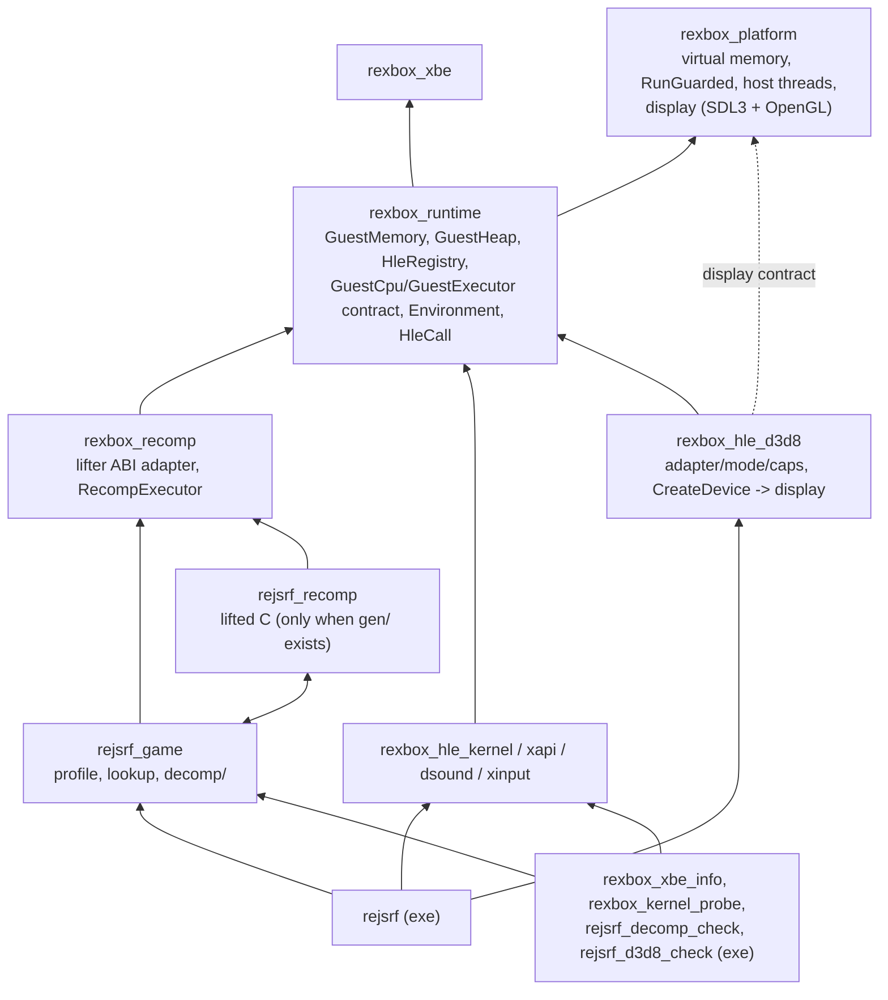
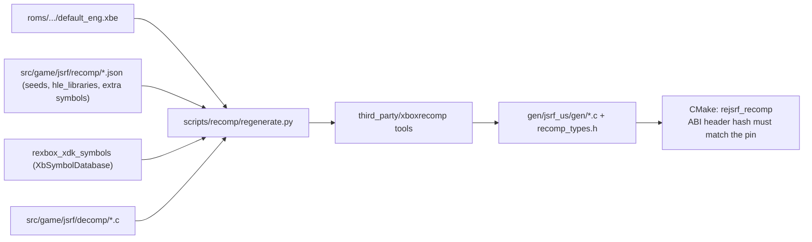
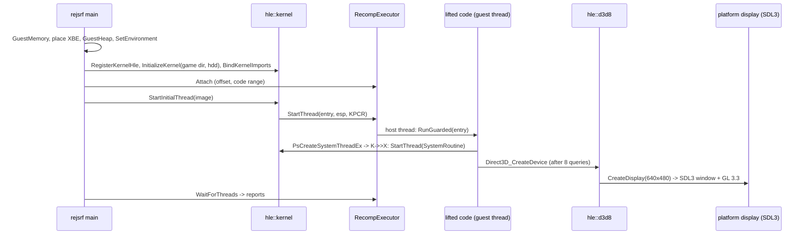

# reJSRF 아키텍처

현재 구현된 코드의 구조를 기록한다. 결정의 근거는 [설계 i001](docs/design/20261012-i001-project-bootstrap.md), [i002](docs/design/20261012-i002-recomp-pipeline.md), [i003](docs/design/20261012-i003-kernel-hle.md), [i006](docs/design/20261012-i006-xdk-symbol-binding.md), [i007](docs/design/20261012-i007-d3d8-hle-first-batch.md)에 있다.

## 1. 레이어와 CMake 타깃

| 타깃 | 경로 | 책임 | 상태 |
|---|---|---|---|
| `rexbox_platform` | `include/rexbox/platform/`, `src/platform/<os>/`, `src/platform/sdl/` | 가상 메모리, `RunGuarded`/`RaiseStop`, `CreateHostThread`, 표시 계약(`display.h`: 창 + OpenGL 계열 컨텍스트, GL 함수 포인터, present) | Win32 구현; 표시는 SDL3 백엔드(모든 OS 공유) |
| `rexbox_xbe` | `src/rexbox/xbe/` | XBE 파싱 | 구현 |
| `rexbox_runtime` | `src/rexbox/runtime/` | `GuestMemory`(based 모델, 스칼라 접근), `GuestHeap`(페이지 할당자), `HleRegistry`, `GuestCpu`·`GuestExecutor` 계약, `Environment`, `HleCall`, 커널 thunk 합성 주소 | 구현 |
| `rexbox_recomp` | `src/rexbox/recomp/` | 생성 코드 ABI 전역·콜백, `RecompExecutor`(게스트 스레드 = 호스트 스레드, `CallGuest`, 스레드별 보고), XDK override 진입점 `rexbox_hle_enter` | 구현 |
| `rexbox_hle_kernel` | `src/rexbox/hle/kernel/` | 커널 export 103개(아래 표) | 부팅이 닿은 서비스 |
| `rexbox_hle_d3d8` | `src/rexbox/hle/d3d8/` | Direct3D 8 HLE(아래 표). 어댑터·모드·Caps 질의 8개, `Direct3D_CreateDevice`(표시 생성) | export 8개 + CreateDevice |
| `rexbox_hle_xapi`, `_dsound`, `_xinput` | `src/rexbox/hle/<module>/` | XDK 라이브러리 HLE | 등록 진입점만 |
| `rejsrf_game` | `src/game/jsrf/` | 프로파일, 생성된 lookup 노출, 디컴파일 함수, 함수 탐색 seed(`recomp/seed_functions.json`) | 디컴파일 1개, seed 10개 |
| `rejsrf_recomp` | `gen/jsrf_us/gen/` (gitignore) | lift된 C 8,721개 함수 | `gen/`이 있을 때만 |
| `rejsrf` | `src/app/` | 부팅 orchestration과 스레드 보고 | D3D8 디바이스 생성(창 표시)까지 |
| `rexbox_xbe_info` | `tools/xbe_info/` | XBE 정보 | 구현 |
| `rexbox_xdk_symbols` | `tools/xdk_symbols/` | XbSymbolDatabase로 XDK 함수·변수 식별 → JSON (`regenerate.py`가 사용) | 구현 |
| `rexbox_kernel_probe` | `tools/kernel_probe/` | 게임 없이 커널 export 검사(27개, CI) | 구현 |
| `rejsrf_decomp_check` | `tools/decomp_check/` | 디컴파일 함수와 lift 본문 비교 | 구현 |
| `rejsrf_d3d8_check` | `tools/d3d8_check/` | D3D8 HLE export와 lift된 XDK 원본(`sub_X_gen`) 비교(eax, esp, 출력 버퍼), `--dump`로 원본의 답 출력 | 구현(12,202 케이스) |

### 커널 HLE 파일

| 파일 | 내용 |
|---|---|
| `kernel_hle.cpp` | 등록, 초기화, thunk 슬롯 바인딩(함수 → 합성 주소, 데이터 → 변수 주소) |
| `kernel_state.cpp`, `kernel_internal.h` | 디스패처 잠금, 핸들 표, 구조체 오프셋, 공용 도우미 |
| `kernel_thread.cpp` | KPCR/ETHREAD/스택/TLS 구성, `PsCreateSystemThreadEx`, 종료, 일시정지, 우선순위, 초기 스레드 |
| `kernel_sync.cpp` | 이벤트, 세마포어, 뮤턴트, 타이머, 대기 |
| `kernel_memory.cpp` | 가상·연속·시스템 메모리, 풀 |
| `kernel_object.cpp` | `NtClose`, `Ob*` |
| `kernel_rtl.cpp` | 크리티컬 섹션, 문자열, 시간 변환, 상태 코드 |
| `kernel_hal.cpp` | IRQL, 시간, 인터럽트·DPC(전달 안 함), PCI, AV, 비휘발 설정, `DbgPrint` |
| `kernel_crypto.cpp` | `XcSHA*` (SHA-1) |
| `kernel_file.cpp`, `kernel_vfs.*` | 파일·디렉터리·장치·볼륨·IOCTL, Xbox 이름공간 → 호스트 디렉터리 |
| `kernel_data.cpp` | 데이터 export, `KeTickCount` 갱신 스레드, 커널 시간 |

### D3D8 HLE 파일

| 파일 | 내용 |
|---|---|
| `d3d8_hle.cpp` | 등록, 모듈 상태 |
| `d3d8_internal.h` | Xbox D3D 상수, 구조체 오프셋(`D3DDISPLAYMODE`, `D3DPRESENT_PARAMETERS`, `D3DCAPS8`), `D3dState` |
| `d3d8_adapter.cpp` | `Direct3D_GetAdapterCount`, `D3D_GetAdapterModeCount`, `D3D_EnumAdapterModes`, `D3D_CheckDeviceFormat`, `Direct3D_CheckDeviceMultiSampleType`; 모드 표 24개와 포맷 능력 바이트 표(측정값) |
| `d3d8_caps.cpp` | `D3D_GetDeviceCaps`, `D3DDevice_GetDeviceCaps`; `D3DCAPS8` 53 DWORD 표(측정값) |
| `d3d8_device.cpp` | `Direct3D_CreateDevice`: 표시 파라미터 읽기, 표시 생성, GL 정보 기록, 디바이스 객체(GuestHeap 1페이지) |
| `d3d8_gl.h/.cpp` | 쓰는 GL 함수만 담은 함수 표, `platform::GetGlProcAddress`로 채움 |

## 2. 재컴파일 코드 생성

* HLE 대상 라이브러리(`hle_libraries.json`, 지금은 D3D8·D3D8LTCG)의 함수마다 `rexbox_hle_overrides.c`에 override `sub_X`가 생성된다. override는 `rexbox_hle_enter(slot)`로 같은 이름의 HLE export를 부르고, 없으면 실행을 멈춰 `stopped at unimplemented XDK function <library> <name>`을 보고한다. 원본은 `sub_X_gen`으로 남는다(`REXBOX_HLE_FALLBACK=lifted`이면 원본을 실행하고 기록하는 진단 모드).

## 3. 실행 흐름

## 4. 주요 계약

* **게스트 주소**: 32비트 `GuestAddress`. C++은 `GuestMemory::Translate`/`Read32`/`Write32`, 생성·디컴파일 C는 `MEM32` 등.
* **레지스터**: HLE와 런타임은 `runtime::GuestCpu`로만 접근한다. 생성 코드의 TLS 전역을 아는 것은 `rexbox_recomp`뿐이다.
* **HLE 함수**: `void()`; 안에서 `runtime::HleCall`로 stdcall 인자(`[esp+4+4i]`)·fastcall 레지스터를 읽고 `Return(value, n)`으로 eax와 esp를 맞춘다.
* **스레드**: 커널이 게스트 메모리에 KPCR/ETHREAD/스택/TLS를 만들고 `GuestExecutor::StartThread`에 맡긴다. 종료는 `ExitThread`(SEH 해제, `/EHa`).
* **동기화**: 디스패처 객체 상태는 게스트 메모리의 `SignalState`, 대기는 전역 디스패처 잠금과 condition variable.
* **표시**: HLE는 `platform/display.h`(폭·높이·제목으로 창과 OpenGL 계열 컨텍스트 생성, `GetGlProcAddress`, `PresentDisplay`)만 부른다. SDL 타입은 `src/platform/sdl/` 밖으로 나오지 않는다. 창은 `Direct3D_CreateDevice`를 부른 게스트 스레드에서 만들어진다(Win32·X11 유효; 메인 스레드가 필요한 플랫폼은 표시 서비스로 바꾼다, 설계 i007 §2.5).
* **파일**: `\Device\CdRom0` → XBE 폴더(읽기 전용), `\Device\Harddisk0\Partition1..5` → `<hdd root>/PartitionN`, `Partition0`은 원시 장치. 파티션 루트는 볼륨(원시 쓰기 허용·폐기).

## 5. 빌드 구성

* MSVC: 전역 `/utf-8 /permissive- /EHa`, `NOMINMAX WIN32_LEAN_AND_MEAN _CRT_SECURE_NO_WARNINGS`; 우리 타깃 `/W4`; 생성 코드 `/w /bigobj /MP`. 게스트 스레드의 호스트 스택은 64 MiB.
* `REJSRF_RECOMP_GEN_DIR`(기본 `gen/jsrf_us/gen`)이 없으면 `rejsrf_recomp`와 `rejsrf_decomp_check`를 만들지 않는다(CI). `rexbox_kernel_probe`는 항상 빌드되고 CI에서 실행된다.
* 라이선스 가드 `REJSRF_COPYLEFT_PATHS`는 모든 우리 타깃과 `rejsrf_recomp`에 적용된다.
* 실행 시 환경 변수: `REJSRF_HDD_ROOT`(HDD 루트, 기본 `./hdd`), `REXBOX_TRACE_FILES`(모든 파일 열기 기록), `REXBOX_HLE_FALLBACK=lifted`(미구현 XDK 함수의 원본 실행, 진단용), `REXBOX_DISPLAY=none`(창 없이 실행; 헤드리스 진단).
* `third_party/SDL`(submodule, release-3.4.18, zlib)은 정적 라이브러리만 빌드되어 `rexbox_platform`에 PRIVATE로 링크된다. 카메라·GPU·렌더러·햅틱·센서·대화상자·트레이는 끄고, 오디오·조이스틱·게임패드는 DSOUND·XInput task를 위해 남긴다.
* `third_party/XbSymbolDatabase`(submodule)는 `rexbox_xdk_symbols`용으로 라이브러리만 빌드된다. 생성 코드를 처음 만들 때는 도구를 먼저 빌드해야 한다.

---

# reJSRF Architecture

This records the structure of the code as implemented now. The reasons are in [design i001](docs/design/20261012-i001-project-bootstrap.md), [i002](docs/design/20261012-i002-recomp-pipeline.md), [i003](docs/design/20261012-i003-kernel-hle.md), [i006](docs/design/20261012-i006-xdk-symbol-binding.md) and [i007](docs/design/20261012-i007-d3d8-hle-first-batch.md).

## 1. Layers and CMake targets

The diagrams and tables above apply. In short: `rexbox_platform` (virtual memory, guarded runs, host threads, and the display contract implemented on SDL3 in `src/platform/sdl/`) ← `rexbox_runtime` (guest memory and heap, HLE registry, the GuestCpu/GuestExecutor contract, Environment, HleCall) ← `rexbox_recomp` (lifter ABI adapter and `RecompExecutor`, one host thread per guest thread) and the HLE modules; `rejsrf_game` and the generated `rejsrf_recomp` sit above; `rejsrf` orchestrates. The kernel HLE exports 103 functions, one file per area (threads, sync, memory, objects, Rtl, HAL, crypto, files with the VFS, data exports). The D3D8 HLE (`rexbox_hle_d3d8`) has one file per area: registration and state, constants and layouts, the adapter/mode/format queries with their measured tables, the caps table, device creation (which opens the display), and the GL function table. Tools: `rexbox_xbe_info`, `rexbox_kernel_probe` (27 checks without a game, run in CI), `rejsrf_decomp_check` and `rejsrf_d3d8_check` (HLE exports against the lifted XDK originals, 12,202 cases).

## 2. Generating the recompiled code

`scripts/recomp/regenerate.py` runs the pinned xboxrecomp tools on the user's XBE, passing the committed function seeds (`src/game/jsrf/recomp/*.json`) to the disassembler and the decompiled `sub_X` definitions to the lifter; CMake checks the generated ABI header against the pin. It also runs `rexbox_xdk_symbols` (XbSymbolDatabase) and, for every function of the libraries in `hle_libraries.json` (now D3D8 and D3D8LTCG), generates an override `sub_X` in `rexbox_hle_overrides.c` that calls the HLE export of the same name through `rexbox_hle_enter(slot)`, or stops and reports `stopped at unimplemented XDK function <library> <name>`; the original stays as `sub_X_gen` (`REXBOX_HLE_FALLBACK=lifted` runs and logs it instead, a diagnostic mode).

## 3. Execution flow

The app builds guest memory, places the XBE, creates the heap and installs the Environment; registers the HLE; initializes the kernel (data exports, VFS with the game directory and the HDD root) and binds the kernel imports; attaches the executor; and starts the entry point as the first guest thread. When the game calls `Direct3D_CreateDevice`, the D3D8 HLE opens the SDL3 window with a GL 3.3 context on that guest thread. The kernel builds each thread's KPCR/ETHREAD/stack/TLS and hands it to `RecompExecutor::StartThread`; the app waits for the threads and prints their reports.

## 4. Key contracts

* **Guest address**: 32-bit `GuestAddress`; C++ uses `GuestMemory::Translate`/`Read32`/`Write32`, generated and decompiled C uses `MEM32` and friends.
* **Registers**: HLE and runtime code go through `runtime::GuestCpu` only; only `rexbox_recomp` knows the generated code's TLS globals.
* **HLE functions**: `void()`, using `runtime::HleCall` to read stdcall arguments (`[esp+4+4i]`) and fastcall registers, and `Return(value, n)` to set eax and esp.
* **Threads**: the kernel builds KPCR/ETHREAD/stack/TLS in guest memory and hands the thread to `GuestExecutor::StartThread`; `ExitThread` unwinds with SEH (`/EHa`).
* **Synchronization**: dispatcher state is the guest `SignalState`; waits use one global dispatcher lock and a condition variable.
* **Display**: the HLE calls only `platform/display.h` (window and OpenGL-family context from width, height and title; `GetGlProcAddress`; `PresentDisplay`). SDL types never leave `src/platform/sdl/`. The window is created on the guest thread that calls `Direct3D_CreateDevice` (valid on Win32 and X11; platforms that need the main thread get a display service, design i007 §2.5).
* **Files**: `\Device\CdRom0` → the XBE's folder (read-only), `\Device\Harddisk0\Partition1..5` → `<hdd root>/PartitionN`, `Partition0` a raw device; a partition root is a volume (raw writes accepted and dropped).

## 5. Build configuration

* MSVC: `/utf-8 /permissive- /EHa` and `NOMINMAX WIN32_LEAN_AND_MEAN _CRT_SECURE_NO_WARNINGS` globally; `/W4` on our targets; `/w /bigobj /MP` for generated code. Guest threads get 64 MiB host stacks.
* Without `REJSRF_RECOMP_GEN_DIR` (default `gen/jsrf_us/gen`), `rejsrf_recomp` and `rejsrf_decomp_check` are not created (CI). `rexbox_kernel_probe` is always built and runs in CI.
* The license guard `REJSRF_COPYLEFT_PATHS` applies to all our targets and to `rejsrf_recomp`.
* Run-time environment variables: `REJSRF_HDD_ROOT` (HDD root, default `./hdd`), `REXBOX_TRACE_FILES` (log every file open), `REXBOX_HLE_FALLBACK=lifted` (run the original of an unimplemented XDK function; diagnostic) and `REXBOX_DISPLAY=none` (run without a window; headless diagnostics).
* `third_party/SDL` (submodule, release-3.4.18, zlib) is built as a static library only and linked PRIVATE into `rexbox_platform`; camera, GPU, renderer, haptic, sensor, dialog and tray are off, audio, joystick and gamepad stay for the DSOUND and XInput tasks.
* `third_party/XbSymbolDatabase` (submodule) is built, library only, for `rexbox_xdk_symbols`; the tool must be built before generating code for the first time.
