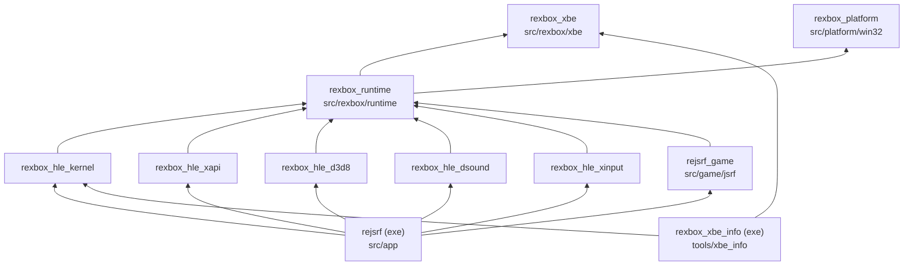
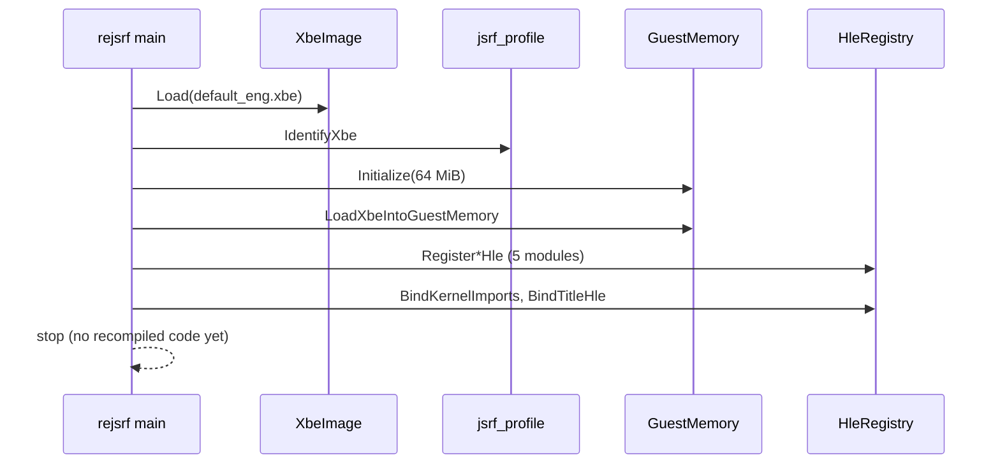

# reJSRF 아키텍처

현재 구현된 코드의 구조를 기록한다. 결정의 근거는 [설계 i001](docs/design/20261012-i001-project-bootstrap.md)에 있다.

## 1. 레이어와 CMake 타깃

| 타깃 | 경로 | 책임 | 상태 |
|---|---|---|---|
| `rexbox_platform` | `include/rexbox/platform/`, `src/platform/<os>/` | OS 계약: 가상 메모리 | Win32 구현 |
| `rexbox_xbe` | `include/rexbox/xbe/`, `src/rexbox/xbe/` | XBE 파싱: 헤더, 인증서, 섹션, 라이브러리, TLS, 커널 import | 구현 |
| `rexbox_runtime` | `include/rexbox/runtime/`, `src/rexbox/runtime/` | `GuestMemory`(based 모델), `LoadXbeIntoGuestMemory`, `HleRegistry` | 구현(dispatcher 없음) |
| `rexbox_hle_kernel` | `src/rexbox/hle/kernel/` | 커널 export 이름 표(371개), thunk 슬롯 바인딩 | 이름 표와 바인딩만, 구현 0개 |
| `rexbox_hle_xapi`, `_d3d8`, `_dsound`, `_xinput` | `src/rexbox/hle/<module>/` | XDK 라이브러리 HLE | 등록 진입점만 |
| `rexbox_hle` | (INTERFACE) | HLE 모듈 묶음 | |
| `rejsrf_game` | `include/rejsrf/`, `src/game/jsrf/` | 타이틀 프로파일: XBE 변형 식별, HLE 바인딩 | 식별만 |
| `rejsrf` | `src/app/` | 진입점: 로드 → 식별 → 배치 → HLE 등록·바인딩 | 로드 후 정지 |
| `rexbox_xbe_info` | `tools/xbe_info/` | XBE 정보 출력 도구 | 구현 |

## 2. 실행 흐름(현재)

## 3. 주요 계약

* **게스트 주소**: `rexbox::runtime::GuestAddress`(32비트). 호스트 포인터는 `GuestMemory::Translate`로만 얻는다.
* **HLE export**: `HleRegistry::AddExport(module, symbol, thunk)`. thunk는 lift된 함수와 같은 `void()` 모양이며, 인자와 결과는 게스트 레지스터·스택 상태로 오간다.
* **HLE 바인딩**: `HleRegistry::BindGuestAddress(address, symbol)`. 커널은 `hle::kernel::BindKernelImports`, XDK 함수는 타이틀 프로파일이 묶는다.
* **플랫폼**: `rexbox::platform::AllocateVirtualMemory` 등. 기본 값만 받는다.

## 4. 빌드 구성

* 루트 `CMakeLists.txt`가 `REJSRF_PLATFORM`(`win32`/`linux`/`web`/`android`)과 `REJSRF_ARCH`를 정한다. 플랫폼 디렉터리가 없으면 configure가 실패한다. 현재는 `win32`만 있다.
* MSVC 옵션: `/utf-8 /W4 /permissive-`.
* 라이선스 가드: `REJSRF_COPYLEFT_PATHS`에 있는 xboxrecomp의 LGPL 경로를 소스로 가진 타깃은 configure가 실패한다.
* `third_party/xboxrecomp`는 submodule이며 아직 빌드에 들어가지 않는다.

---

# reJSRF Architecture

This records the structure of the code as implemented now. The reasons behind it are in [design i001](docs/design/20261012-i001-project-bootstrap.md).

## 1. Layers and CMake targets

The diagram above shows the link graph; arrows point from a target to what it links.

| Target | Path | Responsibility | State |
|---|---|---|---|
| `rexbox_platform` | `include/rexbox/platform/`, `src/platform/<os>/` | OS contracts: virtual memory | Win32 implemented |
| `rexbox_xbe` | `include/rexbox/xbe/`, `src/rexbox/xbe/` | XBE parsing: header, certificate, sections, libraries, TLS, kernel imports | Implemented |
| `rexbox_runtime` | `include/rexbox/runtime/`, `src/rexbox/runtime/` | `GuestMemory` (based model), `LoadXbeIntoGuestMemory`, `HleRegistry` | Implemented (no dispatcher) |
| `rexbox_hle_kernel` | `src/rexbox/hle/kernel/` | Kernel export name table (371 entries), thunk slot binding | Table and binding only; 0 implementations |
| `rexbox_hle_xapi`, `_d3d8`, `_dsound`, `_xinput` | `src/rexbox/hle/<module>/` | XDK library HLE | Registration entry only |
| `rexbox_hle` | (INTERFACE) | Bundle of the HLE modules | |
| `rejsrf_game` | `include/rejsrf/`, `src/game/jsrf/` | Title profile: XBE variant identification, HLE bindings | Identification only |
| `rejsrf` | `src/app/` | Entry: load → identify → place → register and bind HLE | Stops after load |
| `rexbox_xbe_info` | `tools/xbe_info/` | XBE information tool | Implemented |

## 2. Execution flow (current)

See the sequence diagram above: the app loads the XBE, identifies the variant, initializes 64 MiB of guest memory, places the image, registers the five HLE modules, binds kernel imports and title bindings, and stops because no recompiled code exists yet.

## 3. Key contracts

* **Guest address**: `rexbox::runtime::GuestAddress` (32-bit). Host pointers come only from `GuestMemory::Translate`.
* **HLE export**: `HleRegistry::AddExport(module, symbol, thunk)`. A thunk has the same `void()` shape as a lifted function; arguments and results travel through the guest register and stack state.
* **HLE binding**: `HleRegistry::BindGuestAddress(address, symbol)`. The kernel binds through `hle::kernel::BindKernelImports`; XDK functions are bound by the title profile.
* **Platform**: `rexbox::platform::AllocateVirtualMemory` and friends, taking plain values only.

## 4. Build configuration

* The root `CMakeLists.txt` sets `REJSRF_PLATFORM` (`win32`/`linux`/`web`/`android`) and `REJSRF_ARCH`. Configure fails if the platform directory does not exist; only `win32` exists now.
* MSVC options: `/utf-8 /W4 /permissive-`.
* License guard: configure fails for any target whose sources include an xboxrecomp LGPL path listed in `REJSRF_COPYLEFT_PATHS`.
* `third_party/xboxrecomp` is a submodule and is not yet part of the build.
