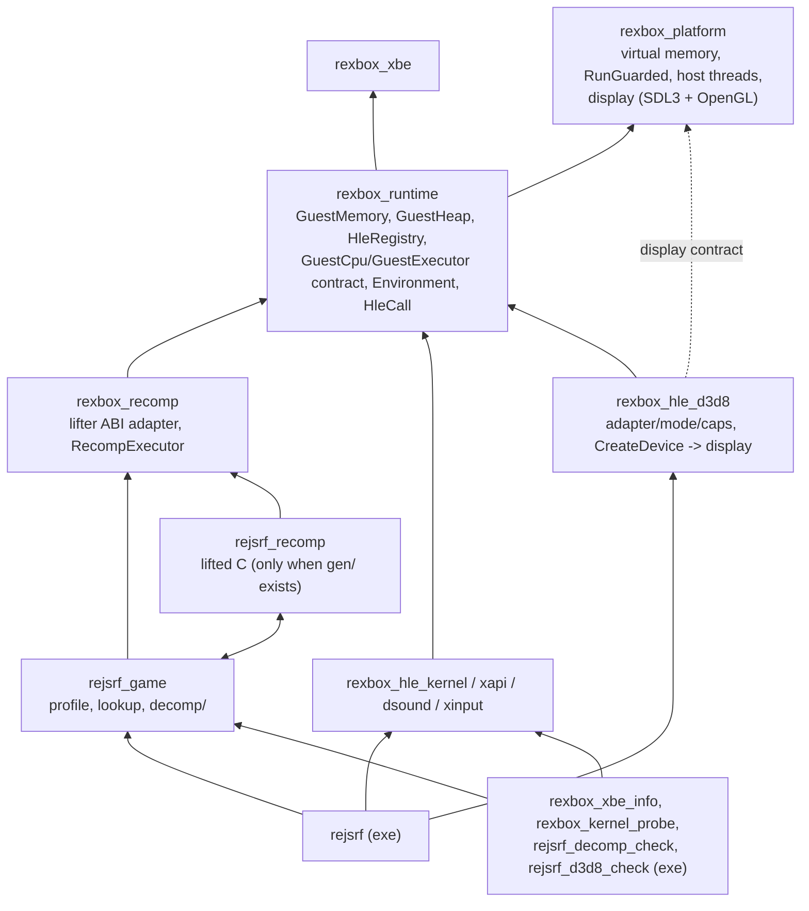
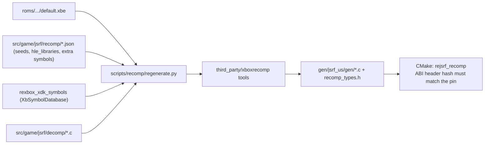
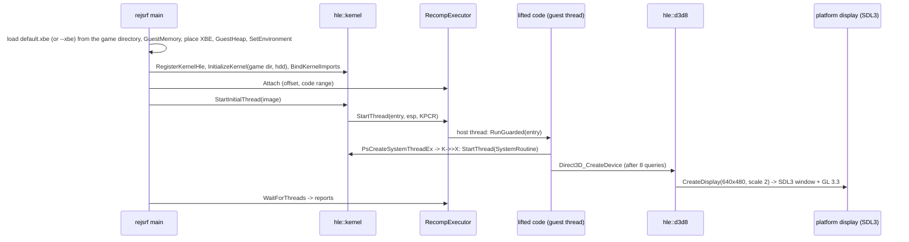

# reJSRF 아키텍처

현재 구현된 코드의 구조를 기록한다. 결정의 근거는 [설계 i001](docs/design/20261012-i001-project-bootstrap.md), [i002](docs/design/20261012-i002-recomp-pipeline.md), [i003](docs/design/20261012-i003-kernel-hle.md), [i006](docs/design/20261012-i006-xdk-symbol-binding.md), [i007](docs/design/20261012-i007-d3d8-hle-first-batch.md), [i012](docs/design/20261012-i012-d3d8-surfaces-first-frame.md), [i015](docs/design/20261012-i015-xinput-hle.md), [i017](docs/design/20261012-i017-dsound-hle.md), [i019](docs/design/20261012-i019-user-apc.md), [i021](docs/design/20261012-i021-node-walk-fault.md), [i023](docs/design/20261012-i023-d3d8-fixed-function-draw.md)에 있다.

## 1. 레이어와 CMake 타깃

| 타깃 | 경로 | 책임 | 상태 |
|---|---|---|---|
| `rexbox_platform` | `include/rexbox/platform/`, `src/platform/<os>/`, `src/platform/sdl/` | 가상 메모리(쓰인 페이지 기록 `TakeWrittenPages`, Win32 `GetWriteWatch`), `RunGuarded`/`RaiseStop`, `CreateHostThread`와 스레드 CPU 시간, 스레드 샘플링 프로파일러(`sampler.h`, 진단; Win32 구현), 표시 계약(`display.h`: 창 + OpenGL 계열 컨텍스트, GL 함수 포인터, present), 입력 계약(`input.h`: 게임패드 스냅샷, 진동 출력과 세기 [설계 i094](docs/design/20261018-i094-gamepad-vibration.md)), 오디오 계약(`audio.h`: 48 kHz 스테레오 float 출력, pull 렌더 함수, 장치가 없으면 실시간 pacing 스레드) | Win32 구현; 표시·입력·오디오는 SDL3 백엔드(모든 OS 공유) |
| `rexbox_xbe` | `src/rexbox/xbe/` | XBE 파싱 | 구현 |
| `rexbox_runtime` | `src/rexbox/runtime/` | `GuestMemory`(based 모델, 스칼라 접근, 페이지별 쓰기 버전 `WriteVersion`: D3D8이 8 KiB 이상 정점·인덱스 범위의 비교를 건너뜀, [설계 i046](docs/design/20261014-i046-hle-performance.md)), `GuestHeap`(페이지 할당자, 작은 객체용 slab, 물리 RAM 64 MiB와 가상 메모리 전용 위 64 MiB), `HleRegistry`, `GuestCpu`·`GuestExecutor` 계약, `Environment`, `HleCall`, 게스트 잠금 `rexbox_guest_lock_enter/leave`(C 계약: 단일 코어 우선순위로 얻던 상호 배제를 호스트 재귀 잠금으로, [설계 i068](docs/design/20261016-i068-adxm-lock.md)), 커널 thunk 합성 주소 | 구현 |
| `rexbox_recomp` | `src/rexbox/recomp/` | 생성 코드 ABI 전역·콜백, `RecompExecutor`(게스트 스레드 = 호스트 스레드, `CallGuest`, 스레드별 보고), XDK override 진입점 `rexbox_hle_enter` | 구현 |
| `rexbox_hle_kernel` | `src/rexbox/hle/kernel/` | 커널 export 104개(아래 표) | 부팅이 닿은 서비스 |
| `rexbox_hle_d3d8` | `src/rexbox/hle/d3d8/` | Direct3D 8 HLE(아래 표): 어댑터·모드·Caps 질의, 디바이스·서피스·리소스 객체(Xbox 헤더 레이아웃), 라이브러리 전역에 쓰는 상태 setter, 리소스 생성·Lock, 셰이더 핸들, GL 고정 기능 그리기(FVF, 텍스처, 텍스처 스테이지 GLSL, 렌더 타깃 FBO, 렌더 타깃을 텍스처로 샘플링(데이터 주소로 찾아 상하 반전 사본, 타깃은 표면 메모리로 식별; [설계 i071](docs/design/20261017-i071-render-target-by-memory.md)), 픽셀 셰이더 + 고정 기능 정점 처리; [설계 i069](docs/design/20261016-i069-render-target-sampling.md)), 가상 vblank 시계 | export 110개; 프로그래머블 셰이더·조명·안개는 보고만 |
| `rexbox_hle_xinput` | `src/rexbox/hle/xinput/` | XAPI 장치·입력 함수 11개(`XInitDevices`, `XGetDevices`, `XGetDeviceChanges`, `XInput*`, `XMountMUA`/`XUnmountMU`) on 플랫폼 입력 계약 | 게임패드 포트 0(호스트 게임패드 또는 키보드), 메모리 유닛 없음 |
| `rexbox_hle_dsound` | `src/rexbox/hle/dsound/` | 게임이 부르는 DSOUND 함수 50개(`DirectSoundCreate`, `IDirectSound_*`, `IDirectSoundBuffer_*`) on 플랫폼 오디오 계약: 객체·버퍼 메모리, Lock·Play·Stop·커서(원본 의미), PCM 8/16·Xbox ADPCM 믹서(주파수·볼륨·루프 구간·믹스 빈), 효과 이미지 서술자와 상태 읽기·쓰기 | 3D·EG·LFO·필터·DSP 효과는 `S_OK`만 |
| `rexbox_hle_xapi` | `src/rexbox/hle/xapi/` | XDK 라이브러리 HLE | 등록 진입점만 |
| `rejsrf_game` | `src/game/jsrf/` | 프로파일, 생성된 lookup 노출, 디컴파일 함수, 함수 탐색 seed(`recomp/seed_functions.json` 손으로 20개(실행에서 닿은 `observed` 1개 포함), `recomp/seed_pointer_targets.json` 포인터로만 참조되는 함수 162개: `scripts/recomp/find_pointer_targets.py`) | 디컴파일 22개(`decomp/mmatrix.c`: MMATRIX 행렬 스택 21개, 이식 가능한 C, i073), 호스트 어댑터 2개(`decomp/adxm_lock.c`, CRI ADXM 잠금 콜백, i068; `decomp/camera_frustum.c`, Hor+ 와이드에서 절두체 컬링의 가로 시야, i097; 호스트 훅은 `include/rejsrf/jsrf_host.h`) |
| `rejsrf_recomp` | `gen/jsrf_us/gen/` (gitignore) | lift된 C 9,215개 함수 | `gen/`이 있을 때만 |
| `rejsrf` | `src/app/` | 게임 디렉터리의 `default.xbe`(또는 `--xbe <파일>`)를 읽어 내용으로 식별, 부팅 orchestration과 스레드 보고 | 로고 시퀀스와 3D 어트랙트 데모 |
| `rexbox_xbe_info` | `tools/xbe_info/` | XBE 정보 | 구현 |
| `rexbox_xdk_symbols` | `tools/xdk_symbols/` | XbSymbolDatabase로 XDK 함수·변수 식별 → JSON (`regenerate.py`가 사용) | 구현 |
| `rexbox_kernel_probe` | `tools/kernel_probe/` | 게임 없이 커널 export 검사(사용자 APC 포함 42개, CI) | 구현 |
| `rexbox_dsound_probe` | `tools/dsound_probe/` | 게임 없이 DSOUND export 검사(수동 출력으로 믹서를 직접 돌림; Lock, 커서, 반복 구간, 형식 디코드, 믹스 빈, 효과 서술자, pop 수; 48개, CI) | 구현 |
| `rejsrf_decomp_check` | `tools/decomp_check/` | 디컴파일 함수와 lift 본문 비교(범용 레지스터, XMM0~7, 게스트 메모리) | 구현 |
| `rexbox_d3d8_probe` | `tools/d3d8_probe/` | 게임·GPU 없이 D3D8 HLE의 순수 부분 검사(스위즐 해제, 16·32비트 포맷, DXT1/3/5, FVF 배치, 고정 기능 GLSL 생성, 감마 램프, 정점 프로그램 디코드·번역·선언, 레지스터 컴바이너 번역; 116개, CI) | 구현 |
| `rejsrf_d3d8_check` | `tools/d3d8_check/` | D3D8 HLE export와 lift된 XDK 원본(`sub_X_gen`) 비교(eax, esp, 스크래치 메모리), `--dump`로 원본의 답 출력; 리소스 헤더 케이스, 디바이스 서피스 인코딩, 상태 setter가 남긴 라이브러리 전역 비교 포함 | 구현(14,018 케이스) |

### 커널 HLE 파일

| 파일 | 내용 |
|---|---|
| `kernel_hle.cpp` | 등록, 초기화, thunk 슬롯 바인딩(함수 → 합성 주소, 데이터 → 변수 주소) |
| `kernel_state.cpp`, `kernel_internal.h` | 디스패처 잠금, 핸들 표, 구조체 오프셋, 공용 도우미 |
| `kernel_thread.cpp` | KPCR/ETHREAD/스택/TLS 구성, `PsCreateSystemThreadEx`, 종료, 일시정지, 우선순위, 초기 스레드 |
| `kernel_sync.cpp` | 이벤트, 세마포어, 뮤턴트, 타이머, 대기(경고 가능 사용자 모드 대기는 사용자 APC를 실행하고 `STATUS_USER_APC`) |
| `kernel_apc.cpp` | 스레드별 사용자 APC 큐(파일 I/O의 `ApcRoutine`), 전달, `NtUserIoApcDispatcher` |
| `kernel_memory.cpp` | 가상·연속·시스템 메모리, 풀 |
| `kernel_object.cpp` | `NtClose`, `Ob*` |
| `kernel_rtl.cpp` | 크리티컬 섹션, 문자열, 시간 변환, 상태 코드(공용 `NtStatusToDosError`) |
| `kernel_hal.cpp` | IRQL, 시간, 인터럽트·DPC(전달 안 함), PCI, AV, 비휘발 설정, `DbgPrint` |
| `kernel_crypto.cpp` | `XcSHA*` (SHA-1) |
| `kernel_file.cpp`, `kernel_vfs.*` | 파일·디렉터리·장치·볼륨·IOCTL, Xbox 이름공간 → 호스트 디렉터리 |
| `kernel_data.cpp` | 데이터 export, `KeTickCount` 갱신 스레드, 커널 시간 |

### D3D8 HLE 파일

| 파일 | 내용 |
|---|---|
| `d3d8_hle.cpp` | 등록, 모듈 상태 |
| `d3d8_internal.h` | Xbox D3D 상수, 구조체 오프셋(`D3DDISPLAYMODE`, `D3DPRESENT_PARAMETERS`, `D3DCAPS8`), `D3dState` |
| `d3d8_adapter.cpp` | `Direct3D_GetAdapterCount`, `D3D_GetAdapterModeCount`, `D3D_EnumAdapterModes`, `D3D_CheckDeviceFormat`, `Direct3D_CheckDeviceMultiSampleType`; 모드 표 24개와 포맷 능력 바이트 표(측정값) |
| `d3d8_caps.cpp` | `D3D_GetDeviceCaps`, `D3DDevice_GetDeviceCaps`; `D3DCAPS8` 53 DWORD 표(측정값) |
| `d3d8_device.cpp` | `Direct3D_CreateDevice`(표시 생성, 백버퍼 2개·깊이 서피스 생성, 원본 기본 상태 루틴 실행), `GetBackBuffer`, `GetDepthStencilSurface`, `SetRenderTarget`, `Reset`, `SetViewport`, `Clear`(Xbox `D3DCLEAR` 비트), `Swap`(vblank 페이싱, 감마 램프를 거친 표시, frame dump), `SetGammaRamp`/`GetGammaRamp`, 디바이스 refcount, `GetRasterStatus`, `BlockUntilVerticalBlank`, 타일·감마·필터 등 |
| `d3d8_resource.h/.cpp` | Xbox `D3DResource` 헤더 레이아웃과 `Common`/`Format`/`Size` 비트, `ResourceTable`(헤더 주소 → 호스트 상태), `AddRef`/`Release`/`GetType`/`D3DSurface_GetDesc`, 디바이스 서피스 생성 |
| `d3d8_create.cpp` | `CreateTexture`/`CreateVolumeTexture`/`CreateImageSurface`/`CreateVertexBuffer`/`CreateIndexBuffer`, `D3DResource_Register`, `GetSurfaceLevel`, `Lock*`, 연속 메모리 |
| `d3d8_globals.h/.cpp` | 라이브러리 전역(`D3D__RenderState`, `D3D__TextureState`, `D3D_g_Stream`, `D3D__IndexData`, `D3D_g_pDevice`)의 위치와 읽기·쓰기 |
| `d3d8_render_state.h` | Xbox(XDK 4134) 렌더 상태·텍스처 스테이지 상태 번호(근거별 확인됨/추정) |
| `d3d8_state.cpp` | 상태 setter: 원본과 같은 전역 칸에 씀; 텍스처 바인딩·변환·셰이더 핸들·광원(`SetLight`/`LightEnable`)·재질은 `PipelineState` |
| `d3d8_shader.h/.cpp` | 정점 셰이더(선언·마이크로코드를 생성 때 복사·해석)와 픽셀 셰이더(정의 0xF0) 객체, 상수, 뷰포트 상수 `c[58]`/`c[59]`, `REXBOX_SHADER_DUMP` |
| `d3d8_vsh.h/.cpp` | NV2A 정점 프로그램 디코드·디스어셈블·GLSL 번역(화면 공간 epilogue 되돌리기), `D3DVSD` 선언 해석(순수) |
| `d3d8_psh.h/.cpp` | 레지스터 컴바이너 `D3DPIXELSHADERDEF` → GLSL, 스테이지 상수 매핑(순수) |
| `d3d8_draw.cpp` | `Draw*`(고정 기능 키 또는 정점 프로그램·픽셀 셰이더, 선언으로 속성 묶기, 바뀐 상수만 올리기, 바뀐 고정 상태만 적용, GL 그리기); `Begin`/`End` 즉시 모드는 모은 정점을 같은 경로로 그림(설계 i062); `CopyRects`는 보고만 |
| `d3d8_fvf.h/.cpp` | FVF → 정점 배치(순수) |
| `d3d8_immediate.h/.cpp` | 즉시 모드: `SetVertexData*` 레지스터 값 유지, `D3DVSDE_VERTEX`로 정점 확정, FVF·선언 배치로 묶기(순수) |
| `d3d8_texture_format.h/.cpp` | 텍스처 포맷 → RGBA8: Morton 스위즐 해제, 16·32비트, DXT1/3/5(순수) |
| `d3d8_ff_shader.h/.cpp` | 고정 기능 키와 GLSL 생성(XYZRHW·XYZ 정점, 스테이지별 텍스처 좌표의 생성·변환(설계 i064), 정점별 D3D 조명(설계 i066), 텍스처 스테이지, 알파 테스트), 법선 행렬(순수) |
| `d3d8_trace.h/.cpp` | `REXBOX_D3D8_TRACE`와 미구현 경로의 한 번 보고 |
| `d3d8_vblank.h/.cpp` | 가상 vblank 시계(디스플레이 refresh, 기본 60 Hz). 60 Hz 근처 모니터에서 vsync swap이 막히면 그 시각에 위상을 맞춘다([설계 i082](docs/design/20261017-i082-vsync.md)); 설정의 VBlank 대기를 끄면 10 kHz로 돌아 대기가 사실상 사라진다(blank 수는 이어짐, [설계 i095](docs/design/20261018-i095-vblank-wait.md)) |
| `d3d8_gamma.h/.cpp` | 감마 램프(Xbox `D3DGAMMARAMP` 768바이트), CPU 적용, present용 GLSL(순수) |
| `d3d8_gl.h/.cpp` | 쓰는 GL 함수만 담은 함수 표, `platform::GetGlProcAddress`로 채움; GL 상태 캐시의 epoch(`InvalidateGlStateCache`) |
| `d3d8_gl_targets.h/.cpp` | 렌더 타깃: 색 서피스 = GL 텍스처, 깊이 = 렌더버퍼, 쌍마다 FBO, 모두 헤더가 아니라 표면 메모리(데이터 주소)로 찾는다([설계 i071](docs/design/20261017-i071-render-target-by-memory.md)); 내부 렌더링 배율(1~8배, `REXBOX_RENDER_SCALE`, Ctrl+1~8)만큼 크게 만들고 D3D에는 게스트 크기를 보인다([설계 i080](docs/design/20261017-i080-render-scale.md)); MSAA(2~16배)면 색은 멀티샘플 렌더버퍼에 그리고 텍스처로 읽을 때·present·덤프 때 resolve한다([설계 i089](docs/design/20261017-i089-anti-aliasing.md)); present(단위 램프는 blit, 아니면 감마 셰이더, SMAA를 켜면 그 전에 적용), BMP 덤프; Hor+ 와이드스크린: 백버퍼·깊이 스텐실만 854·1120 너비로 넓히고 그 타깃에 그리는 정점의 클립 x를 `RenderTargetWideFactor()`(640/W)로 줄인다([설계 i085](docs/design/20261018-i085-widescreen-horplus.md)) |
| `d3d8_smaa.h/.cpp` | SMAA 1x(`third_party/smaa`의 `SMAA.hlsl`을 GLSL 3로, 프리셋 High): 색 에지 → 가중치 → 이웃 혼합 세 패스, 조회 텍스처(AreaTex, SearchTex). 소스는 빌드 때 `cmake/embed_text.cmake`가 바이트 배열로 넣는다([설계 i089](docs/design/20261017-i089-anti-aliasing.md)) |
| `d3d8_gl_textures.h/.cpp` | 텍스처 캐시(헤더 → GL 텍스처, Lock·해시로 재업로드), 스테이지 샘플러(선형 필터면 비등방성 필터링 배율을 붙인다, 설계 i089). 2D DXT는 S3TC로 압축된 채 올린다(`REXBOX_DXT=cpu`면 CPU 디코드, [설계 i088](docs/design/20261017-i088-dxt-compressed.md)) |
| `d3d8_gl_programs.h/.cpp` | 프로그램 캐시(고정 기능, 정점 프로그램 + 고정 기능 프래그먼트, 정점 프로그램 + 컴바이너; 구조체 키와 해시), 프로그램별 유니폼 캐시 |
| `d3d8_gl_program_cache.h/.cpp` | 링크한 GL 프로그램을 드라이버 바이너리로 `cache\shaders\`에 저장하고 다음 실행에서 불러옴(드라이버 문자열과 소스가 완전히 같을 때만, 거부되면 컴파일; 저장 실패는 한 번 보고하고 임시 파일을 남기지 않음; `REXBOX_SHADER_CACHE`, 설계 i051) |
| `d3d8_gl_buffers.h/.cpp` | 정점·인덱스 데이터: 게스트 버퍼 범위는 GL 버퍼에 두고 게스트 바이트가 바뀔 때만 다시 올림, UP 데이터와 만든 인덱스는 스트리밍 버퍼, QUADLIST 전개(설계 i040); 그리기용 VAO의 속성 상태를 기억해 바뀐 것만 보냄(설계 i050) |
| `d3d8_profile.h/.cpp` | `REXBOX_D3D8_PROFILE`: present 스레드에서 잰 그리기 단계·present·vblank 대기·나머지의 프레임당 시간, CPU 시간, 그리기 수, 업로드 바이트, 미구현 경로의 프레임당 호출 수; `REXBOX_SAMPLE`: 샘플링 구간 |

## 2. 재컴파일 코드 생성

* HLE 대상 라이브러리(`hle_libraries.json`, 지금은 D3D8·D3D8LTCG)의 함수마다 `rexbox_hle_overrides.c`에 override `sub_X`가 생성된다. override는 `rexbox_hle_enter(slot)`로 같은 이름의 HLE export를 부르고, 없으면 실행을 멈춰 `stopped at unimplemented XDK function <library> <name>`을 보고한다. 원본은 `sub_X_gen`으로 남는다(`REXBOX_HLE_FALLBACK=lifted`이면 원본을 실행하고 기록하는 진단 모드).

## 3. 실행 흐름

## 4. 주요 계약

* **게스트 주소**: 32비트 `GuestAddress`. C++은 `GuestMemory::Translate`/`Read32`/`Write32`, 생성·디컴파일 C는 `MEM32` 등.
* **레지스터**: HLE와 런타임은 `runtime::GuestCpu`로만 접근한다. 생성 코드의 TLS 전역을 아는 것은 `rexbox_recomp`뿐이다.
* **HLE 함수**: `void()`; 안에서 `runtime::HleCall`로 stdcall 인자(`[esp+4+4i]`)·fastcall 레지스터를 읽고 `Return(value, n)`으로 eax와 esp를 맞춘다.
* **스레드**: 커널이 게스트 메모리에 KPCR/ETHREAD/스택/TLS를 만들고 `GuestExecutor::StartThread`에 맡긴다. 종료는 `ExitThread`(SEH 해제, `/EHa`).
* **동기화**: 디스패처 객체 상태는 게스트 메모리의 `SignalState`, 대기는 전역 디스패처 잠금과 condition variable.
* **표시**: HLE는 `platform/display.h`(폭·높이·제목으로 창과 OpenGL 계열 컨텍스트 생성, `GetGlProcAddress`, `PresentDisplay`)만 부른다. SDL 타입은 `src/platform/sdl/` 밖으로 나오지 않는다. 창은 그림의 2배 크기로 열리고, 종횡비를 지키며 크기를 바꿀 수 있다. Alt+1/2/3은 1~3배 고정 배율, 더블클릭과 Alt+Enter는 테두리 없는 전체화면 전환이다. 제목은 앱이 `SetDisplayTitle`로 준 이름·버전·빌드(`reJSRF v<버전> (<플랫폼>/<아키텍처> <구성>) - Build <일시>`)에 GL 버전과 초당 present 수(`FPS`)를 붙인다(rePIU 형식, 설계 i031). 창은 `Direct3D_CreateDevice`를 부른 게스트 스레드에서 만들어진다(Win32·X11 유효; 메인 스레드가 필요한 플랫폼은 표시 서비스로 바꾼다, 설계 i007 §2.5). 창 이벤트는 그 스레드가 디바이스를 만들 때와 present 때 처리한다. 창을 닫으면(X 버튼, Alt+F4) D3D8 HLE가 `runtime::RequestExit`를 부르고, 앱이 등록한 처리기가 출력을 비운 뒤 프로세스를 끝낸다(설계 i038).
* **오디오**: HLE는 `platform/audio.h`만 부른다. `StartAudioOutput`이 출력 스레드(SDL 오디오 스트림 콜백 또는 pacing 스레드)에서 렌더 함수를 부르고, DSOUND 믹서가 그때마다 게스트 메모리의 버퍼를 직접 읽어 섞고 재생 커서를 옮긴다(원본 `Unlock`이 아무것도 하지 않으므로). 게임 스레드의 HLE 호출과 렌더는 DSOUND mutex 하나를 쓴다.
* **파일**: `\Device\CdRom0` → XBE 폴더(읽기 전용), `\Device\Harddisk0\Partition1..5` → `<hdd root>/PartitionN`, `Partition0`은 원시 장치. 파티션 루트는 볼륨(원시 쓰기 허용·폐기).

## 5. 빌드 구성

* MSVC: 전역 `/utf-8 /permissive- /EHa`, `NOMINMAX WIN32_LEAN_AND_MEAN _CRT_SECURE_NO_WARNINGS`; 우리 타깃 `/W4`; 생성 코드 `/w /bigobj /MP`. 게스트 스레드의 호스트 스택은 64 MiB이고 `CreateHostThread`가 명시한다. `rejsrf`는 `/LARGEADDRESSAWARE`로 링크하고 이미지 기본 스택은 1 MiB로 둔다. 기본값이 크면 크기를 지정하지 않은 모든 스레드(오디오, SDL, GL 드라이버)가 그만큼 예약해 32비트 주소 공간이 바닥난다(issue #25). 원본을 메인 스레드에서 실행하는 `rejsrf_d3d8_check`만 `/STACK:64MB`를 쓴다.
* `REJSRF_RECOMP_GEN_DIR`(기본 `gen/jsrf_us/gen`)이 없으면 `rejsrf_recomp`와 `rejsrf_decomp_check`를 만들지 않는다(CI). `rexbox_kernel_probe`는 항상 빌드되고 CI에서 실행된다.
* 라이선스 가드 `REJSRF_COPYLEFT_PATHS`는 모든 우리 타깃과 `rejsrf_recomp`에 적용된다.
* 실행 시 환경 변수: `REJSRF_HDD_ROOT`(HDD 루트, 기본 `./hdd`), `REXBOX_TRACE_FILES`(모든 파일 열기 기록), `REXBOX_HLE_FALLBACK=lifted`(미구현 XDK 함수의 원본 실행, 진단용), `REXBOX_DISPLAY=none`(창 없이 실행; 헤드리스 진단), `REXBOX_AUDIO=none`(오디오 장치를 열지 않음; 커서는 실시간으로 움직임), `REXBOX_DSOUND_TRACE=1`(버퍼 생성 형식·믹스 빈과 `Play` 기록), `REXBOX_FRAME_LOG=<n>`(n번째 present마다 프레임 수와 경과 시간 한 줄), `REXBOX_DISPLAY=hidden`(보이지 않는 창 + GL 컨텍스트; 그리기는 하고 화면에 내지 않음), `REXBOX_FRAME_DUMP=<n>[,<n>…]`(n번째 present의 백버퍼를 `frame_<n>.bmp`로 저장, 폴더는 `REXBOX_FRAME_DUMP_DIR`), `REXBOX_SHADER_DUMP=1`(만들어지는 정점 셰이더의 선언·디스어셈블, 픽셀 셰이더 정의), `REXBOX_D3D8_TRACE=1`(처음 보는 텍스처 포맷·FVF·프로그램 키 기록), `REXBOX_D3D8_PROFILE=<n>`(n번째 present마다 그리기 단계·present·vblank 대기·나머지의 프레임당 시간, present 스레드의 CPU 시간, 그리기 수, 업로드 바이트, 캐시 사본과 비교한 바이트·범위 수, 미구현 경로의 프레임당 호출 수 `unimplemented per frame:`), `REXBOX_SAMPLE=<first>-<last>[:<file>]`(present 구간 동안 present 스레드의 명령 포인터 샘플링, 플랫폼 계약 `sampler.h`; `scripts/perf/resolve_samples.py`가 링커 map `rejsrf.map`으로 함수 이름을 붙임, [frame-time](docs/analysis/frame-time.md)), `REXBOX_GL_CALLS=1`(모든 GL 함수를 호출 계수 래퍼로 감싸, 프로파일 보고에 프레임당 GL 호출 수를 함수별로 냄, 설계 i050), `REXBOX_SHADER_CACHE=<폴더>|0`(GL 프로그램 바이너리 캐시의 위치, 0이면 끔; 기본 `cache\shaders`, 설계 i051).
* 진단 환경 변수(멈춤·손상 추적): `REXBOX_STALL_REPORT=<초>`(기본 10, `0`이면 끔. present가 그만큼 없으면 게스트 스레드마다 마지막 HLE 호출과 대기 대상·신호 상태를 한 번 출력하고, 재개되면 알림. 추정 호출 스택과 커널의 suspend count·우선순위·핸들도 쓰고, `REXBOX_STALL_DUMP=<파일>`이면 게스트 메모리도 저장; `runtime/thread_activity`, [설계 i060](docs/design/20261015-i060-stall-report.md)), `REXBOX_GUEST_LOCK_TIMEOUT_MS=<ms>`(기본 2000, `0`이면 무한: 게스트 잠금을 그만큼 기다리면 한 번 보고하고 배제 없이 들어감; `runtime/guest_lock`, [설계 i068](docs/design/20261016-i068-adxm-lock.md)), `REXBOX_VSH_WATCH=<핸들>[:<첫>-<끝>][,...]`(그 정점 셰이더로 그릴 때 c[] 범위(기본 96–103)와 컬링·블렌드·0번 스테이지 상태를 값이 달라질 때마다 한 줄, 핸들마다 최대 64줄, `all`이면 모든 핸들 4줄씩; `d3d8_draw_watch`, [설계 i070](docs/design/20261016-i070-outline-watch.md)), 창에서 **F9**(또는 `REXBOX_CAPTURE_FRAME=<n>`): 다음 프레임의 모든 Clear·그리기와 상태를 `capture_<n>.txt`, 그림을 `capture_<n>.bmp`로(`REXBOX_FRAME_DUMP_DIR`; `d3d8_capture`, 플랫폼 `ConsumeCaptureRequest`), `REXBOX_HLE_TRACE=<n>`(XDK HLE 호출을 인자·ecx·eax와 함께, 커널 import는 ordinal로 처음 n개 기록), `REXBOX_TRACE_MEMORY`(가상 메모리 할당·커밋 기록; 부족하면 남은 바이트와 최대 연속 구간), `REXBOX_WATCHDOG=<초>`(그 시간이 지나면 게스트 스레드의 직접 호출 프로파일을 덤프하고 종료; `REXBOX_WATCHDOG_DUMP=<파일>`이면 게스트 주소 공간 128 MiB도 저장), `REXBOX_HEAP_CHECK=<주소>`(NT 힙의 가변 크기 자유 리스트를 HLE 진입마다 검사해 첫 손상 지점 보고). 직접 호출 프로파일은 CMake `REJSRF_RECOMP_CALL_PROFILE=ON`으로 생성 코드를 빌드했을 때만 채워진다.
* `scripts/recomp/check_hle_pops.py`는 D3D8·XInput·DSOUND HLE export의 `Return(value, n)`(템플릿 `AcceptSetting<n>`은 인자 n)과 lift 원본의 `ret n`을 대조한다(스택 불균형 예방). `scripts/recomp/find_pointer_targets.py`는 데이터·즉시값으로만 참조되어 lift되지 않은 함수 시작을 찾아 seed 파일을 쓴다.
* `third_party/SDL`(submodule, release-3.4.18, zlib)은 정적 라이브러리만 빌드되어 `rexbox_platform`에 PRIVATE로 링크된다. 카메라·GPU·렌더러·햅틱·센서·대화상자·트레이는 끄고, 오디오(DSOUND)·조이스틱·게임패드(XInput)는 켜 둔다.
* `third_party/imgui`(submodule, v1.93.0, MIT)는 설정 오버레이다. 코어는 정적 라이브러리 `imgui`로 앱과 `rexbox_platform`에 링크된다. SDL3·OpenGL3 백엔드는 `rexbox_platform` 안에서 컴파일되고, 계약은 `include/rexbox/platform/overlay.h`다. D3D8 HLE는 present에서 swap 직전에 `platform::RenderOverlay()`를 부를 뿐, 내용은 모른다. 화면 내용과 `rejsrf.ini`는 앱(`src/app/settings*.cpp`)에 있다. 앱은 공개 헤더 `include/rexbox/hle/d3d8/d3d8_display.h`로 렌더링 배율·와이드스크린·시작 기본값을 다룬다([설계 i084](docs/design/20261017-i084-settings-overlay.md)).
* `third_party/XbSymbolDatabase`(submodule)는 `rexbox_xdk_symbols`용으로 라이브러리만 빌드된다. 생성 코드를 처음 만들 때는 도구를 먼저 빌드해야 한다.
* `third_party/xboxrecomp`는 업스트림 PR [#198](https://github.com/sp00nznet/xboxrecomp/pull/198)(`lock xadd` 플래그, `FCMOVcc`)과 [#199](https://github.com/sp00nznet/xboxrecomp/pull/199)(별칭 본문의 분기 고아 블록), [#200](https://github.com/sp00nznet/xboxrecomp/pull/200)(다른 함수 본문 중간으로 가는 분기)가 머지되기 전까지 그 수정들과 i044의 성능 개선(upstream PR을 보류한 `perf/mem-base-local`, 우리 fork에만 두는 `perf/xmm-intrinsics`), i048의 `fix/mxcsr`(게스트 MXCSR을 TLS `g_mxcsr`로 두고 `rexbox_recomp_reset_thread`가 0x1F80으로 초기화, `CVTSS2SI`가 그 RC로 반올림; upstream PR #198에 합침), i055의 `58f7166`(tail-jump pass 뒤에 생긴 본문의 tail jump를 alias로; upstream PR #200에 합침), i058의 `0c32a78`·`982cd28`·`7c58ec6`(늦은 본문의 `jcc`, 복구된 switch case 안의 중첩 switch; PR #200에 합침)과 `feat/stub-report`(모든 스텁에 `RECOMP_UNRESOLVED_STUB`, `RECOMP_STUB_REPORT`일 때 보고; upstream PR 보류)를 합친 포크 `nworkers/xboxrecomp`의 `rejsrf` 브랜치를 가리킨다(`THIRD_PARTY_NOTICES.md`). `perf/xmm-intrinsics`의 SSE2 XMM 도우미는 CMake `REXBOX_RECOMP_XMM_SSE2=ON`일 때만 쓴다. 기본(`OFF`)은 `rexbox_recomp`가 `RECOMP_XMM_PORTABLE`를 PUBLIC으로 정의해 칸 단위 C를 쓴다([설계 i044 §3.4](docs/design/20261013-i044-recomp-codegen.md)).
* HLE 대상은 `src/game/jsrf/recomp/hle_libraries.json`의 `libraries`(라이브러리 전체)와 `functions`(개별 함수)로 고른다. `regenerate.py`는 식별된 XDK 변수 표 `rexbox_xdk_variables[]`도 생성한다.
* 진단(추가): `REXBOX_WATCH32=<주소,…>`(HLE 진입마다 DWORD 변화 기록), `REXBOX_PROFILE_ON_SKIP`(첫 건너뛴 간접 호출에서 호출 프로파일 덤프; 기록에 esp와 호출 지점 포함), `REXBOX_SKIP_DUMP=<파일>`/`REXBOX_STOP_DUMP=<파일>`(건너뛴 호출·비정상 정지 때 게스트 RAM 저장), CMake `REJSRF_RECOMP_ABI_CHECK`(직접 호출마다 callee의 `ebx/esi/edi` 보존과 반환 주소 pop 확인; `REXBOX_ABI_IGNORE`, `REXBOX_ABI_ESP_ONLY`로 걸러냄). 건너뛴 간접 호출 경고는 호출 지점을 함께 찍는다. 실행된 미해결 스텁은 주소마다 한 번 보고한다(`RECOMP_STUB_REPORT`, [unresolved-stubs](docs/analysis/unresolved-stubs.md)).

---

# reJSRF Architecture

This records the structure of the code as implemented now. The reasons are in [design i001](docs/design/20261012-i001-project-bootstrap.md), [i002](docs/design/20261012-i002-recomp-pipeline.md), [i003](docs/design/20261012-i003-kernel-hle.md), [i006](docs/design/20261012-i006-xdk-symbol-binding.md), [i007](docs/design/20261012-i007-d3d8-hle-first-batch.md), [i012](docs/design/20261012-i012-d3d8-surfaces-first-frame.md), [i015](docs/design/20261012-i015-xinput-hle.md), [i017](docs/design/20261012-i017-dsound-hle.md), [i019](docs/design/20261012-i019-user-apc.md), [i021](docs/design/20261012-i021-node-walk-fault.md) and [i023](docs/design/20261012-i023-d3d8-fixed-function-draw.md).

## 1. Layers and CMake targets

The diagrams and tables above apply. In short: `rexbox_platform` (virtual memory with written-page queries for `GuestMemory::WriteVersion`, which lets D3D8 skip comparing unwritten vertex and index ranges of 8 KiB or more ([design i046](docs/design/20261014-i046-hle-performance.md)), guarded runs, host threads and their CPU time, a thread sampling profiler for diagnostics, and the display, input and audio contracts implemented on SDL3 in `src/platform/sdl/`) ← `rexbox_runtime` (guest memory: a 128 MiB address space whose low 64 MiB stands for physical RAM and whose upper 64 MiB serves only virtual memory; a page heap with slabs for small objects; HLE registry, the GuestCpu/GuestExecutor contract, Environment, HleCall) ← `rexbox_recomp` (lifter ABI adapter and `RecompExecutor`, one host thread per guest thread) and the HLE modules; `rejsrf_game` and the generated `rejsrf_recomp` sit above (`decomp/mmatrix.c` rewrites 21 MMATRIX matrix-stack functions in portable C, checked by `rejsrf_decomp_check` against the lifted bodies on general registers, XMM0–7 and memory, [design i073](docs/design/20261016-i073-mmatrix.md); `decomp/` also holds one host-concurrency adapter, `adxm_lock.c`, which wraps the CRI ADXM lock callbacks in the runtime's guest lock `rexbox_guest_lock_enter/leave`, a C contract giving on the host the exclusion the guest got from single-core priority scheduling; [design i068](docs/design/20261016-i068-adxm-lock.md); and `camera_frustum.c`, which widens the horizontal field of view of the game's frustum culling to match the Hor+ picture through the host hook in `include/rejsrf/jsrf_host.h`, [design i097](docs/design/20261018-i097-frustum-culling.md)); `rejsrf` orchestrates. It takes the game directory, serves it as the game's `D:`, loads its `default.xbe` (or the file `--xbe` names) and identifies it by content. The kernel HLE exports 104 functions, one file per area (threads, sync, memory, objects, Rtl, HAL, crypto, files with the VFS, data exports, and user APCs: a per-thread queue fed by file I/O completion routines, run by alertable user-mode waits that then return `STATUS_USER_APC`, with `NtUserIoApcDispatcher`). The D3D8 HLE (`rexbox_hle_d3d8`) has one file per area: registration and state, constants and layouts, the adapter/mode/format queries with their measured tables, the caps table, device creation (which opens the display), and the GL function table. The DSOUND HLE (`rexbox_hle_dsound`) implements the 50 DSOUND functions the game calls on the platform audio contract: objects and buffer memory, Lock/Play/Stop and cursors with the original semantics, a PCM 8/16 and Xbox ADPCM mixer (frequency, volume, loop region, mix bins), and the effects image descriptor with state reads and writes; 3D, EG, LFO, filters and DSP effects only return `S_OK`. Function seeds: 20 by hand in `seed_functions.json` (one marked `observed`) and 162 pointer-only functions in `seed_pointer_targets.json` (from `scripts/recomp/find_pointer_targets.py`); 9,215 functions are lifted. Tools: `rexbox_xbe_info`, `rexbox_kernel_probe` (42 checks without a game, user APCs included, run in CI), `rexbox_dsound_probe` (48 DSOUND checks without a game, driving the mixer by hand, run in CI), `rejsrf_decomp_check` and `rejsrf_d3d8_check` (HLE exports against the lifted XDK originals, 13,557 cases).

## 2. Generating the recompiled code

`scripts/recomp/regenerate.py` runs the pinned xboxrecomp tools on the user's XBE, passing the committed function seeds (`src/game/jsrf/recomp/*.json`) to the disassembler and the decompiled `sub_X` definitions to the lifter; CMake checks the generated ABI header against the pin. It also runs `rexbox_xdk_symbols` (XbSymbolDatabase) and, for every function of the libraries in `hle_libraries.json` (now D3D8 and D3D8LTCG), generates an override `sub_X` in `rexbox_hle_overrides.c` that calls the HLE export of the same name through `rexbox_hle_enter(slot)`, or stops and reports `stopped at unimplemented XDK function <library> <name>`; the original stays as `sub_X_gen` (`REXBOX_HLE_FALLBACK=lifted` runs and logs it instead, a diagnostic mode).

## 3. Execution flow

The app builds guest memory, places the XBE, creates the heap and installs the Environment; registers the HLE; initializes the kernel (data exports, VFS with the game directory and the HDD root) and binds the kernel imports; attaches the executor; and starts the entry point as the first guest thread. When the game calls `Direct3D_CreateDevice`, the D3D8 HLE opens the SDL3 window with a GL 3.3 context on that guest thread. The kernel builds each thread's KPCR/ETHREAD/stack/TLS and hands it to `RecompExecutor::StartThread`; the app waits for the threads and prints their reports.

## 4. Key contracts

* **Guest address**: 32-bit `GuestAddress`; C++ uses `GuestMemory::Translate`/`Read32`/`Write32`, generated and decompiled C uses `MEM32` and friends.
* **Registers**: HLE and runtime code go through `runtime::GuestCpu` only; only `rexbox_recomp` knows the generated code's TLS globals.
* **HLE functions**: `void()`, using `runtime::HleCall` to read stdcall arguments (`[esp+4+4i]`) and fastcall registers, and `Return(value, n)` to set eax and esp.
* **Threads**: the kernel builds KPCR/ETHREAD/stack/TLS in guest memory and hands the thread to `GuestExecutor::StartThread`; `ExitThread` unwinds with SEH (`/EHa`).
* **Synchronization**: dispatcher state is the guest `SignalState`; waits use one global dispatcher lock and a condition variable.
* **Input**: `include/rexbox/platform/input.h` gives a gamepad snapshot as plain values (digital buttons, analog face buttons and triggers 0–255, sticks with +Y up), implemented on SDL3 in `src/platform/sdl/input_sdl.cpp` with a keyboard fallback for the first controller. Rumble goes the other way: `SetGamepadRumble` (left low-frequency, right high-frequency motor, 0..65535) scaled by `SetRumbleStrength`, renewed while it runs and stopped while the settings menu is open; the HLE `XInputSetState` passes the title's `XINPUT_RUMBLE` (`+0x42`) ([design i094](docs/design/20261018-i094-gamepad-vibration.md)). XAPI's device types are addresses of XDK variables (`g_DeviceType_Gamepad`), which the title profile binds into `HleRegistry::BindVariable` from the generated `rexbox_xdk_variables[]` table.
* **D3D8 state and drawing**: render and texture-stage state lives in the library globals (`D3D__RenderState`, `D3D__TextureState`, `D3D__IndexData`, found through the identified XDK variables), which the title's inlines and the HLE setters both write; the device runs the library's own default-state routine (bound by the title profile as `D3D_InitializeDeviceState`). Each `Draw*` reads its vertices and indices from guest memory, picks a fixed-function GLSL program by key, decodes textures to RGBA8 on the CPU (cached per header, re-uploaded after a lock or a hash change) and draws into the render target's FBO; render targets are keyed by surface memory rather than by header, since the title points one header at surfaces of different sizes ([design i071](docs/design/20261017-i071-render-target-by-memory.md)), and are drawn at an internal rendering scale of 1x to 8x (`REXBOX_RENDER_SCALE`, Ctrl+1 to 8 while running) while D3D keeps seeing guest sizes ([design i080](docs/design/20261017-i080-render-scale.md)), and a texture over a render target's memory samples a vertically flipped copy of it, refreshed when the target was bound since, and a pixel shader with fixed-function vertex processing links the fixed-function vertex stage (every stage active) with the register-combiner fragment shader ([design i069](docs/design/20261016-i069-render-target-sampling.md)); `Swap` blits the shown back buffer to the window. A virtual vblank clock at the display refresh paces `Swap`, `BlockUntilVerticalBlank` and `GetRasterStatus` (docs/design/20261012-i023-d3d8-fixed-function-draw.md); a visible window swaps with host vsync (`REXBOX_VSYNC`, default adaptive; hidden windows swap at once), and on a monitor near the guest refresh the clock's phase follows the host's blank whenever a swap waited for it ([design i082](docs/design/20261017-i082-vsync.md)).
* **Resources**: a D3D resource is a guest header in the Xbox layout (`Common` refcount/type bits, `Data`, `Format`/`Size` XGRAPHC bit fields, surfaces add `Parent`), because the title reads and builds headers itself; the HLE keeps host state per header address in a `ResourceTable` (docs/kb/xbox-d3d8-api.md).
* **Display**: the HLE calls only `platform/display.h` (window and OpenGL-family context from width, height and title; `GetGlProcAddress`; `PresentDisplay`). SDL types never leave `src/platform/sdl/`. The window opens at twice the picture and resizes with its aspect ratio kept. Alt+1/2/3 give fixed 1x–3x scales, and a double click or Alt+Enter toggles borderless fullscreen. The title is the name, version and build the app gives through `SetDisplayTitle` (`reJSRF v<version> (<platform>/<arch> <config>) - Build <time>`), followed by the GL version and the presents per second (`FPS`), in rePIU's form (design i031). The window is created on the guest thread that calls `Direct3D_CreateDevice` (valid on Win32 and X11; platforms that need the main thread get a display service, design i007 §2.5). That thread handles window events at device creation and at each present. Closing the window (X button, Alt+F4) makes the D3D8 HLE call `runtime::RequestExit`, and the handler the app installs flushes the output and ends the process (design i038).
* **Audio**: the HLE calls only `platform/audio.h`. `StartAudioOutput` calls a render function on the output thread (SDL's audio-stream callback, or a pacing thread without a device); the DSOUND mixer then reads the buffers straight from guest memory, mixes them and moves the play cursors (the original `Unlock` does nothing). HLE calls on game threads and renders share one DSOUND mutex.
* **Files**: `\Device\CdRom0` → the XBE's folder (read-only), `\Device\Harddisk0\Partition1..5` → `<hdd root>/PartitionN`, `Partition0` a raw device; a partition root is a volume (raw writes accepted and dropped).

## 5. Build configuration

* MSVC: `/utf-8 /permissive- /EHa` and `NOMINMAX WIN32_LEAN_AND_MEAN _CRT_SECURE_NO_WARNINGS` globally; `/W4` on our targets; `/w /bigobj /MP` for generated code. Guest threads get 64 MiB host stacks, given explicitly by `CreateHostThread`. `rejsrf` links with `/LARGEADDRESSAWARE` and keeps the image default stack at 1 MiB: a large default is reserved by every thread created without a size (audio, SDL, the GL driver) and exhausts the 32-bit address space (issue #25). Only `rejsrf_d3d8_check`, which runs originals on its main thread, uses `/STACK:64MB`.
* Without `REJSRF_RECOMP_GEN_DIR` (default `gen/jsrf_us/gen`), `rejsrf_recomp` and `rejsrf_decomp_check` are not created (CI). `rexbox_kernel_probe` is always built and runs in CI.
* The license guard `REJSRF_COPYLEFT_PATHS` applies to all our targets and to `rejsrf_recomp`.
* Run-time environment variables: `REJSRF_HDD_ROOT` (HDD root, default `./hdd`), `REXBOX_TRACE_FILES` (log every file open), `REXBOX_HLE_FALLBACK=lifted` (run the original of an unimplemented XDK function; diagnostic), `REXBOX_DISPLAY=none` (run without a window; headless diagnostics), `REXBOX_AUDIO=none` (open no audio device; cursors still move in real time), `REXBOX_DSOUND_TRACE=1` (log buffer formats, mix bins and `Play`) and `REXBOX_FRAME_LOG=<n>` (one line with the frame count and elapsed time every n presents), `REXBOX_DISPLAY=hidden` (an invisible window with a GL context: everything is drawn, nothing is shown), `REXBOX_FRAME_DUMP=<n>[,<n>...]` (the back buffer of the n-th present as `frame_<n>.bmp`, in `REXBOX_FRAME_DUMP_DIR`) and `REXBOX_SHADER_DUMP=1` (each created vertex shader's declaration and disassembly, each pixel shader's definition), `REXBOX_D3D8_TRACE=1` (each texture format, FVF and program key the first time it appears), `REXBOX_D3D8_PROFILE=<n>` (every n presents, the per-frame time of the draw phases, present, the vblank wait and the rest, the presenting thread's CPU time, draw counts, uploaded bytes, the bytes and ranges compared with cached copies, and calls per frame into unimplemented paths, `unimplemented per frame:`), `REXBOX_SAMPLE=<first>-<last>[:<file>]` (samples the presenting thread's instruction pointer over a range of presents through the platform contract `sampler.h`; `scripts/perf/resolve_samples.py` names the functions with the linker map `rejsrf.map`, [frame-time](docs/analysis/frame-time.md)), `REXBOX_GL_CALLS=1` (every GL entry point goes through a counting wrapper, and the profile report adds GL calls per frame by function; design i050), `REXBOX_SHADER_CACHE=<folder>|0` (where the GL program binary cache lives, 0 turns it off; default `cache\shaders`, design i051). Diagnostics for hangs and corruption: `REXBOX_HLE_TRACE=<n>` (the first n XDK HLE calls with arguments, ecx and eax, and kernel imports by ordinal), `REXBOX_TRACE_MEMORY` (virtual-memory allocations and commits; on exhaustion, the free bytes and the longest free run), `REXBOX_WATCHDOG=<seconds>` (dump the guest threads' direct-call profile and exit; with `REXBOX_WATCHDOG_DUMP=<file>` also write the 128 MiB guest address space), `REXBOX_HEAP_CHECK=<address>` (validate an NT heap's variable-size free list at every HLE entry and report the first corruption). The direct-call profile is filled only when the generated code is built with CMake `REJSRF_RECOMP_CALL_PROFILE=ON`. `scripts/recomp/check_hle_pops.py` compares each D3D8, XInput and DSOUND export's `Return(value, n)` (for the `AcceptSetting<n>` template, its argument) with the lifted original's `ret n`; `scripts/recomp/find_pointer_targets.py` finds unlifted function starts referenced only from data or immediates and writes a seed file. More diagnostics: `REXBOX_STALL_REPORT=<seconds>` (default 10, `0` off: when presents stop that long, print once per guest thread its last HLE call and what it waits on with the object's signal state, and say when presents resume, with a guessed call stack and the kernel's suspension count, priority and handles; `REXBOX_STALL_DUMP=<file>` also saves guest memory; `runtime/thread_activity`, [design i060](docs/design/20261015-i060-stall-report.md)), `REXBOX_GUEST_LOCK_TIMEOUT_MS=<ms>` (default 2000, `0` for no limit: a thread that waits that long for a guest lock reports once and enters without exclusion; `runtime/guest_lock`, [design i068](docs/design/20261016-i068-adxm-lock.md)), `REXBOX_VSH_WATCH=<handle>[:<first>-<last>][,...]` (for draws with that vertex shader, a line with the c[] range (default 96–103) and the culling, blending and stage-0 state whenever they change, at most 64 lines per handle, or `all` for every handle at 4 lines each; `d3d8_draw_watch`, [design i070](docs/design/20261016-i070-outline-watch.md)), **F9** in the window (or `REXBOX_CAPTURE_FRAME=<n>`): every Clear and draw of the next frame with its state to `capture_<n>.txt` and the picture to `capture_<n>.bmp` (`REXBOX_FRAME_DUMP_DIR`; `d3d8_capture`, the platform's `ConsumeCaptureRequest`), `REXBOX_WATCH32=<addresses>` (log DWORD changes at every HLE entry), `REXBOX_PROFILE_ON_SKIP` (dump the call profile, with esp and call site per record, at the first skipped indirect call), `REXBOX_SKIP_DUMP=<file>`/`REXBOX_STOP_DUMP=<file>` (guest RAM at a skipped call or an abnormal stop), and the CMake option `REJSRF_RECOMP_ABI_CHECK` (every direct call checks the callee kept `ebx/esi/edi` and popped its return address; filtered with `REXBOX_ABI_IGNORE` and `REXBOX_ABI_ESP_ONLY`); skipped-call warnings name the call site, and an unresolved stub that runs is reported once per address (`RECOMP_STUB_REPORT`, [unresolved-stubs](docs/analysis/unresolved-stubs.md)). HLE targets are chosen in `hle_libraries.json` by `libraries` and single `functions`, and `regenerate.py` also emits the `rexbox_xdk_variables[]` table. `third_party/xboxrecomp` points at the fork's `rejsrf` branch, which carries upstream PRs #198, #199 and #200 until they are merged, and i044's performance branches: `perf/mem-base-local` (upstream PR held) and `perf/xmm-intrinsics` (our fork only), and i048's `fix/mxcsr` (guest MXCSR as TLS `g_mxcsr`, reset 0x1F80 by `rexbox_recomp_reset_thread`; `CVTSS2SI` rounds by its RC; added to upstream PR #198), and i055's `58f7166` (tail jumps from bodies made after the tail-jump pass become aliases; added to upstream PR #200), i058's `0c32a78`, `982cd28` and `7c58ec6` (`jcc` from late bodies; nested switches inside recovered arms; also in PR #200), and `feat/stub-report` (`RECOMP_UNRESOLVED_STUB` in every stub, reporting under `RECOMP_STUB_REPORT`; upstream PR held). The SSE2 XMM helpers of `perf/xmm-intrinsics` are used only with the CMake option `REXBOX_RECOMP_XMM_SSE2=ON`; by default (`OFF`) `rexbox_recomp` defines `RECOMP_XMM_PORTABLE` as PUBLIC and the lane-wise C is used ([design i044 §3.4](docs/design/20261013-i044-recomp-codegen.md)).
* `third_party/SDL` (submodule, release-3.4.18, zlib) is built as a static library only and linked PRIVATE into `rexbox_platform`; camera, GPU, renderer, haptic, sensor, dialog and tray are off, audio (DSOUND), joystick and gamepad (XInput) stay on.
* `third_party/imgui` (submodule, v1.93.0, MIT) is the settings overlay. Its core is the static library `imgui`, linked into the app and `rexbox_platform`; the SDL3 and OpenGL3 backends compile inside `rexbox_platform` behind the contract `include/rexbox/platform/overlay.h`. The D3D8 HLE only calls `platform::RenderOverlay()` in present just before the swap and knows nothing of the content; the screens and `rejsrf.ini` belong to the app (`src/app/settings*.cpp`), which reaches render scale, widescreen and start-up defaults through the public header `include/rexbox/hle/d3d8/d3d8_display.h` ([design i084](docs/design/20261017-i084-settings-overlay.md)).
* `third_party/XbSymbolDatabase` (submodule) is built, library only, for `rexbox_xdk_symbols`; the tool must be built before generating code for the first time.
