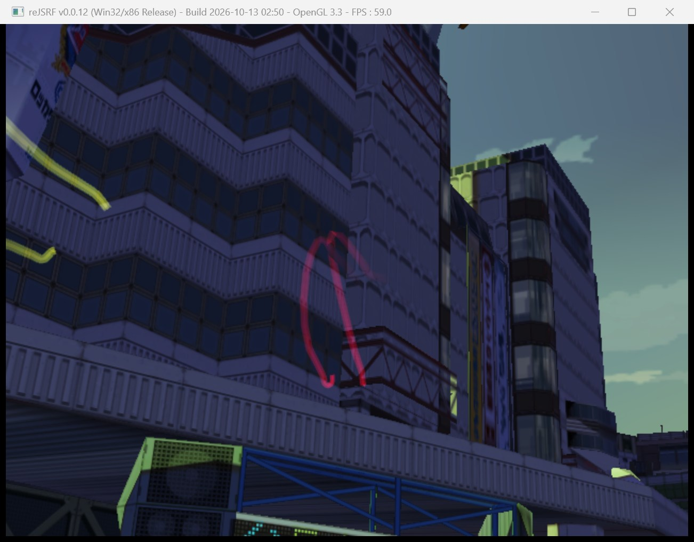
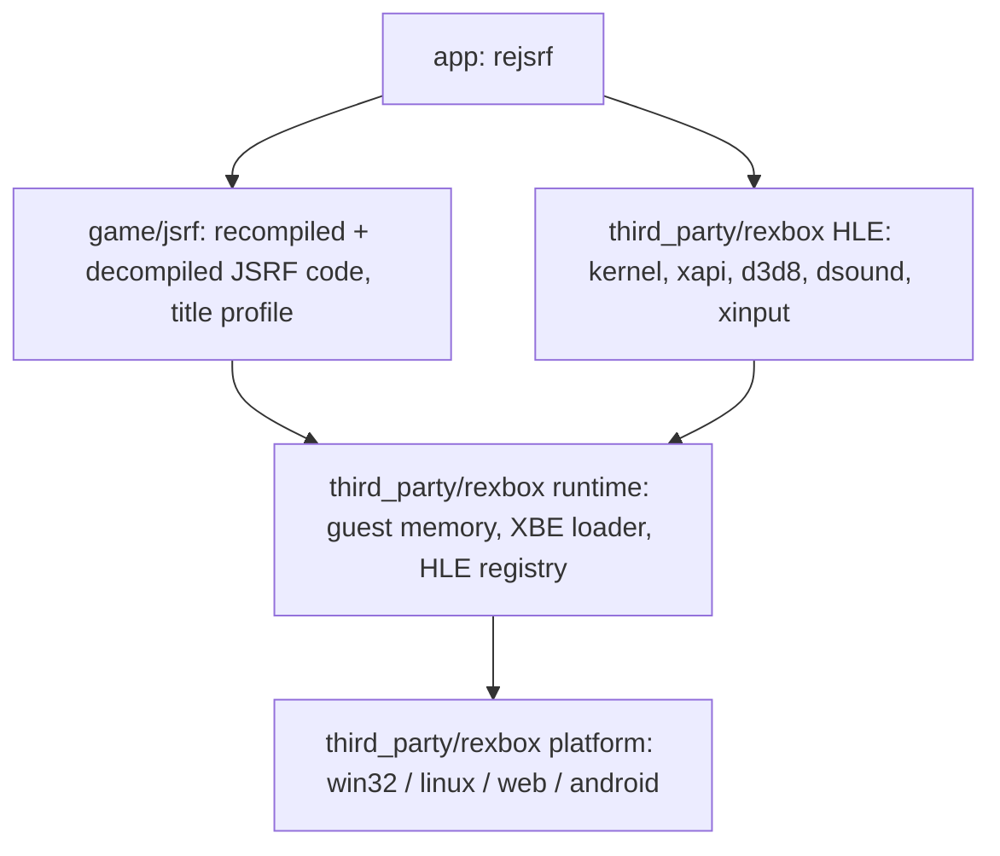

# reJSRF

Xbox 게임 **Jet Set Radio Future**를 정적 재컴파일과 디컴파일로 Win32, Win64, Linux x86, Linux x64, Web, Android에 네이티브 포팅하는 프로젝트입니다.

> **진행 중입니다.** 재컴파일된 US판이 Win32에서 로고 시퀀스(SEGA, Smilebit, ADX, Dolby Digital, 낙서 경고문)를 지나 스테이지를 읽고, 3D 어트랙트 데모를 음악과 함께 그립니다. 캐릭터(정점 셰이더 프로그램)는 아직 그리지 않습니다. 여기까지의 과정: [From XBE to First Screen — Work in Progress 1](docs/post/2026-10-13-031546-from-xbe-to-first-screen-wip.md)



## 게임 데이터는 포함되지 않습니다

이 저장소에는 게임의 실행 파일, 자산, 그리고 실행 파일에서 기계적으로 생성한 코드가 들어 있지 않으며 앞으로도 넣지 않습니다. 직접 소유한 디스크의 덤프를 `roms/`에 두고 사용하세요.

## 구조



* **rexbox**는 타이틀에 의존하지 않는 재사용 가능한 Xbox 런타임입니다. reJSRF 안에서 만들어진 뒤 별도 저장소 [reexec/rexbox](https://github.com/reexec/rexbox)로 분리되었고, reJSRF는 submodule `third_party/rexbox`로 씁니다. [reCT3](https://github.com/reexec/reCT3)(Crazy Taxi 3)도 같은 런타임을 씁니다.
* **game/jsrf**는 원본 x86 코드를 C로 옮긴 재컴파일 코드(로컬 생성)와, 그것을 함수 단위로 대체하는 디컴파일 코드를 담습니다.
* 자세한 내용: [ARCHITECTURE.md](ARCHITECTURE.md), [설계 i001](docs/design/20261012-i001-project-bootstrap.md), [프로젝트 헌장](docs/PROJECT_CHARTER.md)

## 빌드 (Win32)

```powershell
git clone --recurse-submodules https://github.com/nworkers/reJSRF.git
cd reJSRF
# 게임 파일을 roms\Jet Set Radio Future\ 에 두고, 처음 한 번 XDK 식별 도구를 빌드한 뒤 재컴파일 코드를 만든다
.\scripts\build_win32_x86.ps1 -Configuration Release -Target rexbox_xdk_symbols
python scripts\recomp\regenerate.py    # default.xbe가 US판이면 gen\jsrf_us, 일본판이면 gen\jsrf_jp
.\scripts\build_win32_x86.ps1          # US판용. 일본판용은 -Variant jp (build\win32_x86_jp)
.\build\win32_x86\src\app\Debug\rejsrf.exe "roms\Jet Set Radio Future"
```

인자는 디스크에서 추출한 **게임 디렉터리**입니다. 앱은 그 폴더를 게임의 `D:`로 쓰고, Xbox 타이틀의 기본 실행 파일인 `default.xbe`를 읽습니다. 다른 XBE를 읽으려면 `--xbe <파일>`로 지정합니다. 예를 들어 Sega GT와 JSRF를 함께 담은 합본 디스크라면 다음과 같습니다.

```powershell
.\build\win32_x86\src\app\Debug\rejsrf.exe "roms\Jet Set Radio Future" --xbe SegaJSRF.xbe
```

US판과 일본판을 모두 지원합니다. 실행 파일 하나는 한 판만 실행하며, 어느 판으로 빌드할지는 `-Variant us|jp`(CMake `-DREJSRF_VARIANT=jsrf_us|jsrf_jp`)로 정합니다. 판은 파일 이름이 아니라 내용으로 식별합니다(재생성 스크립트는 MD5, 앱은 인증서). 빌드한 판과 다른 XBE를 주면 어느 판으로 빌드해야 하는지 알리고 멈춥니다. 언어(English / Japanese)는 두 판 모두 설정 메뉴의 Game 탭에서 고릅니다.

자세한 절차: [Win32 개발 환경 준비와 빌드](docs/guides/win32-setup-and-build.md)

## 플랫폼 상태

| 플랫폼 | 상태 |
|---|---|
| Win32 x86 | 빌드됨. 로고 시퀀스와 3D 어트랙트 데모를 SDL3/OpenGL 창에 그리고 음악을 낸다(고정 기능 그리기; 프로그래머블 셰이더는 아직) |
| Win64 | 예정 |
| Linux x86 / x64 | 예정 |
| Web (wasm32) | 예정 |
| Android | 예정 |

## 기여와 작업 규칙

[AGENTS.md](AGENTS.md)와 [docs/CODING_STYLE.md](docs/CODING_STYLE.md)를 따릅니다. 규칙은 [reexec/rePIU](https://github.com/reexec/rePIU)를 바탕으로 합니다.

## 참고 프로젝트

[xboxrecomp](https://github.com/sp00nznet/xboxrecomp)(재컴파일 파이프라인), [jsrf-recomp](https://github.com/andeecollard/jsrf-recomp)(JSRF macOS 포트) 등. 목록과 라이선스: [docs/kb/external-references.md](docs/kb/external-references.md), [CREDITS.md](CREDITS.md)

## 라이선스

[MIT](LICENSE). 서드파티 코드: [THIRD_PARTY_NOTICES.md](THIRD_PARTY_NOTICES.md). Jet Set Radio Future는 SEGA의 상표이며, 이 프로젝트는 SEGA 또는 Microsoft와 관련이 없습니다.

---

# reJSRF

A native port of the Xbox game **Jet Set Radio Future** to Win32, Win64, Linux x86, Linux x64, the web and Android through static recompilation and decompilation.

> **Work in progress.** On Win32 the recompiled US build runs the logo sequence (SEGA, Smilebit, ADX, Dolby Digital, the anti-graffiti notice), loads the stage and draws the 3D attract demo with music. Characters (vertex-shader programs) are not drawn yet. How it got here: [From XBE to First Screen — Work in Progress 1](docs/post/2026-10-13-031546-from-xbe-to-first-screen-wip.md)


## No game data included

This repository does not and will not contain the game's executable, its assets, or code mechanically generated from the executable. Put a dump of a disc you own under `roms/`.

## Structure

See the diagram above.

* **rexbox** is a reusable, title-agnostic Xbox runtime. It was built inside reJSRF and split out into its own repository, [reexec/rexbox](https://github.com/reexec/rexbox), which reJSRF uses as the submodule `third_party/rexbox`; [reCT3](https://github.com/reexec/reCT3) (Crazy Taxi 3) uses the same runtime.
* **game/jsrf** holds the recompiled code (the original x86 lifted to C, generated locally) and the decompiled code that replaces it function by function.
* More: [ARCHITECTURE.md](ARCHITECTURE.md), [design i001](docs/design/20261012-i001-project-bootstrap.md), [project charter](docs/PROJECT_CHARTER.md)

## Build (Win32)

See the commands above, and [Win32 development setup and build](docs/guides/win32-setup-and-build.md) for the full procedure. The argument is the **game directory** extracted from the disc. The app serves that folder as the game's `D:` and loads `default.xbe`, an Xbox title's default executable. `--xbe <file>` loads another XBE, for example `--xbe SegaJSRF.xbe` on a disc that carries Sega GT and JSRF together. Before the first build, put the game files under `roms\Jet Set Radio Future\`, build the XDK identification tool once (`-Target rexbox_xdk_symbols`) and generate the recompiled code with `python scripts\recomp\regenerate.py`. The US and Japanese builds are both supported: one executable runs one build, chosen with `-Variant us|jp` (CMake `-DREJSRF_VARIANT=jsrf_us|jsrf_jp`; the Japanese build goes to `build\win32_x86_jp`). Builds are told apart by content, never by file name (MD5 in the scripts, the certificate in the app); an XBE of the other build is explained and stopped. Both builds choose English or Japanese in the settings menu's Game tab.

## Platform status

Win32 x86 builds; it draws the logo sequence and the 3D attract demo in the SDL3/OpenGL window and plays the music (fixed-function drawing; programmable shaders not yet). Win64, Linux x86/x64, the web (wasm32) and Android are planned.

## Contributing and working rules

Follow [AGENTS.md](AGENTS.md) and [docs/CODING_STYLE.md](docs/CODING_STYLE.md). The rules are based on [reexec/rePIU](https://github.com/reexec/rePIU).

## Reference projects

[xboxrecomp](https://github.com/sp00nznet/xboxrecomp) (recompilation pipeline), [jsrf-recomp](https://github.com/andeecollard/jsrf-recomp) (a JSRF macOS port) and others. List and licenses: [docs/kb/external-references.md](docs/kb/external-references.md), [CREDITS.md](CREDITS.md)

## License

[MIT](LICENSE). Third-party code: [THIRD_PARTY_NOTICES.md](THIRD_PARTY_NOTICES.md). Jet Set Radio Future is a trademark of SEGA; this project is not affiliated with SEGA or Microsoft.
