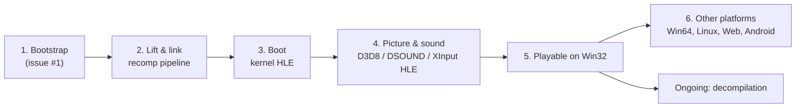

# 프로젝트 헌장

## 목적

reJSRF는 Xbox 게임 Jet Set Radio Future를 정적 재컴파일과 디컴파일로 Win32, Win64, Linux x86, Linux x64, Web, Android에서 네이티브로 실행되게 만든다.

게임 로직은 원본 x86 코드에서 기계적으로 옮긴 코드가 담당하고, 디컴파일은 그 코드를 같은 동작의 읽을 수 있는 코드로 바꿔 간다. C/C++ 런타임은 Xbox 커널, XDK 라이브러리, 하드웨어를 대신하는 HLE와 호스트 플랫폼 서비스에 집중한다.

## Purpose

reJSRF makes the Xbox game Jet Set Radio Future run natively on Win32, Win64, Linux x86, Linux x64, the web and Android through static recompilation and decompilation.

Game logic is carried by code mechanically lifted from the original x86, and decompilation gradually turns that code into readable code of the same behavior. The C/C++ runtime focuses on HLE replacing the Xbox kernel, the XDK libraries and the hardware, and on host platform services.

## 현재 1차 목표

* 1차 타깃 실행 파일은 US판 `default_eng.xbe`(MD5 `f4e366bfdceee551a09f42219c90d84e`)다. 일본 지역판 `default.xbe`는 식별만 한다.
* 1차 호스트는 Win32 x86이다. 어느 정도 진행된 뒤 Win64, Linux x86/x64, Web, Android로 넓힌다.
* 여러 빌드 변형과 다른 타이틀을 염두에 두고, 타이틀 고유 사항은 타이틀 프로파일로 분리한다.

## Current First Target

* The first target executable is the US build `default_eng.xbe` (MD5 `f4e366bfdceee551a09f42219c90d84e`). The Japan-region `default.xbe` is recognized only.
* The first host is Win32 x86. Once the project is well along, it widens to Win64, Linux x86/x64, the web and Android.
* With other build variants and other titles in mind, title specifics are separated into the title profile.

## 방향성

* 재컴파일된 원본 코드를 기준 구현으로 취급한다.
* 에뮬레이터(xemu, Cxbx-Reloaded)를 통합하지 않는다. 동작 비교의 기준으로만 쓴다.
* 재사용 가능한 Xbox 런타임 `rexbox`(XBE, 런타임, HLE 모듈)와 타이틀 코드 `rejsrf`를 분리한다. `rexbox`는 다른 타이틀에서 그대로 쓸 수 있어야 한다.
* HLE는 API 경계(커널 ordinal, XDK 라이브러리 함수)에서 하고, 하드웨어 LLE는 필요한 지점에만 둔다.
* 플랫폼 공용 코어를 먼저 설계하고 OS별 세부 구현은 플랫폼 계층에 둔다.
* 게임 데이터와 그것에서 생성한 코드는 저장소에 넣지 않는다. 사용자가 자기 덤프로 만든다.
* 라이선스는 MIT이며, 전염성 라이선스 코드는 빌드에 넣지 않는다.
* 코드 변경 전에는 설계와 작업 계획을 문서화한다.
* 프로젝트 버전은 `VERSION` 파일의 `major.minor.patch` 형식으로 관리한다.

## Direction

* Treat the recompiled original code as the reference implementation.
* Do not integrate an emulator (xemu, Cxbx-Reloaded); use one only as a reference for comparing behavior.
* Keep the reusable Xbox runtime `rexbox` (XBE, runtime, HLE modules) separate from the title code `rejsrf`. `rexbox` must be usable unchanged by other titles.
* Do HLE at API boundaries (kernel ordinals, XDK library functions), with hardware LLE only where needed.
* Design the shared platform-neutral core first and keep OS specifics in the platform layer.
* Keep game data and code generated from it out of the repository; users build it from their own dump.
* The license is MIT, and copyleft code is not built in.
* Document design and work plans before changing code.
* Manage the project version in the `VERSION` file using `major.minor.patch`.

## 단계

1. 부트스트랩: 규칙, 레이어, Win32 빌드 골격, XBE 분석.
2. 재컴파일 파이프라인 연결: US XBE를 lift해 Win32에서 링크한다.
3. 커널 HLE로 진입점부터 부팅한다.
4. D3D8, DSOUND, XInput HLE로 화면과 소리를 낸다.
5. Win32에서 플레이 가능.
6. Win64, Linux, Web, Android로 확장한다. 디컴파일은 2단계 이후 계속 진행한다.

## Stages

1. Bootstrap: rules, layers, Win32 build skeleton, XBE analysis.
2. Connect the recompilation pipeline: lift the US XBE and link it on Win32.
3. Boot from the entry point on kernel HLE.
4. Picture and sound through D3D8, DSOUND and XInput HLE.
5. Playable on Win32.
6. Widen to Win64, Linux, the web and Android. Decompilation proceeds continuously from stage 2 on.
