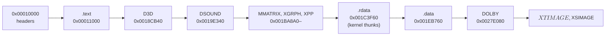

# JSRF XBE 구조와 설계 (한국어)

원본 XBE 분석으로 확인한 구조를 누적한다. 상세 근거와 확인 상태는 [`docs/analysis/`](analysis/README.md)에 있고, 여기에는 설계에 영향을 주는 결론만 모은다. 영어판: [XBE_DESIGN.en.md](XBE_DESIGN.en.md).

## 1. 대상 빌드

* 1차 타깃은 US판 `default_eng.xbe`(지역 1, MD5 `f4e366bf…`)다. 일본 지역판 `default.xbe`는 코드가 달라 주소를 공유하지 않는다. → [jsrf-xbe-overview §1](analysis/jsrf-xbe-overview.md)
* 두 빌드 모두 XDK 4134, title id `5345000A`, 진입점 `0x00148023`.

## 2. 메모리 배치 (US)

* 이미지 끝은 `0x00288620`이다(base + `0x00278620`). 64 MiB guest memory 안에 충분히 들어간다.
* kernel thunk 표는 `.rdata`의 첫 주소 `0x001C3F60`에 있다. 120개 슬롯.

## 3. HLE 설계에 주는 결론

* XDK 라이브러리 코드가 섹션 이름으로 분리되어 있어(`D3D`, `DSOUND`, `XGRPH`, `XPP`), 함수 식별의 범위를 섹션 단위로 좁힐 수 있다.
* HLE 모듈은 XDK 4134 API(렌더 상태 번호 등)에 맞춘다.
* 커널 import 중 인터럽트·장치·GPU 메모리 관련 항목은 D3D8/DSOUND를 API 수준에서 HLE하면 최소 구현으로 충분할 가능성이 있다(**추정**).

## 4. 시작 순서와 커널 구조

* 진입점 `0x148023`은 XAPI 시작 코드다. `CreateThread`(`0x147F53`)로 메인 스레드를 만들고 핸들을 닫은 뒤 반환한다. 메인 스레드는 `SystemRoutine 0x147EBB(StartRoutine 0x147FB4, ctx)`로 시작한다. → [boot-frontier](analysis/boot-frontier.md)
* 게임 코드가 직접 읽는 커널 구조: `fs:[0x28]` 현재 스레드, `fs:[0x20]` Prcb, `fs:[4]` StackBase(TLS 기준), `KTHREAD+0x28` TlsData, `ETHREAD+0x12C` 스레드 ID. TLS는 커널 스택 맨 위에 둔다. → [kb/xbox-kernel-structures](kb/xbox-kernel-structures.md)
* XAPI 초기화는 T:, U:, Z: 드라이브를 준비한다(Z:는 Partition5를 포맷해 사용).
* 함수 탐색이 놓친 함수 10개(`0x0018AFB0`–`0x0018C3C0`)는 seed 파일로 보충한다(`src/game/jsrf/recomp/seed_functions.json`).
