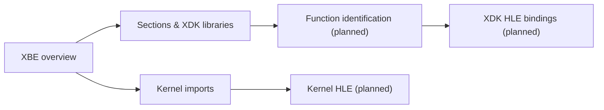

# reJSRF 바이너리 분석 색인

이 디렉터리는 원본 JSRF XBE와 reJSRF 실행 결과에서 직접 확인한 프로젝트 고유 사실을 주제별로 누적한다. 시간순 작업 증거는 `docs/work-logs/`에 남기고, 여기에는 현재 유효한 결론을 통합한다.

표기 기준:

* **확인됨**: 정적 분석, 바이트 덤프, 반복 실행 또는 코드로 직접 검증
* **추정**: 관측·정황·외부 프로젝트의 보고와 일치하지만 우리 바이너리에서 더 확인해야 함
* **미확정**: 다음 분석에서 검증해야 할 가설 또는 blocker

## 문서

* [JSRF XBE 개요: 빌드 변형, 섹션, XDK 라이브러리, 커널 import, 디스크 자산](jsrf-xbe-overview.md)

---

# reJSRF Binary Analysis Index

This directory accumulates project-specific facts confirmed directly from the original JSRF XBE and from running reJSRF, by topic. Chronological evidence stays in `docs/work-logs/`; current conclusions are consolidated here.

Labels:

* **Confirmed**: verified directly by static analysis, byte dumps, repeated runs or code
* **Inferred**: consistent with observation, circumstance or another project's report, but still to be checked on our binary
* **Unresolved**: a hypothesis or blocker for the next analysis

## Documents

* [JSRF XBE overview: build variants, sections, XDK libraries, kernel imports, disc assets](jsrf-xbe-overview.md)
