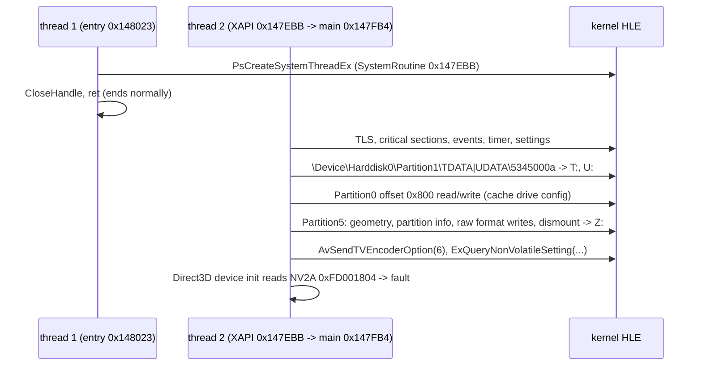

# 부팅 frontier

재컴파일된 US 빌드를 진입점부터 실행했을 때 어디까지 가는지 기록한다. 작업마다 갱신하며, 지난 frontier는 아래 이력에 남긴다.

This records how far the recompiled US build gets when run from its entry point. It is updated by each task; earlier frontiers stay in the history below.

## 현재 / Current (issue #3, 2026-10-12)

| 항목 / Item | 값 / Value |
|---|---|
| 생성 코드 / Generated code | xboxrecomp v0.13.1, seed 10개 / 10 seeds, 함수 8,721개 / functions |
| 커널 / Kernel | export 103개, import 120개 중 106개 바인딩 / 103 exports, 106 of 120 imports bound |
| 실행 결과 / Outcome | **thread 2(게임 메인)가 D3D8 초기화에서 NV2A 레지스터 `0xFD001804`를 읽다 fault / thread 2 (game main) faults reading NV2A register `0xFD001804` during D3D8 initialization** |
| 시간 / Time | 약 1.7초(Debug) / about 1.7 s (Debug) |
| 레지스터 / Registers | ecx = esi = `0019D468`(D3D 섹션 안의 디바이스 객체 / device object inside the D3D section), eax `0019D638`, edx `00007F7F` |

### 확인된 부팅 순서 / Confirmed boot sequence

* **확인됨**: 진입 스레드는 메인 스레드를 만든 뒤 정상 종료한다(eax 1). 게임 메인 스레드는 XAPI 초기화(T:, U:, Z: 드라이브 준비 포함)를 마치고 D3D8 초기화로 들어간다.
* **확인됨**: 파티션을 장치 이름으로 열면 XAPI는 그 볼륨에 원시 섹터를 써서 포맷한다. HLE는 이 쓰기를 버리는 볼륨 객체로 받아들인다(파일은 호스트 디렉터리에 있으므로 FATX 구조가 필요 없다).
* **확인됨**: seed 없이 생성한 코드에서는 `0x0018AFB0`부터 `0x0018C3C0`까지 10개 주소가 함수로 탐지되지 않아, 부팅 중 그곳으로 가는 간접 호출이 건너뛰어졌다. `src/game/jsrf/recomp/seed_functions.json`으로 탐지시켜 해결했다.
* **확인됨**: fault 주소는 게스트 `0xFD001804`(NV2A MMIO, 64 MiB RAM 밖)다. Win32에서는 base만큼 wrap되어 호스트의 할당되지 않은 주소에 닿아 fault로 드러났다(운이 좋은 경우다; 설계 i003 §6).
* **추정**: D3D8 디바이스 생성(`Direct3D_CreateDevice` 계열)이 GPU를 초기화하는 지점이다. 다음 task는 D3D8을 API 수준에서 HLE해 이 경로를 대체하는 것이다(i001 §4).
* **미확정**: 정확히 어느 D3D 함수인지(레지스터 base를 디바이스 객체에서 읽으므로 정적 grep으로는 나오지 않는다). D3D8 함수 식별 task에서 특정한다.
* **미확정**: KeSetTimer로 건 타이머와 KeInsertQueueDpc로 넣은 DPC는 아직 실행되지 않는다. 이것에 기대는 코드가 있는지는 D3D·DSOUND HLE 뒤에 다시 본다.

* **Confirmed**: the entry thread creates the main thread and ends normally (eax 1). The game's main thread completes XAPI initialization (including preparing the T:, U: and Z: drives) and enters D3D8 initialization.
* **Confirmed**: opening a partition by its device name, XAPI formats the volume by writing raw sectors to it; the HLE accepts them through a volume object that drops them (files live in host directories, so no FATX structures are needed).
* **Confirmed**: code generated without seeds missed the 10 functions from `0x0018AFB0` to `0x0018C3C0`, so indirect calls to them were skipped during boot. `src/game/jsrf/recomp/seed_functions.json` makes the disassembler find them.
* **Confirmed**: the fault address is guest `0xFD001804` (NV2A MMIO, outside the 64 MiB RAM). On Win32 it wrapped by the base onto an unallocated host address and so showed up as a fault (the lucky case; design i003 §6).
* **Inferred**: this is D3D8 device creation (the `Direct3D_CreateDevice` family) initializing the GPU. The next task replaces this path with an API-level D3D8 HLE (i001 §4).
* **Unresolved**: exactly which D3D function (it reads the register base from the device object, so a static grep does not find it); pinned down by the D3D8 function-identification task.
* **Unresolved**: timers armed with KeSetTimer and DPCs queued with KeInsertQueueDpc never run yet; whether any code depends on them is revisited after the D3D and DSOUND HLE.

## 이력 / History

| issue | frontier |
|---|---|
| #2 | 첫 실행: 미구현 커널 import 255 `PsCreateSystemThreadEx` / first run: unimplemented kernel import 255 `PsCreateSystemThreadEx` |
| #3 | `NtOpenFile` → `HalReturnToFirmware`(Partition0 없음) → D3D8의 NV2A `0xFD001804` 읽기 / `NtOpenFile` → `HalReturnToFirmware` (no Partition0) → D3D8 reading NV2A `0xFD001804` |
