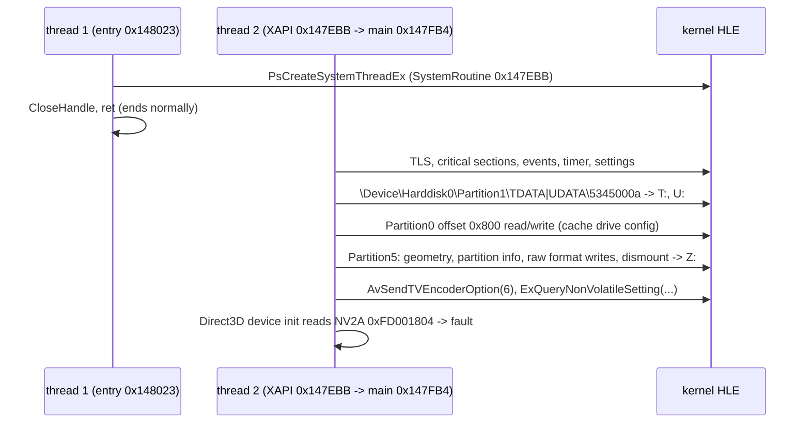

# 부팅 frontier

재컴파일된 US 빌드를 진입점부터 실행했을 때 어디까지 가는지 기록한다. 작업마다 갱신하며, 지난 frontier는 아래 이력에 남긴다.

This records how far the recompiled US build gets when run from its entry point. It is updated by each task; earlier frontiers stay in the history below.

## 현재 / Current (issue #17, 2026-10-12)

| 항목 / Item | 값 / Value |
|---|---|
| 생성 코드 / Generated code | 함수 9,015개(포인터로만 참조되는 함수 162개 seed 뒤 +163), 미해결 스텁 105개, XDK override 258개(D3D8·D3D8LTCG 라이브러리 197 + 선택 함수 61: XAPILIB 11, DSOUND 50), XDK 변수 43개 / 9,015 functions (+163 after seeding 162 pointer-only functions), 105 unresolved stubs, 258 XDK overrides (197 from the D3D8 and D3D8LTCG libraries + 61 selected functions: 11 XAPILIB, 50 DSOUND), 43 XDK variables |
| 실행 결과 / Outcome | **`DirectSoundCreate`(HLE, 호스트 오디오 48 kHz)를 지나 게임 스레드 4개가 돈다. 주 스레드가 `D:\Media\Sounds\dsstdfx.bin`을 완료 루틴(`NtReadFile`의 `ApcRoutine`)과 함께 읽고 이벤트를 기다리며 멈춘다(사용자 APC 미전달) / past `DirectSoundCreate` (HLE, host audio at 48 kHz), four game threads run; the main thread reads `D:\Media\Sounds\dsstdfx.bin` with a completion routine (`NtReadFile`'s `ApcRoutine`) and stops waiting for an event (user APCs are not delivered)** |

* **확인됨**: DSOUND HLE가 APU 접근을 없앤다. `DirectSoundCreate` 다음 lift된 `DirectSoundUseFullHRTF`, `SetCooperativeLevel`/`Compact` 꼴 스텁이 문제없이 돈다([dsound §5](dsound.md)).
* **확인됨**: 그 뒤 게임이 부르는 스레드 루틴 4개(`0x0013B180` 등, `push offset`으로만 참조)와 파일 읽기 메서드 `0x00178F40`(vtable)이 lift되지 않아 건너뛰어졌다. `scripts/recomp/find_pointer_targets.py`가 `.text`의 16바이트 정렬·패딩 뒤 함수 시작 중 데이터나 즉시값으로만 참조되는 162개를 찾아 `seed_pointer_targets.json`에 넣었고, 이제 건너뛴 간접 호출은 0건이다.
* **확인됨**: 현재 정지점은 커널의 사용자 APC다. XAPI의 비동기 파일 읽기(`ReadFileEx` 계열)는 `NtReadFile`에 완료 루틴을 넘기고, 경고 가능 대기에서 그 루틴이 실행되기를 기다린다. 커널 HLE는 I/O를 동기로 끝내지만 APC를 큐에 넣거나 전달하지 않는다(`NtUserIoApcDispatcher` ordinal 232도 미구현).
* **미확정**: 다음 task는 사용자 APC(`NtReadFile`/`NtWriteFile`의 `ApcRoutine`, `NtQueueApcThread`, 경고 가능 대기의 `STATUS_USER_APC`). 그 뒤 효과 이미지 다운로드와 버퍼 생성, 첫 `D3DDevice_Swap`.
* **Confirmed**: the DSOUND HLE removes the APU accesses; after `DirectSoundCreate`, the lifted `DirectSoundUseFullHRTF` and the `SetCooperativeLevel`/`Compact`-shaped stubs run fine ([dsound §5](dsound.md)).
* **Confirmed**: the four thread routines the game then starts (`0x0013B180` and others, referenced only by `push offset`) and the file-read method `0x00178F40` (a vtable slot) were not lifted and were skipped. `scripts/recomp/find_pointer_targets.py` finds the 162 16-byte-aligned, padding-preceded function starts in `.text` that are referenced only from data or immediates and writes them to `seed_pointer_targets.json`; no indirect call is skipped now.
* **Confirmed**: the current stop is the kernel's user APCs. XAPI's asynchronous file reads (the `ReadFileEx` family) pass a completion routine to `NtReadFile` and wait, alertably, for it to run; the kernel HLE completes the I/O synchronously but neither queues nor delivers the APC (`NtUserIoApcDispatcher`, ordinal 232, is not implemented either).
* **Unresolved**: the next task is user APCs (`NtReadFile`/`NtWriteFile` `ApcRoutine`, `NtQueueApcThread`, `STATUS_USER_APC` from alertable waits); then the effects image download, buffer creation, and the first `D3DDevice_Swap`.

## 이력 / History

| issue | frontier |
|---|---|
| #2 | 첫 실행: 미구현 커널 import 255 `PsCreateSystemThreadEx` / first run: unimplemented kernel import 255 `PsCreateSystemThreadEx` |
| #3 | `NtOpenFile` → `HalReturnToFirmware`(Partition0 없음) → D3D8의 NV2A `0xFD001804` 읽기 / `NtOpenFile` → `HalReturnToFirmware` (no Partition0) → D3D8 reading NV2A `0xFD001804` |
| #6 | 첫 D3D8 API `Direct3D_GetAdapterCount` / the first D3D8 API, `Direct3D_GetAdapterCount` |
| #7 | `Direct3D_CreateDevice` 통과(SDL3 창), `D3DDevice_GetBackBuffer` / past `Direct3D_CreateDevice` (SDL3 window), `D3DDevice_GetBackBuffer` |
| #12 | D3D8 초기화·게임 객체 생성 통과, 커널 import 65 `IoCreateDevice` / past D3D8 initialization and object setup, kernel import 65 `IoCreateDevice` |
| #15 | 입력·폰트·셰이더 생성 통과, `DirectSoundCreate`의 APU `0xFE801100` / past input, font and shader creation, APU `0xFE801100` in `DirectSoundCreate` |
| #17 | `DirectSoundCreate`(HLE) 통과, `dsstdfx.bin` 읽기의 사용자 APC 대기 / past `DirectSoundCreate` (HLE), waiting for the user APC of the `dsstdfx.bin` read |

### issue #15 frontier 상세 / issue #15 frontier details

| 항목 / Item | 값 / Value |
|---|---|
| 생성 코드 / Generated code | 함수 8,852개(디스어셈블러 수정 뒤 +117), 미해결 스텁 109개(184에서), XDK override 147개(D3D8 136 + XAPILIB 11), XDK 변수 43개 바인딩 / 8,852 functions (+117 after the disassembler fix), 109 unresolved stubs (from 184), 147 XDK overrides (136 D3D8 + 11 XAPILIB), 43 XDK variables bound |
| 실행 결과 / Outcome | **입력 초기화, 폰트 텍스처, 정점 셰이더 154개, 픽셀 셰이더 11개, 버퍼 생성을 지나 thread 2가 `DirectSoundCreate`(`0x001A0D9C`) 안에서 MCPX APU 레지스터 `0xFE801100`을 읽다 fault / past input initialization, the font texture, 154 vertex shaders, 11 pixel shaders and buffers, thread 2 faults reading MCPX APU register `0xFE801100` inside `DirectSoundCreate` (`0x001A0D9C`)** |

* **확인됨**: XAPI 입력 API를 HLE로 바꾸자 `IoCreateDevice` 등 I/O 관리자 export는 더 이상 닿지 않는다. 게임의 DirectInput식 열거는 `XGetDeviceChanges`(FALSE) → `XGetDevices`(포트 0) → `XInputOpen` → `XInputGetCapabilities` → `XInputPoll` → `XInputGetState` 순서다([xdk-symbols §4](xdk-symbols.md)).
* **확인됨**: 게임 객체 생성 실패의 원인은 두 가지였다. (1) 게임패드가 `XInitDevices` 직후 "변경 대기"로 보이면 열거가 `E_FAIL`을 돌려준다. (2) xboxrecomp 디스어셈블러가 별칭 본문의 분기 대상(`0x00154DAA`)을 놓쳐 미해결 스텁이 되어 스택이 12바이트 어긋났다(업스트림 PR [#199](https://github.com/sp00nznet/xboxrecomp/pull/199)). 둘 다 고친 뒤 건너뛴 간접 호출은 0건이다.
* **확인됨**: XAPI는 `D:\…` 파일을 `RootDirectory = ObDosDevicesDirectory()`(`0xFFFFFFFD`)로 열고, 이름 있는 객체는 `0xFFFFFFFC`로 연다. 커널 HLE가 이 의사 핸들을 해석하게 되어 `D:\Media\Font\TNRoman.bin`이 열린다.
* **미확정**: DSOUND HLE(다음 task). 그 뒤 첫 `D3DDevice_Swap`.
* **Confirmed**: with the XAPI input API on HLE, the I/O-manager exports (`IoCreateDevice`, …) are no longer reached. The game's DirectInput-style enumeration runs `XGetDeviceChanges` (FALSE) → `XGetDevices` (port 0) → `XInputOpen` → `XInputGetCapabilities` → `XInputPoll` → `XInputGetState` ([xdk-symbols §4](xdk-symbols.md)).
* **Confirmed**: the game's object creation failed for two reasons: (1) its enumeration returns `E_FAIL` when the gamepad shows as a pending change right after `XInitDevices`; (2) the xboxrecomp disassembler missed a branch target of an alias body (`0x00154DAA`), which became an unresolved stub and left the stack 12 bytes off (upstream PR [#199](https://github.com/sp00nznet/xboxrecomp/pull/199)). With both fixed, no indirect call is skipped.
* **Confirmed**: XAPI opens `D:\…` files with `RootDirectory = ObDosDevicesDirectory()` (`0xFFFFFFFD`) and named objects with `0xFFFFFFFC`; the kernel HLE now resolves these pseudo-handles, and `D:\Media\Font\TNRoman.bin` opens.
* **Unresolved**: the DSOUND HLE (next task), then the first `D3DDevice_Swap`.

### issue #12 frontier 상세 / issue #12 frontier details

| 항목 / Item | 값 / Value |
|---|---|
| 생성 코드 / Generated code | 함수 8,721개, D3D8 override 136개, D3D8 HLE export 110개, lifter 수정(`lock xadd` 플래그) 포함 / 8,721 functions, 136 D3D8 overrides, 110 D3D8 HLE exports, lifter fix (`lock xadd` flags) |
| 실행 결과 / Outcome | **D3D8 초기화와 게임 객체 생성을 지나 thread 2가 미구현 커널 import 65 `IoCreateDevice`에서 정지 (약 5초) / past D3D8 initialization and the game's object setup, thread 2 stops at the unimplemented kernel import 65 `IoCreateDevice` (about 5 s)** |

* **확인됨**: 게임의 COM 식 `Release`(`lock xadd [obj+8], -1; jne`)가 lifter 버그(`lock xadd`를 플래그 미정의로 취급 → `jne`가 항상 거짓)로 매번 파괴 경로를 타 객체를 두 번 해제했고, XAPI NT 힙의 `FreeLists` 체인이 순환해 `RtlAllocateHeap`이 멈췼다. 진단: `REXBOX_WATCHDOG`의 직접 호출 프로파일, `REXBOX_HEAP_CHECK`, 메모리 덤프 분석. 수정은 업스트림 PR [xboxrecomp#198](https://github.com/sp00nznet/xboxrecomp/pull/198).
* **확인됨**(해결): XPP 섹션의 `0x001BD274`는 USB 클래스 드라이버 표(`0x001BC970`)의 초기화 함수로, `KeInitializeTimerEx(0x002649A8, NotificationTimer)`를 부른다. 프롤로그 없이 `ret` 바로 뒤에 있어 탐지되지 않았고 간접 호출이 건너뛰어졌다. 같은 XPP 드라이버 표에서만 참조되는 FPO 함수 8개와 함께 seed로 추가해 해결했다([xdk-symbols §3](xdk-symbols.md)).
* **확인됨**: `IoCreateDevice`는 XAPI `MU_Init`(`0x001BC98C`, `XInitDevices`가 부름)의 `0x001BCA34`에서 호출된다. 메모리 유닛 장치 객체 생성이다.
* **미확정**: `IoCreateDevice` 뒤에 USB 장치 계층(XPP)이 요구하는 커널 서비스. 첫 `D3DDevice_Swap`은 아직 도달하지 않았다.
* **Confirmed**: the game's COM-style `Release` (`lock xadd [obj+8], -1; jne`) took the destroy arm every time because the lifter treated `lock xadd` as leaving undefined flags (the `jne` was always false), freeing objects twice; XAPI's NT heap `FreeLists` chain became circular and `RtlAllocateHeap` spun. Diagnosed with the `REXBOX_WATCHDOG` direct-call profile, `REXBOX_HEAP_CHECK` and a memory dump; fixed upstream in [xboxrecomp#198](https://github.com/sp00nznet/xboxrecomp/pull/198).
* **Confirmed** (resolved): `0x001BD274` in the XPP section is the init function of a USB class-driver table (`0x001BC970`) and calls `KeInitializeTimerEx(0x002649A8, NotificationTimer)`. It starts right after a `ret` with no prologue, so it was not detected and the indirect call to it was skipped. It was seeded together with eight more FPO functions referenced only from the same XPP driver tables ([xdk-symbols §3](xdk-symbols.md)).
* **Confirmed**: `IoCreateDevice` is called at `0x001BCA34` in XAPI's `MU_Init` (`0x001BC98C`, called by `XInitDevices`): creating the memory-unit device object.
* **Unresolved**: the kernel services the USB device layer (XPP) needs after `IoCreateDevice`. The first `D3DDevice_Swap` has not been reached.

### issue #7 frontier 상세 / issue #7 frontier details

| 항목 / Item | 값 / Value |
|---|---|
| 생성 코드 / Generated code | 함수 8,721개, D3D8 override 136개, D3D8 HLE export 8개 / 8,721 functions, 136 D3D8 overrides, 8 D3D8 HLE exports |
| 실행 결과 / Outcome | `Direct3D_CreateDevice`가 SDL3 창(640×480, OpenGL 3.3)을 열고 성공한 뒤, thread 2가 `D3DDevice_GetBackBuffer`(`0x0018D620`)에서 정지 / `Direct3D_CreateDevice` succeeds, opening an SDL3 window (640×480, OpenGL 3.3), then thread 2 stops at `D3DDevice_GetBackBuffer` (`0x0018D620`) |

* **확인됨**: 어댑터·모드·Caps 질의 8개의 HLE 답은 원본과 일치한다(`rejsrf_d3d8_check` 12,202 케이스). 게임은 640×480 `D3DFMT_LIN_R5G6B5`, 백버퍼 2개, 깊이 `LIN_D24S8`, `D3DCREATE_HARDWARE_VERTEXPROCESSING`으로 디바이스를 만든다([d3d8-adapter §5](d3d8-adapter.md)).
* **Confirmed**: the HLE answers of the eight adapter, mode and caps queries match the originals (`rejsrf_d3d8_check`, 12,202 cases); the game creates its device at 640×480 `D3DFMT_LIN_R5G6B5` with 2 back buffers, a `LIN_D24S8` depth buffer and `D3DCREATE_HARDWARE_VERTEXPROCESSING` ([d3d8-adapter §5](d3d8-adapter.md)).

### issue #6 frontier 상세 / issue #6 frontier details

| 항목 / Item | 값 / Value |
|---|---|
| 생성 코드 / Generated code | 함수 8,721개, D3D8 override 136개 / 8,721 functions, 136 D3D8 overrides |
| 실행 결과 / Outcome | thread 2가 첫 D3D8 API `Direct3D_GetAdapterCount`(`0x00199820`)에서 정지 / thread 2 stops at the first D3D8 API, `Direct3D_GetAdapterCount` (`0x00199820`) |

* **확인됨**: D3D8 함수가 모두 HLE 진입점으로 가므로 NV2A 직접 접근 fault는 나지 않는다. 진단 모드에서 원본을 돌리면 `Direct3D_CreateDevice` → `CMiniport_InitHardware`가 `0xFD001804`를 읽는다. 호출 순서는 [xdk-symbols](xdk-symbols.md) §2.
* **Confirmed**: every D3D8 function enters the HLE, so the direct NV2A fault no longer happens; running the originals in diagnostic mode shows `Direct3D_CreateDevice` → `CMiniport_InitHardware` reading `0xFD001804` (call order in [xdk-symbols](xdk-symbols.md) §2).

### issue #3 frontier 상세 / issue #3 frontier details

| 항목 / Item | 값 / Value |
|---|---|
| 생성 코드 / Generated code | xboxrecomp v0.13.1, seed 10개 / 10 seeds, 함수 8,721개 / functions |
| 커널 / Kernel | export 103개, import 120개 중 106개 바인딩 / 103 exports, 106 of 120 imports bound |
| 실행 결과 / Outcome | **thread 2(게임 메인)가 D3D8 초기화에서 NV2A 레지스터 `0xFD001804`를 읽다 fault / thread 2 (game main) faults reading NV2A register `0xFD001804` during D3D8 initialization** |
| 시간 / Time | 약 1.7초(Debug) / about 1.7 s (Debug) |
| 레지스터 / Registers | ecx = esi = `0019D468`(D3D 섹션 안의 디바이스 객체 / device object inside the D3D section), eax `0019D638`, edx `00007F7F` |

### 확인된 부팅 순서 / Confirmed boot sequence

* **확인됨**: 진입 스레드는 메인 스레드를 만든 뒤 정상 종료한다(eax 1). 게임 메인 스레드는 XAPI 초기화(T:, U:, Z: 드라이브 준비 포함)를 마치고 D3D8 초기화로 들어간다.
* **확인됨**: 파티션을 장치 이름으로 열면 XAPI는 그 볼륨에 원시 섹터를 써서 포맷한다. HLE는 이 쓰기를 버리는 볼륨 객체로 받아들인다(파일은 호스트 디렉터리에 있으므로 FATX 구조가 필요 없다).
* **확인됨**: seed 없이 생성한 코드에서는 `0x0018AFB0`부터 `0x0018C3C0`까지 10개 주소가 함수로 탐지되지 않아, 부팅 중 그곳으로 가는 간접 호출이 건너뛰어졌다. `src/game/jsrf/recomp/seed_functions.json`으로 탐지시켜 해결했다.
* **확인됨**: fault 주소는 게스트 `0xFD001804`(NV2A MMIO, 64 MiB RAM 밖)다. Win32에서는 base만큼 wrap되어 호스트의 할당되지 않은 주소에 닿아 fault로 드러났다(운이 좋은 경우다; 설계 i003 §6).
* **추정**: D3D8 디바이스 생성(`Direct3D_CreateDevice` 계열)이 GPU를 초기화하는 지점이다. 다음 task는 D3D8을 API 수준에서 HLE해 이 경로를 대체하는 것이다(i001 §4).
* **미확정**: 정확히 어느 D3D 함수인지(레지스터 base를 디바이스 객체에서 읽으므로 정적 grep으로는 나오지 않는다). D3D8 함수 식별 task에서 특정한다.
* **미확정**: KeSetTimer로 건 타이머와 KeInsertQueueDpc로 넣은 DPC는 아직 실행되지 않는다. 이것에 기대는 코드가 있는지는 D3D·DSOUND HLE 뒤에 다시 본다.

* **Confirmed**: the entry thread creates the main thread and ends normally (eax 1). The game's main thread completes XAPI initialization (including preparing the T:, U: and Z: drives) and enters D3D8 initialization.
* **Confirmed**: opening a partition by its device name, XAPI formats the volume by writing raw sectors to it; the HLE accepts them through a volume object that drops them (files live in host directories, so no FATX structures are needed).
* **Confirmed**: code generated without seeds missed the 10 functions from `0x0018AFB0` to `0x0018C3C0`, so indirect calls to them were skipped during boot. `src/game/jsrf/recomp/seed_functions.json` makes the disassembler find them.
* **Confirmed**: the fault address is guest `0xFD001804` (NV2A MMIO, outside the 64 MiB RAM). On Win32 it wrapped by the base onto an unallocated host address and so showed up as a fault (the lucky case; design i003 §6).
* **Inferred**: this is D3D8 device creation (the `Direct3D_CreateDevice` family) initializing the GPU. The next task replaces this path with an API-level D3D8 HLE (i001 §4).
* **Unresolved**: exactly which D3D function (it reads the register base from the device object, so a static grep does not find it); pinned down by the D3D8 function-identification task.
* **Unresolved**: timers armed with KeSetTimer and DPCs queued with KeInsertQueueDpc never run yet; whether any code depends on them is revisited after the D3D and DSOUND HLE.
