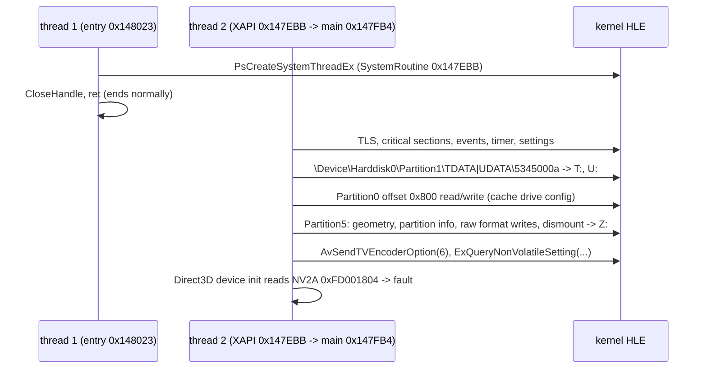

# 부팅 frontier

재컴파일된 US 빌드를 진입점부터 실행했을 때 어디까지 가는지 기록한다. 작업마다 갱신하며, 지난 frontier는 아래 이력에 남긴다.

This records how far the recompiled US build gets when run from its entry point. It is updated by each task; earlier frontiers stay in the history below.

## 현재 / Current (issue #40, 2026-10-13)

| 항목 / Item | 값 / Value |
|---|---|
| 그리기 / Drawing | 고정 기능, 정점 셰이더 프로그램(NV2A 마이크로코드 → GLSL), 레지스터 컴바이너 픽셀 셰이더 / fixed function, vertex-shader programs (NV2A microcode to GLSL), register-combiner pixel shaders |
| 실행 결과 / Outcome | **로고 시퀀스 뒤 3D 어트랙트 데모에 도시, 차량, 캐릭터(스케이터, 행인)가 그려진다. 데모 구간은 Release에서 초당 21~39프레임이다(그리기 250~480개; Intel HD Graphics 620, [설계 i040](../design/20261013-i040-draw-performance.md)). 아직 그리지 않거나 근사하는 것: 안개, `BUMPENVMAP` 등 dot/bump 텍스처 모드, `Begin`/`End` 즉시 모드, 고정 기능 조명, 텍스처 변환·좌표 생성 / after the logo sequence, the 3D attract demo draws the city, vehicles and characters (skaters, pedestrians); the demo runs at 21–39 frames per second in Release (250–480 draws; Intel HD Graphics 620, [design i040](../design/20261013-i040-draw-performance.md)). Not drawn or approximated yet: fog, dot and bump texture modes such as `BUMPENVMAP`, `Begin`/`End` immediate mode, fixed-function lighting, texture transforms and coordinate generation** |

* **확인됨**: 캐릭터가 없던 원인은 데모 그리기의 약 40%를 차지하는 정점 셰이더 프로그램 그리기를 HLE가 건너뛴 것이었다. 캐릭터 몸체는 픽셀 셰이더 1·4번과 함께 그려진다([설계 i037](../design/20261013-i037-vertex-shader-programs.md), [d3d8 §10](d3d8-adapter.md)).
* **미확정**: 가까운 캐릭터 몇이 청록 단색에 가까운 프레임(3,400)이 원본과 같은지. 60프레임까지 남은 시간의 대부분은 그리기 경로 밖(게임 코드와 다른 HLE 호출, 프레임당 약 12.7 ms)에 있다([작업 로그 i040](../work-logs/20261013-i040-draw-performance.md)).
* **Confirmed**: the characters were missing because the HLE skipped vertex-shader program draws, about 40% of the demo's draws; character bodies are drawn with pixel shaders 1 and 4 ([design i037](../design/20261013-i037-vertex-shader-programs.md), [d3d8 §10](d3d8-adapter.md)).
* **Unresolved**: whether the frame (3,400) with a few close characters in nearly flat teal matches the original; most of the time still between the demo and 60 frames per second lies outside the draw path (the title's code and the other HLE calls, about 12.7 ms per frame; [work log i040](../work-logs/20261013-i040-draw-performance.md)).

## 이력 / History

| issue | frontier |
|---|---|
| #2 | 첫 실행: 미구현 커널 import 255 `PsCreateSystemThreadEx` / first run: unimplemented kernel import 255 `PsCreateSystemThreadEx` |
| #3 | `NtOpenFile` → `HalReturnToFirmware`(Partition0 없음) → D3D8의 NV2A `0xFD001804` 읽기 / `NtOpenFile` → `HalReturnToFirmware` (no Partition0) → D3D8 reading NV2A `0xFD001804` |
| #6 | 첫 D3D8 API `Direct3D_GetAdapterCount` / the first D3D8 API, `Direct3D_GetAdapterCount` |
| #7 | `Direct3D_CreateDevice` 통과(SDL3 창), `D3DDevice_GetBackBuffer` / past `Direct3D_CreateDevice` (SDL3 window), `D3DDevice_GetBackBuffer` |
| #12 | D3D8 초기화·게임 객체 생성 통과, 커널 import 65 `IoCreateDevice` / past D3D8 initialization and object setup, kernel import 65 `IoCreateDevice` |
| #15 | 입력·폰트·셰이더 생성 통과, `DirectSoundCreate`의 APU `0xFE801100` / past input, font and shader creation, APU `0xFE801100` in `DirectSoundCreate` |
| #17 | `DirectSoundCreate`(HLE) 통과, `dsstdfx.bin` 읽기의 사용자 APC 대기 / past `DirectSoundCreate` (HLE), waiting for the user APC of the `dsstdfx.bin` read |
| #19 | 사용자 APC 전달, 효과 이미지·버퍼 생성·첫 `D3DDevice_Swap`·폰트·효과음 버퍼 통과, `D3DVertexBuffer_Lock` 뒤 `0x0FE80026` fault / user APCs delivered; past the effects image, buffer creation, the first `D3DDevice_Swap`, fonts and sound-effect buffers, fault at `0x0FE80026` after `D3DVertexBuffer_Lock` |
| #21 | 노드 순회 fault 해결(xboxrecomp #200), 프레임 루프가 계속 돎, 그리기·`Play` 없음 / node-walk fault fixed (xboxrecomp #200); the frame loop keeps running, no drawing or `Play` yet |
| #23 | 고정 기능 그리기(GL), 60 Hz 페이싱, "Presented by SEGA" 로고 표시 뒤 로고에 머묾 / fixed-function drawing on GL, 60 Hz pacing; shows the "Presented by SEGA" logo and stays on it |
| #27 | `FCMOVcc` lift; 로고 시퀀스 완료, 스테이지 로드 중 게스트 메모리 부족 / `FCMOVcc` lifted; the logo sequence completes, guest memory runs out while loading the stage |
| #29 | 게스트 주소 공간 128 MiB와 slab; 스테이지 로드 통과, 3D 어트랙트 데모 / a 128 MiB guest address space and slabs; past the stage load, the 3D attract demo |
| #37 | 정점 셰이더 프로그램과 컴바이너 픽셀 셰이더; 오프닝에 캐릭터가 그려짐 / vertex-shader programs and combiner pixel shaders; the opening draws the characters |
| #40 | 그리기 경로의 GL 상태·버퍼 캐시; 데모가 초당 8~10에서 21~39프레임으로 / GL state and buffer caches in the draw path; the demo goes from 8–10 to 21–39 frames per second |
| #44 | xboxrecomp XMM 도우미의 SSE2 intrinsic; 데모 프레임 CPU 시간 약 12% 감소(그 뒤 선택 사항, 기본 끔) / SSE2 intrinsics for xboxrecomp's XMM helpers; demo frame CPU time about 12% lower (later optional, off by default) |
| #46 | D3D8 변경 감지에 게스트 메모리 쓰기 감시(8 KiB 이상 범위), 상수 버전, 보고·렌더 타깃 조회 정리; 데모 프레임 CPU 시간 약 11% 감소 / write watching on guest memory for D3D8 change detection (ranges of 8 KiB or more), constant versions, cheaper reports and render-target lookups; demo frame CPU time about 11% lower |
| #48 | 게스트 MXCSR과 `stmxcsr`/`ldmxcsr` lift, `CVTSS2SI` 반올림; 매 프레임의 미번역 경고 사라짐 / guest MXCSR, `stmxcsr`/`ldmxcsr` lifted, `CVTSS2SI` rounding; the per-frame untranslated warning is gone |

### issue #29 frontier 상세 / issue #29 frontier details

| 항목 / Item | 값 / Value |
|---|---|
| 게스트 메모리 / Guest memory | 주소 공간 128 MiB: 아래 64 MiB 물리 RAM, 위 64 MiB 가상 메모리 전용, 작은 객체 slab / a 128 MiB address space: the low 64 MiB physical RAM, the upper 64 MiB virtual memory only, slabs for small objects |
| 실행 결과 / Outcome | **로고 시퀀스 뒤 스테이지를 읽고 3D 어트랙트 데모(도시 비행과 거리)가 이어진다. 150초 실행에서 메모리 부족 없이 watchdog으로 끝난다. 가상 메모리는 `0x04000000`~`0x05830000`에 놓인다. 3,600번째 present는 검은 화면이다(원인 미확인). 아직 그리지 않는 경로: 정점 셰이더 프로그램(`DrawIndexedVertices ... 03FD63C1`), `Begin`/`End` 즉시 모드, 고정 기능 조명, 텍스처 변환·좌표 생성 / after the logo sequence the stage loads and the 3D attract demo (a flight over the city, then the streets) follows. A 150 s run ends by watchdog with no memory exhaustion. Virtual memory sits at `0x04000000`–`0x05830000`. The 3,600th present is black (cause not known). Paths not drawn yet: vertex-shader programs (`DrawIndexedVertices ... 03FD63C1`), `Begin`/`End` immediate mode, fixed-function lighting, texture transforms and coordinate generation** |

* **확인됨**: 메모리 부족은 평면 64 MiB가 예약한 페이지를 모두 차지한 탓이었다. 작은 예약의 64 KiB 올림(약 19 MiB), 커밋되지 않은 예약 3.8 MiB, 페이지 하나씩 쓰던 HLE 객체가 겹쳤다([설계 i029](../design/20261013-i029-guest-memory.md)).
* **미확정**: 3,600번째 present의 검은 화면이 장면 전환인지, 그리지 않는 경로 탓인지.
* **Confirmed**: memory ran out because the flat 64 MiB backed every reserved page. Three costs added up: small reservations rounded to 64 KiB (about 19 MiB), 3.8 MiB of uncommitted reservations, and HLE objects that took a page each ([design i029](../design/20261013-i029-guest-memory.md)).
* **Unresolved**: whether the black 3,600th present is a scene transition or a path not drawn yet.

### issue #27 frontier 상세 / issue #27 frontier details

| 항목 / Item | 값 / Value |
|---|---|
| 생성 코드 / Generated code | xboxrecomp `rejsrf` `500de2b1`(+`FCMOVcc`) |
| 실행 결과 / Outcome | **로고 시퀀스(SEGA → Smilebit → ADX → Dolby Digital → 낙서 경고문)가 끝까지 진행하고, 약 40초 뒤 스테이지 자원을 만들다가 `NtAllocateVirtualMemory out of guest memory`로 멈춘다(종료 코드 3) / the logo sequence (SEGA → Smilebit → ADX → Dolby Digital → the anti-graffiti notice) runs to the end; after about 40 s, while creating stage assets, it hits `NtAllocateVirtualMemory out of guest memory` (exit code 3)** |

### issue #23 frontier 상세 / issue #23 frontier details

| 항목 / Item | 값 / Value |
|---|---|
| 생성 코드 / Generated code | issue #21과 같음(함수 9,193개) / as in issue #21 (9,193 functions) |
| 실행 결과 / Outcome | **첫 화면이 나온다: "Presented by SEGA" 로고(FVF `0x1C4` 텍스처 사각형, DXT1 512×512). 프레임 루프는 가상 vblank 시계로 60 Hz에 맞춰 돈다. 게임은 로고를 그리는 동안 스테이지와 "PRESS" 자원을 읽고, 그 뒤 2분 이상 로고에 머문다 / the first screen shows: the "Presented by SEGA" logo (an FVF `0x1C4` textured quad, DXT1 512×512). The frame loop runs at 60 Hz on the virtual vblank clock. While showing the logo the game reads the stage and "PRESS" assets, then stays on the logo for over two minutes** |

* **확인됨**: 그리기를 막던 두 가지를 고쳤다. HLE `SetIndices`가 `D3D__IndexData`를 쓰지 않아 인덱스 포인터가 0이었다. 또 `D3DCLEAR` 비트를 PC 값으로 읽어, 그리기 뒤의 `Clear(3)`(깊이·스텐실)가 색까지 지웠다([analysis: d3d8-adapter §8](d3d8-adapter.md)).
* **확인됨**: 프레임 덤프(`REXBOX_DISPLAY=hidden`, `REXBOX_FRAME_DUMP`)의 600·1,800·8,700번째 프레임이 같은 로고다.
* **미확정**: 로고에서 넘어가지 않는 이유는 아직 모른다. 페이싱 전(issue #21)에도 4번 중 3번은 같은 자원을 읽고 같은 루프에 머물렀다. 다음 후보는 (1) 로고 뒤 진행 조건(사운드 `Play`가 한 번도 불리지 않음, 커널 타이머 `KeSetTimer`가 발화하지 않음), (2) 프로그래머블 정점 셰이더와 픽셀 셰이더 그리기(i023 설계 §9)다.
* **확인됨**(issue #25): 로고 동안 주 스레드는 막혀 있지 않다. 매 프레임 감마 램프(0..255)를 계산해 `SetGammaRamp`를 부르고 로고를 그린다. 프레임 스레드(`sub_0013B2A0`)는 자기 일시정지 뒤 vblank 스레드의 재개를 기다린다(이제 커널 HLE가 자기 일시정지를 지킨다). 오디오 출력 스레드가 주소 공간 부족으로 만들어지지 않던 문제는 고쳤고, `Play`는 여전히 없다([dsound §6](dsound.md)).
* **Confirmed** (issue #25): the main thread is not blocked during the logo. Each frame it computes a gamma ramp (0..255), calls `SetGammaRamp` and draws the logo. The frame thread (`sub_0013B2A0`) suspends itself and waits for the vblank thread to resume it (the kernel HLE now honors self-suspension). The audio output thread that failed for lack of address space is fixed; there is still no `Play` ([dsound §6](dsound.md)).
* **Confirmed**: two things that blocked drawing are fixed. The HLE `SetIndices` did not write `D3D__IndexData`, so the index pointer was 0. And the `D3DCLEAR` bits were read with PC values, so the `Clear(3)` (depth and stencil) after drawing also wiped the color ([analysis: d3d8-adapter §8](d3d8-adapter.md)).
* **Confirmed**: frame dumps (`REXBOX_DISPLAY=hidden`, `REXBOX_FRAME_DUMP`) of frames 600, 1,800 and 8,700 show the same logo.
* **Unresolved**: why the game does not move past the logo. Before pacing (issue #21), three runs of four also read the same assets and stayed in the same loop. Next candidates: (1) what lets the boot move past the logo (the sound `Play` is never called, and the kernel timer `KeSetTimer` never fires), and (2) drawing with programmable vertex shaders and pixel shaders (i023 design §9).

### issue #21 frontier 상세 / issue #21 frontier details

| 항목 / Item | 값 / Value |
|---|---|
| 생성 코드 / Generated code | 함수 9,193개(다른 함수 본문 중간으로 가는 분기 대상 48개를 alias로 복구, xboxrecomp PR [#200](https://github.com/sp00nznet/xboxrecomp/pull/200)), 미해결 스텁 83개(105에서), XDK override 258개, 커널 export 104개 / 9,193 functions (48 branch targets inside other functions recovered as aliases, xboxrecomp PR [#200](https://github.com/sp00nznet/xboxrecomp/pull/200)), 83 unresolved stubs (from 105), 258 XDK overrides, 104 kernel exports |
| 실행 결과 / Outcome | **fault 없이 프레임 루프가 계속 돈다(헤드리스 5분, 약 18만 5천 present, 수직 동기 대기가 없어 매우 빠름). 그리기는 아직 받기만 하고 그리지 않으며(`DrawIndexedVertices` 등), 게임은 사운드 버퍼 67개를 만들지만 `Play`는 아직 부르지 않는다 / the frame loop keeps running with no fault (5 minutes headless, about 185,000 presents, very fast because nothing waits for vertical blank). Drawing is still accepted but not drawn (`DrawIndexedVertices` and others), and the game creates 67 sound buffers but calls no `Play` yet** |

* **확인됨**: `0x0FE80026` fault는 노드 순회 `0x00011070`의 `esi` 손상이었다. `0x0007E180`의 공유 꼬리 `pop esi; ret`(`0x0007E255`)로 가는 `jcc` 네 개가, 디스어셈블러가 그 앞 블록(`0x0007E242`)을 함수로 자르면서 `g_esp += 4` 스텁으로 lift되었다. `REJSRF_RECOMP_ABI_CHECK` 빌드가 첫 위반(`call 0x0007E180`, 반환 주소 미pop)을 찾았다([설계 i021](../design/20261012-i021-node-walk-fault.md)).
* **확인됨**: 실행 4번 중 3번은 "PRESS" 화면 자원(`Mark\PRESS\JSRF_TEXS_0.JTX`)과 캐시 표를 읽은 뒤 같은 루프를 돈다. 1번은 그 전에 미션 `mssn0090`, 스테이지 `Stg10_*`, 캐릭터(Corn, Beat, Gum), 효과음(`se_stg01`, `p_cmn`, `pv_*`)을 읽었다. 데모 같은 경로가 실행마다 달라지는 것으로 보인다(**추정**).
* **확인됨**: 그 1번 실행에서 `NtAllocateVirtualMemory`가 한 번 크기 0(반올림 뒤)으로 실패했다(`out of guest memory for 0 bytes`). 원인은 아직 보지 않았다.
* **미확정**: 다음 task 후보는 둘이다. (1) D3D8 그리기(정점·인덱스 버퍼, 셰이더, 텍스처, `Draw*`), (2) 첫 `Play`가 나오는 조건(타이틀 음악·데모의 사운드 스트림) 확인.
* **Confirmed**: the `0x0FE80026` fault was a corrupted `esi` in the node walk `0x00011070`. The four `jcc` to `0x0007E180`'s shared `pop esi; ret` tail (`0x0007E255`) became `g_esp += 4` stubs when the disassembler cut the block before it (`0x0007E242`) into a function; a `REJSRF_RECOMP_ABI_CHECK` build found the first violation (`call 0x0007E180`, return address not popped) ([design i021](../design/20261012-i021-node-walk-fault.md)).
* **Confirmed**: three runs of four read the "PRESS" screen assets (`Mark\PRESS\JSRF_TEXS_0.JTX`) and the cache tables, then run the same loop; one first read mission `mssn0090`, stage `Stg10_*`, characters (Corn, Beat, Gum) and sound effects (`se_stg01`, `p_cmn`, `pv_*`). A demo-like path apparently differs from run to run (**inferred**).
* **Confirmed**: in that run, one `NtAllocateVirtualMemory` failed with a size of 0 after rounding (`out of guest memory for 0 bytes`); not looked into yet.
* **Unresolved**: two candidates for the next task: (1) D3D8 drawing (vertex and index buffers, shaders, textures, `Draw*`), (2) what makes the first `Play` happen (the sound streams of the title music and demo).

### issue #19 frontier 상세 / issue #19 frontier details

| 항목 / Item | 값 / Value |
|---|---|
| 생성 코드 / Generated code | 함수 9,016개(실행에서 닿은 `0x0007BE30`을 `observed` seed로 +1), 미해결 스텁 105개, XDK override 258개, 커널 export 104개(+`NtUserIoApcDispatcher`) / 9,016 functions (+1: `0x0007BE30`, reached at run time, as an `observed` seed), 105 unresolved stubs, 258 XDK overrides, 104 kernel exports (+`NtUserIoApcDispatcher`) |
| 실행 결과 / Outcome | **`dsstdfx.bin` 읽기의 완료 APC가 전달되어 `DownloadEffectsImage`(효과 20개), 스트리밍 PCM 버퍼 4개, 첫 `D3DDevice_Swap`, 폰트 읽기, 효과음 버퍼 10개(Xbox ADPCM 9 + PCM 1), 세이브 메타데이터 확인(`U:\…\SaveMeta.xbx` 없음)을 지나, thread 2가 `D3DVertexBuffer_Lock` 뒤 `0x0FE80026`을 읽다 fault(약 50초, 헤드리스) / the completion APC of the `dsstdfx.bin` read is delivered; past `DownloadEffectsImage` (20 effects), four streaming PCM buffers, the first `D3DDevice_Swap`, font loading, ten sound-effect buffers (9 Xbox ADPCM + 1 PCM) and the save-metadata check (`U:\…\SaveMeta.xbx` absent), thread 2 faults reading `0x0FE80026` after `D3DVertexBuffer_Lock` (about 50 s, headless)** |

* **확인됨**: XAPI `ReadFileEx`가 넘긴 `NtUserIoApcDispatcher` APC가 다음 경고 가능 대기에서 실행되고 대기는 `STATUS_USER_APC`로 끝난다. 게임은 이어서 효과 이미지를 내려받는다([dsound §5](dsound.md)).
* **확인됨**: 첫 프레임 뒤 vtable 슬롯 `0x0007BE30`(`.data 0x0020D2B8`)이 `0x0007BDDB`에서 불려 건너뛰어졌다. 앞 함수 `sub_0007BDD0`의 switch 표를 선형 스윕이 코드로 읽어 seed가 "명령 중간"으로 거부되었으므로 `observed` seed로 넣었다. 같은 모양의 후보 `0x0001FD10`, `0x00020F10`은 아직 닿지 않았다.
* **미확정**: fault 직전 마지막 간접 호출은 가상 getter `0x00038ED0`(`return this->[0x1770]`, 0을 돌려줌)이고, 호출자가 `esi = 0x0FE80022`에서 읽는다. 다음 task에서 호출자와 `esi`의 출처를 찾는다.
* **Confirmed**: the `NtUserIoApcDispatcher` APC that XAPI's `ReadFileEx` passes runs at the next alertable wait, which ends with `STATUS_USER_APC`; the game then downloads the effects image ([dsound §5](dsound.md)).
* **Confirmed**: after the first frame, the vtable slot `0x0007BE30` (`.data 0x0020D2B8`) was called from `0x0007BDDB` and skipped. The linear sweep had decoded the preceding `sub_0007BDD0`'s switch tables as code, so its seed was rejected as mid-instruction; it is now an `observed` seed. The two candidates of the same shape, `0x0001FD10` and `0x00020F10`, are not reached yet.
* **Unresolved**: the last indirect call before the fault is the virtual getter `0x00038ED0` (`return this->[0x1770]`, which returns 0), and the caller then reads from `esi = 0x0FE80022`. The next task finds the caller and where `esi` comes from.

### issue #17 frontier 상세 / issue #17 frontier details

| 항목 / Item | 값 / Value |
|---|---|
| 생성 코드 / Generated code | 함수 9,015개(포인터로만 참조되는 함수 162개 seed 뒤 +163), 미해결 스텁 105개, XDK override 258개(D3D8·D3D8LTCG 라이브러리 197 + 선택 함수 61: XAPILIB 11, DSOUND 50), XDK 변수 43개 / 9,015 functions (+163 after seeding 162 pointer-only functions), 105 unresolved stubs, 258 XDK overrides (197 from the D3D8 and D3D8LTCG libraries + 61 selected functions: 11 XAPILIB, 50 DSOUND), 43 XDK variables |
| 실행 결과 / Outcome | **`DirectSoundCreate`(HLE, 호스트 오디오 48 kHz)를 지나 게임 스레드 4개가 돈다. 주 스레드가 `D:\Media\Sounds\dsstdfx.bin`을 완료 루틴(`NtReadFile`의 `ApcRoutine`)과 함께 읽고 이벤트를 기다리며 멈춘다(사용자 APC 미전달) / past `DirectSoundCreate` (HLE, host audio at 48 kHz), four game threads run; the main thread reads `D:\Media\Sounds\dsstdfx.bin` with a completion routine (`NtReadFile`'s `ApcRoutine`) and stops waiting for an event (user APCs are not delivered)** |

* **확인됨**: DSOUND HLE가 APU 접근을 없앤다. `DirectSoundCreate` 다음 lift된 `DirectSoundUseFullHRTF`, `SetCooperativeLevel`/`Compact` 꼴 스텁이 문제없이 돈다([dsound §5](dsound.md)).
* **확인됨**: 그 뒤 게임이 부르는 스레드 루틴 4개(`0x0013B180` 등, `push offset`으로만 참조)와 파일 읽기 메서드 `0x00178F40`(vtable)이 lift되지 않아 건너뛰어졌다. `scripts/recomp/find_pointer_targets.py`가 `.text`의 16바이트 정렬·패딩 뒤 함수 시작 중 데이터나 즉시값으로만 참조되는 162개를 찾아 `seed_pointer_targets.json`에 넣었고, 이제 건너뛴 간접 호출은 0건이다.
* **확인됨**: 현재 정지점은 커널의 사용자 APC다. XAPI의 비동기 파일 읽기(`ReadFileEx` 계열)는 `NtReadFile`에 완료 루틴을 넘기고, 경고 가능 대기에서 그 루틴이 실행되기를 기다린다. 커널 HLE는 I/O를 동기로 끝내지만 APC를 큐에 넣거나 전달하지 않는다(`NtUserIoApcDispatcher` ordinal 232도 미구현).
* **미확정**: 다음 task는 사용자 APC(`NtReadFile`/`NtWriteFile`의 `ApcRoutine`, `NtQueueApcThread`, 경고 가능 대기의 `STATUS_USER_APC`). 그 뒤 효과 이미지 다운로드와 버퍼 생성, 첫 `D3DDevice_Swap`.
* **Confirmed**: the DSOUND HLE removes the APU accesses; after `DirectSoundCreate`, the lifted `DirectSoundUseFullHRTF` and the `SetCooperativeLevel`/`Compact`-shaped stubs run fine ([dsound §5](dsound.md)).
* **Confirmed**: the four thread routines the game then starts (`0x0013B180` and others, referenced only by `push offset`) and the file-read method `0x00178F40` (a vtable slot) were not lifted and were skipped. `scripts/recomp/find_pointer_targets.py` finds the 162 16-byte-aligned, padding-preceded function starts in `.text` that are referenced only from data or immediates and writes them to `seed_pointer_targets.json`; no indirect call is skipped now.
* **Confirmed**: the current stop is the kernel's user APCs. XAPI's asynchronous file reads (the `ReadFileEx` family) pass a completion routine to `NtReadFile` and wait, alertably, for it to run; the kernel HLE completes the I/O synchronously but neither queues nor delivers the APC (`NtUserIoApcDispatcher`, ordinal 232, is not implemented either).
* **Unresolved**: the next task is user APCs (`NtReadFile`/`NtWriteFile` `ApcRoutine`, `NtQueueApcThread`, `STATUS_USER_APC` from alertable waits); then the effects image download, buffer creation, and the first `D3DDevice_Swap`.

### issue #15 frontier 상세 / issue #15 frontier details

| 항목 / Item | 값 / Value |
|---|---|
| 생성 코드 / Generated code | 함수 8,852개(디스어셈블러 수정 뒤 +117), 미해결 스텁 109개(184에서), XDK override 147개(D3D8 136 + XAPILIB 11), XDK 변수 43개 바인딩 / 8,852 functions (+117 after the disassembler fix), 109 unresolved stubs (from 184), 147 XDK overrides (136 D3D8 + 11 XAPILIB), 43 XDK variables bound |
| 실행 결과 / Outcome | **입력 초기화, 폰트 텍스처, 정점 셰이더 154개, 픽셀 셰이더 11개, 버퍼 생성을 지나 thread 2가 `DirectSoundCreate`(`0x001A0D9C`) 안에서 MCPX APU 레지스터 `0xFE801100`을 읽다 fault / past input initialization, the font texture, 154 vertex shaders, 11 pixel shaders and buffers, thread 2 faults reading MCPX APU register `0xFE801100` inside `DirectSoundCreate` (`0x001A0D9C`)** |

* **확인됨**: XAPI 입력 API를 HLE로 바꾸자 `IoCreateDevice` 등 I/O 관리자 export는 더 이상 닿지 않는다. 게임의 DirectInput식 열거는 `XGetDeviceChanges`(FALSE) → `XGetDevices`(포트 0) → `XInputOpen` → `XInputGetCapabilities` → `XInputPoll` → `XInputGetState` 순서다([xdk-symbols §4](xdk-symbols.md)).
* **확인됨**: 게임 객체 생성 실패의 원인은 두 가지였다. (1) 게임패드가 `XInitDevices` 직후 "변경 대기"로 보이면 열거가 `E_FAIL`을 돌려준다. (2) xboxrecomp 디스어셈블러가 별칭 본문의 분기 대상(`0x00154DAA`)을 놓쳐 미해결 스텁이 되어 스택이 12바이트 어긋났다(업스트림 PR [#199](https://github.com/sp00nznet/xboxrecomp/pull/199)). 둘 다 고친 뒤 건너뛴 간접 호출은 0건이다.
* **확인됨**: XAPI는 `D:\…` 파일을 `RootDirectory = ObDosDevicesDirectory()`(`0xFFFFFFFD`)로 열고, 이름 있는 객체는 `0xFFFFFFFC`로 연다. 커널 HLE가 이 의사 핸들을 해석하게 되어 `D:\Media\Font\TNRoman.bin`이 열린다.
* **미확정**: DSOUND HLE(다음 task). 그 뒤 첫 `D3DDevice_Swap`.
* **Confirmed**: with the XAPI input API on HLE, the I/O-manager exports (`IoCreateDevice`, …) are no longer reached. The game's DirectInput-style enumeration runs `XGetDeviceChanges` (FALSE) → `XGetDevices` (port 0) → `XInputOpen` → `XInputGetCapabilities` → `XInputPoll` → `XInputGetState` ([xdk-symbols §4](xdk-symbols.md)).
* **Confirmed**: the game's object creation failed for two reasons: (1) its enumeration returns `E_FAIL` when the gamepad shows as a pending change right after `XInitDevices`; (2) the xboxrecomp disassembler missed a branch target of an alias body (`0x00154DAA`), which became an unresolved stub and left the stack 12 bytes off (upstream PR [#199](https://github.com/sp00nznet/xboxrecomp/pull/199)). With both fixed, no indirect call is skipped.
* **Confirmed**: XAPI opens `D:\…` files with `RootDirectory = ObDosDevicesDirectory()` (`0xFFFFFFFD`) and named objects with `0xFFFFFFFC`; the kernel HLE now resolves these pseudo-handles, and `D:\Media\Font\TNRoman.bin` opens.
* **Unresolved**: the DSOUND HLE (next task), then the first `D3DDevice_Swap`.

### issue #12 frontier 상세 / issue #12 frontier details

| 항목 / Item | 값 / Value |
|---|---|
| 생성 코드 / Generated code | 함수 8,721개, D3D8 override 136개, D3D8 HLE export 110개, lifter 수정(`lock xadd` 플래그) 포함 / 8,721 functions, 136 D3D8 overrides, 110 D3D8 HLE exports, lifter fix (`lock xadd` flags) |
| 실행 결과 / Outcome | **D3D8 초기화와 게임 객체 생성을 지나 thread 2가 미구현 커널 import 65 `IoCreateDevice`에서 정지 (약 5초) / past D3D8 initialization and the game's object setup, thread 2 stops at the unimplemented kernel import 65 `IoCreateDevice` (about 5 s)** |

* **확인됨**: 게임의 COM 식 `Release`(`lock xadd [obj+8], -1; jne`)가 lifter 버그(`lock xadd`를 플래그 미정의로 취급 → `jne`가 항상 거짓)로 매번 파괴 경로를 타 객체를 두 번 해제했고, XAPI NT 힙의 `FreeLists` 체인이 순환해 `RtlAllocateHeap`이 멈췼다. 진단: `REXBOX_WATCHDOG`의 직접 호출 프로파일, `REXBOX_HEAP_CHECK`, 메모리 덤프 분석. 수정은 업스트림 PR [xboxrecomp#198](https://github.com/sp00nznet/xboxrecomp/pull/198).
* **확인됨**(해결): XPP 섹션의 `0x001BD274`는 USB 클래스 드라이버 표(`0x001BC970`)의 초기화 함수로, `KeInitializeTimerEx(0x002649A8, NotificationTimer)`를 부른다. 프롤로그 없이 `ret` 바로 뒤에 있어 탐지되지 않았고 간접 호출이 건너뛰어졌다. 같은 XPP 드라이버 표에서만 참조되는 FPO 함수 8개와 함께 seed로 추가해 해결했다([xdk-symbols §3](xdk-symbols.md)).
* **확인됨**: `IoCreateDevice`는 XAPI `MU_Init`(`0x001BC98C`, `XInitDevices`가 부름)의 `0x001BCA34`에서 호출된다. 메모리 유닛 장치 객체 생성이다.
* **미확정**: `IoCreateDevice` 뒤에 USB 장치 계층(XPP)이 요구하는 커널 서비스. 첫 `D3DDevice_Swap`은 아직 도달하지 않았다.
* **Confirmed**: the game's COM-style `Release` (`lock xadd [obj+8], -1; jne`) took the destroy arm every time because the lifter treated `lock xadd` as leaving undefined flags (the `jne` was always false), freeing objects twice; XAPI's NT heap `FreeLists` chain became circular and `RtlAllocateHeap` spun. Diagnosed with the `REXBOX_WATCHDOG` direct-call profile, `REXBOX_HEAP_CHECK` and a memory dump; fixed upstream in [xboxrecomp#198](https://github.com/sp00nznet/xboxrecomp/pull/198).
* **Confirmed** (resolved): `0x001BD274` in the XPP section is the init function of a USB class-driver table (`0x001BC970`) and calls `KeInitializeTimerEx(0x002649A8, NotificationTimer)`. It starts right after a `ret` with no prologue, so it was not detected and the indirect call to it was skipped. It was seeded together with eight more FPO functions referenced only from the same XPP driver tables ([xdk-symbols §3](xdk-symbols.md)).
* **Confirmed**: `IoCreateDevice` is called at `0x001BCA34` in XAPI's `MU_Init` (`0x001BC98C`, called by `XInitDevices`): creating the memory-unit device object.
* **Unresolved**: the kernel services the USB device layer (XPP) needs after `IoCreateDevice`. The first `D3DDevice_Swap` has not been reached.

### issue #7 frontier 상세 / issue #7 frontier details

| 항목 / Item | 값 / Value |
|---|---|
| 생성 코드 / Generated code | 함수 8,721개, D3D8 override 136개, D3D8 HLE export 8개 / 8,721 functions, 136 D3D8 overrides, 8 D3D8 HLE exports |
| 실행 결과 / Outcome | `Direct3D_CreateDevice`가 SDL3 창(640×480, OpenGL 3.3)을 열고 성공한 뒤, thread 2가 `D3DDevice_GetBackBuffer`(`0x0018D620`)에서 정지 / `Direct3D_CreateDevice` succeeds, opening an SDL3 window (640×480, OpenGL 3.3), then thread 2 stops at `D3DDevice_GetBackBuffer` (`0x0018D620`) |

* **확인됨**: 어댑터·모드·Caps 질의 8개의 HLE 답은 원본과 일치한다(`rejsrf_d3d8_check` 12,202 케이스). 게임은 640×480 `D3DFMT_LIN_R5G6B5`, 백버퍼 2개, 깊이 `LIN_D24S8`, `D3DCREATE_HARDWARE_VERTEXPROCESSING`으로 디바이스를 만든다([d3d8-adapter §5](d3d8-adapter.md)).
* **Confirmed**: the HLE answers of the eight adapter, mode and caps queries match the originals (`rejsrf_d3d8_check`, 12,202 cases); the game creates its device at 640×480 `D3DFMT_LIN_R5G6B5` with 2 back buffers, a `LIN_D24S8` depth buffer and `D3DCREATE_HARDWARE_VERTEXPROCESSING` ([d3d8-adapter §5](d3d8-adapter.md)).

### issue #6 frontier 상세 / issue #6 frontier details

| 항목 / Item | 값 / Value |
|---|---|
| 생성 코드 / Generated code | 함수 8,721개, D3D8 override 136개 / 8,721 functions, 136 D3D8 overrides |
| 실행 결과 / Outcome | thread 2가 첫 D3D8 API `Direct3D_GetAdapterCount`(`0x00199820`)에서 정지 / thread 2 stops at the first D3D8 API, `Direct3D_GetAdapterCount` (`0x00199820`) |

* **확인됨**: D3D8 함수가 모두 HLE 진입점으로 가므로 NV2A 직접 접근 fault는 나지 않는다. 진단 모드에서 원본을 돌리면 `Direct3D_CreateDevice` → `CMiniport_InitHardware`가 `0xFD001804`를 읽는다. 호출 순서는 [xdk-symbols](xdk-symbols.md) §2.
* **Confirmed**: every D3D8 function enters the HLE, so the direct NV2A fault no longer happens; running the originals in diagnostic mode shows `Direct3D_CreateDevice` → `CMiniport_InitHardware` reading `0xFD001804` (call order in [xdk-symbols](xdk-symbols.md) §2).

### issue #3 frontier 상세 / issue #3 frontier details

| 항목 / Item | 값 / Value |
|---|---|
| 생성 코드 / Generated code | xboxrecomp v0.13.1, seed 10개 / 10 seeds, 함수 8,721개 / functions |
| 커널 / Kernel | export 103개, import 120개 중 106개 바인딩 / 103 exports, 106 of 120 imports bound |
| 실행 결과 / Outcome | **thread 2(게임 메인)가 D3D8 초기화에서 NV2A 레지스터 `0xFD001804`를 읽다 fault / thread 2 (game main) faults reading NV2A register `0xFD001804` during D3D8 initialization** |
| 시간 / Time | 약 1.7초(Debug) / about 1.7 s (Debug) |
| 레지스터 / Registers | ecx = esi = `0019D468`(D3D 섹션 안의 디바이스 객체 / device object inside the D3D section), eax `0019D638`, edx `00007F7F` |

### 확인된 부팅 순서 / Confirmed boot sequence

* **확인됨**: 진입 스레드는 메인 스레드를 만든 뒤 정상 종료한다(eax 1). 게임 메인 스레드는 XAPI 초기화(T:, U:, Z: 드라이브 준비 포함)를 마치고 D3D8 초기화로 들어간다.
* **확인됨**: 파티션을 장치 이름으로 열면 XAPI는 그 볼륨에 원시 섹터를 써서 포맷한다. HLE는 이 쓰기를 버리는 볼륨 객체로 받아들인다(파일은 호스트 디렉터리에 있으므로 FATX 구조가 필요 없다).
* **확인됨**: seed 없이 생성한 코드에서는 `0x0018AFB0`부터 `0x0018C3C0`까지 10개 주소가 함수로 탐지되지 않아, 부팅 중 그곳으로 가는 간접 호출이 건너뛰어졌다. `src/game/jsrf/recomp/seed_functions.json`으로 탐지시켜 해결했다.
* **확인됨**: fault 주소는 게스트 `0xFD001804`(NV2A MMIO, 64 MiB RAM 밖)다. Win32에서는 base만큼 wrap되어 호스트의 할당되지 않은 주소에 닿아 fault로 드러났다(운이 좋은 경우다; 설계 i003 §6).
* **추정**: D3D8 디바이스 생성(`Direct3D_CreateDevice` 계열)이 GPU를 초기화하는 지점이다. 다음 task는 D3D8을 API 수준에서 HLE해 이 경로를 대체하는 것이다(i001 §4).
* **미확정**: 정확히 어느 D3D 함수인지(레지스터 base를 디바이스 객체에서 읽으므로 정적 grep으로는 나오지 않는다). D3D8 함수 식별 task에서 특정한다.
* **미확정**: KeSetTimer로 건 타이머와 KeInsertQueueDpc로 넣은 DPC는 아직 실행되지 않는다. 이것에 기대는 코드가 있는지는 D3D·DSOUND HLE 뒤에 다시 본다.

* **Confirmed**: the entry thread creates the main thread and ends normally (eax 1). The game's main thread completes XAPI initialization (including preparing the T:, U: and Z: drives) and enters D3D8 initialization.
* **Confirmed**: opening a partition by its device name, XAPI formats the volume by writing raw sectors to it; the HLE accepts them through a volume object that drops them (files live in host directories, so no FATX structures are needed).
* **Confirmed**: code generated without seeds missed the 10 functions from `0x0018AFB0` to `0x0018C3C0`, so indirect calls to them were skipped during boot. `src/game/jsrf/recomp/seed_functions.json` makes the disassembler find them.
* **Confirmed**: the fault address is guest `0xFD001804` (NV2A MMIO, outside the 64 MiB RAM). On Win32 it wrapped by the base onto an unallocated host address and so showed up as a fault (the lucky case; design i003 §6).
* **Inferred**: this is D3D8 device creation (the `Direct3D_CreateDevice` family) initializing the GPU. The next task replaces this path with an API-level D3D8 HLE (i001 §4).
* **Unresolved**: exactly which D3D function (it reads the register base from the device object, so a static grep does not find it); pinned down by the D3D8 function-identification task.
* **Unresolved**: timers armed with KeSetTimer and DPCs queued with KeInsertQueueDpc never run yet; whether any code depends on them is revisited after the D3D and DSOUND HLE.
