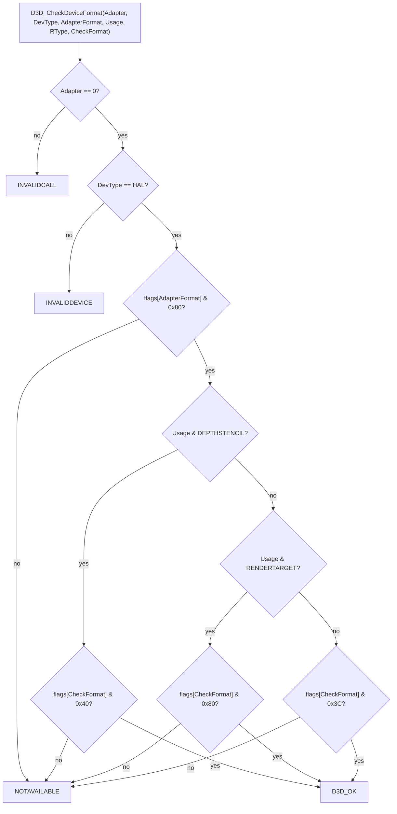

# D3D8 어댑터·모드·Caps 질의: 원본 라이브러리의 답 (US 빌드)

`rejsrf_d3d8_check`로 XDK 4134 D3D8 라이브러리의 lift된 원본(`sub_X_gen`)을 커널 HLE 위에서 실행해 얻은 결과다(issue #7). HLE export는 같은 도구의 비교 모드로 이 답과 일치함을 매번 확인한다(12,202 케이스).

This is what the lifted originals (`sub_X_gen`) of the XDK 4134 D3D8 library answer when run on top of the kernel HLE with `rejsrf_d3d8_check` (issue #7). The HLE exports are confirmed to match these answers by the same tool's comparison mode on every run (12,202 cases).

## 1. 호출 규약 / Calling conventions

| 함수 / Function | 주소 / Address | `ret n` | 비고 / Note |
|---|---|---|---|
| `Direct3D_GetAdapterCount` | `0x00199820` | `ret 4` | 항상 1. jsrf-recomp의 추론 이름이지만 인자 하나를 pop한다 / always 1; pops one argument although named as taking none |
| `D3D_GetAdapterModeCount` | `0x00199830` | `ret 4` | XbSymbolDatabase는 인자 2개로 적지만 실제로는 1개(`Adapter`, 무시됨) / the database lists 2 parameters, the code pops 1 and ignores it |
| `D3D_EnumAdapterModes` | `0x001998D0` | `ret 12` | `Adapter` 무시, `pMode`를 검사 없이 씀 / adapter ignored, writes through `pMode` unchecked |
| `D3D_CheckDeviceFormat` | `0x00199A60` | `ret 24` | |
| `Direct3D_CheckDeviceMultiSampleType` | `0x00199AE0` | `ret 20` | `Windowed` 무시 / ignored |
| `D3D_GetDeviceCaps` | `0x00199A30` | `ret 12` | 검사 뒤 `D3DDevice_GetDeviceCaps`를 부르고 0을 돌려준다 / validates, calls `D3DDevice_GetDeviceCaps`, returns 0 |
| `D3DDevice_GetDeviceCaps` | `0x0018CB40` | `ret 4` | `0x0022E480`의 53 DWORD를 복사, eax 보존 / copies 53 DWORDs from `0x0022E480`, leaves eax |
| `Direct3D_CreateDevice` | `0x0018E460` | `ret 24` | 원본은 `CMiniport_InitHardware`에서 NV2A에 닿음 / original reaches the NV2A in `CMiniport_InitHardware` |

* **확인됨**: 모든 `Adapter`/`DeviceType` 검사는 `Adapter != 0 → D3DERR_INVALIDCALL(0x8876086C)`, `DeviceType != D3DDEVTYPE_HAL(1) → D3DERR_INVALIDDEVICE(0x8876086B)` 순서다. 지원하지 않는 포맷은 `D3DERR_NOTAVAILABLE(0x8876086A)`.
* **Confirmed**: every adapter/device check is `Adapter != 0 → D3DERR_INVALIDCALL (0x8876086C)` then `DeviceType != D3DDEVTYPE_HAL (1) → D3DERR_INVALIDDEVICE (0x8876086B)`; an unsupported format is `D3DERR_NOTAVAILABLE (0x8876086A)`.

## 2. 디스플레이 모드 / Display modes

커널 HLE가 보고하는 AV 설정(NTSC-M, 컴포지트, `XC_VIDEO` 0)에서 모드는 24개다. `D3DDISPLAYMODE`의 Xbox 레이아웃은 **`{Width, Height, RefreshRate, Flags, Format}`** 이다(PC와 달리 `Flags`가 `Format` 앞).

With the AV settings the kernel HLE reports (NTSC-M, composite, `XC_VIDEO` 0) there are 24 modes. The Xbox `D3DDISPLAYMODE` layout is **`{Width, Height, RefreshRate, Flags, Format}`** (unlike the PC, `Flags` precedes `Format`).

| # | Width × Height | Hz | Flags | Formats (4 each) |
|---|---|---|---|---|
| 0–3 | 640 × 480 | 60 | `0x020` | `LIN_X8R8G8B8` (0x1E), `LIN_R5G6B5` (0x11), `LIN_X1R5G5B5` (0x1C), `LIN_A8R8G8B8` (0x12) |
| 4–7 | 720 × 480 | 60 | `0x020` | same |
| 8–11 | 640 × 240 | 60 | `0x0A0` | same |
| 12–15 | 720 × 240 | 60 | `0x0A0` | same |
| 16–19 | 640 × 480 | 60 | `0x120` | same |
| 20–23 | 640 × 240 | 60 | `0x1A0` | same |

* **확인됨**: 위 표. 모드 24 이상은 `D3DERR_INVALIDCALL`.
* **추정**: `Flags` 비트의 의미(0x20, 0x80, 0x100)는 XDK 4134 `D3DPRESENTFLAG_*` 값으로 보이지만 아직 대조하지 않았다.
* **미확정**: AV 설정이 바뀔 때(와이드스크린, 480p/720p/1080i 허용) 모드 표가 어떻게 바뀌는지. 커널 HLE의 `ExQueryNonVolatileSetting(XC_VIDEO)`와 `AvSendTVEncoderOption(6)` 답에 따른다.
* **Confirmed**: the table above; mode 24 and up return `D3DERR_INVALIDCALL`.
* **Inferred**: the meaning of the `Flags` bits (0x20, 0x80, 0x100) looks like XDK 4134 `D3DPRESENTFLAG_*` values, not yet cross-checked.
* **Unresolved**: how the table changes with other AV settings (widescreen, 480p/720p/1080i enabled); it follows the kernel HLE's answers to `ExQueryNonVolatileSetting(XC_VIDEO)` and `AvSendTVEncoderOption(6)`.

## 3. 포맷 지원 판정 / Format support

라이브러리는 `0x0019A058`의 **포맷별 능력 바이트 표**(인덱스 = `D3DFORMAT` 값)를 본다.

The library consults a **per-format capability byte table** at `0x0019A058` (index = the `D3DFORMAT` value).

* **확인됨**: `RType`은 판정에 쓰이지 않는다. bit 7 = 컬러 렌더 타깃(03, 05, 06, 07, 11, 12, 13, 17, 1C, 1E), bit 6 = 깊이·스텐실(2A–31), bits 2–5 = 일반 리소스 포맷.
* **확인됨**: `Direct3D_CheckDeviceMultiSampleType`은 같은 표를 `SurfaceFormat`(bit 7 필요)과 **`MultiSampleType`(bit 6 필요)** 으로 인덱싱한다. `D3DMULTISAMPLE_NONE(0x11)`을 비롯해 실제 멀티샘플 값은 모두 `D3DERR_NOTAVAILABLE`이다. 게임은 `0x0011`로 `CreateDevice`를 부르므로 영향이 없다.
* **확인됨**: 표의 실제 길이는 0x42이며, 그 뒤 인덱스는 라이브러리의 다음 데이터를 읽는다(HLE는 0xFF까지 같은 바이트를 둔다).
* **Confirmed**: `RType` plays no part. Bit 7 = color render target (03, 05, 06, 07, 11, 12, 13, 17, 1C, 1E), bit 6 = depth/stencil (2A–31), bits 2–5 = plain resource format.
* **Confirmed**: `Direct3D_CheckDeviceMultiSampleType` indexes the same table with `SurfaceFormat` (bit 7 required) and **`MultiSampleType` (bit 6 required)**, so every real multisample value, `D3DMULTISAMPLE_NONE (0x11)` included, is `D3DERR_NOTAVAILABLE`. The game calls `CreateDevice` with `0x0011`, so this has no effect.
* **Confirmed**: the table's real length is 0x42; indices beyond read the library's following data (the HLE keeps the same bytes up to 0xFF).

## 4. 디바이스 Caps / Device caps

`D3DDevice_GetDeviceCaps`는 `0x0022E480`(.data)의 53 DWORD(212바이트)를 복사한다. 값은 `src/rexbox/hle/d3d8/d3d8_caps.cpp`의 `kCaps`에 그대로 있다. 눈에 띄는 값: `DeviceType` 1(HAL), `DevCaps` `0x007BBEF0`, `TextureCaps` `0x0007EC87`, `MaxTextureWidth/Height` 4096, `MaxSimultaneousTextures` 4, `MaxStreams` 16, `VertexShaderVersion` `0xFFFF0101`(1.1), `MaxVertexShaderConst` 96, `PixelShaderVersion` `0xFFFF0101`(1.1), `MaxPixelShaderValue` 1.0.

`D3DDevice_GetDeviceCaps` copies 53 DWORDs (212 bytes) from `0x0022E480` (.data); the values are kept verbatim in `kCaps` of `src/rexbox/hle/d3d8/d3d8_caps.cpp`. Notable: `DeviceType` 1 (HAL), `DevCaps` `0x007BBEF0`, `TextureCaps` `0x0007EC87`, `MaxTextureWidth/Height` 4096, `MaxSimultaneousTextures` 4, `MaxStreams` 16, `VertexShaderVersion` `0xFFFF0101` (1.1), `MaxVertexShaderConst` 96, `PixelShaderVersion` `0xFFFF0101` (1.1), `MaxPixelShaderValue` 1.0.

* **확인됨**: 212바이트가 쓰인다(PC `D3DCAPS8` 220바이트와 다름; 뒤 두 필드가 없다고 보인다 — **추정**).
* **Confirmed**: 212 bytes are written (the PC `D3DCAPS8` is 220; the last two fields appear to be absent — **inferred**).

## 5. 게임이 요청한 디바이스 / The device the game asks for

부팅 중 `Direct3D_CreateDevice`에 넘어온 `D3DPRESENT_PARAMETERS`(**확인됨**, issue #7 부팅 로그):

The `D3DPRESENT_PARAMETERS` the game passes to `Direct3D_CreateDevice` during boot (**confirmed**, issue #7 boot log):

| 필드 / Field | 값 / Value |
|---|---|
| BackBufferWidth × Height | 640 × 480 |
| BackBufferFormat | `0x11` `D3DFMT_LIN_R5G6B5` |
| BackBufferCount | 2 |
| MultiSampleType | `0x0011` `D3DMULTISAMPLE_NONE` |
| EnableAutoDepthStencil / Format | TRUE / `0x2E` `D3DFMT_LIN_D24S8` |
| Flags | `0x00000100` |
| FullScreen_PresentationInterval | 1 |
| BehaviorFlags (CreateDevice) | `0x40` `D3DCREATE_HARDWARE_VERTEXPROCESSING` |

## 6. 리소스 함수 / Resource functions (issue #12)

`rejsrf_d3d8_check`에 헤더 케이스를 더해 측정했다(13,557 케이스, 차이 0).

Measured with header cases added to `rejsrf_d3d8_check` (13,557 cases, 0 differences).

| 함수 / Function | 주소 / Address | `ret n` | 확인된 동작 / Confirmed behavior |
|---|---|---|---|
| `D3DResource_AddRef` | `0x00192950` | 4 | `Common` 하위 16비트 +1, 그 값을 반환; refcount 0인 서피스는 `Parent`(+0x14)도 AddRef / increments the low 16 bits and returns them; a zero-count surface AddRefs its parent |
| `D3DResource_Release` | `0x00192990` | 4 | refcount 1이고 내부 refcount(`0x780000`) 0 → 파괴 후 0; 아니면 −1 값 반환; 서피스는 같은 조건에서 `Parent` Release / destroys and returns 0 at count 1 with no internal count, else returns the decremented count |
| `D3DResource_GetType` | `0x00192790` | 4 | `Common` 타입 비트와 `Format` 차원·큐브맵 비트로 `D3DRESOURCETYPE` / type bits plus dimension and cube bits of `Format` |
| `D3DSurface_GetDesc` | `0x0018E730` | 8 | 28바이트 `D3DSURFACE_DESC`; eax는 HRESULT가 아니라 레벨 폭이 남는다 / 28-byte desc; eax is the level width, not an HRESULT |
| `D3DResource_Register` | `0x001929E0` | 8 | `Data += pBase`, push buffer(타입 2)가 아니면 `& 0x03FFFFFF`; eax = 새 `Data` / adds the base, masks except for push buffers, returns the new `Data` |
| `XGSetSurfaceHeader` (XGRAPHC, lift 원본 실행) | `0x001BBCA5` | 24 | `Common = 0x50001`, `Format` DMA 니블 2, 선형 `Size` 인코딩; 디바이스 서피스 헤더가 이것과 일치함을 확인 / `Common = 0x50001`, DMA nibble 2, linear `Size`; the device's own surface headers match it |

* **확인됨**: `D3DDevice_GetBackBuffer`는 디바이스 구조체 `+0x207C + idx*4`(idx: 0→0, −1→1, 그 외→2), `GetDepthStencilSurface`는 `+0x2074`를 읽어 AddRef한다. 디바이스 refcount는 `+0x43C`.
* **확인됨**: `D3DDevice_GetTexture2(Stage, ppTexture)`는 인자 2개(`ret 8`)다(데이터베이스는 1개로 적음).
* **Confirmed**: `D3DDevice_GetBackBuffer` reads device `+0x207C + idx*4` (idx: 0→0, −1→1, else→2) and `GetDepthStencilSurface` `+0x2074`, AddRef'ing the result; the device refcount is at `+0x43C`.
* **Confirmed**: `D3DDevice_GetTexture2(Stage, ppTexture)` takes two arguments (`ret 8`; the database lists one).

## 7. 디바이스 생성 이후 / After device creation (issue #12)

부팅은 `GetBackBuffer`, `GetDepthStencilSurface`, 렌더·텍스처 상태 setter 수십 개, `SetTransform`, `SetViewport`, `SetLight`/`LightEnable`, `GetGammaRamp`를 거친 뒤 게임 자체의 COM 식 객체 생성·해제로 들어간다. 그 Release(`lock xadd [obj+8], -1; jne`)가 lifter 버그로 항상 파괴 경로를 타 같은 객체를 두 번 해제했고, XAPI의 NT 힙 자유 리스트가 깨져 `RtlAllocateHeap`이 무한 루프했다. lifter 수정([xboxrecomp#198](https://github.com/sp00nznet/xboxrecomp/pull/198)) 뒤에는 커널 import 65 `IoCreateDevice`에서 멈춘다.

After device creation the boot goes through `GetBackBuffer`, `GetDepthStencilSurface`, dozens of render and texture state setters, `SetTransform`, `SetViewport`, `SetLight`/`LightEnable` and `GetGammaRamp`, then into the game's own COM-style object creation and release. A lifter bug made every Release (`lock xadd [obj+8], -1; jne`) take the destroy arm, freeing the same object twice and corrupting XAPI's NT heap free list, which left `RtlAllocateHeap` spinning. With the lifter fixed ([xboxrecomp#198](https://github.com/sp00nznet/xboxrecomp/pull/198)) the boot stops at kernel import 65 `IoCreateDevice`.
