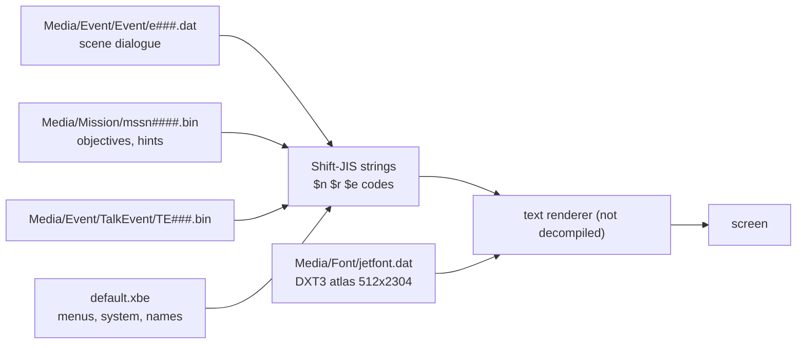

# 텍스트와 글꼴: 게임 문장이 있는 곳, 인코딩, 글꼴 아틀라스

issue [#105](https://github.com/nworkers/reJSRF/issues/105)(한국어 패치 검토)의 분석 결과다. 스크립트는 [scripts/analysis/text/](../../scripts/analysis/text/README.md)에 있다. 언어 인덱스는 [language](language.md)를 본다.

## 1. 문장이 있는 곳 (확인됨, `find_text.py`, `text_records.py`)

| 위치 | 내용 | 일본어 | 영어 |
|---|---|---|---|
| `Media/Event/Event/e###.dat`(300개) | 이벤트 장면 대사 | 134개 레코드, 8,930자 | 17,842글자 |
| `Media/Mission/mssn####.bin`(311개) | 미션 목표·안내 | 2,776개 레코드, 11,617자 | 21,374글자 |
| `Media/Event/TalkEvent/TE###.bin` | 대화 | 5개 레코드, 288자(일본어만) | 없음 |
| `default.xbe` | 메뉴, 시스템 메시지(메모리 유닛 등), 기술·그래피티·장소 이름, 레이스 대사 | 585개 문자열, 6,471자 | 같은 곳에 영어(그리고 §1.1) |

* 일본어 문장은 모두 합쳐 약 27,000자다. 서로 다른 글자는 800자(가나 157, 한자 603, 기타 전각 40)다(XBE 제외 집계).
* 장면 대사와 미션 문장은 **한 파일 안에 일본어와 영어가 함께** 있다. 언어 인덱스로 어느 쪽을 쓸지 고르는 것으로 보인다(**추정**).
* 그 밖의 `.dat`에서 잡힌 일본어(`Effect/ptcl*.dat`, `Stage/*_t.dat` 등)는 제작 경로(`C:\Documents and Settings\...\デスクトップ\...`)이거나 바이너리 잡음이다. 화면에 나오는 문장이 아니다.

### 1.1 XBE 안의 다른 언어

* 그래피티 편집기 문장은 이탈리아어·스페인어·독일어·프랑스어·영어로 있다([language §8.1](language.md)). 일본어 그래피티 편집기 문장은 위 585개에 들어 있다.

## 2. 문자열 형식 (확인됨, 일부 추정)

* 인코딩은 **Shift-JIS(CP932)**다. 영어 부분은 ASCII다. 자체 코드표가 아니다.
* NUL로 끝나는 문자열이 `NORM` 레코드 안에 있다. 레코드 머리에 시작·끝 오프셋과 크기(예: `e105.dat`의 `0x3540`/`0x3650`/`0x110`)가 있다.
* 제어 코드(`$` + 한 글자):

| 코드 | 뜻 | 근거 |
|---|---|---|
| `$n` | 줄바꿈 | 문장 중간에만 나온다(확인됨) |
| `$r` | 페이지(말풍선) 나눔 | 메시지 앞뒤와 페이지 사이(추정) |
| `$e` | 메시지 끝 | 메시지마다 `$r$e$r`로 끝난다(확인됨). 이벤트는 일본어 메시지 다음에 영어 메시지가 온다 |
| `$p`, `$b`, `$c`, `$a`, `$g`, `$s` | 이름 삽입·서식·대기 등 | 뜻 미확정. `$p`는 플레이어 이름 자리로 보인다(**추정**) |

* 예(`e000.dat`): `人、車の波止場、シブヤターミナル。$rシブヤターミナルをうめつくす、$nアヤしいグラフィティをぬりかえろ！$r$e$rThis is Shibuya Terminal, …`

## 3. 글꼴 (확인됨, 일부 미확정)

* `Media/Font/jetfont.dat`(1,179,952바이트): `NORM` 머리(0x40바이트) 뒤에 **DXT3 텍스처 512×2304**가 있다. 색은 흰색 하나이고 글자 모양은 alpha에 있다.
* 26픽셀 간격으로 약 88줄, **글리프 약 1,500개**: 한자(대부분), 히라가나·가타카나, 숫자·영대문자, 기호(、。・：？！ー～「」『』¥%&※♪ 등). 아래쪽 약 24줄은 비어 있다.
* 한자 순서는 JIS 순서가 아니다(예: `隷疲獄紛勘違跡捕捉騒濯魔…`). 이 순서를 담은 문자열 표는 XBE와 `Media` 어디에도 없다(Shift-JIS, 16비트, UTF-16으로 검색). 따라서 **문자 코드 → 글리프 위치**의 대응은 코드 안의 다른 형태(코드로 인덱싱하는 표 등)다. 텍스트 렌더러를 디컴파일해야 알 수 있다(**미확정**).
* `Media/Font/TNRoman.bin`(5,632바이트)은 16바이트 항목 352개(float 값들)다. 영문 비례 글꼴의 너비·좌표 표로 보인다(**추정**). XBE에서 `sub_0005F350`이 이 파일을 연다. `jetfont.dat` 경로는 `.data`의 파일 이름 표(`0x1EDE3C`)를 거쳐 쓰인다.

## 4. 그림 속 글자와 음성 (확인됨: 파일, 추정: 내용)

| 파일 | 내용 |
|---|---|
| `Title/LogoJ.dat`, `Title/Title.dat` | SEGA 로고, 낙서 경고문, 타이틀 로고(가타카나 부제)가 그림이다([language §8](language.md)) |
| `Disp/SprNorm.bin/.dat` | 일본어용 스프라이트 묶음(메뉴 글자 그림으로 추정) |
| `Ending/tex_Jpn.dat` | 엔딩 텍스처(크레딧 등으로 추정) |
| `Mark/List_jpn.dat`, `Mark/tex_jpn.dat` | 그래피티 목록과 텍스처(이름 그림으로 추정) |
| `Sounds/SE/*_j.dat`, `Z_ADX/MUSENJ/`(116개) | 일본어 음성(효과음 묶음, 무전 대사). 영어는 `Z_ADX/MUSEN/` 116개 |

## 5. 미확정

* 문자 코드 → 글리프 위치 대응(§3). 텍스트 렌더러 디컴파일이 필요하다.
* `$p` `$b` `$c` `$a` `$g` `$s`의 뜻.
* 글자 그림(`SprNorm`, `tex_Jpn`, `List_jpn`)에 무엇이 그려져 있는지. 텍스처 덤프(`F9` 캡처 등)로 확인한다.
* 장면 대사가 음성과 시간으로 묶여 있는지(페이지 넘김이 입력인지 음성 길이인지).

---

# Text and font: where the game's text lives, its encoding, the font atlas

Findings of issue [#105](https://github.com/nworkers/reJSRF/issues/105) (the Korean patch review). The scripts are in [scripts/analysis/text/](../../scripts/analysis/text/README.md); for the language index see [language](language.md).

## 1. Where the text lives (confirmed, `find_text.py`, `text_records.py`)

| Place | Content | Japanese | English |
|---|---|---|---|
| `Media/Event/Event/e###.dat` (300) | event scene dialogue | 134 records, 8,930 characters | 17,842 letters |
| `Media/Mission/mssn####.bin` (311) | mission objectives and hints | 2,776 records, 11,617 characters | 21,374 letters |
| `Media/Event/TalkEvent/TE###.bin` | talk | 5 records, 288 characters (Japanese only) | none |
| `default.xbe` | menus, system messages (memory units ...), trick, graffiti and place names, race lines | 585 strings, 6,471 characters | English alongside (and §1.1) |

* The Japanese text totals about 27,000 characters, with 800 distinct ones (157 kana, 603 kanji, 40 other full-width), XBE not counted.
* Scene dialogue and mission text keep **Japanese and English in the same file**; the language index presumably picks one (**inferred**).
* The other Japanese hits in `.dat` files (`Effect/ptcl*.dat`, `Stage/*_t.dat` ...) are authoring paths (`C:\Documents and Settings\...\デスクトップ\...`) or binary noise, not on-screen text.

### 1.1 Other languages in the XBE

* The graffiti editor text exists in Italian, Spanish, German, French and English ([language §8.1](language.md)); its Japanese text is among the 585 strings above.

## 2. String format (confirmed, partly inferred)

* The encoding is **Shift-JIS (CP932)**; English parts are ASCII. There is no custom code table.
* NUL-terminated strings sit in `NORM` records whose headers give start and end offsets and a size (for example `0x3540`/`0x3650`/`0x110` in `e105.dat`).
* Control codes (`$` plus one character):

| Code | Meaning | Basis |
|---|---|---|
| `$n` | line break | only inside sentences (confirmed) |
| `$r` | page (speech bubble) break | before and after messages and between pages (inferred) |
| `$e` | end of message | every message ends in `$r$e$r` (confirmed); events put the Japanese message before the English one |
| `$p`, `$b`, `$c`, `$a`, `$g`, `$s` | name insertion, formatting, waits ... | unresolved; `$p` looks like the player's name (**inferred**) |

* Example (`e000.dat`): `人、車の波止場、シブヤターミナル。$rシブヤターミナルをうめつくす、$nアヤしいグラフィティをぬりかえろ！$r$e$rThis is Shibuya Terminal, …`

## 3. Font (confirmed, partly unresolved)

* `Media/Font/jetfont.dat` (1,179,952 bytes): a `NORM` header (0x40 bytes), then a **DXT3 texture of 512×2304**, one white colour with the glyph shapes in alpha.
* About 88 rows at a 26-pixel pitch, **about 1,500 glyphs**: mostly kanji, hiragana and katakana, digits and capital letters, symbols (、。・：？！ー～「」『』¥%&※♪ ...). About 24 rows at the bottom are empty.
* The kanji are not in JIS order (`隷疲獄紛勘違跡捕捉騒濯魔…`), and no string table with that order exists in the XBE or `Media` (searched as Shift-JIS, 16-bit and UTF-16). The **character code → glyph slot** mapping is therefore in another form in the code (a table indexed by code, for example); decompiling the text renderer will tell (**unresolved**).
* `Media/Font/TNRoman.bin` (5,632 bytes) is 352 entries of 16 bytes (floats), likely the widths and coordinates of a proportional Latin font (**inferred**). In the XBE, `sub_0005F350` opens it; the `jetfont.dat` path is used through the `.data` file-name table (`0x1EDE3C`).

## 4. Text in pictures, and voice (confirmed: files; inferred: content)

| File | Content |
|---|---|
| `Title/LogoJ.dat`, `Title/Title.dat` | the SEGA logo, the graffiti warning and the title logo (katakana subtitle) are pictures ([language §8](language.md)) |
| `Disp/SprNorm.bin/.dat` | the Japanese sprite set (inferred: menu lettering) |
| `Ending/tex_Jpn.dat` | ending textures (inferred: credits) |
| `Mark/List_jpn.dat`, `Mark/tex_jpn.dat` | the graffiti list and textures (inferred: name pictures) |
| `Sounds/SE/*_j.dat`, `Z_ADX/MUSENJ/` (116) | Japanese voice (effect banks, radio lines); English is `Z_ADX/MUSEN/` (116) |

## 5. Unresolved

* The character code → glyph slot mapping (§3); needs the text renderer decompiled.
* The meaning of `$p` `$b` `$c` `$a` `$g` `$s`.
* What the lettering pictures (`SprNorm`, `tex_Jpn`, `List_jpn`) show; check with texture dumps (the `F9` capture and the like).
* Whether scene dialogue is timed to voice (pages advanced by input or by voice length).
