# XDK 심볼 식별 (US 빌드)

`rexbox_xdk_symbols`(XbSymbolDatabase `20eced5`)로 `default_eng.xbe`를 스캔한 결과다(issue #6).

This is the result of scanning `default_eng.xbe` with `rexbox_xdk_symbols` (XbSymbolDatabase `20eced5`) (issue #6).

## 1. 식별 결과 / Identification

| 라이브러리 / Library | 함수 / Functions | 변수 / Variables |
|---|---|---|
| D3D8 | 131 | 32 |
| DSOUND | 137 | 0 |
| XAPILIB | 48 | 11 |
| XGRAPHC | 4 | 0 |
| 합계 / Total | 320 | 43 |

* **확인됨**: 스캔은 1.5초 걸리고 363개 심볼을 낸다. 시그니처 빌드는 3911로 보고된다(XDK 4134 라이브러리가 3911 시그니처로 맞음).
* **확인됨**: `Direct3D_CreateDevice`는 `0x0018E460`, stdcall, 인자 6개.
* **확인됨**: jsrf-recomp의 D3D8 진입점 103개 중 98개가 주소와 이름까지 일치한다. 나머지 5개는 jsrf-recomp가 코드 모양으로 추론한 이름이고, XbSymbolDatabase는 찾지 못한다. 이 5개는 `src/game/jsrf/recomp/xdk_symbols_extra.json`으로 보충한다(**추정**, 출처 jsrf-recomp).
* **확인됨**: HLE 대상(D3D8, D3D8LTCG) 함수 136개 모두가 디스어셈블러가 탐지한 함수 시작과 일치해 override가 만들어진다.

* **Confirmed**: the scan takes 1.5 s and yields 363 symbols, matched with signature build 3911 (the XDK 4134 libraries match 3911 signatures).
* **Confirmed**: `Direct3D_CreateDevice` is at `0x0018E460`, stdcall, 6 parameters.
* **Confirmed**: of jsrf-recomp's 103 D3D8 entry points, 98 agree on both address and name. The other 5 are names jsrf-recomp inferred from code shape, which XbSymbolDatabase does not find; `src/game/jsrf/recomp/xdk_symbols_extra.json` supplies them (**inferred**, source jsrf-recomp).
* **Confirmed**: all 136 functions of the HLE libraries (D3D8, D3D8LTCG) coincide with function starts the disassembler found, so each gets an override.

## 2. 부팅 중 D3D8 호출 순서 / D3D8 call order during boot

`REXBOX_HLE_FALLBACK=lifted`(구현 없는 함수는 원본을 실행하고 기록)로 얻은 처음 호출 순서다.

The first calls, recorded with `REXBOX_HLE_FALLBACK=lifted` (unimplemented functions run their original and are logged):

```mermaid
flowchart LR
    A["Direct3D_GetAdapterCount"] --> B["D3D_GetAdapterModeCount"] --> C["CMiniport_GetDisplayCapabilities"] --> D["D3D_EnumAdapterModes"] --> E["D3D_CheckDeviceFormat"] --> F["Direct3D_CheckDeviceMultiSampleType"] --> G["D3D_GetDeviceCaps"] --> H["D3DDevice_GetDeviceCaps"] --> I["Direct3D_CreateDevice"] --> J["CMiniport_InitHardware -> NV2A 0xFD001804"]
```

* **확인됨**: i003에서 추정한 "디바이스 생성 중 GPU 초기화"는 `Direct3D_CreateDevice` → `CMiniport_InitHardware`의 NV2A 접근이다.
* **확인됨**(issue #7): 이 아홉 개가 D3D8 HLE 첫 묶음으로 구현됐고 질의 8개는 원본과 답이 일치한다([d3d8-adapter](d3d8-adapter.md)). 그 다음 호출은 `D3DDevice_GetBackBuffer`다.

* **Confirmed**: the "GPU initialization during device creation" inferred in i003 is `Direct3D_CreateDevice` → `CMiniport_InitHardware` touching the NV2A.
* **Confirmed** (issue #7): these nine are implemented as the first D3D8 HLE batch, and the eight queries answer like the originals ([d3d8-adapter](d3d8-adapter.md)); the next call is `D3DDevice_GetBackBuffer`.

## 3. XPP USB 클래스 드라이버 표와 누락 함수 / XPP USB class-driver tables and missed functions (issue #12)

XPP 섹션(XAPI의 USB 장치 계층: 게임패드, 메모리 유닛, 키보드, IR 동글)은 코드와 드라이버 표가 섞여 있다. 표(`0x001BC7C0`–`0x001BC98C`)는 장치 종류 GUID, 콜백 포인터, 초기화 함수를 담고, 그 콜백들은 표를 통해서만 불린다. 디스어셈블러는 그중 프롤로그 없이 `ret`/`jmp` 직후에 시작하는 FPO 함수 9개를 찾지 못했다.

The XPP section (XAPI's USB device layer: gamepads, memory units, keyboards, IR dongles) mixes code with driver tables. The tables (`0x001BC7C0`–`0x001BC98C`) hold device-type GUIDs, callback pointers and init functions, and the callbacks are reached only through them. The disassembler missed nine of them, FPO functions starting right after a `ret`/`jmp` with no prologue.

| 함수 / Function | 표 위치 / Table slot | 비고 / Note |
|---|---|---|
| `0x001BCAA3` | `0x001BC894`, `0x001BC8AC` | 콜백 / callback |
| `0x001BD274` | `0x001BC978` | 드라이버 초기화: `KeInitializeTimerEx(0x002649A8)` / driver init |
| `0x001BD853` | `0x001BC7FC` | 콜백 / callback |
| `0x001BDE21` | `0x001BC938` | thiscall 콜백 / thiscall callback |
| `0x001BDE62` | `0x001BC968` | thiscall 콜백 / thiscall callback |
| `0x001BDE86` | `0x001BC950` | thiscall 콜백 / thiscall callback |
| `0x001BE0B4` | `0x001BC89C`, `0x001BC8B4` | 콜백 / callback |
| `0x001BE689` | `0x001BC898`, `0x001BC8B0` | 콜백 / callback |
| `0x001C213A` | `0x001BC97C` | `0x002649A8` 타이머 블록을 쓰는 콜백 / callback using the `0x002649A8` timer block |

* **확인됨**: 9개 모두 `src/game/jsrf/recomp/seed_functions.json`에 seed로 넣어 재생성 뒤 디스패치 표에 들어갔고, 부팅 중 `[recomp] indirect call to 001BD274 has no target` 경고가 사라졌다. XPP 섹션 안의 다른 코드 포인터는 모두 탐지된 함수의 시작이다(표 안을 가리키는 데이터 포인터 제외).
* **추정**: 각 콜백의 역할(장치 추가·제거, 상태 폴링)은 XAPI의 USB 클래스 드라이버 구조(`XPP_DEVICE_TYPE`)에서 온 이름이며 아직 확인하지 않았다.
* **Confirmed**: all nine were seeded in `src/game/jsrf/recomp/seed_functions.json`; after regeneration they are in the dispatch table and the boot no longer logs `[recomp] indirect call to 001BD274 has no target`. Every other code pointer inside the XPP section is the start of a detected function (data pointers into the tables themselves excluded).
* **Inferred**: the callbacks' roles (device add/remove, state polling) follow XAPI's USB class-driver structure (`XPP_DEVICE_TYPE`) and are not confirmed yet.
