# XDK 심볼 식별 (US 빌드)

`rexbox_xdk_symbols`(XbSymbolDatabase `20eced5`)로 `default_eng.xbe`를 스캔한 결과다(issue #6).

This is the result of scanning `default_eng.xbe` with `rexbox_xdk_symbols` (XbSymbolDatabase `20eced5`) (issue #6).

## 1. 식별 결과 / Identification

| 라이브러리 / Library | 함수 / Functions | 변수 / Variables |
|---|---|---|
| D3D8 | 131 | 32 |
| DSOUND | 137 | 0 |
| XAPILIB | 48 | 11 |
| XGRAPHC | 4 | 0 |
| 합계 / Total | 320 | 43 |

* **확인됨**: 스캔은 1.5초 걸리고 363개 심볼을 낸다. 시그니처 빌드는 3911로 보고된다(XDK 4134 라이브러리가 3911 시그니처로 맞음).
* **확인됨**: `Direct3D_CreateDevice`는 `0x0018E460`, stdcall, 인자 6개.
* **확인됨**: jsrf-recomp의 D3D8 진입점 103개 중 98개가 주소와 이름까지 일치한다. 나머지 5개는 jsrf-recomp가 코드 모양으로 추론한 이름이고, XbSymbolDatabase는 찾지 못한다. 이 5개는 `src/game/jsrf/recomp/xdk_symbols_extra.json`으로 보충한다(**추정**, 출처 jsrf-recomp).
* **확인됨**: HLE 대상(D3D8, D3D8LTCG) 함수 136개 모두가 디스어셈블러가 탐지한 함수 시작과 일치해 override가 만들어진다.

* **Confirmed**: the scan takes 1.5 s and yields 363 symbols, matched with signature build 3911 (the XDK 4134 libraries match 3911 signatures).
* **Confirmed**: `Direct3D_CreateDevice` is at `0x0018E460`, stdcall, 6 parameters.
* **Confirmed**: of jsrf-recomp's 103 D3D8 entry points, 98 agree on both address and name. The other 5 are names jsrf-recomp inferred from code shape, which XbSymbolDatabase does not find; `src/game/jsrf/recomp/xdk_symbols_extra.json` supplies them (**inferred**, source jsrf-recomp).
* **Confirmed**: all 136 functions of the HLE libraries (D3D8, D3D8LTCG) coincide with function starts the disassembler found, so each gets an override.

## 2. 부팅 중 D3D8 호출 순서 / D3D8 call order during boot

`REXBOX_HLE_FALLBACK=lifted`(구현 없는 함수는 원본을 실행하고 기록)로 얻은 처음 호출 순서다.

The first calls, recorded with `REXBOX_HLE_FALLBACK=lifted` (unimplemented functions run their original and are logged):

```mermaid
flowchart LR
    A["Direct3D_GetAdapterCount"] --> B["D3D_GetAdapterModeCount"] --> C["CMiniport_GetDisplayCapabilities"] --> D["D3D_EnumAdapterModes"] --> E["D3D_CheckDeviceFormat"] --> F["Direct3D_CheckDeviceMultiSampleType"] --> G["D3D_GetDeviceCaps"] --> H["D3DDevice_GetDeviceCaps"] --> I["Direct3D_CreateDevice"] --> J["CMiniport_InitHardware -> NV2A 0xFD001804"]
```

* **확인됨**: i003에서 추정한 "디바이스 생성 중 GPU 초기화"는 `Direct3D_CreateDevice` → `CMiniport_InitHardware`의 NV2A 접근이다.
* **추정**: D3D8 HLE의 첫 구현 묶음은 이 아홉 개(어댑터·모드·Caps 질의와 디바이스 생성)다.

* **Confirmed**: the "GPU initialization during device creation" inferred in i003 is `Direct3D_CreateDevice` → `CMiniport_InitHardware` touching the NV2A.
* **Inferred**: the first D3D8 HLE batch is these nine (adapter, mode and caps queries, and device creation).
