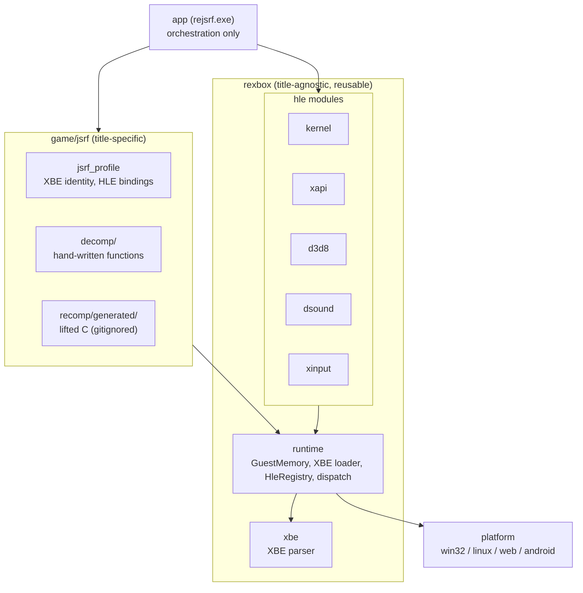
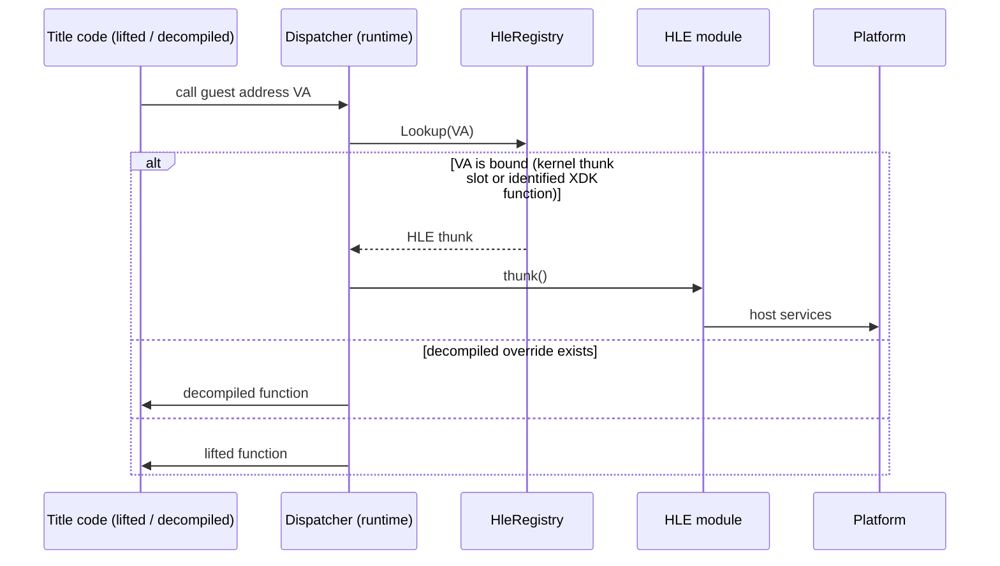
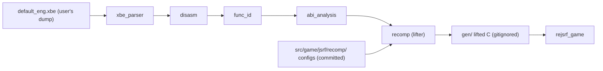

# 설계: 프로젝트 부트스트랩과 레이어 구조 (issue #1)

## 1. 요구사항

* Xbox 게임 Jet Set Radio Future를 디컴파일과 재컴파일로 Win32, Win64, Linux x86, Linux x64, Web, Android에 포팅한다.
* 작업 규칙과 코딩 규칙은 rePIU를 따르고, 라이선스는 MIT로 한다. 원격 저장소는 `nworkers/reJSRF`.
* 이번 범위는 프로젝트 생성과 작업 준비까지이며, 빌드는 Win32부터 한다.
* HLE 계층은 나중에 재사용할 수 있도록 경계를 정해 디컴파일 코드와 분리한다.
* 외부 프로젝트와 코드를 적극 참조한다.

## 2. 접근 방식 비교

| 방식 | 대표 프로젝트 | 장점 | 한계 | 판단 |
|---|---|---|---|---|
| 매칭 디컴파일 | Codeberg `JSRF-Decompilation`, dplewis/jsrf | 원본과 바이트 단위로 같은 소스 | MSVC 7.0으로 Xbox XBE를 다시 만드는 것이 목표라 그 자체로는 포팅이 아니다. 전체 진행률이 낮다(Codeberg 기준 XBE의 1.5%). | 지식 출처로만 참고 |
| 정적 재컴파일(x86 → C) | sp00nznet/xboxrecomp, andeecollard/jsrf-recomp | 전체 코드가 즉시 호스트에서 돈다. jsrf-recomp가 JSRF로 챕터 2 게임플레이와 60 fps까지 도달했다. | 생성 코드는 읽기 어렵고 원본 바이트에서 파생되어 배포할 수 없다. | **기본 실행 경로로 채택** |
| 에뮬레이터 | xemu, Cxbx-Reloaded | 호환성 | 목표(네이티브 포팅)와 맞지 않고 GPL/LGPL이다. | 제외(동작 참고만) |

결정: **재컴파일을 먼저 돌리고, 디컴파일로 함수를 하나씩 대체한다.** 재컴파일 코드가 기준 동작이며, 디컴파일한 함수는 같은 게스트 주소의 재컴파일 함수를 대체하고 언제든 되돌릴 수 있다. 이 방식은 N64Recomp 계열 포트가 디컴파일 결과를 합쳐 가는 방식과 같다.

## 3. 레이어 구조

* 각 레이어는 아래 레이어만 링크한다. CMake 타깃이 이 그래프를 그대로 표현하므로, 위반하면 링크 단계에서 드러난다.
* `rexbox`는 타이틀을 모른다. JSRF 이름, 주소, `rejsrf` 헤더가 이 아래에 나타나면 규칙 위반이다(AGENTS.md).
* HLE 모듈은 서로 링크하지 않는다. 각 모듈은 `Register<Module>Hle(HleRegistry&)` 하나로 런타임에 붙는다.
* 플랫폼 계층은 런타임 타입을 모른다(`include/rexbox/platform/`의 계약은 기본 값만 받는다).

## 4. HLE 경계

Xbox 타이틀은 XDK 라이브러리(XAPI, D3D8, DSOUND, XGRAPHC, LIBC)를 **정적으로 링크**한다. 실제 동적 import는 커널 ordinal뿐이다. 그래서 경계가 두 종류다.

1. **커널**: XBE의 kernel thunk 표 슬롯마다 ordinal이 있다. `hle::kernel::BindKernelImports`가 슬롯 주소를 같은 이름의 export에 묶는다. 이름 표는 xboxrecomp(MIT)에서 가져왔다.
2. **XDK 라이브러리 함수**: 각 HLE 모듈은 안정된 심볼 이름(예: `D3DDevice_Clear`)으로 구현을 export한다. 타이틀 프로파일은 함수 식별(XDK 4134 시그니처, 다른 타이틀의 심볼 이전)로 찾은 게스트 주소를 그 이름에 묶는다. 같은 XDK 빌드를 쓰는 다른 타이틀은 프로파일만 새로 만들면 HLE 모듈을 그대로 쓴다.
3. **하드웨어(NV2A, MCPX APU)**: 기본적으로 에뮬레이션하지 않는다. D3D8/DSOUND를 API 수준에서 대체하면 게임이 하드웨어를 직접 만지는 경로가 사라지기 때문이다. jsrf-recomp는 D3D8 API lift가 프레임의 99% 이상을 그리고 NV2A 모델보다 2~3배 빠르다고 보고했다(**추정**, 출처: jsrf-recomp README). 직접 접근이 남는 곳이 확인되면 그 지점만 별도 모듈로 다룬다.
* 위 그림은 간접 호출 기준이다. 생성 코드의 직접 호출은 C 함수 호출로 고정되므로, 같은 우선순위(HLE → 디컴파일 → lift)를 생성 단계나 lift 함수 진입부에서 적용해야 한다. 방법은 파이프라인 연결 task에서 정한다(**미확정**).

4. **미들웨어(CRI ADX/Sofdec 등)**: 디스크에 `.adx` 703개가 있다. 미들웨어는 Xbox 고유가 아니므로 필요해지면 `rexbox` 안에 별도 모듈 그룹(`src/rexbox/middleware/<name>/`)으로 두고 같은 registry 방식으로 묶는다. 이번 범위에서는 만들지 않는다.

## 5. 게스트 주소 모델

게스트 주소는 항상 32비트 `GuestAddress`이고 호스트 포인터는 `base + guest`로 얻는다(**based 모델**).

* 64비트 호스트(Win64, Linux x64, Android arm64)에서는 포인터 크기가 달라 게스트 주소를 호스트 포인터로 쓸 수 없다. wasm32는 선형 메모리라 역시 base가 필요하다.
* Win32 x86에서는 게스트 범위를 같은 주소에 매핑하는 identity 모델도 가능하지만, Windows가 낮은 주소(널 페이지, 실행 파일, DLL)를 쓰므로 실패할 수 있고 플랫폼마다 코드가 갈라진다.
* 그래서 모든 호스트에서 based 모델 하나만 쓴다. Win32에서 identity가 성능상 필요하다는 측정이 나오면 그때 선택적 최적화로 다시 검토한다.
* xboxrecomp의 생성 코드도 `g_xbox_mem_offset`을 통한 같은 모델을 지원한다.

## 6. 재컴파일 파이프라인

* 파이프라인 도구는 `third_party/xboxrecomp`(submodule, v0.13.1 `193e2995`에 고정)의 Python 도구(capstone 사용)를 쓴다.
* 생성 코드의 ABI(전역 레지스터 상태, `void(void)` 함수, `recomp_lookup`)는 xboxrecomp를 따른다. 우리 런타임의 dispatcher가 그 ABI와 `HleRegistry`를 잇는 adapter가 된다. 이 연결은 다음 task에서 설계한다.
* 타이틀별 설정(함수 경계 보정, 수동 override 목록)은 커밋하고, 생성 결과는 커밋하지 않는다.

## 7. xboxrecomp 사용 범위

xboxrecomp는 MIT지만 xemu에서 가져온 일부 파일은 LGPL-2.1+다(`src/apu/*`, `src/nv2a/nv2a_core.c`, `nv2a_regs.h`, `nv2a_state.h`, 그리고 `nv2a_regs.h`를 include하는 `include/xbox/xboxrecomp.h`).

* Python 파이프라인과 MIT 소스만 파일 단위로 가져오거나 옮긴다. 옮긴 파일은 `THIRD_PARTY_NOTICES.md`에 기록한다.
* xboxrecomp의 CMake를 `add_subdirectory`로 통째로 가져오지 않는다.
* 루트 `CMakeLists.txt`의 `REJSRF_COPYLEFT_PATHS` 가드가 위 LGPL 경로를 컴파일하려는 타깃을 configure 단계에서 막는다.

## 8. 플랫폼 로드맵

| 순서 | 플랫폼 | 툴체인 | 비고 |
|---|---|---|---|
| 1 | Win32 x86 | MSVC (VS 2022/2026), `-A Win32` | 이번 task부터 빌드 |
| 2 | Win64 | MSVC x64 | based 모델 그대로 |
| 3 | Linux x86 / x64 | GCC/Clang | `src/platform/linux/` |
| 4 | Web | Emscripten (wasm32) | 스레드, 파일 시스템, 오디오 정책 별도 설계 |
| 5 | Android | NDK (arm64-v8a 우선) | x86이 아닌 첫 호스트: 생성 코드의 x86 의존(x87, SSE intrinsic) 점검 필요 |

* 창, 입력, 오디오의 호스트 백엔드는 6개 플랫폼을 모두 지원하는 SDL3(zlib)를 우선 후보로 한다. 그래픽 백엔드(D3D11, OpenGL/GLES, WebGL, Vulkan, SDL GPU)는 D3D8 HLE task에서 정한다.

## 9. 저장소 구성

| 경로 | 내용 |
|---|---|
| `include/rexbox/`, `src/rexbox/` | 재사용 Xbox 런타임: `xbe/`, `runtime/`, `hle/<module>/` |
| `include/rexbox/platform/`, `src/platform/<os>/` | 플랫폼 계약과 구현 |
| `include/rejsrf/`, `src/game/jsrf/` | JSRF 프로파일, (예정) `recomp/` 설정, `decomp/` |
| `src/app/` | 실행 파일 진입점 |
| `tools/` | 개발 도구(`rexbox_xbe_info`) |
| `third_party/xboxrecomp/` | 재컴파일 파이프라인(submodule) |
| `scripts/` | 빌드·참조 저장소 스크립트 |
| `roms/`, `gen/`, `build/` | 로컬 전용(gitignore) |

## 10. 이번 task의 검증

* Win32 x86 Debug/Release 빌드(/W4 경고 없음).
* `rexbox_xbe_info`로 두 XBE를 읽어 헤더, 인증서, 섹션, 라이브러리, 커널 import를 출력한다.
* `rejsrf`가 US/JP XBE를 식별하고 guest memory에 배치하며, XBE가 아닌 파일은 거부한다.
* LGPL 가드: 금지 경로를 넣은 타깃으로 configure가 실패하는지 확인한다.

## 11. 다음 task 후보

1. 재컴파일 파이프라인 연결: US XBE를 `gen/`으로 lift하고 `rejsrf_game`에 넣어 Win32에서 링크. dispatcher와 생성 코드 ABI adapter.
2. 커널 HLE 최소 집합: 메모리(`Mm*`, `NtAllocateVirtualMemory`), 파일 I/O(`Nt*File`), 스레드·동기화(`Ke*`, `Ps*`), 진입점까지 부팅.
3. XDK 4134 함수 식별과 타이틀 바인딩(D3D8, DSOUND, XAPI).
4. 플랫폼 백엔드(SDL3) 도입과 D3D8 HLE 렌더러.
5. 디컴파일 워크플로: override 등록, 재컴파일 버전과의 비교 하네스.

---

# Design: project bootstrap and layer structure (issue #1)

## 1. Requirements

* Port the Xbox game Jet Set Radio Future to Win32, Win64, Linux x86, Linux x64, the web and Android through decompilation and recompilation.
* Follow rePIU's working and coding rules; license under MIT. The remote is `nworkers/reJSRF`.
* This scope is project creation and preparation for work; building starts with Win32.
* Draw the HLE layers' boundaries so they stay separate from the decompiled code and can be reused later.
* Reference external projects and code actively.

## 2. Approaches compared

| Approach | Projects | Strength | Limit | Verdict |
|---|---|---|---|---|
| Matching decompilation | Codeberg `JSRF-Decompilation`, dplewis/jsrf | Byte-identical source | Aims to rebuild the Xbox XBE with MSVC 7.0, so it is not a port by itself; overall progress is low (1.5% of the XBE on Codeberg). | Knowledge source only |
| Static recompilation (x86 → C) | sp00nznet/xboxrecomp, andeecollard/jsrf-recomp | All code runs on the host at once; jsrf-recomp reached chapter-2 gameplay at 60 fps with JSRF. | Generated code is hard to read and, derived from the original bytes, cannot be distributed. | **Adopted as the default execution path** |
| Emulator | xemu, Cxbx-Reloaded | Compatibility | Not the goal (a native port), and GPL/LGPL. | Excluded (behavior reference only) |

Decision: **run the recompiled code first, then replace functions one at a time with decompiled ones.** The recompiled code defines the reference behavior; a decompiled function replaces the recompiled function at the same guest address and can always be switched back. This is how N64Recomp-style ports fold decompilation results in.

## 3. Layer structure

The diagram in the Korean section applies. Each layer links only the layers below it, and the CMake targets express exactly that graph, so a violation shows up at link time. `rexbox` knows no title: a JSRF name, address or `rejsrf` header under it breaks the rule (AGENTS.md). HLE modules never link each other; each attaches to the runtime through a single `Register<Module>Hle(HleRegistry&)`. The platform layer knows no runtime types (contracts in `include/rexbox/platform/` take plain values).

## 4. HLE boundary

Xbox titles link the XDK libraries (XAPI, D3D8, DSOUND, XGRAPHC, LIBC) **statically**; the only real dynamic imports are kernel ordinals. So there are two kinds of boundary (sequence diagram above).

1. **Kernel**: each slot of the XBE's kernel thunk table holds an ordinal. `hle::kernel::BindKernelImports` binds each slot's address to the export of the same name. The name table comes from xboxrecomp (MIT).
2. **XDK library functions**: each HLE module exports implementations under stable symbol names (for example `D3DDevice_Clear`). The title profile binds the guest addresses found by function identification (XDK 4134 signatures, symbols transferred from other titles) to those names. Another title on the same XDK build needs only a new profile to reuse the modules unchanged.
3. **Hardware (NV2A, MCPX APU)**: not emulated by default. Replacing D3D8/DSOUND at the API level removes the paths on which the game touches hardware directly. jsrf-recomp reports its D3D8 API lift draws over 99% of each frame and runs 2–3× faster than the NV2A model (**inferred**, source: jsrf-recomp README). Where direct access is confirmed to remain, that point alone gets its own module.
* The diagram shows indirect calls. Direct calls in generated code are fixed C calls, so the same priority (HLE → decompiled → lifted) must be applied at generation time or at the lifted function's entry. How is decided in the pipeline task (**unresolved**).

4. **Middleware (CRI ADX/Sofdec, ...)**: the disc carries 703 `.adx` files. Middleware is not Xbox-specific, so when it is needed it gets its own module group inside `rexbox` (`src/rexbox/middleware/<name>/`), bound through the same registry. Not created in this scope.

## 5. Guest address model

A guest address is always a 32-bit `GuestAddress`, and the host pointer is `base + guest` (the **based model**).

* On 64-bit hosts (Win64, Linux x64, Android arm64) pointer sizes differ, so a guest address cannot serve as a host pointer; wasm32 linear memory needs a base as well.
* Win32 x86 could map the guest range at identical addresses (identity model), but Windows occupies low addresses (the null page, the executable, DLLs), so it can fail, and the code would fork per platform.
* So every host uses the based model alone. If measurement shows identity is needed for performance on Win32, it is reconsidered then as an optional optimization.
* xboxrecomp's generated code supports the same model through `g_xbox_mem_offset`.

## 6. Recompilation pipeline

The pipeline (diagram above) uses the Python tools (with capstone) of `third_party/xboxrecomp`, a submodule pinned to v0.13.1 `193e2995`. The generated code's ABI (global register state, `void(void)` functions, `recomp_lookup`) follows xboxrecomp; our runtime's dispatcher becomes the adapter between that ABI and `HleRegistry`, designed in the next task. Per-title configuration (function-boundary fixes, manual override lists) is committed; generated output is not.

## 7. Scope of xboxrecomp use

xboxrecomp is MIT, but some files taken from xemu are LGPL-2.1+ (`src/apu/*`, `src/nv2a/nv2a_core.c`, `nv2a_regs.h`, `nv2a_state.h`, and `include/xbox/xboxrecomp.h`, which includes `nv2a_regs.h`).

* Only the Python pipeline and MIT sources are taken or ported, file by file, and each is recorded in `THIRD_PARTY_NOTICES.md`.
* xboxrecomp's CMake is not pulled in wholesale with `add_subdirectory`.
* The `REJSRF_COPYLEFT_PATHS` guard in the root `CMakeLists.txt` stops, at configure time, any target that tries to compile those LGPL paths.

## 8. Platform roadmap

See the table above: Win32 x86 (MSVC, from this task), then Win64, Linux x86/x64, the web (Emscripten; threads, file system and audio policy designed separately), and Android (NDK, arm64-v8a first; the first non-x86 host, so the generated code's x86 dependencies — x87, SSE intrinsics — need checking). SDL3 (zlib) is the first candidate for window, input and audio on all six platforms; the graphics backend (D3D11, OpenGL/GLES, WebGL, Vulkan, SDL GPU) is chosen in the D3D8 HLE task.

## 9. Repository layout

See the table above.

## 10. Verification for this task

* Win32 x86 Debug/Release builds with no /W4 warnings.
* `rexbox_xbe_info` reads both XBEs and prints header, certificate, sections, libraries and kernel imports.
* `rejsrf` identifies the US and JP XBEs, places them in guest memory, and rejects a non-XBE file.
* License guard: configure fails for a target that names a blocked path.

## 11. Next task candidates

1. Connect the recompilation pipeline: lift the US XBE into `gen/`, add it to `rejsrf_game` and link on Win32; the dispatcher and the generated-code ABI adapter.
2. Minimal kernel HLE: memory (`Mm*`, `NtAllocateVirtualMemory`), file I/O (`Nt*File`), threads and sync (`Ke*`, `Ps*`); boot to the entry point.
3. XDK 4134 function identification and title bindings (D3D8, DSOUND, XAPI).
4. Platform backend (SDL3) and the D3D8 HLE renderer.
5. Decompilation workflow: override registration and a harness comparing against the recompiled version.
