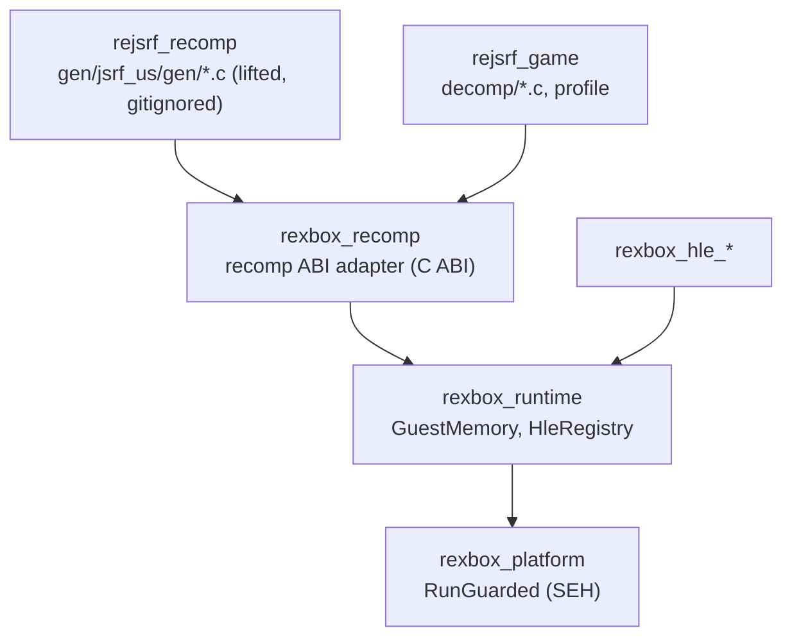
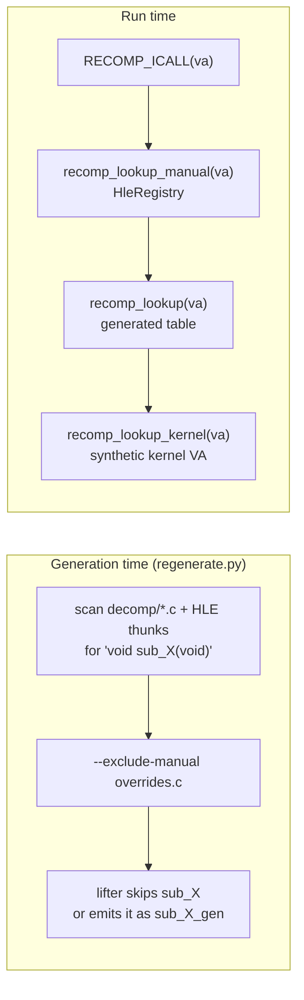

# 설계: 재컴파일 파이프라인 연결 (issue #2)

선행: [i001 설계 §6, §11](20261012-i001-project-bootstrap.md)

## 1. 요구사항

* 사용자 US XBE(`default_eng.xbe`)를 xboxrecomp 파이프라인으로 C로 옮기고(`gen/`, 커밋 안 함) Win32 x86에서 링크한다.
* 생성 코드와 `rexbox` 런타임 사이의 ABI 계약을 정한다.
* 간접 호출과 직접 호출 모두에 HLE → 디컴파일 → lift 우선순위를 적용하는 방법을 정한다(i001에서 **미확정**).

## 2. 파이프라인 기준선 (측정)

`third_party/xboxrecomp`(v0.13.1) 도구를 seed 없이 기본 설정으로 실행한 결과다.

| 단계 | 도구 | 시간 | 결과 |
|---|---|---|---|
| XBE 파싱 | `tools.xbe_parser --json` | 0.2초 | `analysis.json` |
| 디스어셈블 | `tools.disasm` | 29초 | 함수 8,711개(.text 7,754, D3D 267, DSOUND 410, XPP 224, MMATRIX 46, XGRPH 10), 명령 582,482개 |
| 함수 분류 | `tools.func_id` | 1.7초 | 카테고리 분류만(XDK 함수 이름은 붙이지 않음) |
| ABI 분석 | `tools.abi_analysis` | 1.2초 | 8,711개, thiscall 2,202개 |
| lift | `tools.recomp --all --split 250` | 52초 | 함수 8,716개 전부 번역, 실패 0, C 약 102만 줄(39 MB), 미해결 호출 대상 stub 184개 |

* 모든 단계가 출력 경로 인자를 받으므로 submodule 트리는 깨끗하게 유지된다.
* jsrf-recomp는 JSRF 전용 seed(스레드 시작점, 간접 호출 대상, 누락된 prologue, 함수 경계)와 vtable thunk 반복 탐색으로 8,876개를 찾았다(**추정**). seed 도입은 부팅 중 실제로 놓친 함수가 확인될 때 한다.

## 3. 생성 코드의 ABI 계약

xboxrecomp `templates/runtime/recomp_types.h`(생성 시 `gen/`에 복사됨)가 계약을 정의한다.

* **함수**: 모든 lift 함수는 `void sub_XXXXXXXX(void)`, 진입점은 `xbe_entry_point`. 인자와 반환값은 게스트 레지스터·스택 상태로 오간다.
* **레지스터**: `g_eax … g_edi`, `g_ebp`, `g_esp`, x87(`g_fp_stack`, `g_fp_top`, 제어어, 비교 상태), `g_xmm0-7`, `g_mm0-7`, `g_df`, `g_fs_base`, `g_seh_ebp`. 모두 스레드별 TLS 전역이다.
* **메모리**: `MEM32(addr) = *(addr + g_xbox_mem_offset)`. 우리 based 모델과 같으므로 `g_xbox_mem_offset = GuestMemory::base()`로 연결한다.
* **간접 호출**: `RECOMP_ICALL`이 `recomp_lookup_manual` → `recomp_lookup`(생성된 표) → `recomp_lookup_kernel` 순서로 찾는다. 코드 범위(`g_xbox_code_lo/hi`) 밖이고 `0xFE000000` 미만이면 버린다.
* **직접 호출**: `RECOMP_ABI_CALL(va, fn)` 매크로로 C 함수를 직접 부른다.
* **런타임 제공 심볼**: 링크 시험으로 확인한 45개(레지스터 정의, `g_xbox_mem_offset`, 코드 범위, 간접 호출 추적 버퍼, `recomp_lookup_manual/kernel`, 실패 로그, `recomp_unimpl`, `xbox_ReadTimeStampCounter` 등)와, 헤더가 선언한 나머지(`recomp_debug_service`, `recomp_setjmp_slot` 등).

## 4. 경계: `rexbox_recomp`

* lifter ABI에 묶이는 코드는 `rexbox_recomp`(`include/rexbox/recomp/`, `src/rexbox/recomp/`) 한 곳에만 둔다. lifter 버전을 바꿀 때 이 타깃만 고친다. 여전히 타이틀을 모른다.
* `rexbox_recomp`는 생성 코드가 요구하는 전역과 함수를 정의하고, C++ 쪽에는 `rexbox::recomp` API(레지스터 접근, 부팅 준비, 활성 런타임 설치)를 준다.
* 생성 코드는 별도 타깃 `rejsrf_recomp`로 빌드한다(경고 끔 `/w`, `/bigobj`). `gen/` 디렉터리가 없으면 이 타깃을 만들지 않고, 앱은 지금처럼 로드 후 멈춘다(CI).

## 5. 우선순위 적용

* **직접 호출**: 생성 단계에서 해결한다. `scripts/recomp/regenerate.py`가 디컴파일 소스(와 이후 HLE 바인딩 thunk)에서 `void sub_X(void)` 정의를 모아 `--exclude-manual`로 넘긴다. lifter는 그 함수를 생성하지 않으므로 직접 호출과 생성된 디스패치 표가 모두 우리 정의로 링크된다. 실행 시간 비용은 0이다.
* **되돌리기와 비교**: 디컴파일 파일이 `extern void sub_X_gen(void);`을 선언하면 lifter는 원래 본문을 `sub_X_gen`으로 생성한다. 디컴파일 버전은 언제든 이 본문으로 되돌리거나 같은 입력으로 비교할 수 있다. 정의를 지우고 재생성하면 lift 버전으로 돌아간다.
* **간접 호출**: 생성된 표가 이미 우리 정의를 가리키므로, `recomp_lookup_manual`은 `HleRegistry`에 묶인 주소만 처리한다.
* **커널 import**: 부팅 준비 때 각 thunk 슬롯에 합성 주소 `0xFE000000 + ordinal × 4`를 쓰고, `HleRegistry`를 그 합성 주소로 바인딩한다. `recomp_lookup_kernel`은 registry를 찾고, 구현이 없으면 ordinal 이름을 보고하고 실행을 멈추는 thunk를 돌려준다.
* **데이터 export 주의**: `KeTickCount`, `ExEventObjectType`, `XboxHardwareInfo`, `LaunchDataPage`, `Xbox*Key` 등은 함수가 아니라 데이터다. 게임은 슬롯 값을 포인터로 읽는다. 합성 주소는 게스트 메모리 밖이므로, 커널 HLE task에서 이 export들을 게스트 메모리에 두고 슬롯에 그 주소를 써야 한다. 이번 task에서는 합성 주소를 쓰며, 접근하면 fault로 보고된다.

## 6. 부팅 준비와 첫 실행

* `g_xbox_mem_offset = base`, `g_xbox_code_lo/hi` = 실행 섹션의 최소·최대 주소.
* 게스트 스택: guest memory 맨 위 1 MiB. `g_esp`를 그 끝 바로 아래로 두고 반환 주소 자리에 0을 넣는다.
* `g_fs_base`: 게스트 주소 `0x00001000`의 0으로 채운 4 KiB(Xbox KPCR/TIB 자리, 내용은 커널 HLE task에서 채움). base 아래 `[0, 0x10000)`는 이미지가 쓰지 않는다.
* 실행: 플랫폼 계약 `RunGuarded(fn, ctx, &fault)`(Win32: SEH)로 `xbe_entry_point`를 부른다. 결과는 세 가지 중 하나다: 정상 반환, 미구현 커널 호출로 정지(ordinal과 이름 보고), 하드웨어 fault(코드와 주소 보고).

## 7. 디컴파일 경로 증명

워크플로가 실제로 동작함을 보이려고 작은 leaf 함수 하나를 디컴파일해 `src/game/jsrf/decomp/`에 둔다. 확인할 것: lifter가 그 함수를 `_gen`으로 생성하고, 직접 호출이 디컴파일 버전으로 링크되며, 같은 입력에서 두 버전의 레지스터·메모리 결과가 같다(시험 도구 `rejsrf_decomp_check`).

## 8. 검증

* `regenerate.py`가 `gen/jsrf_us/`를 처음부터 다시 만들고 submodule을 더럽히지 않는다.
* Win32 x86 Debug/Release에서 `rejsrf`가 생성 코드와 함께 링크된다(우리 코드 /W4 경고 0).
* `rejsrf default_eng.xbe`가 진입점부터 실행해 첫 미구현 커널 호출 또는 첫 fault를 보고한다.
* 디컴파일 함수 비교 시험이 통과한다.
* `gen/` 없이 configure해도 빌드된다(CI 경로).

---

# Design: connecting the recompilation pipeline (issue #2)

Prerequisite: [i001 design §6, §11](20261012-i001-project-bootstrap.md)

## 1. Requirements

* Lift the user's US XBE (`default_eng.xbe`) to C with the xboxrecomp pipeline (`gen/`, never committed) and link it on Win32 x86.
* Define the ABI contract between generated code and the `rexbox` runtime.
* Decide how the HLE → decompiled → lifted priority applies to both indirect and direct calls (**unresolved** in i001).

## 2. Pipeline baseline (measured)

The table above was measured with the `third_party/xboxrecomp` (v0.13.1) tools at their defaults, without seeds: parse 0.2 s; disassembly 29 s, 8,711 functions (.text 7,754, D3D 267, DSOUND 410, XPP 224, MMATRIX 46, XGRPH 10) and 582,482 instructions; classification 1.7 s (categories only, no XDK names); ABI analysis 1.2 s (2,202 thiscall); lift 52 s, all 8,716 functions translated with 0 failures, about 1.02 M lines of C (39 MB), 184 stubs for unresolved call targets. Every step takes an output path, so the submodule tree stays clean. jsrf-recomp found 8,876 functions with JSRF-specific seeds and iterative vtable-thunk discovery (**inferred**); seeds are adopted when booting shows a function that was actually missed.

## 3. The generated code's ABI contract

Defined by xboxrecomp's `templates/runtime/recomp_types.h` (copied into `gen/` during generation): every lifted function is `void sub_XXXXXXXX(void)`, the entry point is `xbe_entry_point`, and arguments and results travel through guest registers and stack. Registers (`g_eax … g_edi`, `g_ebp`, `g_esp`, x87 state, `g_xmm0-7`, `g_mm0-7`, `g_df`, `g_fs_base`, `g_seh_ebp`) are per-thread TLS globals. Memory is `MEM32(addr) = *(addr + g_xbox_mem_offset)`, the same as our based model, connected by `g_xbox_mem_offset = GuestMemory::base()`. Indirect calls (`RECOMP_ICALL`) look up `recomp_lookup_manual` → `recomp_lookup` (generated table) → `recomp_lookup_kernel`, dropping targets outside the code range (`g_xbox_code_lo/hi`) and below `0xFE000000`. Direct calls are plain C calls through `RECOMP_ABI_CALL(va, fn)`. The runtime must supply 45 symbols found by a link test, plus the rest the header declares (`recomp_debug_service`, `recomp_setjmp_slot`, ...).

## 4. Boundary: `rexbox_recomp`

Code tied to the lifter ABI lives only in `rexbox_recomp` (`include/rexbox/recomp/`, `src/rexbox/recomp/`), so a lifter upgrade touches only that target; it still knows no title. It defines the globals and functions generated code needs and gives C++ the `rexbox::recomp` API (register access, boot preparation, installing the active runtime). Generated code builds as its own target `rejsrf_recomp` (warnings off with `/w`, `/bigobj`). Without a `gen/` directory that target is not created and the app stops after loading, as today (the CI path).

## 5. Applying the priority

* **Direct calls** are resolved at generation time. `scripts/recomp/regenerate.py` collects `void sub_X(void)` definitions from the decompiled sources (and later the HLE binding thunks) and passes them as `--exclude-manual`. The lifter does not generate those functions, so direct calls and the generated dispatch table both link to our definitions, at zero run-time cost.
* **Switching back and comparing**: when a decompiled file declares `extern void sub_X_gen(void);`, the lifter emits the original body as `sub_X_gen`. The decompiled version can always fall back to it or be compared against it on the same inputs; deleting the definition and regenerating restores the lifted version.
* **Indirect calls**: the generated table already points at our definitions, so `recomp_lookup_manual` only handles addresses bound in `HleRegistry`.
* **Kernel imports**: boot preparation writes the synthetic address `0xFE000000 + ordinal × 4` into each thunk slot and binds `HleRegistry` at that synthetic address. `recomp_lookup_kernel` asks the registry; with no implementation it returns a thunk that reports the ordinal's name and stops the run.
* **Data exports**: `KeTickCount`, `ExEventObjectType`, `XboxHardwareInfo`, `LaunchDataPage`, `Xbox*Key` and others are data, not functions; the game reads the slot value as a pointer. A synthetic address lies outside guest memory, so the kernel HLE task must place these exports in guest memory and write their addresses into the slots. In this task they get synthetic addresses, and an access is reported as a fault.

## 6. Boot preparation and first run

`g_xbox_mem_offset = base`; `g_xbox_code_lo/hi` span the executable sections. The guest stack is the top 1 MiB of guest memory, with `g_esp` just below its end and a zero return address. `g_fs_base` points at a zeroed 4 KiB block at guest address `0x00001000` (the Xbox KPCR/TIB; its contents come with the kernel HLE task); `[0, 0x10000)` below the base is unused by the image. The platform contract `RunGuarded(fn, ctx, &fault)` (Win32: SEH) calls `xbe_entry_point`. The outcome is one of: a normal return, a stop at an unimplemented kernel call (ordinal and name reported), or a hardware fault (code and address reported).

## 7. Proving the decompilation path

To show the workflow works, one small leaf function is decompiled into `src/game/jsrf/decomp/`. Checked: the lifter emits that function as `_gen`, direct calls link to the decompiled version, and both versions leave the same registers and memory on the same inputs (test tool `rejsrf_decomp_check`).

## 8. Verification

* `regenerate.py` rebuilds `gen/jsrf_us/` from scratch without dirtying the submodule.
* On Win32 x86 Debug/Release, `rejsrf` links with the generated code (0 /W4 warnings in our code).
* `rejsrf default_eng.xbe` runs from the entry point and reports the first unimplemented kernel call or the first fault.
* The decompiled-function comparison test passes.
* Configuring without `gen/` still builds (the CI path).
