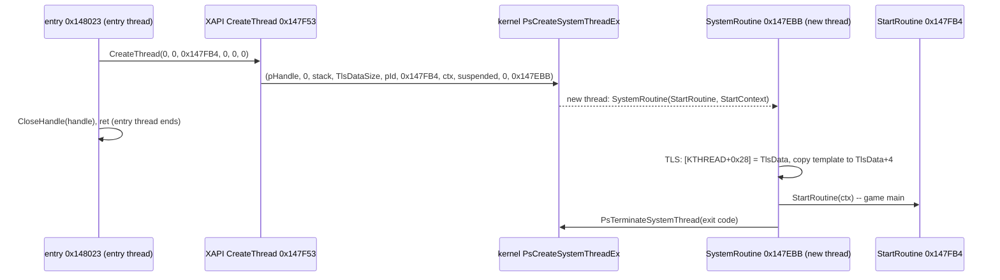
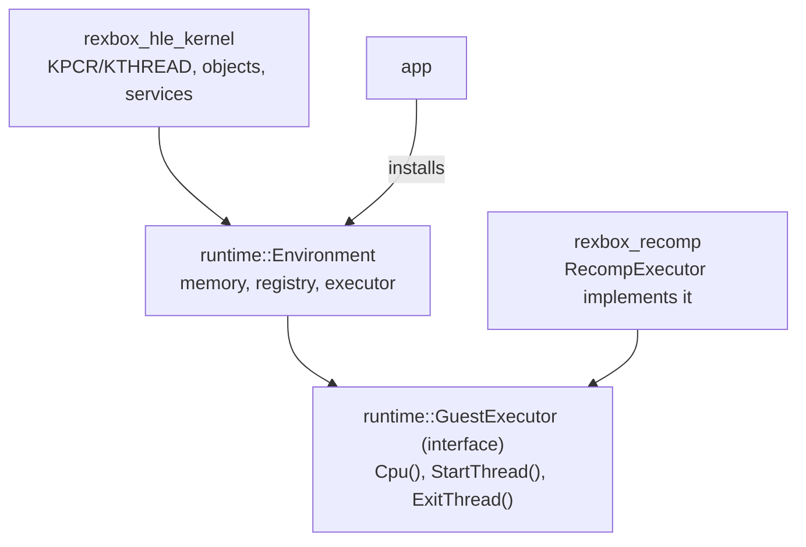

# 설계: 커널 HLE 최소 구현 (issue #3)

선행: [i002 설계](20261012-i002-recomp-pipeline.md), [부팅 frontier](../analysis/boot-frontier.md)

## 1. 요구사항

* US 빌드가 멈춘 `PsCreateSystemThreadEx`부터 커널 import를 구현해 게임 메인 스레드로 들어가고, 부팅이 닿는 순서대로 커널 서비스를 늘린다.
* HLE 모듈은 lifter ABI(`rexbox_recomp`)에 의존하지 않는다(i001 레이어 규칙).
* 데이터 export를 게스트 메모리에 둔다.
* Win32에서 64 MiB 밖 게스트 주소가 wrap되는 문제의 처리 방침을 정한다.

## 2. 원본 코드에서 확인한 시작 순서 (US)

**확인됨**(디스어셈블): 게임이 읽는 커널 구조는 `fs:[0x28]`(현재 KTHREAD), `fs:[0x20]`(Prcb 포인터, `+0x250` 읽기), `fs:[4]`(NtTib.StackBase), `KTHREAD+0x28`(TlsData), `ETHREAD+0x12C`(UniqueThread)다. TLS index는 `-TlsDataSize/4`로 계산되어 `[fs:[4] + index*4]`가 TlsData를 가리켜야 하므로, **StackBase = TlsData + TlsDataSize**(커널 스택 맨 위에 TLS 영역)다.

## 3. HLE 호출 계약 (런타임)

* `runtime::GuestCpu`: 호출 스레드의 게스트 범용 레지스터 읽기·쓰기 인터페이스.
* `runtime::GuestExecutor`: `Cpu()`, `StartThread(spec)`(새 호스트 스레드에서 게스트 함수를 지정한 esp·FS로 실행), `ExitThread(code)`(현재 게스트 스레드를 끝냄). 구현은 `rexbox_recomp`의 `RecompExecutor`다. 실행 방식이 바뀌어도(다른 lifter, 인터프리터) HLE는 그대로다.
* `runtime::Environment`: 활성 `GuestMemory`, `HleRegistry`, `GuestExecutor`. 앱이 설치한다.
* `runtime::HleCall`: HLE 함수 안에서 인자를 읽고 결과를 돌려주는 도우미. stdcall은 `[esp+4+4i]`, fastcall은 ecx·edx 다음 스택. `ReturnStdcall(value, n)`은 eax를 쓰고 `esp += 4 + 4n`.

## 4. 커널 모델

* **KPCR/KTHREAD**: 게스트 스레드마다 게스트 메모리에 KPCR(0x28 + KPRCB)과 ETHREAD(0x130)를 만든다. `NtTib.Self`, `SelfPcr`, `Prcb = KPCR+0x28`, `PrcbData.CurrentThread = ETHREAD`. 스택은 `KernelStackSize + TlsDataSize`를 할당하고 `KTHREAD.StackBase/StackLimit/TlsData`, `NtTib.StackBase = TlsData + TlsDataSize`를 채운다. `Prcb+0x250`은 0으로 둔다(D3D가 쓰는 자리로 보이며 HLE 후 다시 판단).
* **게스트 메모리 할당자**(런타임 `GuestHeap`): 64 MiB를 페이지 단위로 관리한다. `[0, 0x10000)`과 이미지, 초기 스택은 예약된다. `NtAllocateVirtualMemory`, `MmAllocateContiguousMemory*`, `ExAllocatePool*`, 커널 데이터와 스레드 스택이 모두 여기서 나온다. 모든 주소는 `[0, 64 MiB)` 안에 있고 `MmGetPhysicalAddress`는 항등이다. 실제 Xbox의 `0x8xxxxxxx` 연속 메모리 주소와 다르지만, 게스트가 주소의 상위 비트를 해석하는 곳이 확인되면 그때 맞춘다(**편차 기록**). issue #29부터 게스트 주소 공간은 128 MiB다. 아래 64 MiB가 물리 RAM이고, 위 64 MiB는 `NtAllocateVirtualMemory`만 쓴다. 작은 HLE 객체와 풀 블록은 slab을 쓴다([설계 i029](20261013-i029-guest-memory.md)).
* **디스패처 객체**: Xbox의 KEVENT/KSEMAPHORE/KMUTANT/KTIMER/KTHREAD는 게스트 메모리의 `DISPATCHER_HEADER`(Type +0, SignalState +4)를 가진다. 상태는 **게스트 메모리의 SignalState 자체**에 두고, 대기와 신호는 전역 디스패처 잠금 하나와 condition variable로 구현한다. 원본과 같은 자리에 상태가 있으므로 게스트가 직접 읽어도 일치한다. 자동 리셋(Synchronization) 이벤트는 대기가 끝날 때 소비한다.
* **핸들**: `Nt*` 함수의 핸들은 커널 객체 표(호스트)에서 나오고 객체의 게스트 주소를 가리킨다.
* **데이터 export**: 커널 데이터 영역을 할당해 `KeTickCount`, `XboxHardwareInfo`, `XboxKrnlVersion` 등을 두고 해당 thunk 슬롯에 그 게스트 주소를 쓴다. 객체 타입 export(`ExEventObjectType`, `PsThreadObjectType`)는 OBJECT_TYPE 자리만 할당한다.
* **인터럽트·DPC**(`KeConnectInterrupt` 등): 성공만 돌려주고 인터럽트는 발생시키지 않는다. D3D8/DSOUND를 API 수준에서 HLE하면 이 경로가 사라지기 때문이다(i001 §4).
* 파일 구성: `kernel_thread`, `kernel_memory`, `kernel_sync`, `kernel_object`, `kernel_file`, `kernel_rtl`, `kernel_hal`, `kernel_data`. 각 파일이 자기 export를 등록한다.

## 5. 실행기의 스레드

* 진입 스레드: 앱이 `Run(entry)`를 부른다. 진입점이 반환하면(원본은 메인 스레드를 만든 뒤 `ret`) 앱은 모든 게스트 스레드가 끝나거나 멈출 때까지 기다린다.
* `StartThread`: 호스트 스레드(플랫폼 계약 `CreateHostThread`, 스택 크기 지정)에서 TLS 레지스터를 초기화하고, `RunGuarded`로 시작 함수를 부른다. 결과(정상 반환, `ExitThread`, 미구현 커널 정지, fault)를 스레드별 보고로 남긴다.
* `ExitThread`: `RaiseStop`의 별도 코드로 그 스레드의 guarded 실행을 풀어 정상 종료로 처리한다.
* 미구현 커널 호출이나 fault가 어느 스레드에서든 나면 실행 전체를 멈추고 그 스레드의 보고를 출력한다(지금 단계의 frontier 측정 목적).

## 6. Win32 주소 wrap 방침

* HLE가 돌려주는 모든 주소는 `[0, 64 MiB)` 안에 둔다(§4). 그러면 커널이 원인인 범위 밖 주소는 생기지 않는다.
* 게스트 코드가 직접 쓰는 고정 하드웨어 주소(NV2A `0xFD000000`, APU `0xFE800000` 등)는 D3D8/DSOUND HLE로 사라질 것으로 본다. 남는 접근은 Win64 빌드(4 GiB 예약으로 fault가 남)에서 찾는다. Win32에서는 감지하지 못하는 한계로 기록한다.

## 7. 검증

* Win32 Debug/Release 빌드, 경고 0.
* 부팅이 `PsCreateSystemThreadEx`를 지나 게임 메인 스레드에서 실행되고, 새 frontier가 `docs/analysis/boot-frontier.md`에 기록된다.
* 디스패처 객체 단위 시험(`rexbox_kernel_probe`): 이벤트 수동/자동 리셋, 세마포어, 타임아웃, 스레드 종료 대기.
* `rejsrf_decomp_check` 회귀 없음.

## 8. 구현 중 확정·추가된 사항

* `GuestExecutor`에 `CallGuest`(현재 스레드에서 게스트 함수 호출)를 더했다. `KeSynchronizeExecution`처럼 커널이 게스트 콜백을 부르는 경우와 이후 DPC 전달에 쓴다.
* 스레드 종료는 SEH 해제이므로 MSVC를 `/EHa`로 빌드한다(해제 중 C++ 소멸자 실행).
* 파일 계층은 `kernel_vfs`(이름공간 → 호스트 디렉터리, 대소문자 무시)와 `kernel_file`(서비스)로 나눴다. 파티션 루트는 **볼륨**으로 열려 원시 섹터 쓰기를 받아 버린다. XAPI가 캐시 파티션을 포맷하기 때문이다. `Partition0`은 원시 장치이며 읽으면 0이다.
* 게임 폴더와 HDD 루트는 앱이 `KernelConfig`로 넘긴다(`REJSRF_HDD_ROOT`, 기본 `./hdd`).
* 함수 탐색이 놓친 간접 호출 대상은 `src/game/jsrf/recomp/*.json` seed로 보충한다(`regenerate.py`가 전달).

---

# Design: minimal kernel HLE (issue #3)

Prerequisite: [i002 design](20261012-i002-recomp-pipeline.md), [boot frontier](../analysis/boot-frontier.md)

## 1. Requirements

* Implement kernel imports from `PsCreateSystemThreadEx`, where the US build stops, to enter the game's main thread, adding kernel services in the order boot reaches them.
* HLE modules do not depend on the lifter ABI (`rexbox_recomp`), per the i001 layer rules.
* Place the data exports in guest memory.
* Decide how to handle the Win32 wrap of guest addresses beyond 64 MiB.

## 2. Start sequence confirmed in the original code (US)

See the sequence diagram above. **Confirmed** (disassembly): the kernel structures the game reads are `fs:[0x28]` (current KTHREAD), `fs:[0x20]` (Prcb pointer, read at `+0x250`), `fs:[4]` (NtTib.StackBase), `KTHREAD+0x28` (TlsData) and `ETHREAD+0x12C` (UniqueThread). The TLS index is computed as `-TlsDataSize/4` and `[fs:[4] + index*4]` must address TlsData, so **StackBase = TlsData + TlsDataSize** (the TLS area sits at the top of the kernel stack).

## 3. HLE calling contract (runtime)

* `runtime::GuestCpu`: reads and writes the calling thread's guest general registers.
* `runtime::GuestExecutor`: `Cpu()`, `StartThread(spec)` (run a guest function on a new host thread with a given esp and FS), `ExitThread(code)` (end the current guest thread). `RecompExecutor` in `rexbox_recomp` implements it; if the execution method changes (another lifter, an interpreter), the HLE stays as is.
* `runtime::Environment`: the active `GuestMemory`, `HleRegistry` and `GuestExecutor`, installed by the app.
* `runtime::HleCall`: helper for reading arguments and returning results inside an HLE function. stdcall arguments are `[esp+4+4i]`; fastcall takes ecx and edx, then the stack. `ReturnStdcall(value, n)` writes eax and does `esp += 4 + 4n`.

## 4. Kernel model

* **KPCR/KTHREAD**: each guest thread gets a KPCR (0x28 + KPRCB) and an ETHREAD (0x130) in guest memory: `NtTib.Self`, `SelfPcr`, `Prcb = KPCR+0x28`, `PrcbData.CurrentThread = ETHREAD`. The stack is `KernelStackSize + TlsDataSize`, filling `KTHREAD.StackBase/StackLimit/TlsData` and `NtTib.StackBase = TlsData + TlsDataSize`. `Prcb+0x250` stays 0 (apparently a D3D slot; revisited after D3D HLE).
* **Guest memory allocator** (runtime `GuestHeap`): manages the 64 MiB in pages, with `[0, 0x10000)`, the image and the initial stack reserved. `NtAllocateVirtualMemory`, `MmAllocateContiguousMemory*`, `ExAllocatePool*`, kernel data and thread stacks all come from it. Every address lies in `[0, 64 MiB)` and `MmGetPhysicalAddress` is the identity. This differs from the real Xbox's `0x8xxxxxxx` contiguous addresses; it is matched once a place is found where the guest interprets the upper bits (**recorded deviation**). Since issue #29 the guest address space is 128 MiB. The low 64 MiB is physical RAM and the upper 64 MiB serves only `NtAllocateVirtualMemory`; small HLE objects and pool blocks use slabs ([design i029](20261013-i029-guest-memory.md)).
* **Dispatcher objects**: the Xbox KEVENT/KSEMAPHORE/KMUTANT/KTIMER/KTHREAD carry a `DISPATCHER_HEADER` in guest memory (Type +0, SignalState +4). State lives **in the guest SignalState itself**; waits and signals use one global dispatcher lock and a condition variable. With state where the original keeps it, a guest reading it directly sees the same thing. Auto-reset (synchronization) events are consumed when a wait completes.
* **Handles**: handles of `Nt*` functions come from a host kernel object table and refer to the object's guest address.
* **Data exports**: a kernel data area holds `KeTickCount`, `XboxHardwareInfo`, `XboxKrnlVersion` and others, and their thunk slots receive those guest addresses. Object-type exports (`ExEventObjectType`, `PsThreadObjectType`) get only an OBJECT_TYPE placeholder.
* **Interrupts and DPCs** (`KeConnectInterrupt`, ...): return success and never deliver an interrupt, because HLE of D3D8/DSOUND at the API level removes these paths (i001 §4).
* Files: `kernel_thread`, `kernel_memory`, `kernel_sync`, `kernel_object`, `kernel_file`, `kernel_rtl`, `kernel_hal`, `kernel_data`, each registering its own exports.

## 5. Executor threads

* Entry thread: the app calls `Run(entry)`. When the entry returns (the original creates the main thread and `ret`s), the app waits until every guest thread has ended or stopped.
* `StartThread`: on a host thread (platform contract `CreateHostThread`, with a stack size), reset the TLS registers and call the start function under `RunGuarded`. The outcome (normal return, `ExitThread`, stop at an unimplemented kernel import, fault) is kept as a per-thread report.
* `ExitThread`: unwinds that thread's guarded run with a separate `RaiseStop` code and treats it as a normal exit.
* An unimplemented kernel call or a fault on any thread stops the whole run and prints that thread's report (to measure the frontier at this stage).

## 6. Win32 address-wrap policy

* Every address the HLE hands out stays in `[0, 64 MiB)` (§4), so the kernel never causes an out-of-range address.
* Fixed hardware addresses guest code uses directly (NV2A `0xFD000000`, APU `0xFE800000`, ...) are expected to disappear with D3D8/DSOUND HLE. Any that remain are found on the Win64 build (where a 4 GiB reservation makes them fault); on Win32 this is recorded as an undetectable limit.

## 7. Verification

* Win32 Debug/Release builds, zero warnings.
* Boot passes `PsCreateSystemThreadEx` and runs in the game's main thread; the new frontier is recorded in `docs/analysis/boot-frontier.md`.
* Dispatcher-object unit test (`rexbox_kernel_probe`): manual/auto-reset events, semaphores, timeouts, waiting for thread termination.
* No regression in `rejsrf_decomp_check`.

## 8. Settled or added during implementation

* `GuestExecutor` gained `CallGuest` (call a guest function on the current thread), for kernel calls that run guest callbacks such as `KeSynchronizeExecution` and for later DPC delivery.
* Thread exit unwinds with SEH, so MSVC builds with `/EHa` (C++ destructors run during the unwind).
* The file layer is split into `kernel_vfs` (namespace → host directories, case-insensitive) and `kernel_file` (the services). A partition root opens as a **volume** that accepts and drops raw sector writes, because XAPI formats the cache partition; `Partition0` is a raw device that reads as zeros.
* The app passes the game folder and HDD root in `KernelConfig` (`REJSRF_HDD_ROOT`, default `./hdd`).
* Indirect-call targets the disassembler misses are supplied as seeds in `src/game/jsrf/recomp/*.json` (passed on by `regenerate.py`).
