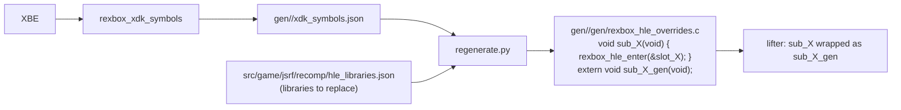

# 설계: XDK 함수 식별과 HLE 바인딩 (issue #6)

선행: [i002 §5 우선순위](20261012-i002-recomp-pipeline.md), [i003](20261012-i003-kernel-hle.md), [부팅 frontier](../analysis/boot-frontier.md)

## 1. 요구사항

* 타이틀에 정적 링크된 XDK 함수(D3D8, DSOUND, XGRAPHC, XAPI …)의 주소를 타이틀과 무관한 방법으로 찾는다.
* HLE로 대체하기로 한 라이브러리(우선 D3D8)의 함수 호출을 직접·간접 모두 HLE export로 보낸다. 구현이 없는 함수는 이름을 보고하고 멈춘다(커널과 같은 방식).
* 부팅을 D3D8 API의 첫 호출까지 진행해 새 frontier로 기록한다.

## 2. 식별: XbSymbolDatabase

[XbSymbolDatabase](https://github.com/Cxbx-Reloaded/XbSymbolDatabase)(MIT)는 XDK 빌드별 함수 시그니처(OOVPA)로 XBE를 스캔해, 심볼마다 라이브러리, 이름, 주소, 종류(함수·변수), 호출 규약, 인자 목록을 콜백으로 넘긴다. Cxbx-Reloaded가 HLE에 쓰는 데이터베이스이고, jsrf-recomp의 D3D8 진입점 표도 이것으로 만들었다(**추정**, 출처: jsrf-recomp `experiments/d3d8_boundary/entry_points.py`).

* `third_party/XbSymbolDatabase` submodule로 고정하고 라이브러리만 빌드한다(CLI, 단위 시험 끔).
* 도구 `rexbox_xdk_symbols <xbe> [--json out]`이 원본 XBE 파일 바이트를 그대로 스캔해(`is_raw`) JSON을 쓴다. `rexbox`의 일부로, 타이틀을 모른다.

## 3. 바인딩: 생성 단계 override

* 직접 호출은 생성 코드에서 C 호출로 고정되므로, 실행 시간 registry 바인딩만으로는 가로챌 수 없다. 그래서 i002 §5의 방식을 쓴다. `regenerate.py`가 대상 라이브러리의 함수마다 override `sub_X`를 생성하고, 같은 파일을 lifter의 `--exclude-manual`에 함께 넘긴다. 그러면 lifter는 원래 본문을 `sub_X_gen`으로 내보내고, 직접 호출·간접 호출·디스패치 표가 모두 override로 간다.
* override는 정적 슬롯 `{va, library, name, sub_X_gen}`을 넘기며 `rexbox_hle_enter(slot)`를 부른다. `rexbox_recomp`가 처음 호출될 때 `HleRegistry::FindExport(name)`로 export를 찾아 슬롯에 캐시하고 호출한다. export가 없으면 `RaiseStop`으로 멈추고, 앱은 `stopped at unimplemented XDK function D3D8 Direct3D_CreateDevice (0x…)`처럼 보고한다.
* 슬롯이 lift 본문(`sub_X_gen`)을 들고 있으므로, 나중에 "하드웨어에 닿지 않는 함수는 원본대로 실행" 같은 정책을 export 단위로 고를 수 있다. 이번 task에서는 쓰지 않는다.
* 대상 라이브러리는 타이틀 설정 `hle_libraries.json`이 정한다. 처음에는 `D3D8`과 `D3D8LTCG`이다. XAPI는 lift된 원본이 커널 HLE 위에서 이미 동작하므로 대상이 아니다.
* 런타임에는 XbSymbolDatabase가 들어가지 않는다. 식별은 생성 단계에서 한 번만 하고, 결과는 override 이름으로 실행 파일에 들어간다.

## 4. 빌드 순서

`rexbox_xdk_symbols`는 생성 코드와 무관하게 빌드된다. 그래서 처음 순서는 configure·빌드(도구) → `regenerate.py` → 다시 빌드이며, 이후에는 `regenerate.py`와 빌드만 반복하면 된다. `regenerate.py`는 도구를 `build/win32_x86/tools/<구성>/`에서 찾거나 `--symbols-tool`로 받는다.

## 5. 검증

* 식별 결과를 jsrf-recomp의 D3D8 진입점 103개와 비교한다(주소와 이름의 일치율).
* Win32 Debug/Release 빌드 경고 0, `rexbox_kernel_probe`, `rejsrf_decomp_check` 회귀 없음.
* 부팅이 첫 D3D8 API 호출에서 그 이름을 보고하며 멈추고, NV2A 직접 접근 fault는 사라진다.

---

# Design: XDK function identification and HLE binding (issue #6)

Prerequisites: [i002 §5 priority](20261012-i002-recomp-pipeline.md), [i003](20261012-i003-kernel-hle.md), [boot frontier](../analysis/boot-frontier.md)

## 1. Requirements

* Find the addresses of the title's statically linked XDK functions (D3D8, DSOUND, XGRAPHC, XAPI, ...) title-agnostically.
* Route both direct and indirect calls to functions of the libraries chosen for HLE (D3D8 first) to HLE exports; a function with no implementation reports its name and stops, as kernel imports do.
* Run boot to the first D3D8 API call and record it as the new frontier.

## 2. Identification: XbSymbolDatabase

[XbSymbolDatabase](https://github.com/Cxbx-Reloaded/XbSymbolDatabase) (MIT) scans an XBE with per-XDK-build function signatures (OOVPA) and reports, for each symbol, its library, name, address, kind (function or variable), calling convention and parameters. Cxbx-Reloaded uses it for HLE, and jsrf-recomp built its D3D8 entry-point table with it (**inferred**; source: jsrf-recomp `experiments/d3d8_boundary/entry_points.py`). It is pinned as the `third_party/XbSymbolDatabase` submodule and only its library is built (CLI and unit tests off). The tool `rexbox_xdk_symbols <xbe> [--json out]` scans the original XBE file bytes as they are (`is_raw`) and writes JSON; it is part of `rexbox` and knows no title.

## 3. Binding: generation-time overrides

Direct calls are fixed C calls in generated code, so run-time registry binding alone cannot intercept them. The i002 §5 mechanism is used instead: `regenerate.py` generates an override `sub_X` for each function of the target libraries and passes the same file to the lifter's `--exclude-manual`, so the lifter emits the original body as `sub_X_gen` and direct calls, indirect calls and the dispatch table all reach the override. An override calls `rexbox_hle_enter(slot)` with a static slot `{va, library, name, sub_X_gen}`; on first use `rexbox_recomp` looks the export up with `HleRegistry::FindExport(name)`, caches it in the slot and calls it. With no export it stops through `RaiseStop`, and the app reports e.g. `stopped at unimplemented XDK function D3D8 Direct3D_CreateDevice (0x…)`. Because the slot holds the lifted body (`sub_X_gen`), a later per-export policy such as "run the original when it never touches hardware" becomes possible; it is unused in this task. The target libraries come from the title setting `hle_libraries.json`, initially `D3D8` and `D3D8LTCG`; XAPI is not a target because its lifted original already works on top of the kernel HLE. XbSymbolDatabase never enters the runtime: identification happens once at generation time, and its result reaches the executable as override names.

## 4. Build order

`rexbox_xdk_symbols` builds independently of generated code, so the first sequence is configure and build (the tool) → `regenerate.py` → build again; afterwards only `regenerate.py` and the build repeat. `regenerate.py` finds the tool in `build/win32_x86/tools/<config>/` or takes it as `--symbols-tool`.

## 5. Verification

* Compare the identification with jsrf-recomp's 103 D3D8 entry points (agreement of addresses and names).
* Win32 Debug/Release builds with zero warnings; no regression in `rexbox_kernel_probe` or `rejsrf_decomp_check`.
* Boot stops at the first D3D8 API call reporting its name, and the direct NV2A access fault disappears.
