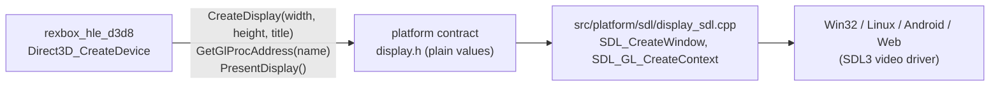
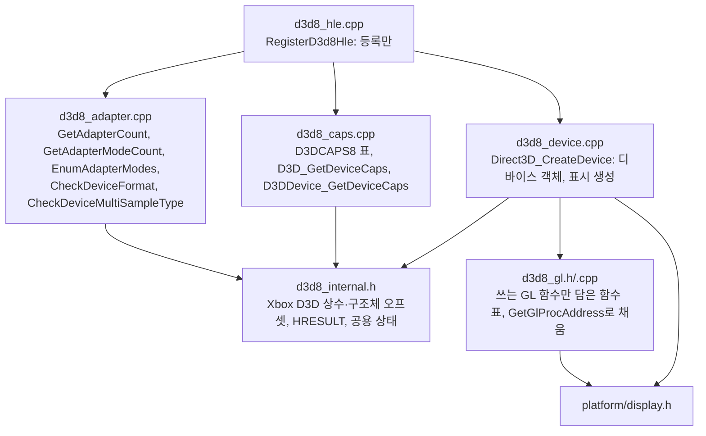
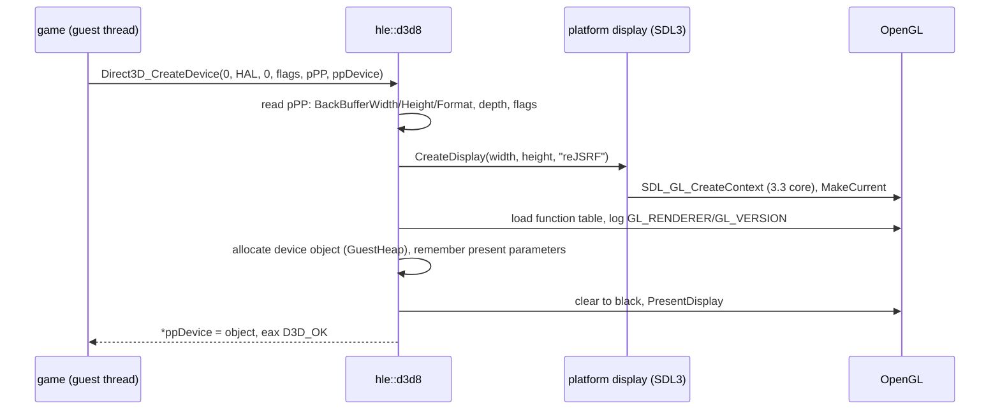
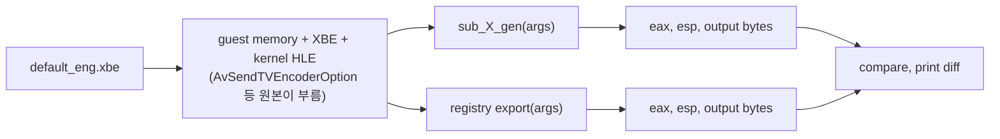

# 설계: D3D8 HLE 첫 묶음 — SDL3 + OpenGL 호스트, 어댑터·모드·Caps 질의, 디바이스 생성 (issue #7)

선행: [i001 §4 플랫폼 백엔드 후보](20261012-i001-project-bootstrap.md), [i006 바인딩 방식](20261012-i006-xdk-symbol-binding.md), [부팅 frontier](../analysis/boot-frontier.md), [XDK 심볼 §2 D3D8 호출 순서](../analysis/xdk-symbols.md)

## 1. 요구사항

* 부팅은 지금 첫 D3D8 API `Direct3D_GetAdapterCount`에서 멈춘다. 진단 모드로 얻은 원본 호출 순서는 어댑터·모드·Caps 질의 8개 뒤에 `Direct3D_CreateDevice`이며, 그 안의 `CMiniport_InitHardware`가 NV2A 레지스터를 건드린다. 이 아홉 개를 HLE export로 구현해 부팅을 다음 D3D8 frontier까지 진행한다.
* 화면 출력 호스트 계층을 도입한다. 사용자가 정한 결정은 **SDL3(zlib) + OpenGL 계열**(데스크톱 GL 3.3 core, GLES 3.0, WebGL2)이다. 6개 목표 플랫폼이 모두 같은 계층을 쓴다.
* HLE가 호스트 계층을 부를 때는 기본 값(크기, 문자열, 함수 포인터)만 넘긴다. 플랫폼 계층은 런타임·타이틀 타입을 알지 못한다(AGENTS.md 레이어 규칙).
* HLE export가 원본과 같은 답을 내는지는 추론이 아니라 실행으로 확인한다(개발 철학: "실행해서 측정한다").

## 2. 호스트 표시 계층

### 2.1 결정: SDL3 + OpenGL 계열

| 후보 | 플랫폼 | 판단 |
|---|---|---|
| SDL3 + OpenGL 계열 | Win32/Win64(GL 3.3), Linux(GL 3.3), Android(GLES 3.0), Web(WebGL2 = GLES 3.0 부분집합) | **채택.** 창·컨텍스트·입력·오디오를 한 라이브러리로, 셰이더는 GLSL 한 계열로 유지 |
| SDL3 GPU API | Vulkan/D3D12/Metal | WebGL과 32비트 Windows(D3D12 없음)에 닿지 않음 |
| D3D11 직접 | Windows만 | 멀티플랫폼 목표와 맞지 않음 |

GL 3.3 core와 GLES 3.0은 공통 부분집합이 넓다(VAO, 3.x GLSL, 정수 텍스처, 인스턴싱). D3D8 HLE는 그 공통 부분집합만 쓰는 것을 원칙으로 하고, 플랫폼 차이는 GLSL 버전 문자열과 몇 개 확장 질의로 좁힌다. 이번 task에서 쓰는 GL은 컨텍스트 정보 질의와 화면 지우기뿐이다.

### 2.2 계약: `include/rexbox/platform/display.h`

| 함수 | 역할 |
|---|---|
| `CreateDisplay(const DisplayConfig&, std::string* error)` | 창 하나와 OpenGL 계열 컨텍스트를 만들고 호출 스레드에 current로 둔다. `DisplayConfig`는 폭, 높이, 제목, 요청 API(`kDesktopGl` 3.3 core 또는 `kGlEs` 3.0) |
| `DestroyDisplay()` | 컨텍스트와 창을 없앤다 |
| `GetGlProcAddress(const char*)` | GL 함수 포인터. HLE는 자기 GL 함수 표를 이것으로 채운다 |
| `PumpDisplayEvents(bool* close_requested)` | 창 이벤트를 처리하고 닫기 요청을 알린다 |
| `PresentDisplay()` | 버퍼 교환(수직 동기 ON) |
| `GetDisplayInfo(DisplayInfo*)` | 실제로 얻은 GL 버전, ES 여부, 드로어블 크기 |

### 2.3 구현 위치: `src/platform/sdl/` (규칙 추가)

SDL3는 OS가 아니라 여러 OS가 공유하는 호스트 라이브러리다. 지금 규칙은 플랫폼 코드를 `src/platform/<os>/`에만 두므로, **공유 호스트 라이브러리 백엔드는 `src/platform/<library>/`에 두고 각 OS가 CMake에서 선택한다**는 규칙을 AGENTS.md와 CODING_STYLE.md에 더한다. `src/platform/CMakeLists.txt`가 `REXBOX_PLATFORM_SOURCES_<os>`에 `sdl/display_sdl.cpp`를 포함하고 `SDL3::SDL3-static`를 링크한다. OS 고유 파일(가상 메모리, 보호 호출, 스레드)은 그대로 `src/platform/<os>/`에 남는다.

### 2.4 빌드: submodule `third_party/SDL`

* `release-3.4.18`(zlib)로 고정하고 `add_subdirectory(... EXCLUDE_FROM_ALL)`로 정적 라이브러리만 빌드한다. 테스트, 예제, 설치, 공유 라이브러리를 끈다. 지금 필요 없는 하위 시스템(카메라, GPU API, 2D 렌더러, 햅틱, 센서, 대화상자)도 끈다. 오디오·조이스틱·게임패드는 DSOUND·XInput task를 위해 남긴다.
* CI(`actions/checkout` `submodules: true`)가 그대로 받는다. `THIRD_PARTY_NOTICES.md`에 zlib 고지를 더한다.
* `rexbox_platform`은 SDL 헤더를 PRIVATE로만 쓴다. 다른 타깃은 SDL 타입을 보지 않는다.

### 2.5 스레드 모델

창은 `Direct3D_CreateDevice`를 부른 게스트 스레드(게임 메인 스레드, 호스트 스레드 하나)에서 만들고, 이벤트도 그 스레드가 `PresentDisplay`/`PumpDisplayEvents`에서 처리한다. Win32와 X11/Wayland에서는 창을 만든 스레드가 메시지를 처리하면 되므로 유효하다. macOS, Android, Web은 프로세스 메인 스레드를 요구하므로, 그 플랫폼을 시작할 때 **표시 서비스**(앱 메인 스레드가 이벤트를 돌리고 게스트 스레드의 생성 요청을 넘겨받는 구조)로 바꾼다. 계약은 어느 스레드에서 불러도 되는 모양으로 두어 그때 HLE가 바뀌지 않게 한다(미해결 항목으로 기록).

## 3. D3D8 HLE 모듈 구조

* 게스트 구조체(`D3DDISPLAYMODE`, `D3DPRESENT_PARAMETERS`, `D3DCAPS8`)는 호스트 구조체로 캐스팅하지 않고 **오프셋 상수**와 `GuestMemory::Read32/Write32`로 다룬다(based 주소 모델, 64비트 호스트 호환). 레이아웃은 [kb: Xbox D3D8 API](../kb/xbox-d3d8-api.md)에 둔다.
* 모듈 안 상태(`D3dState`): 어댑터 모드 표, 디바이스 객체 주소, 현재 표시 파라미터. 모듈 밖으로 노출하지 않는다.
* XDK가 쓰는 전역 변수(`D3D_g_pDevice` 등, XbSymbolDatabase가 변수 32개를 식별)는 이번 묶음에서 쓰지 않는다. 게임 코드가 그 변수를 직접 읽는지는 다음 frontier에서 드러난다(미해결).

### 3.1 export 동작

| export | 규약·인자 | 동작 |
|---|---|---|
| `Direct3D_GetAdapterCount` | stdcall, 1 (사용 안 함; 코드가 `ret 4`) | `1` |
| `D3D_GetAdapterModeCount` | stdcall, 1 (`Adapter`, 무시) — 데이터베이스는 2개로 적지만 코드는 `ret 4` | 모드 표 길이(24) |
| `D3D_EnumAdapterModes` | stdcall, 3 (`Adapter` 무시, `Mode`, `pMode`) | 표의 `Mode`번째를 20바이트 `D3DDISPLAYMODE`(`{Width, Height, RefreshRate, Flags, Format}`)로 쓰고 `D3D_OK`, 범위 밖이면 `D3DERR_INVALIDCALL` |
| `D3D_CheckDeviceFormat` | stdcall, 6 | 원본과 같은 판정 규칙(§4에서 측정해 정한다) |
| `Direct3D_CheckDeviceMultiSampleType` | stdcall, 5 | 같은 방식 |
| `D3D_GetDeviceCaps` | stdcall, 3 (`Adapter`, `DeviceType`, `pCaps`) | 상수 `D3DCAPS8` 표를 복사 |
| `D3DDevice_GetDeviceCaps` | stdcall, 1 (`pCaps`) | 같은 표 |
| `Direct3D_CreateDevice` | stdcall, 6 | §3.2 |

반환은 `HleCall::Return(value, n)`으로 eax와 esp를 맞춘다. `n`이 틀리면 호출자의 스택이 어긋나므로 §4의 도구가 원본과 esp를 비교한다.

### 3.2 `Direct3D_CreateDevice`

* 디바이스 객체는 GuestHeap에서 한 페이지를 받아 0으로 채운 뒤 주소를 `*ppReturnedDeviceInterface`에 쓴다. Xbox D3D8은 디바이스 메서드를 전역 디바이스에 대한 일반 함수로 노출하므로(`D3DDevice_*`, `this` 없음) 객체 내용은 아직 쓰이지 않는다. 게임이 객체 필드를 직접 읽는 경우는 다음 frontier에서 확인한다.
* `pPresentationParameters`의 폭·높이가 0이면 모드 표의 첫 모드(640×480)를 쓴다.
* 표시 생성에 실패하면 `D3DERR_NOTAVAILABLE`을 돌려주고 stderr에 이유를 남긴다. 게임은 보통 여기서 멈추므로 frontier 보고로 드러난다.
* 실행 환경 변수 `REXBOX_DISPLAY=none`이면 창을 만들지 않고 GL 없이 진행한다(CI·헤드리스 진단용; 그리기 export가 늘면 각 export가 "표시 없음"을 처리한다).

## 4. 검증 도구 `rejsrf_d3d8_check`

`rejsrf_decomp_check`와 같은 방식으로, **HLE export와 lift된 원본(`sub_X_gen`)을 같은 게스트 상태에서 실행해 eax, esp, 출력 버퍼를 비교**한다. 질의 함수 8개는 하드웨어에 닿지 않으므로 원본이 그대로 실행된다(진단 모드에서 이미 확인). 원본이 내부 D3D 함수(`CMiniport_GetDisplayCapabilities`)를 부르면 override가 끼어들므로, 도구는 시작 시 `REXBOX_HLE_FALLBACK=lifted`를 켠다.

* `--dump`는 원본의 답(모드 표, Caps 55 DWORD, 포맷별 CheckDeviceFormat 결과)을 출력한다. HLE의 상수 표는 이 출력으로 만들고, 비교 모드가 그것을 매번 다시 확인한다. 이렇게 얻은 값은 analysis 문서에 **확인됨**으로 적는다.
* 비교 범위: `D3D_CheckDeviceFormat`은 포맷 0x00–0x7F × 리소스 종류(SURFACE, TEXTURE, VOLUMETEXTURE, CUBETEXTURE) × Usage(0, RENDERTARGET, DEPTHSTENCIL); `Direct3D_CheckDeviceMultiSampleType`은 포맷 몇 개 × 멀티샘플 종류 전부; `D3D_EnumAdapterModes`는 모드 수 + 1까지.
* `Direct3D_CreateDevice`는 창을 만들고 원본은 하드웨어에 닿으므로 비교 대상이 아니다. 부팅으로 확인한다.
* 도구는 타이틀 주소(`sub_00199820_gen` 등)를 알므로 `rejsrf_` 접두를 쓰고 생성 코드가 있을 때만 빌드된다(`rejsrf_decomp_check`와 같음).

## 5. 검증 계획

| 검증 | 기대 |
|---|---|
| Win32 Debug/Release 빌드 | 우리 타깃 경고 0 (SDL은 자기 경고 설정) |
| `rexbox_kernel_probe`, `rejsrf_decomp_check` | 회귀 없음 |
| `rejsrf_d3d8_check` | 모든 비교 일치, exit 0 |
| 부팅 | 창이 뜨고 검게 지워진 뒤, 다음 미구현 D3D8 함수 이름에서 정지. [boot-frontier](../analysis/boot-frontier.md) 갱신 |
| CI | 생성 코드 없이 SDL 포함 빌드 통과 |

## 6. 미해결 항목

* 표시 서비스 스레드(macOS, Android, Web)는 그 플랫폼 task에서.
* 모드 표는 커널 HLE가 보고하는 AV 설정(NTSC-M, 컴포지트, HD 꺼짐)에 대한 원본의 답이다. 커널의 AV 설정이 바뀌면 D3D8 모듈도 같은 설정을 봐야 하므로, 그때 런타임 계약(예: `runtime::VideoSettings`)으로 올린다. 모듈끼리는 링크하지 않는다.
* 게임 코드가 XDK 전역(`D3D_g_pDevice`, `D3D_g_RenderState`…)을 직접 읽는지는 다음 frontier에서 본다. 읽는다면 HLE가 그 변수 주소를 타이틀 프로파일에서 바인딩으로 받아 갱신하는 설계가 필요하다.

---

# Design: D3D8 HLE, first batch — SDL3 + OpenGL host, adapter/mode/caps queries, device creation (issue #7)

Prerequisites: [i001 §4 platform backend candidate](20261012-i001-project-bootstrap.md), [i006 binding mechanism](20261012-i006-xdk-symbol-binding.md), [boot frontier](../analysis/boot-frontier.md), [XDK symbols §2 D3D8 call order](../analysis/xdk-symbols.md)

## 1. Requirements

* Boot now stops at the first D3D8 API, `Direct3D_GetAdapterCount`. The original call order obtained in diagnostic mode is eight adapter/mode/caps queries followed by `Direct3D_CreateDevice`, inside which `CMiniport_InitHardware` touches NV2A registers. Implement these nine as HLE exports and run boot to the next D3D8 frontier.
* Introduce the display host layer. The user's decision is **SDL3 (zlib) + the OpenGL family** (desktop GL 3.3 core, GLES 3.0, WebGL2); all six target platforms share it.
* The HLE calls the host layer with plain values only (sizes, strings, function pointers); the platform layer knows no runtime or title types (AGENTS.md layer rules).
* Whether an HLE export answers like the original is confirmed by running, not by inference (development philosophy: "measure by running").

## 2. Display host layer

### 2.1 Decision: SDL3 + OpenGL family

SDL3 with the OpenGL family is adopted: Win32/Win64 and Linux use GL 3.3 core, Android GLES 3.0, the web WebGL2 (a GLES 3.0 subset); one library covers window, context, input and audio, and shaders stay in one GLSL family. SDL3's GPU API (Vulkan/D3D12/Metal) does not reach WebGL or 32-bit Windows, and direct D3D11 is Windows only. GL 3.3 core and GLES 3.0 share a wide common subset (VAOs, GLSL 3.x, integer textures, instancing); the D3D8 HLE uses only that subset, narrowing platform differences to the GLSL version string and a few extension queries. This task uses GL only for context information and clearing the screen.

### 2.2 Contract: `include/rexbox/platform/display.h`

The diagram above applies. `CreateDisplay(const DisplayConfig&, std::string* error)` creates the one window and an OpenGL-family context current on the calling thread (`DisplayConfig`: width, height, title, requested API `kDesktopGl` 3.3 core or `kGlEs` 3.0); `DestroyDisplay()` tears them down; `GetGlProcAddress(const char*)` returns GL function pointers with which the HLE fills its own function table; `PumpDisplayEvents(bool* close_requested)` processes window events; `PresentDisplay()` swaps buffers with vsync on; `GetDisplayInfo(DisplayInfo*)` reports the GL version actually obtained, whether it is ES, and the drawable size.

### 2.3 Location: `src/platform/sdl/` (rule added)

SDL3 is not an OS but a host library shared by several OSes. The current rule puts platform code only under `src/platform/<os>/`, so AGENTS.md and CODING_STYLE.md gain the rule that **a shared host-library backend lives in `src/platform/<library>/` and each OS selects it in CMake**. `src/platform/CMakeLists.txt` adds `sdl/display_sdl.cpp` to `REXBOX_PLATFORM_SOURCES_<os>` and links `SDL3::SDL3-static`. OS-specific files (virtual memory, guarded calls, threads) stay in `src/platform/<os>/`.

### 2.4 Build: submodule `third_party/SDL`

Pinned at `release-3.4.18` (zlib) and built as a static library only via `add_subdirectory(... EXCLUDE_FROM_ALL)`, with tests, examples, installation and the shared library off, and the subsystems not needed yet (camera, GPU API, 2D renderer, haptic, sensor, dialog) off; audio, joystick and gamepad stay for the DSOUND and XInput tasks. CI's checkout with `submodules: true` fetches it as is. `THIRD_PARTY_NOTICES.md` gains the zlib notice. `rexbox_platform` uses the SDL headers PRIVATE only; no other target sees SDL types.

### 2.5 Thread model

The window is created on the guest thread that calls `Direct3D_CreateDevice` (the game's main thread, one host thread), which also processes events in `PresentDisplay`/`PumpDisplayEvents`. This is valid on Win32 and X11/Wayland, where the creating thread must process the messages. macOS, Android and the web require the process main thread, so when those platforms start, a **display service** (the app's main thread runs the event loop and takes creation requests from guest threads) replaces this. The contract is shaped so it may be called from any thread, so the HLE will not change then (recorded as unresolved).

## 3. D3D8 HLE module structure

The diagram above applies: `d3d8_hle.cpp` registers only; `d3d8_internal.h` holds the Xbox D3D constants, structure offsets, HRESULTs and shared state; `d3d8_adapter.cpp` implements GetAdapterCount, GetAdapterModeCount, EnumAdapterModes, CheckDeviceFormat and CheckDeviceMultiSampleType; `d3d8_caps.cpp` the `D3DCAPS8` table and both GetDeviceCaps; `d3d8_device.cpp` `Direct3D_CreateDevice` (device object, display creation); `d3d8_gl.h/.cpp` a function table of only the GL functions used, filled through `GetGlProcAddress`.

* Guest structures (`D3DDISPLAYMODE`, `D3DPRESENT_PARAMETERS`, `D3DCAPS8`) are handled through **offset constants** and `GuestMemory::Read32/Write32`, never cast to host structures (based address model, 64-bit host compatibility). Layouts are in [kb: Xbox D3D8 API](../kb/xbox-d3d8-api.md).
* Module state (`D3dState`): the adapter mode table, the device object address, the current presentation parameters; not exposed outside the module.
* The XDK's global variables (`D3D_g_pDevice` and others; XbSymbolDatabase identifies 32 variables) are not used in this batch. Whether game code reads them directly shows up at the next frontier (unresolved).

### 3.1 Export behavior

The table above applies: `Direct3D_GetAdapterCount` (stdcall, 1 unused argument: the code does `ret 4`) returns 1; `D3D_GetAdapterModeCount` (stdcall, 1: `Adapter`, ignored; the database lists 2 but the code does `ret 4`) the mode table length (24); `D3D_EnumAdapterModes` (stdcall, 3; adapter ignored) writes the `Mode`-th entry as a 20-byte `D3DDISPLAYMODE` (`{Width, Height, RefreshRate, Flags, Format}`) and returns `D3D_OK`, or `D3DERR_INVALIDCALL` out of range; `D3D_CheckDeviceFormat` (stdcall, 6) and `Direct3D_CheckDeviceMultiSampleType` (stdcall, 5) apply the rule measured in §4; `D3D_GetDeviceCaps` (stdcall, 3) and `D3DDevice_GetDeviceCaps` (stdcall, 1) copy the constant `D3DCAPS8` table; `Direct3D_CreateDevice` (stdcall, 6) is §3.2. Returns go through `HleCall::Return(value, n)`, setting eax and esp; a wrong `n` skews the caller's stack, which is why the §4 tool compares esp with the original.

### 3.2 `Direct3D_CreateDevice`

The sequence diagram above applies. The device object is one zeroed page from the GuestHeap whose address is written to `*ppReturnedDeviceInterface`; since Xbox D3D8 exposes device methods as plain functions on a global device (`D3DDevice_*`, no `this`), the object's contents are unused so far, and direct field reads by the game are checked at the next frontier. A zero width or height in `pPresentationParameters` falls back to the first mode of the table (640×480). If display creation fails, `D3DERR_NOTAVAILABLE` is returned and the reason goes to stderr; the game usually stops there, which the frontier report shows. With the run-time variable `REXBOX_DISPLAY=none` no window is created and GL is absent (CI and headless diagnostics; as drawing exports grow, each handles "no display").

## 4. Verification tool `rejsrf_d3d8_check`

Like `rejsrf_decomp_check`, it **runs each HLE export and the lifted original (`sub_X_gen`) from the same guest state and compares eax, esp and the output buffers**. The eight query functions never touch hardware, so the originals run as they are (already seen in diagnostic mode). Since an original may call an internal D3D function (`CMiniport_GetDisplayCapabilities`) whose override would intercept it, the tool sets `REXBOX_HLE_FALLBACK=lifted` at startup.

* `--dump` prints the originals' answers (the mode table, the 55 DWORDs of caps, CheckDeviceFormat per format). The HLE's constant tables are authored from this output, and the comparison mode re-checks them every run; values obtained this way are recorded as **confirmed** in the analysis documents.
* Coverage: `D3D_CheckDeviceFormat` over formats 0x00–0x7F × resource types (SURFACE, TEXTURE, VOLUMETEXTURE, CUBETEXTURE) × usage (0, RENDERTARGET, DEPTHSTENCIL); `Direct3D_CheckDeviceMultiSampleType` over a few formats × every multisample type; `D3D_EnumAdapterModes` up to the mode count plus one.
* `Direct3D_CreateDevice` is not compared (it opens a window and the original touches hardware); boot verifies it.
* The tool knows title addresses (`sub_00199820_gen` and others), so it carries the `rejsrf_` prefix and is built only when generated code exists, like `rejsrf_decomp_check`.

## 5. Verification plan

Win32 Debug/Release builds with zero warnings on our targets (SDL keeps its own warning settings); no regression in `rexbox_kernel_probe` and `rejsrf_decomp_check`; `rejsrf_d3d8_check` all matching with exit 0; boot opens a window, clears it to black and stops at the next unimplemented D3D8 function by name, with [boot-frontier](../analysis/boot-frontier.md) updated; CI passes the no-generated-code build with SDL included.

## 6. Unresolved

* The display service thread (macOS, Android, web) belongs to those platform tasks.
* The mode table is the original's answer for the AV settings the kernel HLE reports (NTSC-M, composite, HD off). When the kernel's AV settings change, the D3D8 module must see the same settings, so they move up into a runtime contract (for example `runtime::VideoSettings`) then; modules never link each other.
* Whether game code reads XDK globals (`D3D_g_pDevice`, `D3D_g_RenderState`, ...) directly is seen at the next frontier. If so, the HLE needs those variable addresses bound from the title profile and kept up to date.
