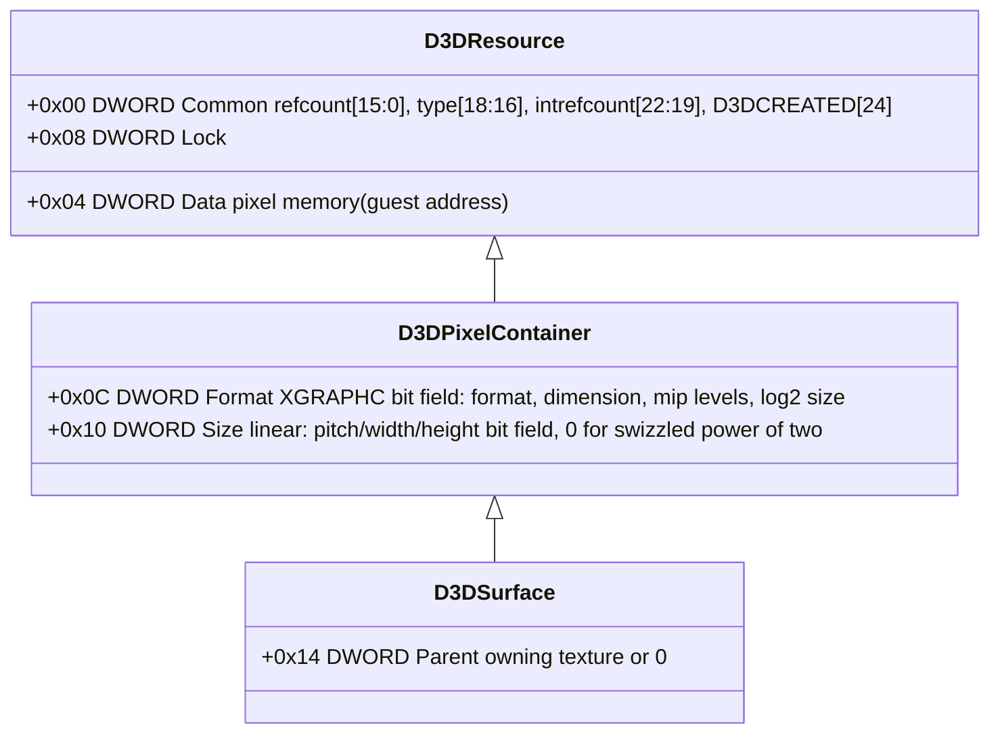
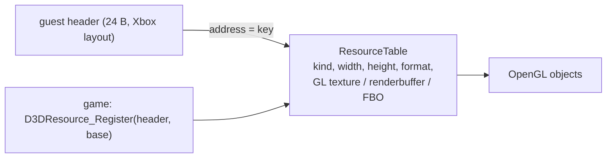

# 설계: D3D8 HLE 두 번째 묶음 — 리소스 모델, 백버퍼·깊이 서피스, Clear/Swap으로 첫 프레임 (issue #12)

선행: [i007](20261012-i007-d3d8-hle-first-batch.md), [analysis: d3d8-adapter](../analysis/d3d8-adapter.md), [kb: Xbox D3D8 API](../kb/xbox-d3d8-api.md)

## 1. 요구사항

* 부팅은 `Direct3D_CreateDevice` 뒤 첫 호출 `D3DDevice_GetBackBuffer`에서 멈춘다. 게임의 D3D 초기화(`sub_00156AB0`)는 그 뒤 `D3DResource_Release`, `D3DDevice_GetDepthStencilSurface`, `D3DResource_Release`를 부르고, 다른 초기화 함수들은 `D3DSurface_GetDesc`, `D3DResource_AddRef`, `D3DDevice_Swap`, `D3DDevice_CreateTexture`, `D3D_AllocContiguousMemory` + `D3DResource_Register`, `D3DDevice_GetTile`/`SetTile`을 쓴다(생성 코드의 호출 목록, **확인됨**; 실행 순서는 부팅으로 확인한다).
* 이번 묶음의 목표: **게임이 첫 프레임을 present할 때까지**(`D3DDevice_Swap`) 진행하고 창에 그 결과(지운 화면)를 보인다. 그 과정에서 닿는 서피스·리소스 함수를 구현한다.
* 리소스 객체는 게임이 직접 읽고 만들기도 하므로(`D3DResource_Register`, XGRAPHC의 헤더 작성 함수는 lift된 원본으로 실행됨) **게스트에 보이는 객체 레이아웃은 Xbox 원본과 같아야 한다**.

## 2. 리소스 모델

### 2.1 게스트 헤더 = Xbox `D3DResource` 레이아웃

* **확인됨**(lift 본문): `D3DResource_AddRef`는 `Common` 하위 16비트를 1 올리고 그 값을 돌려준다. 타입(`Common & 0x70000`)이 서피스(`0x50000`)이고 `Parent`(+0x14)가 있으면 부모도 AddRef한다. `Release`는 refcount가 1이고 내부 refcount(`Common & 0x780000`)가 0이면 파괴 루틴(`0x00192830`)을 부르고 0을 돌려주며, 그렇지 않으면 1 내린 값을 돌려준다. 서피스의 부모는 같은 조건에서 Release된다.
* **확인됨**: `D3DDevice_GetBackBuffer(BackBuffer, Type, ppBackBuffer)`는 디바이스 구조체의 `+0x207C + idx*4`에서 서피스 포인터를 읽어 `*ppBackBuffer`에 쓰고 AddRef한다(idx: 0 → 0, −1 → 1, 그 외 → 2). `GetDepthStencilSurface`는 `+0x2074`를 쓰고 AddRef하며, 없으면 `D3DERR_NOTFOUND(0x88760866)`.
* **추정**(Cxbx-Reloaded 지식, 우리 바이너리에서는 비트 일부만 확인): `Common` 타입 값 VERTEXBUFFER 0, INDEXBUFFER 0x10000, PUSHBUFFER 0x20000, PALETTE 0x30000, TEXTURE 0x40000, SURFACE 0x50000, FIXUP 0x60000; `D3DCOMMON_D3DCREATED 0x01000000`.
* HLE가 만드는 서피스(백버퍼 2개, 깊이 1개)는 GuestHeap에 **24바이트 헤더**를 두고 이 레이아웃으로 채운다(`Common` = refcount 1 | SURFACE | D3DCREATED, `Format`/`Size`는 XGRAPHC 인코딩, `Data`는 픽셀 메모리 게스트 주소). 픽셀 메모리는 실제로 할당한다(게임이 `Data`를 읽거나 lock할 수 있다). 디바이스 구조체 필드(`+0x207C`, `+0x2074`)는 **원본 라이브러리만 읽으므로 모사하지 않는다**. 게임이 디바이스 구조체를 직접 읽는 것이 드러나면 그때 그 필드만 채운다.

### 2.2 호스트 쪽 리소스 표

* `ResourceTable`(모듈 내부)은 헤더 주소를 키로 호스트 상태(종류, 크기, 포맷, GL 객체)를 든다. 게임이 만든 헤더(`Register`)는 등록 시 `Format`/`Size`를 해석해 표에 넣는다. 파괴는 refcount 규칙에 따라 표에서 지우고 GL 객체를 놓는다.
* 백버퍼는 기본 프레임버퍼로 대응한다(렌더 타깃이 백버퍼면 FBO 0). 깊이 버퍼는 창의 깊이·스텐실 부착물이다. 텍스처는 다음 묶음에서 GL 텍스처로.

## 3. export와 동작

| export | 규약·인자(원본 `ret n`) | 동작 |
|---|---|---|
| `D3DDevice_GetBackBuffer` | stdcall, 3 | 백버퍼 헤더 주소를 `*ppBackBuffer`에, AddRef, `D3D_OK` |
| `D3DDevice_GetDepthStencilSurface` | stdcall, 1 | 깊이 헤더, AddRef, 없으면 `D3DERR_NOTFOUND` |
| `D3DResource_AddRef`, `D3DResource_Release` | stdcall, 1 | §2.1 규칙 그대로(비교 도구로 확인) |
| `D3DResource_GetType` | stdcall, 1 | `Common` 타입과 `Format` 차원으로 `D3DRESOURCETYPE` 산출(원본과 비교) |
| `D3DSurface_GetDesc` | stdcall, 2 | 헤더의 `Format`/`Size`로 32바이트 `D3DSURFACE_DESC` 작성(원본 `0x00192F50`과 비교) |
| `D3DDevice_SetRenderTarget` | stdcall, 2 | 현재 렌더 타깃·깊이 갱신(FBO 바인딩), 뷰포트 재설정 |
| `D3DDevice_Clear` | stdcall, 6 | `Flags`에 따라 `glClear`(색·깊이·스텐실), `Count`/`pRects`가 있으면 scissor로 사각형마다 |
| `D3DDevice_Swap` | stdcall, 1 | `PresentDisplay`, 이벤트 처리, 프레임 카운터 |
| `D3DDevice_Reset` | stdcall, 1 | 표시 파라미터 다시 읽기, 백버퍼·깊이 재생성(크기 같으면 유지) |
| `D3DDevice_SetViewport`, `D3DDevice_BlockUntilVerticalBlank`, `D3DDevice_SetVerticalBlankCallback`, `D3DDevice_SetGammaRamp`, `SetFlickerFilter`, `SetSoftDisplayFilter` | 각각 | 상태 저장만(화면 효과는 적용하지 않음), 게임이 닿을 때 |
| `D3D_AllocContiguousMemory`, `D3D_FreeContiguousMemory`, `D3DResource_Register`, `D3DDevice_GetTile`/`SetTile`, `CreateTexture` 계열 | 각각 | **닿는 순서대로 이번 묶음에 포함할지 결정**한다. 연속 메모리는 `MmAllocateContiguousMemory` 동등(GuestHeap). 타일은 상태 저장만. 텍스처 생성은 헤더 + 픽셀 메모리 할당과 표 등록(GL 업로드는 그리기 묶음에서) |

* 반환값·esp는 모두 `rejsrf_d3d8_check`에 케이스를 더해 원본과 비교한다(§4). `D3DSURFACE_DESC` 레이아웃 `{Format, Type, Usage, Pool, Size, MultiSampleType, Width, Height}`은 비교로 확정한다.
* 게임이 요청한 표시 파라미터(640×480 `LIN_R5G6B5`, 깊이 `LIN_D24S8`)에 맞춰 백버퍼 헤더의 `Format`은 `LIN_R5G6B5`, 깊이는 `LIN_D24S8`로 인코딩한다. 인코딩 비트는 XGRAPHC(`XGSetSurfaceHeader`에 해당) lift 본문 또는 Cxbx 지식에서 가져와 **추정**으로 적고, 게임이 `GetDesc`로 읽은 결과가 원본 디바이스에서와 같은지는 레이아웃 비교로 확인한다.

## 4. 검증 도구 확장

`rejsrf_d3d8_check`에 **헤더 기반 순수 함수** 케이스를 더한다: 직접 채운 24바이트 헤더(여러 타입·refcount·parent 조합)로 `D3DResource_AddRef`/`Release`(파괴 경로 제외: refcount ≥ 2 또는 내부 refcount 설정)/`GetType`, `D3DSurface_GetDesc`를 원본과 비교한다. 디바이스 전역을 읽는 함수(`GetBackBuffer`, `Swap`, `Clear`)는 부팅으로 확인한다.

## 5. 검증 계획

| 검증 | 기대 |
|---|---|
| Win32 Debug/Release 빌드 | 경고 0 |
| `rexbox_kernel_probe`, `rejsrf_decomp_check`, `rejsrf_d3d8_check` | 회귀 없음, 새 케이스 일치 |
| 부팅 | 창에 게임의 첫 `Clear` 색이 보이고 `Swap`을 통과; 다음 frontier 기록 |

## 6. 미해결 항목

* XGRAPHC(`XGSetTextureHeader` 등)는 lift된 원본으로 실행되며 헤더 비트를 쓴다. HLE가 같은 인코딩을 읽어야 하므로 비트 정의를 `docs/kb/xbox-d3d8-api.md`에 누적한다.
* 게임 코드가 `D3D__pDevice`나 디바이스 구조체 필드를 직접 읽는지(추정: 읽지 않음)는 부팅 로그와 `recomp_icall`·메모리 접근으로 본다.
* 텍스처 업로드·그리기(정점 버퍼, 셰이더, 렌더 상태)는 세 번째 묶음.

---

# Design: D3D8 HLE, second batch — resource model, back-buffer and depth surfaces, Clear/Swap to the first frame (issue #12)

Prerequisites: [i007](20261012-i007-d3d8-hle-first-batch.md), [analysis: d3d8-adapter](../analysis/d3d8-adapter.md), [kb: Xbox D3D8 API](../kb/xbox-d3d8-api.md)

## 1. Requirements

* Boot stops at `D3DDevice_GetBackBuffer`, the first call after `Direct3D_CreateDevice`. The game's D3D initialization (`sub_00156AB0`) then calls `D3DResource_Release`, `D3DDevice_GetDepthStencilSurface` and `D3DResource_Release`; other initialization functions use `D3DSurface_GetDesc`, `D3DResource_AddRef`, `D3DDevice_Swap`, `D3DDevice_CreateTexture`, `D3D_AllocContiguousMemory` + `D3DResource_Register` and `D3DDevice_GetTile`/`SetTile` (call lists from the generated code, **confirmed**; the execution order is confirmed by booting).
* Goal of this batch: **run until the game presents its first frame** (`D3DDevice_Swap`) and show the result (the cleared screen) in the window, implementing the surface and resource functions reached on the way.
* The game reads and even builds resource objects itself (`D3DResource_Register`; XGRAPHC's header-writing functions run as lifted originals), so **the guest-visible object layout must equal the Xbox original**.

## 2. Resource model

### 2.1 Guest header = the Xbox `D3DResource` layout

The class diagram above applies: `Common` (+0x00: refcount bits 15:0, type bits 18:16, internal refcount bits 22:19, D3DCREATED bit 24), `Data` (+0x04, pixel memory guest address), `Lock` (+0x08); pixel containers add `Format` (+0x0C, the XGRAPHC bit field) and `Size` (+0x10); surfaces add `Parent` (+0x14).

* **Confirmed** (lifted bodies): `D3DResource_AddRef` increments the low 16 bits of `Common` and returns them; for a surface (type `0x50000`) with a `Parent` it also AddRefs the parent. `Release` with refcount 1 and internal refcount (`Common & 0x780000`) zero calls the destroy routine (`0x00192830`) and returns 0, otherwise returns the decremented count; a surface's parent is released under the same condition.
* **Confirmed**: `D3DDevice_GetBackBuffer(BackBuffer, Type, ppBackBuffer)` reads the surface pointer at device `+0x207C + idx*4` (idx: 0 → 0, −1 → 1, else → 2), stores it to `*ppBackBuffer` and AddRefs it; `GetDepthStencilSurface` uses `+0x2074`, AddRefs, and returns `D3DERR_NOTFOUND (0x88760866)` when absent.
* **Inferred** (Cxbx-Reloaded knowledge; only some bits confirmed on our binary): `Common` type values VERTEXBUFFER 0, INDEXBUFFER 0x10000, PUSHBUFFER 0x20000, PALETTE 0x30000, TEXTURE 0x40000, SURFACE 0x50000, FIXUP 0x60000; `D3DCOMMON_D3DCREATED 0x01000000`.
* The surfaces the HLE creates (two back buffers, one depth buffer) get a **24-byte header** from the GuestHeap in this layout (`Common` = refcount 1 | SURFACE | D3DCREATED, `Format`/`Size` in XGRAPHC encoding, `Data` a real pixel allocation, since the game may read or lock it). The device structure fields (`+0x207C`, `+0x2074`) are **not mirrored**: only the original library reads them. If the game turns out to read the device structure, those fields are filled then.

### 2.2 Host-side resource table

`ResourceTable` (module-internal) maps a header address to host state (kind, size, format, GL objects). Game-built headers (`Register`) are decoded from `Format`/`Size` on registration. Destruction follows the refcount rule and releases the GL objects. Back buffers map to the default framebuffer (FBO 0 when the render target is a back buffer); the depth buffer is the window's depth/stencil attachment; textures become GL textures in the next batch.

## 3. Exports and behavior

The table above applies: `GetBackBuffer` and `GetDepthStencilSurface` hand out the header addresses with an AddRef; `D3DResource_AddRef`/`Release`/`GetType` follow §2.1 (confirmed by the comparison tool); `D3DSurface_GetDesc` writes the 32-byte `D3DSURFACE_DESC` from the header (compared with the original `0x00192F50`); `SetRenderTarget` rebinds the FBO and viewport; `Clear` maps `Flags` to `glClear` with scissored rectangles when `Count`/`pRects` are given; `Swap` presents, pumps events and counts frames; `Reset` re-reads the presentation parameters and recreates the surfaces when the size changes; viewport, vblank, gamma and filter setters only store state; contiguous memory, `Register`, tiles and the `CreateTexture` family are **included as they are reached** (contiguous memory from the GuestHeap, tiles as stored state, textures as header + pixel allocation + table entry, with GL upload in the drawing batch). Return values and esp are compared with the originals through new `rejsrf_d3d8_check` cases (§4), which also fixes the `D3DSURFACE_DESC` layout `{Format, Type, Usage, Pool, Size, MultiSampleType, Width, Height}`. The back buffer headers encode `LIN_R5G6B5` and the depth buffer `LIN_D24S8` to match the game's request; the encoding bits come from the lifted XGRAPHC body or Cxbx knowledge, recorded as **inferred**, and the `GetDesc` result is confirmed by comparison.

## 4. Verification tool extension

`rejsrf_d3d8_check` gains **header-based pure-function** cases: hand-filled 24-byte headers (several type, refcount and parent combinations) run through `D3DResource_AddRef`/`Release` (excluding the destroy path: refcount ≥ 2 or internal refcount set), `GetType` and `D3DSurface_GetDesc` against the originals. Functions that read the device global (`GetBackBuffer`, `Swap`, `Clear`) are verified by booting.

## 5. Verification plan

Win32 Debug/Release builds with zero warnings; no regression in `rexbox_kernel_probe`, `rejsrf_decomp_check` and `rejsrf_d3d8_check`, new cases matching; boot shows the game's first `Clear` color in the window, passes `Swap`, and the next frontier is recorded.

## 6. Unresolved

* XGRAPHC (`XGSetTextureHeader` and friends) runs as lifted code and writes header bits; the HLE must read the same encoding, accumulated in `docs/kb/xbox-d3d8-api.md`.
* Whether game code reads `D3D__pDevice` or device-structure fields directly (inferred: no) is checked from boot logs, indirect-call reports and memory accesses.
* Texture upload and drawing (vertex buffers, shaders, render state) are the third batch.
