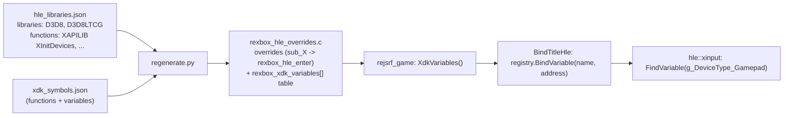
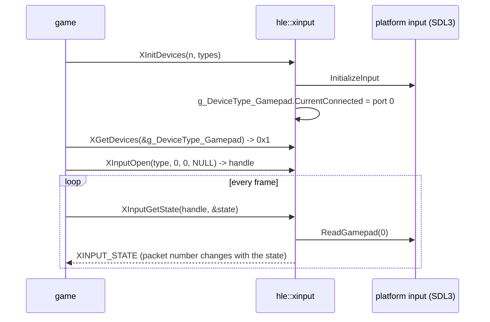

# 설계: XInput HLE — XAPI 장치·입력 함수를 SDL3 호스트 입력 위에 (issue #15)

선행: [i006 바인딩](20261012-i006-xdk-symbol-binding.md), [i007 표시 계층](20261012-i007-d3d8-hle-first-batch.md), [부팅 frontier](../analysis/boot-frontier.md), [XDK 심볼 §3](../analysis/xdk-symbols.md)

## 1. 요구사항

* 부팅은 커널 import 65 `IoCreateDevice`에서 멈춘다. 호출자는 XAPI `XInitDevices` → `MU_Init`이다. XAPI의 XPP 섹션에는 USB 호스트(OHCI)와 클래스 드라이버(게임패드, 메모리 유닛, 키보드, IR 동글)가 정적 링크되어 있고, 이 스택은 I/O 관리자 커널 export 6개(`IoCreateDevice`, `IoStartPacket`, `IofCompleteRequest`, `IoStartNextPacket`, `IoMarkIrpMustComplete`, `IoInvalidDeviceRequest`)와 인터럽트·DPC를 거쳐 OHCI 레지스터에 닿는다.
* 설계 목표 2(API 경계에서 HLE, 하드웨어 수준은 최후 수단)에 따라 USB 스택을 돌리지 않고 **게임이 부르는 XAPI 입력 API를 HLE로 대체**한다. 대상: `XInitDevices`, `XGetDevices`, `XGetDeviceChanges`, `XInputOpen`, `XInputClose`, `XInputGetCapabilities`, `XInputGetState`, `XInputSetState`, `XInputPoll`, `XMountMUA`, `XUnmountMU`(모두 XbSymbolDatabase가 식별, [xdk-symbols §1](../analysis/xdk-symbols.md)).
* XAPILIB의 나머지(파일, 스레드, 이벤트, 시간)는 lift된 원본이 커널 HLE 위에서 이미 돌므로 그대로 둔다. 그래서 HLE 대상 선택을 **라이브러리 단위에서 함수 단위로** 넓힌다.
* 호스트 입력은 SDL3 게임패드(아날로그 스틱·트리거·아날로그 버튼)와 키보드 대체 입력으로 제공한다. 플랫폼 계층은 기본 값만 주고받는다.

## 2. 함수 단위 HLE 선택과 XDK 변수 바인딩

* `hle_libraries.json`에 `functions` 목록(`{library, name}`)을 더한다. `regenerate.py`는 라이브러리 전체 또는 목록에 있는 함수에 override를 만든다.
* XInput API는 장치 종류를 **XAPI 전역 변수의 주소**(`XDEVICE_TYPE_GAMEPAD` = `&g_DeviceType_Gamepad` 등)로 받는다. 그 주소는 타이틀마다 다르므로, `regenerate.py`가 식별된 XDK 변수를 `rexbox_xdk_variables[]` 표로 생성하고, 타이틀 프로파일의 `BindTitleHle`가 그것을 `HleRegistry::BindVariable(name, address)`로 등록한다. HLE 모듈은 `FindVariable(name)`으로 찾는다. `rexbox`는 타이틀 주소를 모르는 채로 남는다(레이어 규칙).
* 생성 코드가 없는 빌드(CI)에서는 표가 없고 바인딩은 0개다(`jsrf_recomp.cpp`의 `REJSRF_HAS_RECOMP` 패턴).

## 3. 호스트 입력 계약: `include/rexbox/platform/input.h`

| 함수 | 역할 |
|---|---|
| `InitializeInput(std::string* error)` | 게임패드 하위 시스템 시작(SDL `SDL_INIT_GAMEPAD`). 실패해도 키보드 대체 입력은 남는다 |
| `ReadGamepad(uint32_t index, GamepadSnapshot*)` | `index`번째 호스트 게임패드(없으면 index 0은 키보드)의 상태 |

`GamepadSnapshot`(기본 값): `connected`, 디지털(`dpad_up/down/left/right`, `start`, `back`, `left_thumb`, `right_thumb`), 아날로그 0–255(`a`, `b`, `x`, `y`, `black`, `white`, `left_trigger`, `right_trigger`), 스틱 −32768–32767(Y는 위가 +).

* SDL3 구현은 `src/platform/sdl/input_sdl.cpp`. SDL 게임패드의 SOUTH/EAST/WEST/NORTH → A/B/X/Y, 왼쪽·오른쪽 숄더 → Black/White(Xbox 컨트롤러의 위치와 같은 순서가 아니라 기능 대응), 트리거는 축 0–32767을 0–255로. SDL의 Y축은 아래가 +이므로 부호를 뒤집는다.
* 키보드 대체(게임패드가 없을 때 index 0): 방향키 → D-pad와 왼쪽 스틱, Enter → START, Backspace → BACK, Z/X/C/V → A/B/X/Y, A/S → 왼쪽/오른쪽 트리거, Q/W → Black/White. 표는 [kb: Xbox XInput](../kb/xbox-xinput.md)에 둔다.
* re2DJ의 SDL3 게임패드 리더(BSD-3)는 디지털 버튼(bitset)만 다뤄 Xbox의 아날로그 입력에 맞지 않으므로 코드를 가져오지 않고 구조(SDL 타입 은닉, 장치 추가·제거 처리)만 참고한다.
* 스레드: 이벤트는 표시 계층이 `PresentDisplay`/`PumpDisplayEvents`에서 펌프한다. 창이 없는 실행(`REXBOX_DISPLAY=none`)에서는 `ReadGamepad`가 `SDL_UpdateGamepads`를 직접 부른다.

## 4. XInput HLE 모듈

| export | 규약(인자) | 동작 |
|---|---|---|
| `XInitDevices` | stdcall(2) | 입력 계층 초기화. 장치 종류 구조체는 비워 둔다(아직 열거 전) |
| `XGetDevices` | stdcall(1: 장치 종류) | 원본과 같은 구조체 의미(§4.1). 첫 조회 뒤에 게임패드 포트 0이 도착 |
| `XGetDeviceChanges` | stdcall(3: 종류, `pInsertions`, `pRemovals`) | 원본과 같은 구조체 의미. 첫 조회는 FALSE, 이후 게임패드 삽입을 TRUE로 보고 |
| `XInputOpen` | stdcall(4: 종류, 포트, 슬롯, 폴링 파라미터) | 연결된 게임패드 포트면 핸들(게스트 힙의 작은 블록), 아니면 NULL과 `ERROR_DEVICE_NOT_CONNECTED` |
| `XInputClose` | stdcall(1) | 핸들 해제 |
| `XInputGetCapabilities` | stdcall(2) | `XINPUT_CAPABILITIES`: SubType 게임패드, 모든 버튼·축 사용 가능 표시 |
| `XInputGetState` | stdcall(2) | `XINPUT_STATE`를 채우고 `ERROR_SUCCESS`; 상태가 바뀌면 `dwPacketNumber` 증가 |
| `XInputSetState` | stdcall(2) | 진동은 아직 적용하지 않음. 피드백 헤더 `dwStatus = ERROR_SUCCESS`로 즉시 완료 |
| `XInputPoll` | stdcall(1) | `ERROR_SUCCESS` |
| `XMountMUA` / `XUnmountMU` | stdcall(3) / (2) | 메모리 유닛 없음: `ERROR_DEVICE_NOT_CONNECTED` |

* 구조체(**추정**, 공개 XDK 헤더 지식, Cxbx-Reloaded·xboxrecomp와 일치하는 부분만): `XINPUT_GAMEPAD` = `{WORD wButtons; BYTE bAnalogButtons[8]; SHORT sThumbLX, sThumbLY, sThumbRX, sThumbRY}`(18바이트), `XINPUT_STATE` = `{DWORD dwPacketNumber; XINPUT_GAMEPAD Gamepad}`(22바이트), `XINPUT_CAPABILITIES` = `{BYTE SubType; WORD Reserved; XINPUT_GAMEPAD In; XINPUT_RUMBLE Out}`(SubType +0, In +4, Out +22). 게임이 실제로 읽는 필드는 실행 추적으로 확인해 analysis에 **확인됨**으로 옮긴다.
* `XPP_DEVICE_TYPE`(**추정**): `{ULONG CurrentConnected; ULONG ChangeConnected; ULONG PreviousConnected}`. HLE가 이 필드도 같은 값으로 써서, 게임이나 lift된 XAPI 코드가 직접 읽어도 HLE와 어긋나지 않게 한다.
* 게임패드는 호스트 장치와 무관하게 포트 0에 연결된 것으로 보고한다(키보드 대체가 있으므로). 여러 포트 지원은 이후.

### 4.1 장치 도착 시점

* **확인됨**: 원본 `XGetDevices`/`XGetDeviceChanges`는 `XPP_DEVICE_TYPE`만 IRQL 보호 아래 다룬다([kb: xbox-xinput §1](../kb/xbox-xinput.md)). 처음 구현은 이 둘을 lift된 원본으로 두고 `XInitDevices`에서 구조체를 "연결됨·변경 대기"로 채웠다.
* **확인됨**: 그러자 게임의 DirectInput식 장치 열거(`0x001669A0`)가 실패했다. 이 함수는 `XGetDeviceChanges(&g_DeviceType_Gamepad)`가 TRUE이면 `E_FAIL`을 돌려주고, 그 실패가 그래픽·입력 객체 생성(`0x0005F2C0`)을 실패시켜, 원본 코드가 null 객체의 vtable 슬롯 `+0xF0`을 호출했다.
* **추정**: 콘솔에서는 `XInitDevices`가 USB 열거를 시작만 하고 돌아오므로 첫 조회에는 장치도 변경도 없고, 게임패드는 이후 프레임 루프의 변경 조회에서 삽입으로 나타난다.
* 그래서 두 함수를 HLE로 옮겨 원본의 구조체 의미를 그대로 구현하고, 게임패드는 **첫 조회가 끝난 뒤** 다음 조회에서 `Current`와 `Change`에 도착 비트를 더한다. 호출 횟수 기준이라 시간에 의존하지 않고 재현 가능하다.
* 원본 XInput 함수는 USB 스택을 거치므로 `rejsrf_d3d8_check`식 원본 비교가 불가능하다. 검증은 부팅과 HLE 추적으로 한다.

## 5. 남는 커널 import

`IoCreateDevice` 등 I/O 관리자 export 6개는 USB 스택에서만 쓰이므로, `XInitDevices`를 HLE로 바꾸면 닿지 않는다. 구현하지 않고 [boot-frontier](../analysis/boot-frontier.md)에 기록한다. 다른 경로로 닿으면 그때 정한다.

## 6. 검증

| 검증 | 기대 |
|---|---|
| Win32 Debug/Release 빌드 | 우리 타깃 경고 0 |
| `rexbox_kernel_probe`, `rejsrf_decomp_check`, `rejsrf_d3d8_check`, `check_hle_pops.py` | 회귀 없음 |
| 부팅 | `IoCreateDevice`를 지나 다음 frontier. `REXBOX_HLE_TRACE`로 XInput 호출 순서와 인자 기록 |
| 수동 | 게임패드·키보드 입력이 `XInputGetState` 값으로 바뀌는지(가이드에 절차) |

---

# Design: XInput HLE — XAPI device and input functions on an SDL3 host input layer (issue #15)

Prerequisites: [i006 binding](20261012-i006-xdk-symbol-binding.md), [i007 display layer](20261012-i007-d3d8-hle-first-batch.md), [boot frontier](../analysis/boot-frontier.md), [XDK symbols §3](../analysis/xdk-symbols.md)

## 1. Requirements

* Boot stops at kernel import 65 `IoCreateDevice`, called from XAPI's `XInitDevices` → `MU_Init`. XAPI's XPP section statically links the USB host (OHCI) and class drivers (gamepad, memory unit, keyboard, IR dongle); that stack goes through six I/O-manager kernel exports (`IoCreateDevice`, `IoStartPacket`, `IofCompleteRequest`, `IoStartNextPacket`, `IoMarkIrpMustComplete`, `IoInvalidDeviceRequest`) and interrupts and DPCs down to the OHCI registers.
* Following design goal 2 (HLE at API boundaries, hardware-level only as a last resort), the USB stack is not run; **the XAPI input API the game calls is replaced by HLE**: `XInitDevices`, `XGetDevices`, `XGetDeviceChanges`, `XInputOpen`, `XInputClose`, `XInputGetCapabilities`, `XInputGetState`, `XInputSetState`, `XInputPoll`, `XMountMUA`, `XUnmountMU` (all identified by XbSymbolDatabase, [xdk-symbols §1](../analysis/xdk-symbols.md)).
* The rest of XAPILIB (files, threads, events, time) already works as lifted code on the kernel HLE and stays, so HLE selection widens **from whole libraries to single functions**.
* Host input comes from SDL3 gamepads (analog sticks, triggers, analog buttons) with a keyboard fallback; the platform layer exchanges plain values only.

## 2. Per-function HLE selection and XDK variable binding

The diagram above applies. `hle_libraries.json` gains a `functions` list (`{library, name}`), and `regenerate.py` creates overrides for whole libraries or listed functions. The XInput API receives device types as **addresses of XAPI globals** (`XDEVICE_TYPE_GAMEPAD` = `&g_DeviceType_Gamepad`, …), which differ per title: `regenerate.py` emits the identified XDK variables as a `rexbox_xdk_variables[]` table, the title profile's `BindTitleHle` registers them with `HleRegistry::BindVariable(name, address)`, and HLE modules look them up with `FindVariable(name)`; `rexbox` stays ignorant of title addresses (layer rules). Builds without generated code (CI) have no table and bind nothing (the `REJSRF_HAS_RECOMP` pattern of `jsrf_recomp.cpp`).

## 3. Host input contract: `include/rexbox/platform/input.h`

`InitializeInput(std::string* error)` starts the gamepad subsystem (SDL `SDL_INIT_GAMEPAD`; the keyboard fallback remains on failure); `ReadGamepad(uint32_t index, GamepadSnapshot*)` returns the `index`-th host gamepad (the keyboard for index 0 when there is none). `GamepadSnapshot` holds plain values: `connected`; digital `dpad_up/down/left/right`, `start`, `back`, `left_thumb`, `right_thumb`; analog 0–255 `a`, `b`, `x`, `y`, `black`, `white`, `left_trigger`, `right_trigger`; sticks −32768–32767 with +Y up.

The SDL3 implementation is `src/platform/sdl/input_sdl.cpp`: SDL's SOUTH/EAST/WEST/NORTH map to A/B/X/Y, the left and right shoulders to Black/White (by function rather than position), triggers scale 0–32767 to 0–255, and the Y axes are negated (SDL's +Y is down). The keyboard fallback (index 0 with no gamepad): arrows → D-pad and left stick, Enter → START, Backspace → BACK, Z/X/C/V → A/B/X/Y, A/S → left/right trigger, Q/W → Black/White; the table lives in [kb: Xbox XInput](../kb/xbox-xinput.md). re2DJ's SDL3 gamepad reader (BSD-3) handles digital buttons only (a bitset) and does not fit the Xbox's analog input, so its structure (hidden SDL types, device add/remove) is a reference but no code is taken. Threads: the display layer pumps events in `PresentDisplay`/`PumpDisplayEvents`; without a window (`REXBOX_DISPLAY=none`) `ReadGamepad` calls `SDL_UpdateGamepads` itself.

## 4. XInput HLE module

The sequence diagram and the table above apply: `XInitDevices` initializes input and leaves the device-type structures empty (nothing enumerated yet); `XGetDevices` and `XGetDeviceChanges` keep the original's structure semantics, with the port-0 gamepad arriving after the first query (§4.1); `XInputOpen` returns a handle (a small guest heap block) for a connected gamepad port, otherwise NULL with `ERROR_DEVICE_NOT_CONNECTED`; `XInputClose` releases it; `XInputGetCapabilities` fills `XINPUT_CAPABILITIES` (gamepad subtype, every button and axis available); `XInputGetState` fills `XINPUT_STATE` and returns `ERROR_SUCCESS`, incrementing `dwPacketNumber` when the state changes; `XInputSetState` does not apply rumble yet and completes immediately with the feedback header's `dwStatus = ERROR_SUCCESS`; `XInputPoll` returns `ERROR_SUCCESS`; `XMountMUA`/`XUnmountMU` return `ERROR_DEVICE_NOT_CONNECTED` (no memory units).

* Structures (**inferred**, from public XDK header knowledge, only where Cxbx-Reloaded and xboxrecomp agree): `XINPUT_GAMEPAD` = `{WORD wButtons; BYTE bAnalogButtons[8]; SHORT sThumbLX, sThumbLY, sThumbRX, sThumbRY}` (18 bytes), `XINPUT_STATE` = `{DWORD dwPacketNumber; XINPUT_GAMEPAD Gamepad}` (22 bytes), `XINPUT_CAPABILITIES` = `{BYTE SubType; WORD Reserved; XINPUT_GAMEPAD In; XINPUT_RUMBLE Out}` (SubType +0, In +4, Out +22). The fields the game actually reads are confirmed from run traces and moved to the analysis as **confirmed**.
* `XPP_DEVICE_TYPE` (**inferred**): `{ULONG CurrentConnected; ULONG ChangeConnected; ULONG PreviousConnected}`; the HLE writes these fields with the same values so the game or lifted XAPI code reading them directly agrees with it.
* The gamepad on port 0 is reported connected, host device or not (the keyboard fallback exists); more ports come later.
* **Arrival timing (§4.1).** **Confirmed**: the originals of `XGetDevices`/`XGetDeviceChanges` only touch `XPP_DEVICE_TYPE` at raised IRQL; the first implementation kept them lifted and had `XInitDevices` fill the structure as "connected, change pending". **Confirmed**: the game's DirectInput-style enumeration (`0x001669A0`) then failed: it returns `E_FAIL` when `XGetDeviceChanges(&g_DeviceType_Gamepad)` is TRUE, which failed the creation of its graphics and input object (`0x0005F2C0`) and made the original code call vtable slot `+0xF0` of a null object. **Inferred**: on the console `XInitDevices` only starts USB enumeration, so the first query sees neither devices nor changes and gamepads appear later as insertions in the frame loop. Both functions therefore became HLE with the original's structure semantics, and the gamepad's bits are added to `Current` and `Change` at the query **after the first one completed**, counted in calls so it is reproducible and independent of time.
* The original XInput functions go through the USB stack, so a `rejsrf_d3d8_check`-style comparison with the originals is impossible; verification is by booting and HLE traces.

## 5. Kernel imports left

The six I/O-manager exports (`IoCreateDevice`, …) are used only by the USB stack, so with `XInitDevices` replaced they are not reached; they stay unimplemented and are recorded in [boot-frontier](../analysis/boot-frontier.md), to be decided if another path reaches them.

## 6. Verification

Win32 Debug/Release builds with zero warnings on our targets; no regression in `rexbox_kernel_probe`, `rejsrf_decomp_check`, `rejsrf_d3d8_check` and `check_hle_pops.py`; boot passes `IoCreateDevice` to the next frontier with the XInput call order and arguments recorded through `REXBOX_HLE_TRACE`; manually, gamepad and keyboard input changing the `XInputGetState` values (procedure in the guide).
