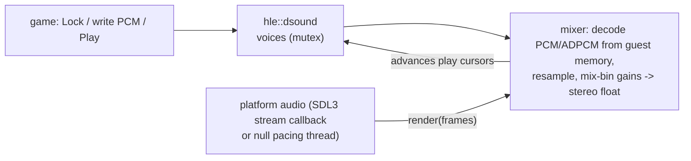

# 설계: DSOUND HLE — DirectSound 객체와 버퍼를 SDL3 호스트 오디오 믹서 위에 (issue #17)

선행: [i015 함수 단위 HLE](20261012-i015-xinput-hle.md), [i007 표시 계층](20261012-i007-d3d8-hle-first-batch.md), [부팅 frontier](../analysis/boot-frontier.md), [XDK 심볼](../analysis/xdk-symbols.md)

## 1. 요구사항

* 부팅은 `DirectSoundCreate` 안에서 MCPX APU 레지스터 `0xFE801100`을 읽다가 멈춘다. DSOUND 섹션(`0x0019E340`, 0x1C55C바이트)은 APU의 음성 처리기(VP)와 GP/EP DSP를 레지스터·DMA·인터럽트로 직접 다룬다.
* 설계 목표 2(API 경계에서 HLE)에 따라 하드웨어를 흉내 내지 않고 **게임이 부르는 DSOUND 공개 API를 HLE로 대체**한다.
* 소리는 SDL3 오디오 장치로 낸다. 오디오 장치가 없거나 꺼진 실행(CI, 진단)에서도 재생 커서는 실시간으로 움직여야 한다. 음악 스트리밍 코드가 커서를 폴링하기 때문이다.
* 이번 범위: 객체 수명, 버퍼 메모리, Lock·Play·Stop·상태·커서, 볼륨·주파수·루프 구간·믹스 빈, PCM과 Xbox ADPCM 디코드, 효과 이미지 서술자와 DSP 상태 읽기·쓰기. 3D 위치, HRTF, DSP 효과(리버브 등), 엔벨로프(EG), LFO, 필터는 호출을 받아들이되(`S_OK`) 소리에 반영하지 않는다(§7).

## 2. HLE 대상

* **확인됨**: 게임 코드(`.text`)에서 DSOUND 섹션으로 가는 `call`/`jmp rel32`를 모두 찾으면 이름 있는 함수 50개다(XbSymbolDatabase 식별, `jmp`는 `IDirectSound_GetSpeakerConfig`와 `IDirectSoundBuffer_SetFrequency`의 꼬리 호출). `.rdata`/`.data`가 가리키는 DSOUND 함수는 DSOUND 자신의 vtable(`DSound_CRefCount_*`)뿐이다.
* 이 50개를 `hle_libraries.json`의 `functions`에 넣는다(i015 방식). DSOUND 내부 함수는 공개 API에서만 불리므로 닿지 않는다.
* 이름 없는 대상 3개는 lift된 원본으로 둔다. 원본이 하드웨어에 닿지 않기 때문이다.

| 주소 | 모양 | 판단 |
|---|---|---|
| `0x0019E4BC` | `xor eax,eax; ret 0xC` | `IDirectSound_SetCooperativeLevel(this, hwnd, level)` 꼴. 게임은 `DirectSoundCreate` 직후 `(ds, hwnd, 3)`으로 부른다. 같은 바이트를 공유하는 다른 COM 꼴 함수도 부른다(ICF 병합) |
| `0x0019E4C1` | `xor eax,eax; ret 4` | `IDirectSound_Compact(this)` 꼴 |
| `0x0019E523` | 임계 구역 안에서 HRTF 함수 포인터 표 8개(`0x001BA080`~)를 채움 | `DirectSoundUseFullHRTF`. 임계 구역 `0x001BA050`은 DSOUND 섹션 안에 정적으로 초기화되어 있다(헤더 type 1, size 4, LockCount −1) |

| export | `ret n` | export | `ret n` |
|---|---|---|---|
| `DirectSoundCreate` | 0xC | `IDirectSoundBuffer_Lock` | 0x20 |
| `DirectSoundDoWork` | 0 | `IDirectSoundBuffer_Unlock` | 0x14 |
| `IDirectSound_AddRef` / `_Release` | 4 | `IDirectSoundBuffer_AddRef` / `_Release` | 4 |
| `IDirectSound_GetCaps` | 8 | `IDirectSoundBuffer_Play` | 0x10 |
| `IDirectSound_GetSpeakerConfig` | 8 | `IDirectSoundBuffer_Stop` | 4 |
| `IDirectSound_CreateSoundBuffer` | 0x10 | `IDirectSoundBuffer_GetStatus` | 8 |
| `IDirectSound_DownloadEffectsImage` | 0x14 | `IDirectSoundBuffer_GetCurrentPosition` | 0xC |
| `IDirectSound_GetEffectData` | 0x14 | `IDirectSoundBuffer_SetCurrentPosition` | 8 |
| `IDirectSound_SetEffectData` | 0x18 | `IDirectSoundBuffer_SetBufferData` | 0xC |
| `IDirectSound_CommitDeferredSettings` | 4 | `IDirectSoundBuffer_SetLoopRegion` | 0xC |
| `IDirectSound_SetOrientation` | 0x20 | `IDirectSoundBuffer_SetVolume` / `SetFrequency` / `SetHeadroom` / `SetMixBins` / `SetLFO` / `SetEG` / `SetFilter` | 8 |
| `IDirectSound_SetPosition` / `SetVelocity` | 0x14 | `IDirectSoundBuffer_SetPosition` / `SetVelocity` / `SetConeOrientation` | 0x14 |
| `IDirectSound_SetAllParameters` / `SetDistanceFactor` / `SetDopplerFactor` / `SetRolloffFactor` / `SetI3DL2Listener` | 0xC | `IDirectSoundBuffer_SetAllParameters` / `SetConeOutsideVolume` / `SetMaxDistance` / `SetMinDistance` / `SetMode` / `SetDistanceFactor` / `SetDopplerFactor` / `SetRolloffFactor` / `SetI3DL2Source` | 0xC |
| | | `IDirectSoundBuffer_SetConeAngles` | 0x10 |

`ret n`은 lift 본문에서 읽었고 `check_hle_pops.py`가 HLE의 `Return(…, n)`과 비교한다(검사 대상에 `dsound` 디렉터리를 더한다).

## 3. 객체 모델

* **확인됨**: 공개 API는 인터페이스 포인터를 받아 원본 안에서 `this − 8`(DirectSound) 또는 `this − 0x1C`(버퍼)로 C++ 객체를 찾는다. 게임은 vtable을 직접 부르지 않고 항상 이 공개 함수를 부른다(호출 지점 조사).
* HLE 객체는 게스트 힙의 작은 블록(0x40바이트, 0으로 채움)이다. 포인터가 유효한 게스트 주소가 되게 하려는 것이다. 상태는 호스트 쪽 표(`std::unordered_map<GuestAddress, …>`)에 둔다. 첫 DWORD(vtable 자리)는 0이라, 게임이 혹시 vtable을 부르면 null 호출로 바로 드러난다.
* `DirectSoundCreate`는 하나뿐인 객체를 만들고, 다시 부르면 같은 객체의 참조 수를 올려 돌려준다(**추정**: XDK 문서의 "DirectSound 객체는 하나"). `Release`가 0이 되면 블록을 놓는다.
* 버퍼 데이터: `dwBufferBytes > 0`이면 HLE가 게스트 힙에 그 크기를 할당하고(원본은 연속 물리 메모리), `SetBufferData`를 쓰면 게임 메모리를 그대로 가리킨다. 버퍼를 놓을 때 HLE가 할당한 메모리만 해제한다.

### 3.1 구조체(게스트 오프셋)

| 구조체 | 배치 | 근거 |
|---|---|---|
| `DSBUFFERDESC` | `dwSize` +0(0x18), `dwFlags` +4, `dwBufferBytes` +8, `lpwfxFormat` +0xC, `lpMixBins` +0x10, `dwInputMixBin` +0x14 | **확인됨**(게임의 버퍼 생성 코드 6곳) |
| `WAVEFORMATEX` | `wFormatTag` +0, `nChannels` +2, `nSamplesPerSec` +4, `nAvgBytesPerSec` +8, `nBlockAlign` +0xC, `wBitsPerSample` +0xE, `cbSize` +0x10 | **확인됨**(`0x00141434`: PCM, 44100 Hz, 16비트) |
| `DSMIXBINS` | `dwMixBinCount` +0, `lpMixBinVolumePairs` +4; 쌍 `{DWORD dwMixBin; LONG lVolume}` 8바이트 | 개수·포인터 **확인됨**(게임이 `{2, 0x0022EBC4}`를 만든다), 쌍 배치 **추정** |
| `DSCAPS` | `dwFree2DBuffers`, `dwFree3DBuffers`, `dwFreeBufferSGEs`, `dwMemoryAllocated` | **추정**(공개 XDK 지식) |
| `DSEFFECTIMAGEDESC` | `dwEffectCount` +0, `dwTotalScratchSize` +4, `aEffectMaps[]` +8(0x20바이트씩: 코드, 코드 크기, 상태, 상태 크기, Y 메모리, 크기, 스크래치, 크기) | **확인됨**(원본 `GetEffectData`가 `map + 8`의 상태 포인터에서 복사) |

플래그(**확인됨**은 원본 코드의 비트 검사): 버퍼 `DSBCAPS_MIXIN 0x2000`과 `DSBCAPS_FXIN 0x80000`(원본 `Stop`이 `0x82000`으로 검사, 확인됨), `DSBCAPS_CTRL3D 0x10`(추정; 게임이 3D 버퍼에만 더한다), `DSBCAPS_LOCDEFER 0x40000`(추정). 형식 `WAVE_FORMAT_PCM 1`, `WAVE_FORMAT_XBOX_ADPCM 0x69`(추정).

## 4. 버퍼 의미 — 원본 코드에서 확인한 것

| 동작 | 원본(`CDirectSoundBuffer_*`, `CMcpxBuffer_*`) |
|---|---|
| `Lock(off, n, p1, n1, p2, n2, flags)` | 플래그 1(`FROMWRITECURSOR`)이면 `off` = 쓰기 커서, 플래그 2(`ENTIREBUFFER`)면 `n` = 버퍼 크기. `*p1 = data + off`, `*n1 = min(n, size − off)`. `p2`와 `n2`가 모두 있으면 남는 부분을 `*p2 = data`, `*n2 = n − *n1`로, 남지 않으면 둘 다 0. `p1`/`n1`은 검사하지 않는다 |
| `Unlock` | `xor eax,eax; ret 0x14`(아무것도 하지 않음). 게임은 재생 중인 버퍼 메모리에 바로 쓴다 |
| `GetStatus` | 재생 중이면 `DSBSTATUS_PLAYING 1`, 반복 재생이면 `5`(+`LOOPING 4`), 아니면 0 |
| `GetCurrentPosition` | 재생 중: 재생 커서 = 하드웨어 위치, 쓰기 커서 = 재생 커서 + 최소 32샘플, 반복 구간이면 구간 안으로 접고 아니면 버퍼 크기로 나눈 나머지. 정지 중: 둘 다 저장된 위치 |
| `Stop` | 현재 재생 위치를 저장하고 멈춘다(MIXIN/FXIN 버퍼는 저장하지 않음) |
| `Play(r1, r2, flags)` | 시작 위치 = `flags & 2`(`FROMSTART`)이면 0, 아니면 저장된 위치. 그다음 저장된 위치를 0으로. `flags & 1`(`LOOPING`)이면 반복 |
| `SetBufferData` | 저장된 위치를 0으로 |

결과: 끝까지 재생되어 멈춘 비반복 버퍼는 위치 0으로 읽힌다(`Play`가 저장 위치를 0으로 두었으므로). HLE는 이 의미를 그대로 구현한다. 재생 중인 버퍼에 다시 `Play`하면 HLE는 반복 여부만 바꾸고(`FROMSTART`면 0으로) 위치를 유지한다. 원본은 음성 상태 비트 2가 서 있으면 시작 위치로 0을 고르는데, 그 비트가 "재생 중"인지는 **미확정**이다(스트리밍 버퍼에 `Play`를 반복해 부르는 코드가 끊기지 않게 하는 쪽을 택함). 반복 구간(`SetLoopRegion(start, length)`)은 바이트 단위이고, `length` 0은 버퍼 끝까지로 본다(**추정**).

## 5. 믹서와 호스트 오디오 계약

* 플랫폼 계약 `include/rexbox/platform/audio.h`: `StartAudioOutput(config, render, context, info)`가 48 kHz 스테레오 float 출력을 시작하고, 출력이 샘플을 원할 때마다 `render(samples, frames, context)`를 부른다. SDL3 구현(`src/platform/sdl/audio_sdl.cpp`)은 `SDL_OpenAudioDeviceStream` + get 콜백이다. 장치가 없거나 `config.null_device`이면 같은 `render`를 실시간 속도로 부르고 결과를 버리는 스레드를 쓴다(null 출력). 어느 쪽이든 커서는 실시간으로 움직인다.
* `REXBOX_AUDIO=none`이면 DSOUND HLE가 null 출력을 요청한다. 도구는 `SetDsoundOutput(DsoundOutput::kManual)` 후 `RenderDsoundFrames`로 믹서를 직접 돌려 시간에 의존하지 않고 검사한다.
* 믹서는 렌더할 때마다 각 재생 음성의 데이터를 **게스트 메모리에서 직접** 읽는다. 원본 `Unlock`이 아무것도 하지 않으므로, 버퍼 내용을 `Play` 때 복사하는 모델(re2DJ의 `LegacyAudioBuffer`)은 스트리밍 버퍼에서 틀린다.
* 재표본화: 단계 = 주파수 / 48000(주파수 0은 형식의 표본률), 선형 보간. 주파수는 `SetFrequency`로 바꾼다.
* 형식: PCM 8비트(부호 없음), PCM 16비트, Xbox ADPCM. ADPCM은 IMA ADPCM이고 블록이 채널당 36바이트(헤더 4바이트: 시작 표본 int16, 단계 색인, 예약, 뒤로 니블 64개가 채널별 4바이트 묶음으로 교대)다. 디코드하면 65표본(헤더 표본 + 니블 64개, xbadpcm의 36 → 130바이트)이 나오지만, XDK `XAudioCreateAdpcmFormat`의 `wSamplesPerBlock`은 64이므로 블록당 64표본(헤더 표본 + 앞 니블 63개)을 재생한다(**추정**: 마지막 표본은 다음 블록 헤더와 겹친다고 본다). 위치는 바이트로 보고하고 ADPCM은 블록 단위로 바이트와 표본을 바꾼다.
* 음량: `SetVolume`(1/100 dB, 0 ~ −10000) → 이득 10^(v/2000), −10000은 0. 믹스 빈 쌍마다 이득을 곱한다. 빈은 두 채널로 접는다: 0·4·6·8(앞/뒤/XTLK 왼쪽) → L, 1·5·7·9 → R, 2·3(가운데, LFE) → 양쪽 × 0.7071. `I3DL2`(10)와 `FXSEND_n`(11~)은 효과 DSP로 가는 송신이라 이번에는 소리 내지 않는다. 믹스 빈이 없으면 모노는 L+R, 다채널은 채널 i → 빈 i. 다채널 음성의 쌍은 채널에 차례로 돌아가며 붙는다(**추정**). `SetHeadroom`은 값만 기록한다.
* MIXIN/FXIN 버퍼(서브믹스 대상)는 데이터가 없으므로 상태만 바뀌고 소리는 없다.
* 스레드: 게임 스레드의 HLE 호출과 오디오 스레드의 렌더가 같은 mutex를 쓴다. 렌더 한 번은 수 ms 이하다.
* re2DJ(BSD-3, [외부 참고](../kb/external-references.md))는 SDL_mixer 트랙에 `Play` 시점 복사본을 넣는다. 위 이유로 코드는 가져오지 않고, SDL 타입을 플랫폼 계층 안에 숨기고 장치가 없을 때 계속 도는 구조만 참고한다.

## 6. 효과 이미지: `DownloadEffectsImage`, `GetEffectData`, `SetEffectData`

* **확인됨**: 게임은 `D:\Media\Sounds\dsstdfx.bin`(30360바이트)을 읽어 `DownloadEffectsImage(ds, image, size, loc, &desc)`를 부르고, `desc`를 보관하며, 이후 `GetEffectData(ds, effect, offset, buf, size)` 20곳과 `SetEffectData` 30곳에서 효과 상태를 읽고 쓴다.
* **확인됨**(원본 `0x001A19D6`, `0x001A1769`): 이미지 헤더는 `+0x800`에 6 DWORD(`+0x804` 코드 워드 수, `+0x80C` X 메모리 워드 수 등), 본문은 `+0x818`부터다. 효과 표는 `+0x818 + (코드 워드 + X 워드) × 4`에 평문으로 있다: `{dwEffectCount, dwTotalScratchSize}` 다음에 효과마다 0x20바이트(이미지 오프셋으로 된 코드·상태 주소와 크기, Y 메모리·스크래치 오프셋과 크기). 코드 구간만 암호화되어 있고(원본이 효과별 키로 복호화), 상태(X 메모리)는 평문 DSP 워드다. 원본은 각 포인터를 APU MMIO 주소로 옮기고 서술자를 돌려준다.
* HLE: 이미지 전체를 게스트 힙에 복사하고, 표를 읽어 서술자를 게스트에 만든다. 코드·상태 포인터는 복사본 안(이미지 오프셋 그대로), Y 메모리는 따로 0으로 채운 블록, 스크래치는 `dwTotalScratchSize` 블록을 가리킨다. `GetEffectData`/`SetEffectData`는 원본처럼 `상태 포인터 + offset`에서 복사한다(효과 번호가 범위를 넘으면 `DSERR_INVALIDCALL 0x88780032`, 원본과 같음). DSP 코드는 돌리지 않으므로 효과는 소리에 반영되지 않는다.
* JSRF의 표: 효과 20개, 스크래치 0xC2000바이트([analysis](../analysis/dsound.md)).

## 7. 이번에 반영하지 않는 것

* 3D(`DSBCAPS_CTRL3D` 버퍼의 위치·속도·원뿔·거리, 리스너 방향·위치, I3DL2 소스·리스너), `CommitDeferredSettings`: `S_OK`만 돌려준다(`AcceptSetting<n>`). 3D 버퍼는 2D처럼 들린다.
* DSP 효과, `SetEG`, `SetLFO`, `SetFilter`: `S_OK`만 돌려준다. `SetHeadroom`은 값만 기록한다. EG가 소리를 끄는 용도로 쓰이면 소리가 남을 수 있다. 실행 추적에서 확인하고 다음 묶음에서 다룬다.
* 알림(`SetNotificationPositions`), 스트림(`IDirectSoundStream`): 게임이 부르지 않는다.

## 8. 검증

| 검증 | 기대 |
|---|---|
| Win32 Debug/Release 빌드 | 우리 타깃 경고 0 |
| `rexbox_dsound_probe`(새 도구, 게임 데이터 불필요, CI) | 수동 출력으로 Lock 나눔, Play/Stop/상태/커서, 반복 구간, `SetBufferData`, PCM·ADPCM 디코드, 믹스 빈 이득, 효과 서술자(합성 이미지), pop 수 |
| `rexbox_kernel_probe`, `rejsrf_decomp_check`, `rejsrf_d3d8_check`, `check_hle_pops.py` | 회귀 없음 |
| 부팅 | `DirectSoundCreate`를 지나 다음 frontier. `REXBOX_HLE_TRACE`로 DSOUND 호출 순서와 버퍼 형식 기록 |
| 수동 | 소리가 나는지(가이드에 절차) |

---

# Design: DSOUND HLE — DirectSound objects and buffers on an SDL3 host audio mixer (issue #17)

Prerequisites: [i015 per-function HLE](20261012-i015-xinput-hle.md), [i007 display layer](20261012-i007-d3d8-hle-first-batch.md), [boot frontier](../analysis/boot-frontier.md), [XDK symbols](../analysis/xdk-symbols.md)

## 1. Requirements

* Boot stops inside `DirectSoundCreate`, which reads the MCPX APU register `0xFE801100`. The DSOUND section (`0x0019E340`, 0x1C55C bytes) drives the APU's voice processor (VP) and GP/EP DSPs through registers, DMA and interrupts.
* Following design goal 2 (HLE at API boundaries), the hardware is not emulated; **the public DSOUND API the game calls is replaced by HLE**.
* Sound goes to an SDL3 audio device. Without a device, or with it disabled (CI, diagnostics), play cursors must still advance in real time, because the music streaming code polls them.
* In scope: object lifetime, buffer memory, Lock, Play, Stop, status and cursors, volume, frequency, loop region and mix bins, PCM and Xbox ADPCM decoding, the effects image descriptor and DSP state reads and writes. 3D positioning, HRTF, DSP effects (reverb and others), envelopes (EG), LFOs and filters are accepted (`S_OK`) but not rendered (§7).

## 2. HLE targets

* **Confirmed**: every `call`/`jmp rel32` from game code (`.text`) into the DSOUND section lands on one of 50 named functions (identified by XbSymbolDatabase; the `jmp`s are tail calls to `IDirectSound_GetSpeakerConfig` and `IDirectSoundBuffer_SetFrequency`). The only DSOUND functions referenced from `.rdata`/`.data` are DSOUND's own vtables (`DSound_CRefCount_*`).
* These 50 go into the `functions` list of `hle_libraries.json` (the i015 mechanism). DSOUND's internal functions are only called from the public API and so are never reached.
* Three unnamed targets stay lifted, because their originals touch no hardware: `0x0019E4BC` (`xor eax,eax; ret 0xC`, the `IDirectSound_SetCooperativeLevel(this, hwnd, level)` shape; the game calls it with `(ds, hwnd, 3)` right after `DirectSoundCreate`, and through identical-code folding also for another COM-shaped call), `0x0019E4C1` (`xor eax,eax; ret 4`, the `IDirectSound_Compact(this)` shape), and `0x0019E523` (`DirectSoundUseFullHRTF`: fills eight HRTF function pointers at `0x001BA080` inside a critical section; the critical section `0x001BA050` is statically initialized inside the DSOUND section, with header type 1, size 4 and LockCount −1).

The `ret n` table above was read from the lifted bodies; `check_hle_pops.py` compares it with the HLE's `Return(…, n)` (its scan gains the `dsound` directory).

## 3. Object model

* **Confirmed**: the public API takes interface pointers and finds the C++ object at `this − 8` (DirectSound) or `this − 0x1C` (buffers). The game never calls the vtables directly; it always calls these public functions (call-site survey).
* HLE objects are small guest-heap blocks (0x40 bytes, zeroed), so the pointers are valid guest addresses; their state lives in host-side tables (`std::unordered_map<GuestAddress, …>`). The first DWORD (the vtable slot) is 0, so a stray vtable call shows up at once as a null call.
* `DirectSoundCreate` makes the single object and, when called again, returns it with its reference count raised (**inferred**: the XDK documents a single DirectSound object). A `Release` to zero frees the block.
* Buffer data: with `dwBufferBytes > 0` the HLE allocates that size on the guest heap (the original uses contiguous physical memory); `SetBufferData` points the buffer at game memory instead. Freeing a buffer frees only memory the HLE allocated.

### 3.1 Structures (guest offsets)

The table above applies: `DSBUFFERDESC` and `WAVEFORMATEX` are **confirmed** from the game's six buffer-creation sites (`0x00141434` builds PCM, 44100 Hz, 16-bit); `DSMIXBINS` count and pointer are **confirmed** (the game builds `{2, 0x0022EBC4}`), the 8-byte pair layout `{DWORD dwMixBin; LONG lVolume}` is **inferred**; `DSCAPS` is **inferred** from public XDK knowledge; `DSEFFECTIMAGEDESC` is **confirmed** (the original `GetEffectData` copies from the state pointer at `map + 8`). Flags: `DSBCAPS_MIXIN 0x2000` and `DSBCAPS_FXIN 0x80000` are **confirmed** (the original `Stop` tests `0x82000`); `DSBCAPS_CTRL3D 0x10` (the game adds it only for 3D buffers) and `DSBCAPS_LOCDEFER 0x40000` are **inferred**; formats `WAVE_FORMAT_PCM 1` and `WAVE_FORMAT_XBOX_ADPCM 0x69` (inferred).

## 4. Buffer semantics confirmed from the original code

The table above applies (from `CDirectSoundBuffer_*` and `CMcpxBuffer_*`): `Lock` resolves the offset from the write cursor with flag 1 and the size from the whole buffer with flag 2, returns `data + off` and `min(n, size − off)`, and the wrapped remainder at `data` only when both second-part pointers are given (else zeros), without checking the first-part pointers; `Unlock` does nothing, so the game writes straight into buffer memory while it plays; `GetStatus` is `1` playing, `5` playing and looping, else 0; `GetCurrentPosition` reports the hardware position and a write cursor at least 32 samples ahead (folded into the loop region when looping, else modulo the buffer size) while playing, and the saved position for both when stopped; `Stop` saves the position (not for MIXIN/FXIN buffers); `Play` starts at 0 with `FROMSTART` (2) and otherwise at the saved position, then zeroes the saved position, and loops with flag 1; `SetBufferData` zeroes the saved position. A one-shot buffer that played to its end therefore reads as position 0. The HLE implements exactly this. Calling `Play` on a playing buffer only changes looping in the HLE (and rewinds with `FROMSTART`), keeping the position; the original picks 0 as the start when voice state bit 2 is set, and whether that bit means "playing" is **unresolved** (the HLE errs on the side of not interrupting code that calls `Play` repeatedly on a streaming buffer). `SetLoopRegion(start, length)` is in bytes, and a `length` of 0 means "to the end of the buffer" (**inferred**).

## 5. Mixer and host audio contract

* Platform contract `include/rexbox/platform/audio.h`: `StartAudioOutput(config, render, context, info)` starts a 48 kHz stereo float output and calls `render(samples, frames, context)` whenever it needs samples. The SDL3 implementation (`src/platform/sdl/audio_sdl.cpp`) uses `SDL_OpenAudioDeviceStream` with a get callback; with no device, or with `config.null_device`, a thread calls the same `render` at real-time pace and discards the result (null output). Either way, cursors move in real time.
* `REXBOX_AUDIO=none` makes the DSOUND HLE request the null output. Tools call `SetDsoundOutput(DsoundOutput::kManual)` and drive the mixer with `RenderDsoundFrames`, so their checks do not depend on time.
* On every render the mixer reads each playing voice's data **directly from guest memory**. Since the original `Unlock` does nothing, a model that copies buffer contents at `Play` (re2DJ's `LegacyAudioBuffer`) is wrong for streaming buffers.
* Resampling: step = frequency / 48000 (frequency 0 means the format's rate), linear interpolation; `SetFrequency` changes it.
* Formats: 8-bit PCM (unsigned), 16-bit PCM, Xbox ADPCM. Xbox ADPCM is IMA ADPCM in 36-byte blocks per channel (a 4-byte header: starting sample int16, step index, reserved; then 64 nibbles, channels alternating in 4-byte groups). Decoding yields 65 samples (the header sample plus 64 nibbles; xbadpcm's 36 → 130-byte conversion), but the XDK's `XAudioCreateAdpcmFormat` sets `wSamplesPerBlock` to 64, so a block plays 64 samples: the header sample and the first 63 nibbles (**inferred**: the last sample is taken to overlap the next block's header). Positions are reported in bytes; for ADPCM, bytes and samples convert per block.
* Volume: `SetVolume` (hundredths of a dB, 0 to −10000) → gain 10^(v/2000), with −10000 as 0, multiplied by each mix-bin pair's gain. Bins fold onto two channels: 0, 4, 6, 8 (front, back and XTLK left) → L; 1, 5, 7, 9 → R; 2 and 3 (center, LFE) → both × 0.7071. `I3DL2` (10) and `FXSEND_n` (11 and up) are sends to the effects DSP and are silent for now. Without mix bins, mono goes to L+R and multichannel channel i to bin i. A multichannel voice's pairs are assigned to its channels in turn (**inferred**). `SetHeadroom` is recorded only.
* MIXIN/FXIN buffers (submix destinations) have no data: their state changes but they make no sound.
* Threads: HLE calls on game threads and renders on the audio thread share one mutex; a render takes a few milliseconds at most.
* re2DJ (BSD-3, [external references](../kb/external-references.md)) feeds SDL_mixer tracks with a copy taken at `Play`. For the reason above no code is taken; only its structure (SDL types hidden inside the platform layer, running on without a device) is a reference.

## 6. Effects image: `DownloadEffectsImage`, `GetEffectData`, `SetEffectData`

* **Confirmed**: the game reads `D:\Media\Sounds\dsstdfx.bin` (30360 bytes), calls `DownloadEffectsImage(ds, image, size, loc, &desc)`, keeps `desc`, and later reads and writes effect state through `GetEffectData(ds, effect, offset, buf, size)` (20 sites) and `SetEffectData` (30 sites).
* **Confirmed** (originals `0x001A19D6`, `0x001A1769`): the image header is six DWORDs at `+0x800` (`+0x804` code words, `+0x80C` X-memory words, …) and the body starts at `+0x818`. The effect table is plaintext at `+0x818 + (code words + X words) × 4`: `{dwEffectCount, dwTotalScratchSize}`, then 0x20 bytes per effect (code and state addresses as image offsets with their sizes, Y-memory and scratch offsets with their sizes). Only the code region is encrypted (the original decrypts it with per-effect keys); the state (X memory) is plaintext DSP words. The original relocates each pointer into APU MMIO and returns the descriptor.
* HLE: copy the whole image to the guest heap, read the table and build the descriptor in guest memory, with code and state pointers into the copy (at their image offsets), Y memory in a separate zeroed block and scratch in a `dwTotalScratchSize` block. `GetEffectData`/`SetEffectData` copy from `state pointer + offset` as the original does (an effect index out of range returns `DSERR_INVALIDCALL 0x88780032`, as in the original). No DSP code runs, so effects are not heard.
* JSRF's table: 20 effects, 0xC2000 bytes of scratch ([analysis](../analysis/dsound.md)).

## 7. Not rendered in this batch

* 3D (position, velocity, cones and distances of `DSBCAPS_CTRL3D` buffers; listener orientation and position; I3DL2 source and listener) and `CommitDeferredSettings`: they only return `S_OK` (`AcceptSetting<n>`); 3D buffers sound like 2D ones.
* DSP effects, `SetEG`, `SetLFO`, `SetFilter`: they only return `S_OK`; `SetHeadroom` is recorded only. If an EG is used to silence a voice, the voice will still be heard; the run trace will show it, for the next batch.
* Notifications (`SetNotificationPositions`) and streams (`IDirectSoundStream`): the game does not call them.

## 8. Verification

The table above applies: Win32 Debug and Release with zero warnings in our targets; the new `rexbox_dsound_probe` (no game data, runs in CI) checks with manual output the Lock split, Play/Stop/status/cursors, the loop region, `SetBufferData`, PCM and ADPCM decoding, mix-bin gains, the effects descriptor (synthetic image) and pop counts; no regressions in `rexbox_kernel_probe`, `rejsrf_decomp_check`, `rejsrf_d3d8_check`, `check_hle_pops.py`; boot passes `DirectSoundCreate` to the next frontier, with the DSOUND call order and buffer formats recorded through `REXBOX_HLE_TRACE`; manually, sound is heard (procedure in the guide).
