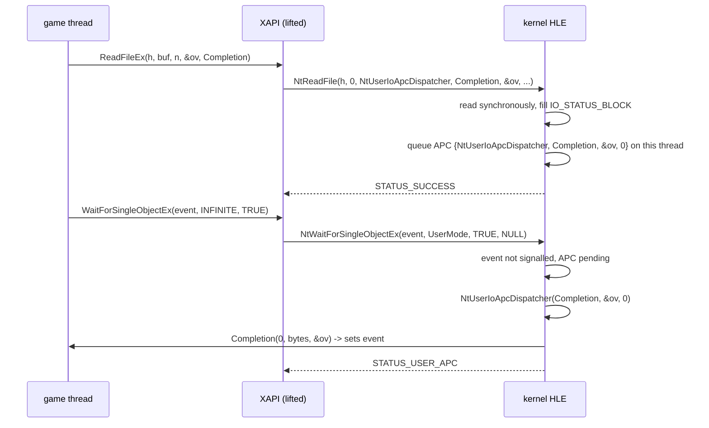

# 설계: 커널 HLE 사용자 APC — I/O 완료 루틴과 경고 가능 대기 (issue #19)

선행: [i003 커널 HLE](20261012-i003-kernel-hle.md), [i017 DSOUND](20261012-i017-dsound-hle.md), [부팅 frontier](../analysis/boot-frontier.md), [kb: 커널 구조](../kb/xbox-kernel-structures.md)

## 1. 요구사항

* 부팅은 `DirectSoundCreate` 뒤 주 스레드가 `D:\Media\Sounds\dsstdfx.bin`을 읽고 기다리는 곳에서 멈춘다.
* **확인됨**: 읽기는 XAPI `ReadFileEx`(`0x00146375`)다. 이 함수는 `NtReadFile(hFile, NULL, NtUserIoApcDispatcher, lpCompletionRoutine, lpOverlapped, lpBuffer, nBytes, &offset)`를 부른다. `ApcRoutine` 자리에 커널 import 232(`NtUserIoApcDispatcher`, thunk `0x001C3FC8`)를, `ApcContext` 자리에 호출자의 완료 루틴을, `IoStatusBlock` 자리에 `OVERLAPPED`를 넘긴다. 결과가 `(status & 0xC0000000) == 0xC0000000`(오류)이면 `FALSE`를 돌려준다.
* **확인됨**: 그다음 호출자는 XAPI `WaitForSingleObjectEx`(`0x00145B5F`)로 `NtWaitForSingleObjectEx(h, UserMode, bAlertable, …)`를 부르고, 완료 루틴이 이벤트를 신호하기를 기다린다.
* 커널 HLE는 I/O를 동기로 끝내지만 APC를 큐에 넣지도 전달하지도 않고, `NtUserIoApcDispatcher`도 없다. 그래서 기다림이 끝나지 않는다.
* 게임이 import하는 APC·대기 관련 커널 함수는 `NtUserIoApcDispatcher`, `NtWaitForSingleObject`, `NtWaitForSingleObjectEx`, `NtWaitForMultipleObjectsEx`, `KeWaitForSingleObject`, `KeDelayExecutionThread`다. `NtQueueApcThread`, `KeInitializeApc`, `KeInsertQueueApc`, `KeAlertThread`는 import하지 않으므로 이번 범위가 아니다.

## 2. 사용자 APC 큐

* `KernelThread`에 사용자 APC 큐(`std::deque<UserApc>`, 항목은 `{routine, argument1, argument2, argument3}`)를 둔다. 디스패처 잠금이 지킨다. 큐에 넣으면 대기자 condition variable을 깨운다.
* 게스트 스레드가 아닌 호스트 스레드(도구)에서 부르면 그 호스트 스레드의 `thread_local` 기록을 쓴다. 그래서 `rexbox_kernel_probe`가 실제 스레드 없이 검사할 수 있다.
* **넣는 곳**: `ApcRoutine`을 받는 파일 I/O export(`NtReadFile`, `NtWriteFile`, `NtDeviceIoControlFile`, `NtFsControlFile`, `NtQueryDirectoryFile`). I/O가 끝나고 최종 상태가 오류(`NT_ERROR`, 상위 두 비트 11)가 아니면, 호출한 스레드에 `{ApcRoutine, ApcContext, IoStatusBlock, 0}`을 넣는다. 오류이면 넣지 않는다. XAPI가 오류에 `FALSE`를 돌려주므로, 넣으면 호출자가 실패를 두 번 처리한다(**추정**: NT의 동기 실패와 같은 규칙).
* `Event`가 있으면 지금처럼 신호한다.

## 3. 전달: 경고 가능 대기

| export | 대기 모드 | 경고 가능 |
|---|---|---|
| `NtWaitForSingleObject(h, Alertable, Timeout)` | 사용자 모드로 본다(**추정**: `Nt` 서비스) | 인자 1 |
| `NtWaitForSingleObjectEx(h, WaitMode, Alertable, Timeout)` | 인자 1 | 인자 2 |
| `NtWaitForMultipleObjectsEx(n, h[], type, WaitMode, Alertable, Timeout)` | 인자 3 | 인자 4 |
| `KeWaitForSingleObject(obj, reason, WaitMode, Alertable, Timeout)` | 인자 2 | 인자 3 |
| `KeDelayExecutionThread(WaitMode, Alertable, Interval)` | 인자 0 | 인자 1 |

* 조건: 경고 가능이고 대기 모드가 `UserMode`(1)일 때만 사용자 APC를 전달한다(NT 규칙).
* 순서(NT `KeWaitForSingleObject`와 같게): 객체가 이미 신호 상태면 대기를 만족시키고 APC는 두고 간다. 아니면 APC가 있는지 보고, 있으면 기다리지 않는다. 기다리는 중에 APC가 들어오면 깨어나 같은 순서로 다시 본다. `KeDelayExecutionThread`도 같은 condition variable에서 기다린다.
* APC가 있어 대기를 끝내면, 디스패처 잠금을 놓은 뒤 큐의 APC를 넣은 순서대로 모두 실행하고 `STATUS_USER_APC`(0x000000C0)를 돌려준다. 실행은 `GuestExecutor::CallGuest(routine, {argument1, argument2, argument3})`다. `routine`이 커널 thunk 주소(`NtUserIoApcDispatcher`)면 실행기가 레지스트리로 HLE export를 찾는다.
* 루틴 안에서 커널 함수를 다시 부를 수 있으므로 잠금 없이 실행한다. 루틴이 새 APC를 넣으면 같은 전달에서 이어서 실행된다(NT에서 APC가 `NtContinue(TestAlert)`로 돌아올 때 남은 APC가 전달되는 것과 같은 효과).

## 4. `NtUserIoApcDispatcher`

`VOID NtUserIoApcDispatcher(PVOID ApcContext, PIO_STATUS_BLOCK IoStatusBlock, ULONG Reserved)`, stdcall 3인자.

* `IoStatusBlock->Status`가 오류(`NT_ERROR`)면 `dwErrorCode = RtlNtStatusToDosError(Status)`, 전송 바이트 0. 아니면 오류 0, 전송 바이트 `IoStatusBlock->Information`(**추정**: Win32 `BasepIoCompletion`과 Cxbx-Reloaded의 구현과 같은 규칙).
* `ApcContext`를 `LPOVERLAPPED_COMPLETION_ROUTINE`으로 보고 `(dwErrorCode, dwNumberOfBytesTransfered, lpOverlapped)`로 부른다. `OVERLAPPED`는 `Internal`(= Status), `InternalHigh`(= Information)로 시작하므로 `lpOverlapped = IoStatusBlock`이다.
* `RtlNtStatusToDosError`의 표는 공용 도우미로 옮겨 둘이 함께 쓴다.

## 5. 검증

| 검증 | 기대 |
|---|---|
| Win32 Debug/Release 빌드 | 우리 타깃 경고 0 |
| `rexbox_kernel_probe` | 새 검사: 비경고 대기는 APC를 전달하지 않음, 경고 가능 대기가 APC를 실행하고 `STATUS_USER_APC`, 완료 루틴 인자(오류 0, 바이트 수, `OVERLAPPED`), 두 번째 대기는 시간 초과, 신호된 객체가 APC보다 먼저, `KeDelayExecutionThread` 전달, 오류로 끝난 읽기는 APC 없음, 커널 모드 대기는 전달 안 함. 가짜 실행기의 `CallGuest`가 레지스트리로 루틴을 찾는다 |
| `rexbox_dsound_probe`, `rejsrf_decomp_check`, `rejsrf_d3d8_check`, `check_hle_pops.py` | 회귀 없음 |
| 부팅 | `dsstdfx.bin` 읽기를 지나 `DownloadEffectsImage`(효과 20개)와 버퍼 생성까지, 다음 frontier 기록 |

---

# Design: kernel HLE user APCs — I/O completion routines and alertable waits (issue #19)

Prerequisites: [i003 kernel HLE](20261012-i003-kernel-hle.md), [i017 DSOUND](20261012-i017-dsound-hle.md), [boot frontier](../analysis/boot-frontier.md), [kb: kernel structures](../kb/xbox-kernel-structures.md)

## 1. Requirements

* Boot stops after `DirectSoundCreate`, where the main thread reads `D:\Media\Sounds\dsstdfx.bin` and waits.
* **Confirmed**: the read is XAPI's `ReadFileEx` (`0x00146375`). It calls `NtReadFile(hFile, NULL, NtUserIoApcDispatcher, lpCompletionRoutine, lpOverlapped, lpBuffer, nBytes, &offset)`, passing kernel import 232 (`NtUserIoApcDispatcher`, thunk `0x001C3FC8`) as `ApcRoutine`, the caller's completion routine as `ApcContext` and the `OVERLAPPED` as `IoStatusBlock`, and returns `FALSE` when the result is an error (`(status & 0xC0000000) == 0xC0000000`).
* **Confirmed**: the caller then waits for the completion routine to signal an event, through XAPI's `WaitForSingleObjectEx` (`0x00145B5F`) → `NtWaitForSingleObjectEx(h, UserMode, bAlertable, …)`.
* The kernel HLE completes the I/O synchronously but neither queues nor delivers the APC, and has no `NtUserIoApcDispatcher`, so the wait never ends.
* The APC- and wait-related kernel functions the game imports are `NtUserIoApcDispatcher`, `NtWaitForSingleObject`, `NtWaitForSingleObjectEx`, `NtWaitForMultipleObjectsEx`, `KeWaitForSingleObject` and `KeDelayExecutionThread`. It imports none of `NtQueueApcThread`, `KeInitializeApc`, `KeInsertQueueApc`, `KeAlertThread`, which are out of scope.

## 2. The user APC queue

* `KernelThread` gains a user APC queue (`std::deque<UserApc>` of `{routine, argument1, argument2, argument3}`) guarded by the dispatcher lock; queuing wakes the waiters' condition variable.
* Called on a host thread that is not a guest thread (tools), the queue is that host thread's `thread_local` record, so `rexbox_kernel_probe` can check it without real threads.
* **Where APCs are queued**: the file I/O exports that take an `ApcRoutine` (`NtReadFile`, `NtWriteFile`, `NtDeviceIoControlFile`, `NtFsControlFile`, `NtQueryDirectoryFile`). When the I/O has finished and its final status is not an error (`NT_ERROR`, top two bits 11), `{ApcRoutine, ApcContext, IoStatusBlock, 0}` is queued on the calling thread; on an error nothing is queued, since XAPI returns `FALSE` then and queuing would make the caller handle the failure twice (**inferred**: the same rule as NT's synchronous failures).
* An `Event`, if given, is signalled as now.

## 3. Delivery: alertable waits

The table above applies (the wait mode and alertable argument of each export; `NtWaitForSingleObject` has no mode and counts as user mode, **inferred** for an `Nt` service).

* Condition: user APCs are delivered only when the wait is alertable and its mode is `UserMode` (1) (the NT rule).
* Order (as NT's `KeWaitForSingleObject`): an object already signalled satisfies the wait and leaves the APCs queued; otherwise pending APCs end the wait without blocking; an APC arriving while blocked wakes the waiter, which re-checks in the same order. `KeDelayExecutionThread` waits on the same condition variable.
* When APCs end the wait, the dispatcher lock is released, every queued APC runs in queue order, and the wait returns `STATUS_USER_APC` (0x000000C0). Each runs through `GuestExecutor::CallGuest(routine, {argument1, argument2, argument3})`; when `routine` is a kernel thunk address (`NtUserIoApcDispatcher`), the executor finds the HLE export through the registry.
* Routines run without the lock because they may call back into the kernel; an APC a routine queues runs in the same delivery (the effect of NT delivering the remaining APCs when an APC returns through `NtContinue(TestAlert)`).

## 4. `NtUserIoApcDispatcher`

`VOID NtUserIoApcDispatcher(PVOID ApcContext, PIO_STATUS_BLOCK IoStatusBlock, ULONG Reserved)`, stdcall with three arguments. If `IoStatusBlock->Status` is an error (`NT_ERROR`), `dwErrorCode = RtlNtStatusToDosError(Status)` and no bytes were transferred; otherwise the error is 0 and the bytes transferred are `IoStatusBlock->Information` (**inferred**: the rule of Win32's `BasepIoCompletion` and of Cxbx-Reloaded's implementation). `ApcContext` is the `LPOVERLAPPED_COMPLETION_ROUTINE`, called with `(dwErrorCode, dwNumberOfBytesTransfered, lpOverlapped)`; an `OVERLAPPED` starts with `Internal` (= Status) and `InternalHigh` (= Information), so `lpOverlapped = IoStatusBlock`. `RtlNtStatusToDosError`'s table moves into a shared helper both use.

## 5. Verification

The table above applies: Win32 Debug and Release with zero warnings on our targets; new kernel probe checks (a non-alertable wait delivers nothing; an alertable wait runs the APC and returns `STATUS_USER_APC`; the completion routine's arguments are error 0, the byte count and the `OVERLAPPED`; a second wait times out; a signalled object wins over an APC; `KeDelayExecutionThread` delivers; a read that ends in an error queues nothing; a kernel-mode wait delivers nothing), with the fake executor's `CallGuest` finding routines through the registry; no regressions in `rexbox_dsound_probe`, `rejsrf_decomp_check`, `rejsrf_d3d8_check`, `check_hle_pops.py`; boot past the `dsstdfx.bin` read to `DownloadEffectsImage` (20 effects) and buffer creation, recording the next frontier.
