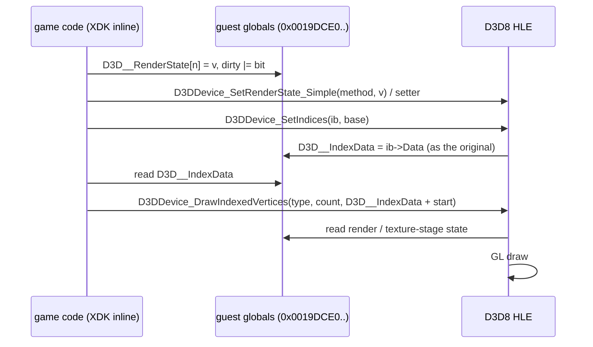
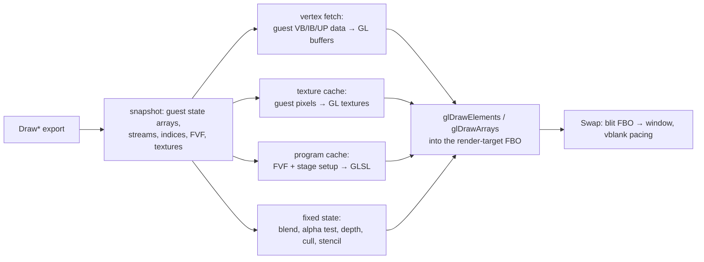
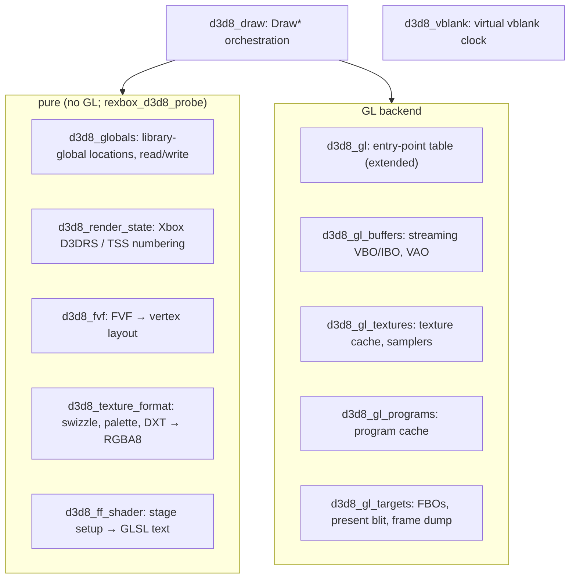

# 설계: D3D8 HLE 세 번째 묶음 — 고정 기능 그리기를 GL로 (issue #23)

선행: [i012 리소스 모델과 첫 프레임](20261012-i012-d3d8-surfaces-first-frame.md), [i007 표시 계층](20261012-i007-d3d8-hle-first-batch.md), [kb: Xbox D3D8 API](../kb/xbox-d3d8-api.md), [boot-frontier](../analysis/boot-frontier.md)

## 1. 요구사항과 측정

부팅은 프레임 루프를 계속 돌지만(헤드리스에서 초당 약 1만 1천 present) 모든 `Draw*`가 스텁이라 창은 검게 지워진 채다. 이번 묶음의 목표는 **게임이 지금 그리는 화면(로딩 화면)을 창에 원본과 같게 보이는 것**이며, 그 경로에 필요한 고정 기능 파이프라인을 만든다.

측정(2026-10-12, Release, 헤드리스 90초, export별 호출 수를 임시 계측으로 셈; **확인됨**):

| 항목 | 값 |
|---|---|
| 프레임마다 | `SetRenderTarget` 1, `Clear` 4, `SetViewport` 3, `SetTexture` 8, `SetTransform` 5, `SetRenderState_Simple` 4, `SetTextureState_TexCoordIndex` 4, `D3DVertexBuffer_Lock` 2, `SetVertexShader`·`SetStreamSource`·`SetIndices`·`DrawIndexedVertices` 각 2, `SetGammaRamp` 1, `Swap` 1 |
| 그리기 인자 | `DrawIndexedVertices(5 = TRIANGLELIST, 6, pIndexData = 0)` |
| 그리기 시점 상태 | 정점 셰이더 `0x1C4`(FVF `XYZRHW \| DIFFUSE \| SPECULAR \| TEX1`), stride 32, 픽셀 셰이더 0, 스테이지 0에 텍스처 하나 |
| 다른 스레드 | `BlockUntilVerticalBlank`가 작업 스레드 루프(`0x0013B1D5`, `0x0013B245`)에서 초당 수백만 번 |
| 부팅 중 생성 | 정점 셰이더 154개, 픽셀 셰이더 11개, 텍스처 221개, 정점 버퍼 358개, 인덱스 버퍼 357개 |

즉 지금 화면은 **변환이 끝난(XYZRHW) 텍스처 사각형**이다. 프로그래머블 정점 셰이더(NV2A 마이크로코드)와 레지스터 컴바이너 픽셀 셰이더는 게임플레이 화면에서 쓰이므로 다음 묶음으로 미룬다(§9).

## 2. 라이브러리 전역: 게임이 직접 읽고 쓴다

XDK 헤더의 inline 함수는 게임 코드 안으로 펼쳐져 라이브러리 전역을 직접 다룬다. 생성 코드에서 `.text`의 게임 함수(`< 0x00180000`)가 D3D8 전역(`0x0019DCE0`~`0x0019E340`)에 접근하는 곳을 모두 세었다(**확인됨**).

| 전역(XbSymbolDatabase 이름 또는 측정) | 주소 | 게임의 접근 | 의미 |
|---|---|---|---|
| `D3D__IndexData` (측정) | `0x0019DED4` | 읽기 5곳 | 원본 `SetIndices`가 `IndexBuffer->Data`를 쓴다. 게임의 `DrawIndexedPrimitive` inline이 이 값 + 시작 인덱스를 `DrawIndexedVertices`의 `pIndexData`로 넘긴다 |
| dirty 플래그 (측정) | `0x0019DED8` | 읽기·쓰기 | inline setter가 비트를 OR한다 |
| `D3D_g_DeferredTextureState` | `0x0019DEE0` | 쓰기 | `[stage * 32 + state]`, 스테이지당 0x80바이트 |
| `D3D_g_RenderState` | `0x0019E0E0` | 쓰기(인덱스 57~74, 82 이상) | `[D3DRS 번호]` DWORD 배열 |
| `D3D_g_DeferredRenderState` | `0x0019E228` (= `RenderState[82]`) | 쓰기 | deferred 렌더 상태의 시작 |
| `D3D_g_ComplexRenderState` | `0x0019E2B4` (= `RenderState[117]`) | 없음(전용 setter만) | complex 렌더 상태의 시작 |

결정:

* **게스트 전역 배열이 상태의 원본이다.** HLE setter는 원본 setter가 쓰는 전역 칸을 같은 값으로 쓰고(지금은 HLE 내부 표에만 저장해 게임 inline이 쓴 값과 갈라진다), 그리기는 그 배열을 읽는다. HLE 내부의 `PipelineState` 렌더·텍스처 상태 사본은 없앤다. 스트림·인덱스·셰이더 핸들·변환 행렬처럼 전역 배열에 없는 상태만 HLE가 가진다.
* 전역 주소는 하드코딩하지 않는다. `rexbox_xdk_variables[]`(XbSymbolDatabase가 찾은 변수)에서 이름으로 찾는다. `D3D__IndexData`와 dirty 플래그처럼 데이터베이스에 없는 칸은 **원본 setter의 lift 본문에서 찾은 상대 위치**(`D3D_g_Stream` 기준 오프셋)를 런타임 계약으로 둔다. 이 상대 위치는 타이틀이 아니라 XDK 4134 라이브러리의 사실이므로 `rexbox`에 둘 수 있다. 다른 XDK 버전은 그때 표를 더한다.
* `rejsrf_d3d8_check`에 setter 케이스를 더해 같은 인자로 원본과 HLE를 실행한 뒤 **전역 칸의 값**을 비교한다(`SetIndices`의 `IndexData`, 렌더 상태 setter의 배열 칸).

### 2.1 Xbox 렌더 상태 번호

Xbox `D3DRENDERSTATETYPE`은 PC와 번호가 다르고(xboxrecomp `d3d8_xbox.h`는 PC 번호), 범위는 픽셀 셰이더 상태 → simple → deferred(82~) → complex(117~)다. 번호와 의미의 대응은 다음 세 근거로 만든다.

1. XbSymbolDatabase가 이름을 준 상태 변수(`D3DRS_FillMode` = `0x0019E2C0` → 인덱스 120 등)는 **확인됨**.
2. simple 상태는 원본 라이브러리 안의 "상태 번호 → NV2A method" 표를 lift 본문에서 찾아 확인한다. 게임은 `SetRenderState_Simple(method, value)`로 method를 넘기므로 이 표가 있으면 method에서 번호와 의미를 모두 알 수 있다.
3. 나머지는 Cxbx-Reloaded의 XDK 4134 번호표를 **지식으로만** 참고해 **추정**으로 적고, 게임이 쓰는 값으로 확인한다(코드는 옮기지 않는다).

번호표는 `docs/kb/xbox-d3d8-api.md`에 누적한다. 텍스처 스테이지 상태(스테이지당 32칸)도 같은 방식이다. 측정으로 `TexCoordIndex`가 칸 21(`0x0019DF34` − `0x0019DEE0` = 0x54)임을 확인했다.

## 3. 그리기 파이프라인

### 3.1 정점

* 입력: `SetStreamSource`의 정점 버퍼 헤더(`Data` = 게스트 주소)와 stride, `*UP`의 직접 포인터, 인덱스는 `pIndexData`(게스트 주소, 16비트).
* 매 그리기마다 쓰이는 범위(인덱스 최소~최대 또는 시작~개수)만 게스트 메모리에서 GL 버퍼(스트리밍 VBO/IBO, orphan 후 `glBufferSubData`)로 올린다. 게임이 `Lock` 없이 정점 메모리를 고쳐 써도 같게 보이도록 **캐시하지 않는다**(정확성 우선). 측정상 프레임당 그리기가 적어 비용이 작다. 게임플레이에서 비용이 문제가 되면 다음 묶음에서 해시 기반 캐시를 검토한다.
* FVF 해석: `XYZ`/`XYZRHW`/`XYZB1..4`, `NORMAL`, `DIFFUSE`, `SPECULAR`, `TEX0..4`와 텍스처 좌표 크기(`D3DFVF_TEXCOORDSIZE*`)를 오프셋 표로 바꾼다. 색은 D3DCOLOR(BGRA 바이트) → `GL_UNSIGNED_BYTE` 정규화, 셰이더에서 `.bgra`.
* 핸들의 bit 0이 1이면 `CreateVertexShader`의 프로그램이다. 이번 묶음은 그 선언(declaration)으로 입력 배치는 만들되 마이크로코드는 실행하지 않는다. 처음 만날 때 한 번 기록하고 그리지 않는다(§9).
* 프리미티브: POINTLIST 1, LINELIST 2, LINELOOP 3, LINESTRIP 4, TRIANGLELIST 5, TRIANGLESTRIP 6, TRIANGLEFAN 7, QUADLIST 8, QUADSTRIP 9, POLYGON 10(Xbox 번호, **추정** → 측정 5가 삼각형 목록과 일치). QUADLIST는 인덱스를 삼각형 두 개로 펼치고, QUADSTRIP은 TRIANGLESTRIP, POLYGON은 TRIANGLEFAN, LINELOOP은 `GL_LINE_LOOP`로 그린다.

### 3.2 변환

* `XYZRHW`: 화면 좌표(픽셀, 위쪽 원점)와 `1/w`. 정점 셰이더가 뷰포트·render target 크기로 NDC를 만들고 `w = 1/rhw`로 원근 보간을 유지한다. Xbox의 화면 공간 오프셋(`SetScreenSpaceOffset`, 기본 0.5 추정)과 픽셀 중심 규칙은 frame dump로 비교해 맞춘다.
* `XYZ`: `World × View × Projection`(`SetTransform`의 행렬, 행 벡터 규약)으로 변환한다. 고정 기능 조명은 `LIGHTING`이 꺼진 경로(정점 색 그대로)만 구현하고, 켜진 그리기를 만나면 한 번 기록한다. 측정상 `SetLight` 3번, `LightEnable` 2번이 부팅 중에 있으므로 쓰이는 곳은 게임플레이에서 확인한다.
* 텍스처 좌표 변환(`D3DTS_TEXTURE0..3`, `TEXTURETRANSFORMFLAGS`)과 `TEXCOORDINDEX`의 생성 모드(카메라 공간 법선 등)는 상태를 읽어 GLSL에 반영한다. 생성 모드는 처음 쓰일 때 구현 여부를 정한다.

### 3.3 텍스처

* `SetTexture`의 헤더에서 `Format`/`Size`(i012 리소스 모델)로 차원·포맷·밉 수·pitch를 얻는다.
* 포맷(**추정**, 번호는 xboxrecomp `d3d8_xbox.h`(MIT)와 우리 lift 본문의 포맷 능력 표로 확인): 스위즐 `A8R8G8B8`/`X8R8G8B8`/`R5G6B5`/`A1R5G5B5`/`X1R5G5B5`/`A4R4G4B4`/`A8`/`L8`/`A8L8`/`P8`(팔레트), 선형 `LIN_*`, 압축 `DXT1`/`DXT3`/`DXT5`. 게임이 실제로 만드는 포맷을 먼저 세어 구현 범위를 정하고, 나머지는 처음 만날 때 기록한다.
* 스위즐(Morton 순서) 해제, 팔레트 확장, DXT 해제는 **CPU에서 RGBA8로** 바꿔 올린다. GLES·WebGL에 S3TC가 없을 수 있어서이며, 순수 함수로 두어 probe로 검증한다(§7). 큐브맵은 6면, 볼륨 텍스처는 `GL_TEXTURE_3D`.
* 캐시: 헤더 주소 → GL 텍스처. **다시 올리는 조건**은 (a) `Format`/`Size`/`Data`가 바뀜, (b) 그 리소스를 `LockRect`/`LockBox`한 뒤 처음 쓰임, (c) 픽셀 메모리의 빠른 해시(밉 0, 샘플링)가 바뀜이다. (c)는 게임이 Lock 없이 쓰는 경우를 위한 안전장치이며, 비용이 크면 끈다. render target으로 쓰인 텍스처는 GL 쪽이 원본이므로 다시 올리지 않는다(§3.5).
* 샘플러: 스테이지 상태의 `ADDRESSU/V/W`(wrap·mirror·clamp·border), `MAGFILTER`/`MINFILTER`/`MIPFILTER`, `MIPMAPLODBIAS`, `MAXMIPLEVEL`를 GL 샘플러 객체에 반영한다.

### 3.4 고정 기능 텍스처 스테이지 → GLSL

* 픽셀 셰이더 핸들이 0이면 스테이지 0~3의 `COLOROP`/`COLORARG0..2`/`ALPHAOP`/`ALPHAARG0..2`/`RESULTARG`와 `TEXTUREFACTOR`, `SPECULARENABLE`, 안개 상태로 PC D3D8의 고정 기능 규칙(첫 `DISABLE`에서 멈춤, `CURRENT` 연쇄, `TEMP` 등)을 GLSL 프래그먼트 셰이더로 만든다.
* 프로그램은 (FVF 입력 배치, 스테이지 설정, 알파 테스트 비교 함수, 안개 모드)의 키로 캐시한다. 상수(텍스처 팩터, 알파 기준값, 안개 색)는 uniform이라 키에 넣지 않는다.
* 알파 테스트(`ALPHATESTENABLE`/`ALPHAFUNC`/`ALPHAREF`)는 GL 3.3 core에 고정 기능이 없으므로 셰이더의 `discard`로 한다.
* 픽셀 셰이더 핸들이 0이 아니면(레지스터 컴바이너) 이번 묶음에서는 한 번 기록하고 그리지 않는다(§9).

### 3.5 렌더 타깃과 표시

* 백버퍼 2개와 깊이 버퍼를 기본 프레임버퍼 대신 **GL 텍스처 + 렌더버퍼를 붙인 FBO**로 만든다. `SetRenderTarget(surface, depth)`는 그 조합의 FBO를 바인딩한다. 텍스처의 레벨 서피스(`GetSurfaceLevel`)가 렌더 타깃이면 그 GL 텍스처를 붙인다(render-to-texture).
* `Swap`은 현재 표시할 백버퍼 FBO를 창으로 blit(Y 뒤집기)하고 `PresentDisplay`를 부른다. 창 크기와 백버퍼 크기가 다르면 비율을 유지해 늘린다.
* `Clear`는 현재 FBO에 그대로 적용한다(기존 구현, scissor 사각형).
* 게스트 메모리의 백버퍼 픽셀(`Data`)은 게임이 읽을 때만 의미가 있다. 이번 묶음은 되읽지 않고, 게임이 `LockRect`로 백버퍼를 읽는 경우가 드러나면 그때 `glReadPixels`로 채운다.

### 3.6 고정 상태

| Xbox 상태 | GL |
|---|---|
| `ZENABLE`, `ZWRITEENABLE`, `ZFUNC` | `GL_DEPTH_TEST`, `glDepthMask`, `glDepthFunc` |
| `ALPHABLENDENABLE`, `SRCBLEND`, `DESTBLEND`, `BLENDOP`, `BLENDCOLOR` | `GL_BLEND`, `glBlendFuncSeparate`, `glBlendEquation`, `glBlendColor` |
| `CULLMODE`, `FRONTFACE` | `GL_CULL_FACE`, `glCullFace`, `glFrontFace`(Xbox는 둘을 따로 가진다) |
| `STENCIL*` | `glStencilFunc`/`glStencilOp`/`glStencilMask` |
| `COLORWRITEENABLE` | `glColorMask` |
| `FILLMODE` | 데스크톱 `glPolygonMode`, GLES는 기록만 |
| `ZBIAS` | `glPolygonOffset` |
| 뷰포트 `MinZ`/`MaxZ` | `glDepthRange` |

상태 적용은 그리기 직전에 한 번, 직전 값과 다를 때만 GL을 부른다.

## 4. 수직 동기

* 측정상 게임은 `PresentationInterval` 1로 디바이스를 만들고, 작업 스레드는 `BlockUntilVerticalBlank`를 바쁘게 부른다. 지금 HLE는 바로 돌아오므로 헤드리스에서 초당 1만 프레임 이상 돈다.
* 60 Hz(AV 모드의 refresh rate) **가상 vblank 시계**를 둔다. `BlockUntilVerticalBlank`는 다음 tick까지 잠들고, `Swap`은 presentation interval만큼의 tick 경계까지 기다린다(창의 vsync가 이미 기다렸으면 추가로 기다리지 않는다). `GetRasterStatus`의 `InVBlank`도 이 시계를 따른다.
* `SetVerticalBlankCallback`으로 등록된 콜백은 Xbox에서 DPC로 불린다. 게스트 코드를 호스트 타이머 스레드에서 부르려면 게스트 스레드 문맥이 필요하므로, 이번 묶음에서는 콜백이 무엇을 하는지(lift 본문) 먼저 확인하고 필요하면 별도 작업으로 다룬다(§9).

## 5. 파일 구성

i012의 파일은 그대로 두고 그리기를 하위 시스템별로 나눈다(AGENTS.md: 큰 기능을 한 파일에 쌓지 않는다). 순수 함수(GL을 부르지 않음)와 GL 백엔드를 분리해 순수 부분을 probe로 검증한다.

* `d3d8_state.cpp`의 setter는 §2대로 게스트 전역을 쓰도록 바꾼다.
* GL 진입점은 지금처럼 `GetGlProcAddress`로 읽는다(GL 헤더·로더 라이브러리 없음). 셰이더 버전 문자열은 컨텍스트에 따라 `#version 330 core` 또는 `#version 300 es`.
* 이 모듈은 `rexbox`에 있으므로 타이틀 이름·주소를 쓰지 않는다. 라이브러리 전역 주소는 `rexbox_xdk_variables[]`에서 온다.

## 6. 진단

* `REXBOX_FRAME_DUMP=<n>[,<n>...]`: n번째 present 직전의 표시 백버퍼를 `frame_<n>.bmp`(현재 폴더, `REXBOX_FRAME_DUMP_DIR`로 변경)로 저장한다. 창을 보지 않고 결과를 비교·기록하기 위한 것이다.
* `REXBOX_DISPLAY=hidden`: 창을 보이지 않게 만들되 GL 컨텍스트는 만든다. 헤드리스처럼 돌리면서 frame dump를 얻는다(`none`은 지금처럼 GL 없음).
* `REXBOX_D3D8_TRACE=1`: 처음 만나는 FVF, 텍스처 포맷, 프로그램 키, 미구현 경로(프로그래머블 셰이더, 조명 등)를 한 번씩 기록한다.

## 7. 검증

| 검증 | 기대 |
|---|---|
| Win32 Debug/Release 빌드 | 우리 타깃 경고 0 |
| `rexbox_kernel_probe`, `rexbox_dsound_probe`, `rejsrf_decomp_check` | 회귀 없음 |
| `rejsrf_d3d8_check` | 기존 13,557 케이스 + setter의 전역 칸 비교 케이스, 차이 0 |
| 새 `rexbox_d3d8_probe`(게임 데이터 불필요, CI) | 스위즐 해제(알려진 패턴), DXT1/3/5 블록 해제(손으로 만든 블록), FVF 배치, 렌더 상태 번호표, 고정 기능 GLSL 생성(문자열 검사) |
| `check_hle_pops.py` | 불일치 0 |
| 부팅(`REXBOX_DISPLAY=hidden`, `REXBOX_FRAME_DUMP`) | 로딩 화면 이미지가 frame dump에 보이고, 창 실행에서 같은 화면이 60 Hz로 갱신된다. 다음 frontier 기록 |

픽셀 단위 기준 이미지가 없으므로 원본과의 비교는 눈으로 한다(실기 또는 xemu 화면과 레이아웃·색 비교, 작업 로그에 이미지 대신 관찰을 기록. 게임 자산이므로 이미지는 커밋하지 않는다).

## 8. 위험

* 상태 번호표가 틀리면 조용히 잘못 그린다. 번호마다 근거(확인됨/추정)를 kb에 남기고, `REXBOX_D3D8_TRACE`로 게임이 쓰는 번호만 먼저 확인한다.
* 매 그리기 업로드와 텍스처 해시는 게임플레이에서 느릴 수 있다. 이번 화면에서 측정해 기록하고 최적화는 뒤로 미룬다.
* GL 호출 스레드: D3D 호출은 게임 스레드에서 오고 GL 컨텍스트는 `CreateDevice`를 부른 스레드에 묶여 있다. 다른 스레드에서 그리기가 오면 한 번 기록한다(측정상 그리기는 주 스레드뿐).

## 9. 범위 밖과 미해결

* **다음 묶음**: NV2A 정점 셰이더 마이크로코드 → GLSL(xboxrecomp `d3d8_vsh.c`(MIT, HLSL 출력)의 파서를 참고하거나 가져올지 그때 결정), 레지스터 컴바이너 픽셀 셰이더 → GLSL, push buffer(`RunPushBuffer`), 고정 기능 조명.
* `SetVerticalBlankCallback` 콜백의 실행(§4).
* 게임이 백버퍼나 render target 텍스처를 CPU로 읽는 경우(§3.5).
* `CopyRects`, `UpdateOverlay` 등 아직 게임이 부르지 않은 표시 함수.

---

# Design: D3D8 HLE, third batch — fixed-function drawing on GL (issue #23)

Prerequisites: [i012 resource model and first frame](20261012-i012-d3d8-surfaces-first-frame.md), [i007 display layer](20261012-i007-d3d8-hle-first-batch.md), [kb: Xbox D3D8 API](../kb/xbox-d3d8-api.md), [boot-frontier](../analysis/boot-frontier.md)

## 1. Requirements and measurements

The boot keeps running its frame loop (about 11,000 presents/s headless), but every `Draw*` is a stub, so the window stays cleared to black. This batch's goal is **to show what the game draws now (the loading screen) the way the original does**, building the fixed-function pipeline that path needs.

Measurements (2026-10-12, Release, 90 s headless, per-export call counts from temporary instrumentation; **confirmed**): per frame `SetRenderTarget` 1, `Clear` 4, `SetViewport` 3, `SetTexture` 8, `SetTransform` 5, `SetRenderState_Simple` 4, `SetTextureState_TexCoordIndex` 4, `D3DVertexBuffer_Lock` 2, `SetVertexShader`/`SetStreamSource`/`SetIndices`/`DrawIndexedVertices` 2 each, `SetGammaRamp` 1, `Swap` 1. The draw is `DrawIndexedVertices(5 = TRIANGLELIST, 6, pIndexData = 0)` with vertex shader `0x1C4` (FVF `XYZRHW | DIFFUSE | SPECULAR | TEX1`), stride 32, pixel shader 0 and one texture on stage 0. Worker threads call `BlockUntilVerticalBlank` millions of times per second (`0x0013B1D5`, `0x0013B245`). During boot the game creates 154 vertex shaders, 11 pixel shaders, 221 textures, 358 vertex buffers and 357 index buffers.

So the current screen is a **pre-transformed (XYZRHW) textured quad**. Programmable vertex shaders (NV2A microcode) and register-combiner pixel shaders serve the gameplay screens and move to the next batch (§9).

## 2. Library globals: the game reads and writes them

XDK header inlines expand into game code and touch library globals directly. Every access from game functions in `.text` (`< 0x00180000`) to the D3D8 globals (`0x0019DCE0`–`0x0019E340`) in the generated code was counted (**confirmed**): `D3D__IndexData` (measured, `0x0019DED4`) is read at 5 sites. The original `SetIndices` stores `IndexBuffer->Data` there, and the game's `DrawIndexedPrimitive` inline passes it plus the start index as `DrawIndexedVertices`'s `pIndexData`. The dirty flags (measured, `0x0019DED8`) are OR'ed by inline setters. `D3D_g_DeferredTextureState` (`0x0019DEE0`, `[stage * 32 + state]`, 0x80 bytes per stage) is written. `D3D_g_RenderState` (`0x0019E0E0`, a DWORD array by `D3DRS` number) is written at indices 57–74 and 82 and up. `D3D_g_DeferredRenderState` (`0x0019E228` = `RenderState[82]`) is written. `D3D_g_ComplexRenderState` (`0x0019E2B4` = `RenderState[117]`) is changed only through its setters. The sequence diagram above shows the flow.

Decisions:

* **The guest global arrays are the source of truth for state.** HLE setters write the same global slots, with the same values, as the original setters. Today they store only into an HLE-internal table, which diverges from what the game's inlines write. Drawing reads those arrays, and the HLE's own `PipelineState` copies of render and texture-stage state are removed. The HLE keeps only state the arrays do not hold: streams, indices, shader handles and transform matrices.
* Global addresses are not hard-coded. They are looked up by name in `rexbox_xdk_variables[]` (variables found by XbSymbolDatabase). Slots the database lacks, such as `D3D__IndexData` and the dirty flags, become a runtime contract as **offsets found in the lifted original setters** (relative to `D3D_g_Stream`). These offsets are facts of the XDK 4134 library, not of the title, so they may live in `rexbox`. Other XDK versions add their own table when needed.
* `rejsrf_d3d8_check` gains setter cases that run the original and the HLE with the same arguments and compare **the global slots**: `SetIndices`'s `IndexData` and the array slot of each render-state setter.

### 2.1 Xbox render-state numbering

The Xbox `D3DRENDERSTATETYPE` numbers differ from the PC ones (xboxrecomp's `d3d8_xbox.h` uses PC numbers). The ranges run pixel-shader states → simple → deferred (82–) → complex (117–). The number-to-meaning map comes from three sources:

1. State variables named by XbSymbolDatabase (`D3DRS_FillMode` = `0x0019E2C0` → index 120, …) are **confirmed**.
2. Simple states are confirmed from the library's own "state number → NV2A method" table, found in the lifted bodies. The game passes the method to `SetRenderState_Simple(method, value)`, so that table gives both the number and the meaning.
3. The rest come from Cxbx-Reloaded's XDK 4134 numbering, consulted **as knowledge only** and recorded as **inferred**, then confirmed against the values the game writes (no code is carried over).

The map accumulates in `docs/kb/xbox-d3d8-api.md`. Texture-stage states (32 slots per stage) work the same way. Measurement confirms `TexCoordIndex` is slot 21 (`0x0019DF34` − `0x0019DEE0` = 0x54).

## 3. Drawing pipeline

The flowchart above applies: each `Draw*` snapshots the guest state, fetches vertices into GL buffers, resolves textures through a cache, picks a program from a cache, applies fixed state, and draws into the render-target FBO. `Swap` blits to the window with vblank pacing.

### 3.1 Vertices

* Inputs: the vertex buffer header from `SetStreamSource` (`Data` = guest address) and its stride, the direct pointers of `*UP` calls, and 16-bit indices from `pIndexData` (a guest address).
* Each draw uploads only the range it uses (index min–max, or start–count) from guest memory into streaming GL buffers (orphaned, then `glBufferSubData`). **No caching**, so a game that rewrites vertex memory without `Lock` still draws correctly (accuracy first). Measured draws per frame are few, so the cost is small. If gameplay makes it costly, a hash-based cache is considered in the next batch.
* FVF decoding: `XYZ`/`XYZRHW`/`XYZB1..4`, `NORMAL`, `DIFFUSE`, `SPECULAR`, `TEX0..4` and texture-coordinate sizes (`D3DFVF_TEXCOORDSIZE*`) become an offset table. Colors are D3DCOLOR (BGRA bytes), fed as normalized `GL_UNSIGNED_BYTE` and swizzled `.bgra` in the shader.
* A handle with bit 0 set is a `CreateVertexShader` program. This batch builds the input layout from its declaration but does not execute the microcode. It logs the first occurrence and skips the draw (§9).
* Primitives use the Xbox numbering (**inferred**; the measured 5 matches a triangle list): POINTLIST 1, LINELIST 2, LINELOOP 3, LINESTRIP 4, TRIANGLELIST 5, TRIANGLESTRIP 6, TRIANGLEFAN 7, QUADLIST 8, QUADSTRIP 9, POLYGON 10. QUADLIST indices expand to two triangles, QUADSTRIP draws as a TRIANGLESTRIP, POLYGON as a TRIANGLEFAN and LINELOOP as `GL_LINE_LOOP`.

### 3.2 Transformation

* `XYZRHW`: screen coordinates (pixels, top-left origin) with `1/w`. The vertex shader builds NDC from the viewport and render-target size and sets `w = 1/rhw` to keep perspective-correct interpolation. The Xbox screen-space offset (`SetScreenSpaceOffset`, inferred default 0.5) and pixel-center rules are matched by comparing frame dumps.
* `XYZ`: transformed by `World × View × Projection` (the `SetTransform` matrices, row-vector convention). Fixed-function lighting is implemented only for the `LIGHTING`-off path (vertex colors as given); a lit draw is logged once. Boot calls `SetLight` 3 times and `LightEnable` 2 times, so their users are checked in gameplay.
* Texture-coordinate transforms (`D3DTS_TEXTURE0..3`, `TEXTURETRANSFORMFLAGS`) and the generation modes in `TEXCOORDINDEX` (camera-space normal and others) are read from state into the GLSL. Each generation mode is implemented when first used.

### 3.3 Textures

* The header passed to `SetTexture` gives dimension, format, mip count and pitch through `Format`/`Size` (the i012 resource model).
* Formats (**inferred**; numbers from xboxrecomp's `d3d8_xbox.h` (MIT), confirmed against the format capability table in our lifted bodies): swizzled `A8R8G8B8`/`X8R8G8B8`/`R5G6B5`/`A1R5G5B5`/`X1R5G5B5`/`A4R4G4B4`/`A8`/`L8`/`A8L8`/`P8` (palette), linear `LIN_*`, and compressed `DXT1`/`DXT3`/`DXT5`. The formats the game actually creates are counted first to set the scope; others are logged when first met.
* Unswizzling (Morton order), palette expansion and DXT decoding run **on the CPU into RGBA8** before upload. GLES and WebGL may lack S3TC, and these pure functions are verified by a probe (§7). Cube maps upload six faces and volume textures use `GL_TEXTURE_3D`.
* Cache: header address → GL texture. A texture is **re-uploaded** when (a) its `Format`/`Size`/`Data` changed, (b) it is first used after `LockRect`/`LockBox`, or (c) a fast hash of its pixel memory (level 0, sampled) changed. (c) is a safety net for writes without a lock and can be turned off if costly. A texture used as a render target is owned by GL and never re-uploaded (§3.5).
* Samplers: the stage states `ADDRESSU/V/W` (wrap, mirror, clamp, border), `MAGFILTER`/`MINFILTER`/`MIPFILTER`, `MIPMAPLODBIAS` and `MAXMIPLEVEL` map to GL sampler objects.

### 3.4 Fixed-function texture stages → GLSL

* With pixel shader handle 0, stages 0–3 (`COLOROP`/`COLORARG0..2`/`ALPHAOP`/`ALPHAARG0..2`/`RESULTARG`) plus `TEXTUREFACTOR`, `SPECULARENABLE` and the fog states become a GLSL fragment shader following PC D3D8's fixed-function rules (stop at the first `DISABLE`, `CURRENT` chaining, `TEMP`, …).
* Programs are cached by (FVF input layout, stage setup, alpha-test comparison, fog mode). Constants (texture factor, alpha reference, fog color) are uniforms and stay out of the key.
* Alpha testing (`ALPHATESTENABLE`/`ALPHAFUNC`/`ALPHAREF`) is a `discard` in the shader, since GL 3.3 core has no fixed-function alpha test.
* A non-zero pixel shader handle (register combiners) is logged once and its draws are skipped in this batch (§9).

### 3.5 Render targets and presentation

* The two back buffers and the depth buffer become **FBOs with GL textures and a renderbuffer attached**, instead of the default framebuffer. `SetRenderTarget(surface, depth)` binds the FBO for that pair. When a texture's level surface (`GetSurfaceLevel`) is the render target, its GL texture is attached (render to texture).
* `Swap` blits the back buffer FBO being shown to the window (flipping Y) and calls `PresentDisplay`. When the window and back buffer sizes differ, the image is scaled with its aspect ratio kept.
* `Clear` applies to the current FBO (the existing implementation with scissored rectangles).
* The back buffer pixels in guest memory (`Data`) matter only if the game reads them. This batch does not read them back; if the game is found reading a back buffer through `LockRect`, they are then filled with `glReadPixels`.

### 3.6 Fixed state

The table above maps the Xbox states: depth (`ZENABLE`, `ZWRITEENABLE`, `ZFUNC`), blending (`ALPHABLENDENABLE`, `SRCBLEND`, `DESTBLEND`, `BLENDOP`, `BLENDCOLOR`), culling (`CULLMODE` and `FRONTFACE`, kept separately on the Xbox), stencil, `COLORWRITEENABLE`, `FILLMODE` (`glPolygonMode` on desktop, logged only on GLES), `ZBIAS` (`glPolygonOffset`) and viewport `MinZ`/`MaxZ` (`glDepthRange`). State is applied once right before a draw, calling GL only for values that changed.

## 4. Vertical blank

* The game creates its device with `PresentationInterval` 1, and worker threads spin on `BlockUntilVerticalBlank`. The HLE returns immediately today, so the headless loop runs above 10,000 frames per second.
* A **virtual vblank clock** at 60 Hz (the AV mode's refresh rate) is added. `BlockUntilVerticalBlank` sleeps until the next tick. `Swap` waits for the tick boundary its presentation interval requires, with no extra wait when the window's vsync already waited. `GetRasterStatus`'s `InVBlank` follows the same clock.
* On the Xbox, the callback from `SetVerticalBlankCallback` runs as a DPC. Running guest code from a host timer thread needs a guest thread context, so this batch first checks what the callback does (its lifted body) and handles it as separate work if needed (§9).

## 5. File layout

The i012 files stay; drawing is split by subsystem (AGENTS.md: do not pile a large feature into one file). Pure functions (no GL calls) are separate from the GL backend so the pure part can be verified by a probe. The diagram above lists the files: the pure `d3d8_globals`, `d3d8_render_state`, `d3d8_fvf`, `d3d8_texture_format` and `d3d8_ff_shader`; the GL backend `d3d8_gl` (extended entry-point table), `d3d8_gl_buffers`, `d3d8_gl_textures`, `d3d8_gl_programs` and `d3d8_gl_targets`; and `d3d8_draw` (orchestration) and `d3d8_vblank`.

* The setters in `d3d8_state.cpp` are changed to write the guest globals (§2).
* GL entry points are still loaded through `GetGlProcAddress` (no GL header or loader library). The shader version line is `#version 330 core` or `#version 300 es`, depending on the context.
* The module lives in `rexbox`, so it names no title or title address. Library global addresses come from `rexbox_xdk_variables[]`.

## 6. Diagnostics

* `REXBOX_FRAME_DUMP=<n>[,<n>...]`: before the n-th present, the shown back buffer is saved as `frame_<n>.bmp` (current folder, or `REXBOX_FRAME_DUMP_DIR`). This lets results be compared and recorded without watching the window.
* `REXBOX_DISPLAY=hidden`: create an invisible window that still has a GL context, to run like headless and still get frame dumps (`none` stays without GL).
* `REXBOX_D3D8_TRACE=1`: logs each FVF, texture format and program key the first time it appears, plus unimplemented paths (programmable shaders, lighting, …).

## 7. Verification

The table above applies: Debug/Release builds with zero warnings on our targets; no regressions in `rexbox_kernel_probe`, `rexbox_dsound_probe` and `rejsrf_decomp_check`; `rejsrf_d3d8_check` with the existing 13,557 cases plus the setters' global-slot comparisons, 0 differences; a new `rexbox_d3d8_probe` (no game data, CI) for unswizzling (known patterns), DXT1/3/5 block decoding (hand-built blocks), FVF layouts, the render-state map and fixed-function GLSL generation (string checks); `check_hle_pops.py` with 0 mismatches; and a boot with `REXBOX_DISPLAY=hidden` and `REXBOX_FRAME_DUMP` whose frame dump shows the loading screen, the same screen updating at 60 Hz in a windowed run, and the next frontier recorded.

There is no pixel-exact reference image, so comparison with the original is visual: layout and colors against real hardware or xemu screens. The work log records observations instead of images, which are game assets and are not committed.

## 8. Risks

* A wrong state-number map draws incorrectly without any error. Each number's evidence (confirmed/inferred) goes into the kb, and `REXBOX_D3D8_TRACE` first confirms only the numbers the game uses.
* Uploading on every draw and hashing textures may be slow in gameplay. It is measured on this screen and recorded; optimization comes later.
* GL thread: D3D calls come from game threads, and the GL context is bound to the thread that called `CreateDevice`. A draw from another thread is logged once (measured draws come only from the main thread).

## 9. Out of scope and unresolved

* **Next batch**: NV2A vertex shader microcode → GLSL (whether to consult or take the parser of xboxrecomp's `d3d8_vsh.c` (MIT, HLSL output) is decided then), register-combiner pixel shaders → GLSL, push buffers (`RunPushBuffer`) and fixed-function lighting.
* Running the `SetVerticalBlankCallback` callback (§4).
* The game reading a back buffer or render-target texture on the CPU (§3.5).
* Display functions the game does not call yet, such as `CopyRects` and `UpdateOverlay`.
