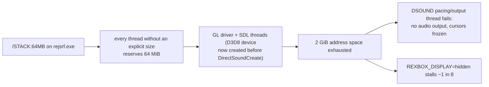

# 설계: 소리가 나지 않는 문제 — 호스트 스레드 스택과 자기 일시정지 (issue #25)

선행: [i017 DSOUND HLE](20261012-i017-dsound-hle.md), [i023 고정 기능 그리기](20261012-i023-d3d8-fixed-function-draw.md), [boot-frontier](../analysis/boot-frontier.md)

## 1. 측정 (2026-10-13, **확인됨**)

* v0.0.10 부팅에서 `[dsound] no audio output (... the pacing thread cannot start: resource unavailable try again)`가 나온다. GL 드라이버가 `DirectSoundCreate`보다 먼저 올라오면서 생긴 일이다.
* `rejsrf.exe`는 `/STACK:67108864`로 링크되어 있고, `LARGEADDRESSAWARE`가 아니다(2 GiB). Windows에서는 스택 크기를 주지 않은 모든 스레드가 이미지 기본값만큼 예약하므로, 드라이버·SDL·`std::thread`가 각각 64 MiB를 잡는다.
* 게스트 스레드는 `CreateHostThread`로 64 MiB를 명시해서 받는다. 앱 메인 스레드는 게스트 코드를 실행하지 않는다(초기 스레드도 `StartInitialThread`가 만든다). 따라서 이미지 기본값이 클 이유가 없다.
* 게임의 프레임 스레드(`sub_0013B2A0`)는 한 프레임을 처리한 뒤 자기 핸들로 `SuspendThread`를 부르고, vblank 스레드(`sub_0013B1C0`)가 매 vblank에 `ResumeThread`한다. HLE `NtSuspendThread`는 실행 중인 스레드를 멈추지 않으므로 프레임 스레드가 쉬지 않고 돈다.
* 게임이 `IDirectSoundBuffer_Play`를 부르지 않는 것은 부팅이 로고에 머물러 있기 때문이다. 주 스레드는 막혀 있지 않고 매 프레임 로고 작업(감마 램프 계산, `SetGammaRamp`, 그리기)을 한다.

## 2. 결정

1. `rejsrf`는 `/STACK` 대신 `/LARGEADDRESSAWARE`로 링크한다. 64비트 Windows에서 4 GiB를 쓰고, 다른 스레드는 1 MiB 기본 스택을 쓴다. `rejsrf_d3d8_check`는 원본을 메인 스레드에서 직접 실행하므로 `/STACK`을 유지한다.
2. `NtSuspendThread`가 자기 자신을 대상으로 하면, 그 호출 지점(안전한 지점)에서 `suspend_count`가 0이 될 때까지 기다린다. 다른 실행 중 스레드의 일시정지는 지금처럼 개수만 센다(안전 지점이 필요하다, 미해결).
3. 로고에서 넘어가지 않는 이유는 이 작업에서 고치지 않고 분석 결과만 남긴다.

## 3. 검증

빌드(Debug/Release), 기존 probe 회귀 없음, 부팅에서 `audio output: host device`(장치 있음)와 `audio output: none ... cursors run in real time`(`REXBOX_AUDIO=none`), 숨김 창 8번 연속 정상, 자기 일시정지 뒤 `NtSuspendThread` 호출이 초당 수만 번에서 vblank 주기(약 60~120번)로 줄어듦.

---

# Design: no sound — host-thread stacks and self-suspension (issue #25)

Prerequisites: [i017 DSOUND HLE](20261012-i017-dsound-hle.md), [i023 fixed-function drawing](20261012-i023-d3d8-fixed-function-draw.md), [boot-frontier](../analysis/boot-frontier.md)

## 1. Measurements (2026-10-13, **confirmed**)

The flowchart above applies. The v0.0.10 boot prints `[dsound] no audio output (... the pacing thread cannot start: resource unavailable try again)`, because the GL driver now loads before `DirectSoundCreate`. `rejsrf.exe` links with `/STACK:67108864` and is not large-address-aware (2 GiB). On Windows every thread created without a stack size reserves the image default, so each driver, SDL and `std::thread` thread takes 64 MiB. Guest threads get their 64 MiB explicitly through `CreateHostThread`, and the app's main thread runs no guest code (`StartInitialThread` creates the first guest thread), so the image default need not be large. The title's frame thread (`sub_0013B2A0`) calls `SuspendThread` on its own handle after each frame, and its vblank thread (`sub_0013B1C0`) calls `ResumeThread` every vblank. The HLE `NtSuspendThread` does not stop a running thread, so the frame thread spins. The game calls no `IDirectSoundBuffer_Play` because the boot stays on the logo. The main thread is not blocked: each frame it does the logo work (gamma-ramp computation, `SetGammaRamp`, drawing).

## 2. Decisions

1. `rejsrf` links with `/LARGEADDRESSAWARE` instead of `/STACK`: 4 GiB on 64-bit Windows, and other threads get the 1 MiB default. `rejsrf_d3d8_check` keeps `/STACK` because it runs originals directly on its main thread.
2. When `NtSuspendThread` targets the calling thread, it waits at that call (a safe point) until `suspend_count` is back to 0. Suspending another running thread still only counts (it needs a safe point; unresolved).
3. Why the boot stays on the logo is not fixed here; only the analysis is recorded.

## 3. Verification

Builds (Debug/Release) and the existing probes without regressions. Boot prints `audio output: host device` (with a device) and `audio output: none ... cursors run in real time` (`REXBOX_AUDIO=none`). Eight hidden-window runs in a row succeed. After self-suspension, `NtSuspendThread` calls drop from tens of thousands per second to the vblank rate (about 60–120).
