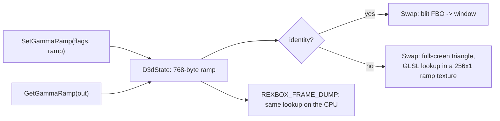

# 설계: D3D8 감마 램프를 화면에 적용 (issue #26)

선행: [i023 고정 기능 그리기](20261012-i023-d3d8-fixed-function-draw.md), [i025](20261013-i025-audio-host-threads.md)

## 1. 사실 (**확인됨**)

* 게임은 로고를 페이드할 때 매 프레임 램프를 새로 계산해 `SetGammaRamp(1, ramp)`를 부른다(i025 프로파일). HLE는 이 호출을 버리고, `GetGammaRamp`는 항상 단위 램프를 돌려준다.
* 원본 `SetGammaRamp`(`0x0018CB60`)는 768바이트(`rep movsd` 0xC0)를 디바이스의 램프 칸 두 개 중 하나로 복사한다. `Flags` bit 0(`D3DSGR_IMMEDIATE`)이면 도우미 `0x0018E584`가 RAMDAC 팔레트(`0x6813C8/9`)에 R, G, B 순서로 256번 바로 쓰고, 아니면 다음 vblank에 반영하도록 표시만 한다. 따라서 Xbox `D3DGAMMARAMP`는 `BYTE red[256], green[256], blue[256]`이다(PC는 WORD).

## 2. 결정

* 램프는 디바이스 상태에 둔다. `GetGammaRamp`는 마지막으로 설정한 값을 돌려준다.
* 화면은 `Swap` 때만 나가므로 IMMEDIATE와 vblank 반영의 차이는 없다. 둘 다 다음 present에 적용한다.
* 단위 램프이면 지금처럼 blit하고, 아니면 백버퍼 텍스처를 그리는 전체 화면 삼각형에서 256×1 램프 텍스처를 `texelFetch`로 찾는다. 알파는 그대로 둔다.
* frame dump도 화면과 같도록 CPU에서 같은 표를 적용한다.
* 순수 부분(`d3d8_gamma`: 단위 판정, CPU 적용, GLSL 텍스트)은 `rexbox_d3d8_probe`로 검사한다.

## 3. 검증

빌드, probe(새 감마 케이스), `rejsrf_d3d8_check`·`check_hle_pops.py` 회귀 없음. 부팅 frame dump에서 로고가 페이드 인/아웃하는지(프레임별 밝기 변화) 확인한다.

---

# Design: apply the D3D8 gamma ramp to the screen (issue #26)

Prerequisites: [i023 fixed-function drawing](20261012-i023-d3d8-fixed-function-draw.md), [i025](20261013-i025-audio-host-threads.md)

## 1. Facts (**confirmed**)

* The game fades its logos by computing a new ramp every frame and calling `SetGammaRamp(1, ramp)` (i025 profile). The HLE drops the call, and `GetGammaRamp` always answers an identity ramp.
* The original `SetGammaRamp` (`0x0018CB60`) copies 768 bytes (`rep movsd`, 0xC0 DWORDs) into one of two ramp slots in the device. With `Flags` bit 0 (`D3DSGR_IMMEDIATE`), the helper `0x0018E584` writes it to the RAMDAC palette (`0x6813C8/9`) at once, 256 times R, G, B; otherwise it is only marked for the next vertical blank. The Xbox `D3DGAMMARAMP` is therefore `BYTE red[256], green[256], blue[256]` (the PC's is WORD).

## 2. Decisions

The flowchart above applies.

* The ramp lives in the device state. `GetGammaRamp` returns the last one set.
* The screen changes only at `Swap`, so immediate and vblank application are the same: both apply at the next present.
* An identity ramp keeps the blit. Otherwise a fullscreen triangle draws the back-buffer texture and looks each channel up in a 256×1 ramp texture with `texelFetch`. Alpha is kept.
* Frame dumps apply the same table on the CPU, so they match the screen.
* The pure part (`d3d8_gamma`: the identity test, the CPU application, the GLSL text) is checked by `rexbox_d3d8_probe`.

## 3. Verification

Builds; probes (new gamma cases); no regressions in `rejsrf_d3d8_check` and `check_hle_pops.py`. Boot frame dumps show the logo fading in and out (brightness changing from frame to frame).
