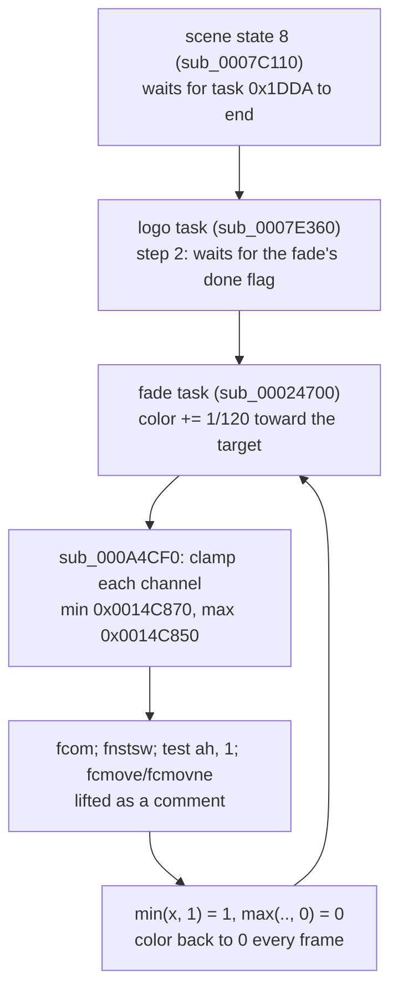

# 설계: FCMOVcc 번역 누락으로 로고 페이드가 끝나지 않음 (issue #27)

선행: [i025](20261013-i025-audio-host-threads.md), [i026](20261013-i026-d3d8-gamma-ramp.md), [boot-frontier](../analysis/boot-frontier.md)

## 1. 원인 (**확인됨**)

* 게스트 RAM 덤프와 생성 코드에 넣은 임시 출력으로 확인했다. 장면 객체 `0x00373CA0`은 상태 8에 있고, 작업 관리자 `0x00363A70`의 작업 `0x1DDA`(로고, `0x00B32D00`)는 단계 2(카운터 121)에 있다. 페이드 작업(`0x00A28260`)은 `fadd` 직후 색 0.0083이었다가, update가 끝날 때 0으로 돌아간다.
* xboxrecomp lifter의 `_lift_fpu`는 `FCMOVcc` 여덟 가지를 처리하지 않고 `/* FPU: ... */` 주석으로 남겼다. 게임 전체에서 이 명령은 두 곳뿐이다(위의 min/max 도우미).

## 2. 결정

* lifter의 `lift_basic_block`에서 `FCMOVcc`를 같은 조건 코드의 jcc 조건식으로 번역한다(`fcmovb`/`jb`, `fcmove`/`je`, `fcmovbe`/`jbe`, `fcmovu`/`jp`, 부정형). 결과는 `if (cond) st(0) = st(i);`다. 추적된 플래그가 없으면 `cmovcc`처럼 `_flags`를 쓴다.
* AGENTS.md의 업스트림 기여 규칙에 따라, 같은 성격(lifter 번역 누락)인 열린 업스트림 PR [sp00nznet/xboxrecomp#198](https://github.com/sp00nznet/xboxrecomp/pull/198)(`xadd` 플래그)에 커밋을 더한다. 포크의 `rejsrf` 브랜치에 합쳐 submodule을 갱신한다.

## 3. 검증

xboxrecomp 테스트(새 `test_lifter_fcmov.py`; 수정 전 4건 실패), 생성 코드에서 `FPU: fcmov` 0건, 빌드와 회귀 도구, 부팅 frame dump로 로고 시퀀스가 진행하는지 확인한다.

---

# Design: FCMOVcc not lifted, so the logo fade never completes (issue #27)

Prerequisites: [i025](20261013-i025-audio-host-threads.md), [i026](20261013-i026-d3d8-gamma-ramp.md), [boot-frontier](../analysis/boot-frontier.md)

## 1. Cause (**confirmed**)

The flowchart above applies. Guest RAM dumps and temporary prints in the generated code show the following. The scene object `0x00373CA0` is in state 8, and task `0x1DDA` of the task manager `0x00363A70` (the logo, `0x00B32D00`) is in step 2 (counter 121). The fade task (`0x00A28260`) has its color at 0.0083 right after the `fadd`, and back at 0 when its update returns. The xboxrecomp lifter's `_lift_fpu` did not handle the eight `FCMOVcc` forms and left them as `/* FPU: ... */` comments. The whole game has only two of them, in the min/max helpers above.

## 2. Decisions

* `lift_basic_block` lifts `FCMOVcc` with the condition of the jcc that has the same condition code (`fcmovb`/`jb`, `fcmove`/`je`, `fcmovbe`/`jbe`, `fcmovu`/`jp` and the negated forms), emitting `if (cond) st(0) = st(i);`. Without tracked flags it uses `_flags`, as `cmovcc` does.
* Following AGENTS.md's upstream-contribution rule, the commit goes onto the open upstream PR of the same nature (a lifter translation gap), [sp00nznet/xboxrecomp#198](https://github.com/sp00nznet/xboxrecomp/pull/198) (`xadd` flags). It is merged into the fork's `rejsrf` branch, and the submodule is updated.

## 3. Verification

xboxrecomp tests (the new `test_lifter_fcmov.py`, whose 4 cases fail without the change); zero `FPU: fcmov` left in the generated code; builds and regression tools; a boot whose frame dumps show the logo sequence moving on.
