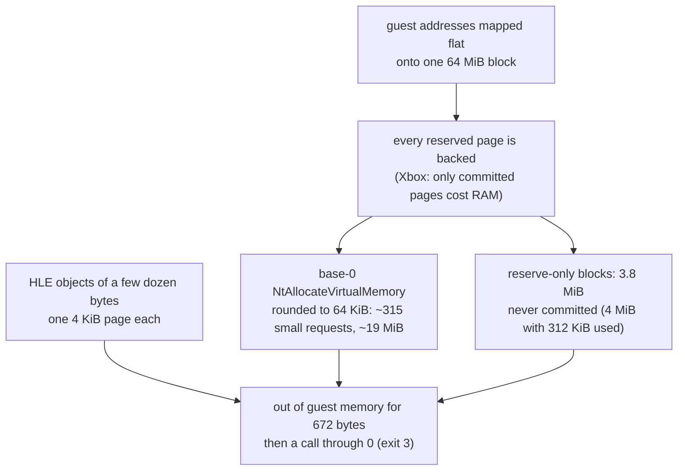

# 설계: 스테이지 로드 중 게스트 메모리 부족 (issue #29)

선행: [i003 §4](20261012-i003-kernel-hle.md), [i027](20261013-i027-fcmov-logo-fade.md), [boot-frontier](../analysis/boot-frontier.md)

## 1. 원인 (**확인됨**)

`REXBOX_TRACE_MEMORY`로 로고 다음 스테이지 로드까지의 할당을 모두 기록해 측정했다.

* 게임의 작은 `NtAllocateVirtualMemory` 요청 315건은 합해 0x5CF50바이트인데, 64 KiB 할당 단위로 올림되어 약 19 MiB를 차지했다.
* 페이지 정렬로 바꾼 뒤에도 힙 확장 요청(8 MiB → 4 → 2 → 1 MiB 재시도)의 8 MiB가 실패했다. 남은 메모리 8.2 MiB, 가장 긴 연속 구간 6.4 MiB였다. 예약만 하고 커밋하지 않은 페이지 3.8 MiB가 그 차이다. Xbox에서는 이 예약이 주소 공간만 쓰므로 같은 요청이 성공한다.
* D3D 리소스 헤더(0x18~0x40바이트), 정점 셰이더 객체, DSOUND·XInput 블록, 커널 풀·동기화 객체가 각각 한 페이지를 차지했다.

## 2. 결정

1. **작은 예약은 페이지 정렬**: base 0인 `NtAllocateVirtualMemory`에서 64 KiB 미만 요청은 페이지 단위로 정렬한다. 큰 요청은 64 KiB 단위를 지킨다.
2. **서브 페이지 할당자**: `GuestHeap::AllocateSmall(size)`는 2 KiB 이하 요청을 크기 등급(16바이트부터 2의 거듭제곱)의 slab 페이지에서 준다. 슬롯은 자기 크기에 정렬된다. `Free`와 `BlockSizeContaining`은 slab 슬롯도 처리한다. 마지막 슬롯이 풀리면 페이지를 돌려준다. 사용처는 D3D 헤더·정점 셰이더 객체, DSOUND `AllocateGuest`, XInput 핸들, 커널 `AllocateZeroed`(정렬이 페이지 미만인 경우: 풀, 이벤트·세마포어·뮤턴트)다.
3. **게스트 주소 공간 128 MiB**: `GuestMemory::kAddressSpaceSize` = 2 × 64 MiB를 매핑한다. `GuestHeap(memory_size, physical_size)`는 아래 64 MiB를 물리 RAM으로 보고 `Allocate`와 `AllocateSmall`을 그 안에서만 처리한다. 위 64 MiB는 `AllocateVirtual`(`NtAllocateVirtualMemory`의 base 0 경로)만 쓰고, 꽉 차면 아래로 내려간다. Xbox에서도 가상 메모리 주소는 물리 주소와 무관하다. 연속 메모리, 풀, HLE 객체, `MmClaimGpuInstanceMemory`는 아래에 남으므로 `D3DResource_Register`의 물리 마스크 `0x03FFFFFF`는 그대로다.
4. **D3D 데이터 주소 마스크**: 그리기와 텍스처 캐시가 쓰던 `0x03FFFFFF` 마스크는 `0x80000000` 연속 매핑 비트만 떼어 내면 된다. 위 64 MiB에 있는 index 데이터와 사용자 포인터 정점을 잃지 않도록 `kPhysicalMask` = `kAddressSpaceSize - 1`(`0x07FFFFFF`, devkit 128 MiB의 마스크와 같음)을 `d3d8_internal.h`에 하나로 둔다.
5. **진단**: 메모리 부족 trace에 남은 바이트와 가장 긴 연속 구간(`largest_free_bytes`)을 함께 적는다.

`MmClaimGpuInstanceMemory`의 끝 주소 질의는 물리 RAM 끝(64 MiB)을 돌려준다.

## 3. 편차 (**편차 기록**)

* 커밋한 메모리가 64 MiB를 넘어도 실패하지 않는다. Xbox에서 실패할 할당이 여기서는 성공할 수 있다. 게임은 Xbox 예산 안에서 동작하도록 만들어졌으므로, 이 편차는 예약 비용과 HLE 오버헤드를 흡수하는 쪽으로만 작용한다.
* 가상 메모리 주소가 `0x04000000` 이상일 수 있다. 게임이 가상 주소를 물리 마스크로 자르는 곳이 보이면 그때 다시 본다.

## 4. 검증

* kernel probe: 작은 예약의 페이지 정렬, 풀 블록의 페이지 공유·크기 등급·해제, 힙 영역(물리/가상, fallback, `Allocate`가 위 영역에 닿지 않음).
* 빌드(Debug/Release), 회귀 도구, 숨김 창 부팅 150초에 메모리 trace와 frame dump.

---

# Design: guest memory runs out while loading the stage (issue #29)

Prerequisites: [i003 §4](20261012-i003-kernel-hle.md), [i027](20261013-i027-fcmov-logo-fade.md), [boot-frontier](../analysis/boot-frontier.md)

## 1. Cause (**confirmed**)

Measured with `REXBOX_TRACE_MEMORY`, which recorded every allocation from the logos to the stage load (flowchart above).

* The title's 315 small `NtAllocateVirtualMemory` requests total 0x5CF50 bytes. Rounded to the 64 KiB allocation granularity, they took about 19 MiB.
* With page alignment, the heap-growth request still failed at 8 MiB (the title retries 8 → 4 → 2 → 1 MiB). At that point 8.2 MiB was free and the longest free run was 6.4 MiB. The 3.8 MiB of pages that were reserved but never committed make the difference. On the Xbox such a reservation costs only address space, so the same request succeeds.
* D3D resource headers (0x18–0x40 bytes), vertex shader objects, DSOUND and XInput blocks, and kernel pool and sync objects each took a whole page.

## 2. Decisions

1. **Small reservations take page alignment.** A base-0 `NtAllocateVirtualMemory` request under 64 KiB is page aligned. Larger requests keep the 64 KiB granularity.
2. **Sub-page allocator.** `GuestHeap::AllocateSmall(size)` serves requests of up to 2 KiB from slab pages of a size class (powers of two from 16 bytes). A slot is aligned to its size. `Free` and `BlockSizeContaining` handle slab slots. A page is returned when its last slot is freed. It is used by:
   * D3D headers and vertex shader objects
   * DSOUND `AllocateGuest`
   * XInput handles
   * kernel `AllocateZeroed` when its alignment is below a page: pool, events, semaphores, mutants
3. **A 128 MiB guest address space.** `GuestMemory::kAddressSpaceSize` (2 × 64 MiB) is mapped.
   * `GuestHeap(memory_size, physical_size)` treats the low 64 MiB as physical RAM. `Allocate` and `AllocateSmall` stay inside it.
   * The upper 64 MiB serves only `AllocateVirtual` (the base-0 path of `NtAllocateVirtualMemory`), which falls back to the low part when the top is full. On the Xbox too, virtual memory addresses have nothing to do with physical ones.
   * Contiguous memory, pool, HLE objects and `MmClaimGpuInstanceMemory` stay low. So `D3DResource_Register` keeps its physical mask `0x03FFFFFF`.
4. **D3D data address mask.** The `0x03FFFFFF` mask in drawing and the texture cache only needs to strip the `0x80000000` contiguous-mapping bit. Index data and user-pointer vertices may now be in the upper 64 MiB. So there is one `kPhysicalMask` = `kAddressSpaceSize - 1` (`0x07FFFFFF`, the devkit's 128 MiB mask) in `d3d8_internal.h`.
5. **Diagnostics.** The out-of-memory trace adds the free bytes and the longest free run (`largest_free_bytes`).

The end-of-instance-memory query of `MmClaimGpuInstanceMemory` returns the end of physical RAM (64 MiB).

## 3. Deviations (**recorded deviation**)

* Committed memory beyond 64 MiB does not fail. An allocation that would fail on the Xbox can succeed here. The title was built to fit the Xbox budget, so this deviation only absorbs the cost of reservations and the HLE overhead.
* Virtual memory addresses can be at `0x04000000` or above. If the title is seen to cut a virtual address with a physical mask, this is revisited.

## 4. Verification

* Kernel probe checks:
  * page alignment of small reservations
  * pool blocks sharing a page, their size class, and freeing
  * heap regions: physical vs virtual, the fallback, and `Allocate` never reaching the upper region
* Builds (Debug and Release), the regression tools, and a 150 s hidden-window boot with the memory trace and frame dumps.
