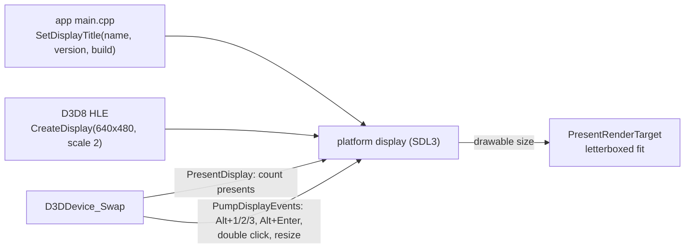

# 설계: 창 제목과 크기·전체화면 조작 (issue #31)

선행: [i007 §2.5](20261012-i007-d3d8-hle-first-batch.md), 참고: rePIU `src/engine/glide_opengl_backend.cpp`(`BuildWindowTitle`, Alt+Enter·더블클릭, Alt+1~4)

## 1. 요구

* 제목을 rePIU 형식으로: 버전, 빌드 일시, FPS.
* 크기 조절과 최대화. 크기를 바꿀 때 종횡비를 지킨다. 기본 크기는 그림의 가로·세로 2배다.
* Alt+1/2/3 고정 배율.
* 더블클릭이나 Alt+Enter로 제목줄 없는 전체화면 전환.

## 2. 결정

* **제목**: 고정 부분은 앱이 `platform::SetDisplayTitle`로 준다. 형식은 `reJSRF v<버전> (<플랫폼>/<아키텍처> <구성>) - Build <YYYY-MM-DD HH:MM>`이다. 표시 계층이 그 뒤에 ` - OpenGL <버전> - FPS : <값>`을 붙인다. FPS는 `PresentDisplay` 사이 간격으로 약 1초마다 계산한다(rePIU와 같은 방식). HLE는 rexbox 쪽이라 reJSRF의 이름과 버전을 모른다. 그래서 이름은 앱이 준다.
* **빌드 일시**: `__DATE__`는 그 파일을 다시 컴파일할 때만 바뀐다. 그래서 `src/app/build_stamp.cmake`가 빌드마다 `rejsrf_build_stamp.h`를 만든다. 내용이 같으면 쓰지 않으므로, 분이 바뀔 때만 `main.cpp`를 다시 컴파일한다. 구성 이름은 `$<CONFIG>`다.
* **창**: `DisplayConfig::scale`(기본 2)배로 열고 `SDL_WINDOW_RESIZABLE`과 `SDL_SetWindowAspectRatio`(그림의 비율)를 쓴다. drawable 크기는 크기 변경 이벤트 때 갱신한다. 표시는 이미 drawable 안에 비율을 지켜 맞추고 나머지를 검게 칠한다.
* **단축키**는 `PumpDisplayEvents`(창을 만든 스레드)에서 처리한다.
  * Alt+1/2/3: 전체화면이나 최대화를 먼저 푼 뒤 그림의 1~3배로 만든다.
  * Alt+Enter와 왼쪽 더블클릭: `SDL_SetWindowFullscreen`을 디스플레이 모드 없이 부른다. 즉 데스크톱 해상도의 테두리 없는 창이 되고, 모드는 바뀌지 않는다.
  * 키보드 입력은 키 상태를 읽으므로, Alt가 눌린 동안 Enter는 START로 보내지 않는다.

## 3. 검증

* Win32 Release에서 창을 실제로 띄워 확인한다.
  * 제목 문자열과 FPS 60.0
  * 클라이언트 크기 1280x960
  * 창 스타일에 크기 조절과 최대화
* Win32 입력을 합성해 확인한다.
  * Alt+1/2/3: 640x480, 1920x1440, 1280x960
  * Alt+Enter와 더블클릭: 3840x2160 `WS_POPUP`, 다시 누르면 원래 창
* Debug/Release 빌드와 probe.

---

# Design: window title, sizing and fullscreen controls (issue #31)

Prerequisite: [i007 §2.5](20261012-i007-d3d8-hle-first-batch.md). Reference: rePIU `src/engine/glide_opengl_backend.cpp` (`BuildWindowTitle`, Alt+Enter and double click, Alt+1–4).

## 1. Requirements

* A title in rePIU's form: version, build time, FPS.
* Resizable and maximizable, keeping the aspect ratio while resizing. The default size is twice the picture in both directions.
* Fixed scales on Alt+1/2/3.
* A double click or Alt+Enter toggles borderless fullscreen.

## 2. Decisions

The flowchart above applies.

* **Title.** The app gives the fixed part through `platform::SetDisplayTitle`: `reJSRF v<version> (<platform>/<arch> <config>) - Build <YYYY-MM-DD HH:MM>`. The display layer appends ` - OpenGL <version> - FPS : <value>`. The FPS comes from the intervals between `PresentDisplay` calls, about once a second, as in rePIU. The HLE belongs to rexbox and does not know reJSRF's name or version, so the app supplies them.
* **Build time.** `__DATE__` changes only when its file is recompiled. So `src/app/build_stamp.cmake` writes `rejsrf_build_stamp.h` on every build. It skips the write when the content is the same, so `main.cpp` recompiles only when the minute changes. The configuration name comes from `$<CONFIG>`.
* **Window.** It opens at `DisplayConfig::scale` (default 2) times the picture, with `SDL_WINDOW_RESIZABLE` and `SDL_SetWindowAspectRatio` (the picture's ratio). The drawable size is updated on resize events. The present already fits the picture into the drawable with its ratio kept and the rest black.
* **Controls** are handled in `PumpDisplayEvents`, on the thread that created the window.
  * Alt+1/2/3 leave fullscreen or the maximized state, then size the window to 1x–3x the picture.
  * Alt+Enter and a left double click call `SDL_SetWindowFullscreen` with no display mode. The window becomes borderless at the desktop resolution, and the display mode never changes.
  * Keyboard input reads key states, so Enter is not sent as START while Alt is held.

## 3. Verification

* A visible window on Win32 Release:
  * the title string with FPS 60.0
  * a 1280x960 client area
  * a window style that allows resizing and maximizing
* Synthesized Win32 input:
  * Alt+1/2/3 give 640x480, 1920x1440 and 1280x960
  * Alt+Enter and a double click give a 3840x2160 `WS_POPUP` window, and pressing again restores the window
* Debug and Release builds and the probes.
