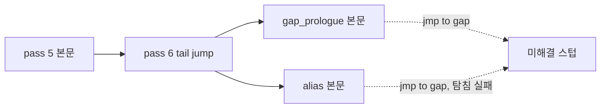

# 설계: 미해결 스텁이 놓친 함수를 말없이 건너뛰는 문제 (issue #55)

선행: [i021 노드 순회 fault](20261012-i021-node-walk-fault.md)(본문 중간 분기의 alias), [unlifted-instructions](../analysis/unlifted-instructions.md)

## 1. 문제

* lift 코드의 **미해결 스텁**은 번역된 코드가 부르거나 점프하지만 디스어셈블러가 함수로 찾지 못한 주소다. 생성기는 반환 주소만 pop하는 빈 함수(`g_esp += 4`)를 만든다.
* 놓친 함수가 실행되면 본문 전체가 건너뛰어지고, 아무것도 보고되지 않는다. 대상을 못 찾은 간접 호출은 보고되는 것과 다르다.
* **확인됨**(임시 계측, 로고와 데모 120초): 83개 중 `sub_00054750` 하나가 실행된다.
  * 진짜 함수다(nop 패딩 뒤 16바이트 정렬, `sub esp, 0x10; push ebx ...`).
  * `sub_00051FC0`이 119칸 상태 표(`0x1F9888`)로 상태 처리 함수를 부른다. 그중 `sub_0005BB31`이 끝에서 `jmp 0x54750`으로 넘어간다.
* **확인됨**(정적 분류): 83개 가운데 7개가 패딩 뒤 정렬된 주소에서 시작하고 `jmp`/`jcc`로만 닿는다(0x22F30, 0x54750, 0x75E90, 0xA5B60, 0xB8A60, 0xC67A0, 0x11B680).

## 2. 원인

xboxrecomp 디스어셈블러(`tools/disasm/functions.py`)의 tail-jump pass(pass 6)는 "자기 본문을 떠나는 무조건 `jmp`의 대상"을 함수로 등록한다. 이 pass는 pass 5가 만든 본문만 본다.

* 7개의 점프는 모두 그 뒤의 pass가 만든 본문 안에 있다.
  * `gap_prologue`(ret 바로 뒤 함수, pass 6 뒤): `sub_0005BB31`, `sub_000C6A90`, `sub_0011BA00`
  * `tail_jump_alias`(데이터 포인터·본문 중간 분기로 생긴 alias, 맨 끝): `sub_00022F7F`, `sub_00077000`, `sub_000A6100`, `sub_000B9960`
* 늦게 생긴 본문의 무조건 `jmp`를 다시 보는 pass는 다음과 같다.
  * `_pass_branches_into_bodies`: 대상이 다른 본문 **안**일 때만 본다.
  * `_pass_alias_branch_orphans`: alias 본문에서 출발할 때만 보고, 대상이 짧은 탐침에서 `ret`에 닿아야 한다(긴 함수는 거절).
  * 그래서 "늦게 생긴 본문에서 **빈 구간**으로 가는 tail jump"를 보는 pass가 없다.

## 3. 설계

### 3.1 디스어셈블러: 늦은 tail jump pass (xboxrecomp fork)

* `_pass_late_tail_jumps`를 `_pass_branches_into_bodies` 뒤, `_pass_alias_branch_orphans` 앞에 둔다.
* 출발점은 최종 함수 본문과 alias 범위 모두다.
* 받는 조건(pass 6과 같은 근거):
  * 무조건 `jmp`이고 자기 본문을 떠난다.
  * 대상은 실행 섹션의 디코드된 명령이고, 어느 함수 본문에도 속하지 않으며, 함수나 alias 시작이 아니다.
* 등록은 alias 항목으로 한다. 함수 후보로 넣지 않으므로 다른 본문을 자르지 않는다. 끝은 다음 시작까지로 두고, 실제 범위는 `_build_alias_entries`가 측정한다.
* 새 alias가 다시 tail jump할 수 있으므로, 새 항목이 없을 때까지 되풀이한다.
* 단위 테스트는 기존 `test_alias_branch_orphans.py`와 같은 모의 엔진으로 쓴다. 두 경우를 확인한다.
  * 늦게 생긴 본문에서 빈 구간으로 가는 `jmp`는 alias가 된다.
  * 본문 안 분기와 다른 본문 안으로 가는 분기는 이 pass가 건드리지 않는다.

### 3.2 스텁의 첫 호출 보고 (xboxrecomp fork + reJSRF 런타임)

* 생성기는 스텁 본문에 `RECOMP_UNRESOLVED_STUB(0xADDR);`를 넣는다.
* `templates/runtime/recomp_types.h`의 동작:
  * `RECOMP_STUB_REPORT`가 정의되면 `recomp_unresolved_stub_log(va)`를 부른다.
  * 정의되지 않으면 아무것도 하지 않는다. 다른 프로젝트는 지금과 같다.
* reJSRF는 `rejsrf_recomp`에 `RECOMP_STUB_REPORT`를 정의한다. `recomp_bridge.cpp`가 주소마다 한 번 보고한다(`[recomp] unresolved stub <va> called (returns to <ret>)`).
* 실행 비용은 스텁이 불릴 때만 든다.

### 3.3 남은 스텁의 분류 (`docs/analysis/`)

* 다시 생성한 뒤 남은 스텁을 정적으로 분류해 새 분석 문서 `unresolved-stubs.md`에 남긴다.
  * 분류: 다른 본문 중간, 명령 경계가 아님, ret/jmp 뒤 정렬 안 됨 등
* 실행에서 보고된 스텁도 함께 적는다.

### 3.4 upstream

* 3.1과 3.2는 upstream main 기반의 fork 브랜치로 만들고 `rejsrf`에 합친다.
* upstream PR은 **준비만 하고 올리지 않는다**(사용자 결정, 검토 뒤 올림).
* 후속(사용자 결정): 3.1은 같은 주제(최종 본문에서 분기를 다시 봄)인 열린 upstream [PR #200](https://github.com/sp00nznet/xboxrecomp/pull/200)에 합쳤다. 3.2는 계속 보류한다. PR 제목과 본문 초안은 작업 로그에 둔다.

## 4. 검증

| 검증 | 기대 |
|---|---|
| xboxrecomp `pytest tools/recomp tools/disasm` | 새 테스트 통과, 기존 회귀 없음 |
| 다시 생성 | 7개가 함수(alias)가 되고 미해결 스텁이 줄어듦. 함수 수와 스텁 수를 기록 |
| 로고·데모 120초 | `0x54750` 본문이 실행됨. 스텁 보고 0건 또는 보고된 주소 기록 |
| 프레임 덤프 | 바뀌기 전과 비교해 차이가 있으면 원인 기록(같은 속도 조건, frame-time §5) |
| Debug/Release, 회귀 도구 | 경고 0, 회귀 없음 |

---

# Design: unresolved stubs silently skip functions the disassembler missed (issue #55)

Prerequisites: [i021 node-walk fault](20261012-i021-node-walk-fault.md) (aliases for branches into bodies), [unlifted-instructions](../analysis/unlifted-instructions.md)

## 1. Problem

* An **unresolved stub** in the lifted code is an address that translated code calls or jumps to but the disassembler did not find as a function. The generator emits an empty function that pops only the return address (`g_esp += 4`).
* When a missed function runs, its whole body is skipped and nothing is reported, unlike an indirect call with no target, which is reported.
* **Confirmed** (temporary instrumentation, logos and demo, 120 s): of the 83, `sub_00054750` runs.
  * It is a real function (aligned to 16 after nop padding, `sub esp, 0x10; push ebx ...`).
  * `sub_00051FC0` calls a state handler through a 119-entry state table (`0x1F9888`), and one of them, `sub_0005BB31`, ends with `jmp 0x54750`.
* **Confirmed** (static classification): 7 of the 83 start at an aligned address after padding and are reached only by `jmp`/`jcc` (0x22F30, 0x54750, 0x75E90, 0xA5B60, 0xB8A60, 0xC67A0, 0x11B680).

## 2. Cause

The xboxrecomp disassembler's tail-jump pass (pass 6, `tools/disasm/functions.py`) registers the target of every unconditional `jmp` that leaves its own body, looking only at the bodies pass 5 built.

* All seven jumps lie in bodies made by later passes:
  * `gap_prologue` (a function right after a ret, after pass 6): `sub_0005BB31`, `sub_000C6A90`, `sub_0011BA00`
  * `tail_jump_alias` (aliases from data pointers and branches into bodies, built last): `sub_00022F7F`, `sub_00077000`, `sub_000A6100`, `sub_000B9960`
* The passes that look again at the jumps of late bodies:
  * `_pass_branches_into_bodies` takes only targets **inside** another body.
  * `_pass_alias_branch_orphans` takes only alias sources, and needs the target to reach a `ret` in a short probe (a long function is refused).
  * So no pass takes a tail jump from a late body into a **gap**.

The diagram above applies: pass 5 bodies feed pass 6; gap-prologue and alias bodies come after it, and their jumps into gaps become unresolved stubs.

## 3. Design

### 3.1 Disassembler: a late tail-jump pass (xboxrecomp fork)

* `_pass_late_tail_jumps` runs after `_pass_branches_into_bodies` and before `_pass_alias_branch_orphans`.
* Its sources are the final function bodies and the alias ranges.
* Acceptance (the same evidence as pass 6):
  * an unconditional `jmp` that leaves its own body
  * a target that is a decoded instruction in an executable section, inside no function body, and not a function or alias start
* The target is registered as an alias entry, not a function candidate, so it cannot cut another body. Its end is the next start; `_build_alias_entries` measures the real extent.
* A new alias can tail-jump onward itself, so the pass repeats until nothing new turns up.
* Unit tests use the mock engine of the existing `test_alias_branch_orphans.py` and check two cases:
  * a `jmp` from a late body into a gap becomes an alias
  * intra-body branches and branches into other bodies are left to the other passes

### 3.2 Reporting a stub's first call (xboxrecomp fork + reJSRF runtime)

* The generator puts `RECOMP_UNRESOLVED_STUB(0xADDR);` into each stub.
* `templates/runtime/recomp_types.h`:
  * with `RECOMP_STUB_REPORT` defined, it calls `recomp_unresolved_stub_log(va)`
  * without it, it does nothing, so other projects are unchanged
* reJSRF defines `RECOMP_STUB_REPORT` on `rejsrf_recomp`, and `recomp_bridge.cpp` reports each address once (`[recomp] unresolved stub <va> called (returns to <ret>)`).
* The cost is paid only when a stub is called.

### 3.3 Classifying the remaining stubs (`docs/analysis/`)

* After regenerating, the remaining stubs are classified statically in a new analysis topic, `unresolved-stubs.md`:
  * inside another body, not on an instruction boundary, unaligned after ret/jmp, and so on
* Stubs reported in runs are listed there too.

### 3.4 Upstream

* 3.1 and 3.2 are fork branches based on upstream main, merged into `rejsrf`.
* Follow-up (the user's decision): 3.1 was added to the open upstream [PR #200](https://github.com/sp00nznet/xboxrecomp/pull/200), which has the same subject (re-examining branches on the final bodies); 3.2 stays held.
* The upstream pull request is **prepared but not opened** (the user's decision, to be opened after review). Its title and description are drafted in the work log.

## 4. Verification

* xboxrecomp `pytest tools/recomp tools/disasm`: the new tests pass, with no regressions.
* Regeneration: the seven become functions (aliases) and unresolved stubs drop; function and stub counts are recorded.
* Logos and demo for 120 s: the body at `0x54750` runs; zero stub reports, or the reported addresses are recorded.
* Frame dumps: compared with before, with any difference explained (same speed conditions, frame-time §5).
* Debug and Release with zero warnings; no regressions in the tools.
