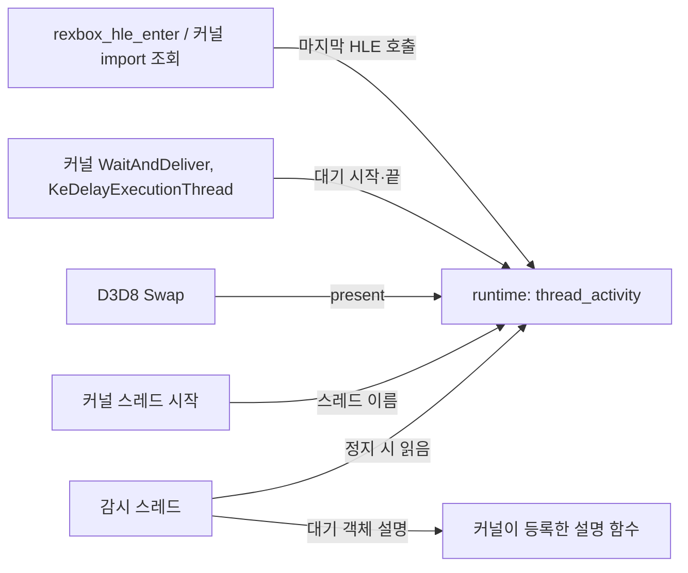

# 설계: present가 멈췄을 때 게스트 스레드의 상태 보고 (issue #60)

## 1. 문제

* v0.0.25로 플레이하다 게임이 멈췄다.
  * 로그에는 `[recomp]` 보고가 없고, `window close requested`도 없었다. 창 이벤트는 present 때 처리되므로 present가 멈춘 것으로 본다(**추정**).
  * 멈추기 직전 마지막 출력은 D3D8 미구현 경고 두 줄(512×512 오프스크린 렌더 타깃, 픽셀 셰이더 `0x0A`와 고정 기능 정점 처리 조합)이다.
* 멈춘 위치를 알아낼 방법이 없다. `REXBOX_WATCHDOG`은 정해진 시간 뒤에 실행을 끝내는 도구라 플레이 중 멈춤에 맞추기 어렵다. 직접 호출 프로파일은 생성 코드를 따로 빌드해야 채워진다.

## 2. 설계

**present 정지 보고**: present가 정해진 시간 동안 없으면, 게스트 스레드마다 지금 하는 일을 한 번 출력한다. present가 다시 시작되면 그 사실을 알리고 다시 감시한다.



* **위치**: 런타임(`include/rexbox/runtime/thread_activity.h`, `src/rexbox/runtime/thread_activity.cpp`). 타이틀을 모르는 공용 계약이고, HLE 모듈은 런타임만 링크한다(레이어 규칙).
* **기록하는 것**(스레드마다, thread_local 레코드를 전역 목록에 한 번 등록):
  * 이름: 커널이 스레드를 시작할 때 `thread <id> (<시작 함수>)`로 붙인다.
  * 마지막 HLE 호출: 이름, 호출한 곳(반환 주소), 시각
    * XDK 함수는 `rexbox_hle_enter`에서 기록한다.
    * 커널 import는 `recomp_lookup_manual`에서 기록한다. 이를 위해 `HleRegistry`에 주소로 export를 돌려주는 `LookupExport`를 더한다.
  * 대기: 무엇을(함수 이름), 어떤 객체를(최대 4개, 그 이상은 개수), 전부/하나, 시한(없으면 무한), 시작 시각
    * 커널의 `WaitAndDeliver`와 `KeDelayExecutionThread`에서 시작과 끝을 기록한다.
* **대기 객체 설명**: 객체의 종류와 신호 상태는 커널 구조다. 커널 모듈이 시작할 때 설명 함수를 런타임에 등록하고, 감시 스레드는 보고할 때 그것을 불러 **그때의** 상태를 쓴다. 그래야 "신호가 섰는데도 깨어나지 않은" 경우가 보인다.
* **present**: D3D8 `Swap`이 `NotePresent(frame)`을 부른다.
* **감시 스레드**: 앱이 시작한다(`StartStallMonitor`).
  * `REXBOX_STALL_REPORT=<초>`로 시간을 정한다. 기본 10초, `0`이면 끈다.
  * 첫 present 전(부팅)에는 감시하지 않는다.
  * 1초마다 확인한다. 정지가 이어지는 동안에는 한 번만 보고하고, present가 다시 오면 `[stall] presents resumed after X s`를 쓴다.
* **보고 형식**(stderr):

  ```
  [stall] no present for 10.0 s (last present 4321); guest threads:
  [stall]   thread 1 (00148023): waiting 9.9 s in NtWaitForSingleObjectEx on 0x0012ABCD SynchronizationEvent signal 0, no timeout; last HLE NtWaitForSingleObjectEx from 0x00145B5F
  [stall]   thread 3 (00147EBB): running; last HLE D3DDevice_Swap 9.9 s ago from 0x00031234
  ```

  * "running"인데 마지막 HLE가 오래됐다면, 게스트 코드가 HLE를 부르지 않고 돌고 있다는 뜻이다(돌기 또는 무한 루프).
* **비용**: HLE 호출마다 thread_local 필드 몇 개를 쓴다(원자적 저장). 보고는 정지 때만 한다. 그래서 기본으로 켠다.

## 3. 검증

| 검증 | 기대 |
|---|---|
| 데모 실행(기본값) | 정지 보고 없음, 프레임 시간 변화 없음(프로파일 `cpu` 열) |
| 인위적 정지(`REXBOX_STALL_REPORT=1`로 짧게, 로딩 등 1초 넘는 구간) | 보고 한 번, 스레드별 줄, 재개 줄 |
| `REXBOX_STALL_REPORT=0` | 감시 스레드 없음 |
| Debug/Release, 회귀 도구 | 경고 0, 통과 |
| 사용자 플레이(멈춘 장면) | 멈춘 스레드와 대기 대상이 보고됨 |

---

# Design: what each guest thread is doing when presents stop (issue #60)

## 1. Problem

* Playing v0.0.25, the game hung.
  * The log had no `[recomp]` reports and no `window close requested`. Window events are handled at presents, so presents are taken to have stopped (**inferred**).
  * The last output before it was two D3D8 not-implemented notes (a 512×512 off-screen render target, and pixel shader `0x0A` with fixed-function vertex processing).
* There is no way to find where it stopped. `REXBOX_WATCHDOG` ends a run after a fixed time, which is hard to time against a hang in play, and the direct-call profile is filled only by a separate build of the generated code.

## 2. Design

**Present-stall report**: when no present happens for a set time, print once what each guest thread is doing; when presents resume, say so and watch again. The diagram above applies: HLE entry and kernel import lookup record the last HLE call, the kernel's waits record wait begin and end, D3D8's Swap records presents, thread start names the thread, and a monitor thread reads it all on a stall, describing wait objects through a function the kernel registers.

* **Location**: the runtime (`include/rexbox/runtime/thread_activity.h`, `src/rexbox/runtime/thread_activity.cpp`). It is a title-agnostic contract, and HLE modules link only the runtime (the layer rule).
* **Recorded** per thread, in a thread_local record registered once in a global list:
  * a name: the kernel labels a thread `thread <id> (<start function>)` when it starts it
  * the last HLE call: name, caller (return address), time
    * XDK functions are recorded in `rexbox_hle_enter`.
    * Kernel imports are recorded in `recomp_lookup_manual`; for that, `HleRegistry` gains `LookupExport`, which returns the export bound at an address.
  * a wait: what (function name), which objects (up to 4, then a count), all or any, the timeout (or none), the start time
    * The kernel's `WaitAndDeliver` and `KeDelayExecutionThread` record its begin and end.
* **Describing wait objects**: an object's kind and signal state are kernel structures. The kernel module registers a describing function with the runtime at start, and the monitor calls it while reporting, so it shows the state **at that time**. That reveals a thread that is still waiting on an object that is signalled.
* **Presents**: D3D8's `Swap` calls `NotePresent(frame)`.
* **Monitor thread**: started by the app (`StartStallMonitor`).
  * `REXBOX_STALL_REPORT=<seconds>` sets the time; the default is 10 s, and `0` turns it off.
  * There is no watching before the first present (boot).
  * It checks every second, reports once per stall, and writes `[stall] presents resumed after X s` when presents come back.
* **Report format** (stderr): as above, one header line and a line per thread. A thread that is "running" with an old last HLE call is executing guest code without calling the HLE (spinning, or an endless loop).
* **Cost**: a few thread_local fields written per HLE call (atomic stores); reports only on a stall. So it is on by default.

## 3. Verification

* Demo run (default): no stall report, no change in frame time (the profile's `cpu` column).
* A provoked stall (`REXBOX_STALL_REPORT=1`, over a stretch longer than a second such as loading): one report, a line per thread, a resume line.
* `REXBOX_STALL_REPORT=0`: no monitor thread.
* Debug and Release with zero warnings; the regression tools pass.
* User play (the hanging scene): the stuck thread and what it waits on are reported.
