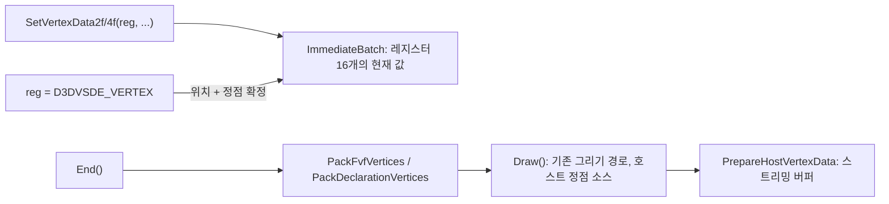

# 설계: Begin/End 즉시 모드 그리기 (issue #62)

## 1. 문제

* `D3DDevice_Begin`/`End`와 `SetVertexData2f`/`4f`는 받기만 하고 그리지 않았다.
* 기본 데모는 프레임마다 `Begin`/`End`를 두 번, `SetVertexData`를 약 20번 부른다.
* 임시 추적에서 본 호출은 다음과 같다(**확인됨**).
  * FVF `0x1C4`(XYZRHW | DIFFUSE | SPECULAR | TEX1), 삼각형 스트립(prim 6), 텍스처 없음
  * 알파 블렌드 `SRCALPHA/INVSRCALPHA`, 깊이 테스트 `LEQUAL`·깊이 쓰기 끔
  * 스텐실 켬: func `LEQUAL`, ref 1, op 모두 `KEEP`
  * 정점 전에 diffuse(레지스터 3) `(0, 0, 0, 0.498)`, specular(레지스터 4) `0`
  * 정점마다 texcoord0(레지스터 9), 이어서 `D3DVSDE_VERTEX`(-1)로 위치
  * 첫 스트립은 위치가 모두 `(-1, -1)`(퇴화). 두 번째는 `(0,0)`, `(640,0)`, `(0,480)`, `(640,480)`, z 0.5, rhw 0.5
* 바로 앞의 그리기들은 섀도 볼륨이다(**확인됨**, 프레임 2,800의 상태 추적).
  * 깊이 함수 `GEQUAL`, 깊이 쓰기 끔
  * 앞면은 스텐실 `INCR`, 뒷면은 `DECR`(컬 방향을 바꿔 두 번)
* 그러므로 즉시 모드 사각형은 **스텐실이 1 이상인 곳, 곧 그림자 안만 절반 어둡게 하는 그림자 칠하기**다. 처음에는 화면 전체를 어둡게 하는 오버레이로 보았으나, 스텐실 상태를 보고 바로잡았다.

## 2. 설계

* **`d3d8_immediate.h/.cpp`(순수, GL 없음)**:
  * `ImmediateBatch`가 레지스터 16개의 현재 값을 가진다. 처음 값은 `(0, 0, 0, 1)`이다.
  * `Set(reg, x, y, z, w)`: 레지스터를 바꾼다. `D3DVSDE_VERTEX`이면 위치(레지스터 0)를 바꾸고, 그때의 모든 레지스터로 정점 하나를 확정한다. 16 이상은 거부한다.
  * 레지스터 값은 정점과 배치를 넘어 유지한다. 하드웨어 레지스터의 동작을 따른 것이다(**추정**).
  * `Begin`은 이전 정점을 버리고 새 배치를 시작한다.
  * `SetVertexData2f`는 `(a, b, 0, 1)`을 넣는다.
* **레지스터 번호**: 확인된 것은 3 diffuse, 4 specular, 9 texcoord0, -1 정점이다. 나머지는 NV2A 속성 순서로 정했다(**추정**, [kb §9](../kb/xbox-d3d8-api.md)).
  * 0 위치, 1 블렌드 가중치, 2 법선, 5 안개, 6 점 크기, 7·8 뒷면 색, 9~12 texcoord0~3
  * 프로그램이면 같은 번호가 입력 레지스터 v0..v15다.
* **묶기**:
  * FVF는 `DecodeFvf` 배치대로 묶는다. 위치는 3개 또는 4개 float이고, 블렌드 가중치·법선·점 크기도 float다. diffuse·specular는 0..1 float를 D3DCOLOR(B, G, R, A 바이트)로 바꾼다. texcoord는 세트별 성분 수만큼 넣는다.
  * 정점 프로그램은 선언의 스트림 0 요소대로 묶는다. float, 정규화 short(×32767), short, 정규화 byte(×255), D3DCOLOR로 바꾼다.
* **그리기**:
  * `VertexSource`에 `immediate`(배치 포인터)를 더한다.
  * `Draw`는 FVF 또는 선언이 정해진 뒤 정점을 묶고, 게스트 메모리 검사 대신 `PrepareHostVertexData`로 스트리밍 버퍼에 올린다.
  * 나머지(프로그램 선택, 상태, QUADLIST 전개, 보고)는 기존 경로 그대로다.
* **진단**: `REXBOX_D3D8_PROFILE` 보고에 `unimplemented per frame:` 줄을 더한다.
  * `ReportOncePer`를 거치는 미구현 보고 지점마다 프레임당 호출 수를 센다(present 스레드, 지점 최대 32개).
  * 다음 미구현 작업(텍스처 좌표 생성·변환, 조명)의 우선순위를 정하는 데 쓴다.

## 3. 검증

| 검증 | 기대 |
|---|---|
| `rexbox_d3d8_probe` | 즉시 모드 검사(레지스터 유지, 정점 확정, FVF `0x1C4`·선언 묶기) 통과 |
| 데모 프레임 덤프 | 고가 구조물 아래 지면에 그림자가 나온다(이전 기준 프레임에는 없음) |
| 프로파일 | `unimplemented per frame:`에 `begin`이 없다 |
| 회귀 | Debug·Release 빌드, probe 3종, `rejsrf_d3d8_check`, `rejsrf_decomp_check`, `check_hle_pops.py` |

## 4. 남은 것

* XYZRHW z의 단위: 지금은 z를 0..1 깊이로 본다. Xbox가 깊이 버퍼 단위(D24면 0..2^24-1)로 받는지는 확인하지 못했다. 이 그림자 패스에서는 z를 0으로 바꿔 보아도 결과가 같았다.
* `SetVertexData2s`·`4s`·`4ub`·`SetVertexDataColor`는 게임에서 식별된 XDK 함수에 없어서 구현하지 않았다.

---

# Design: Begin/End immediate-mode drawing (issue #62)

## 1. Problem

* `D3DDevice_Begin`/`End` and `SetVertexData2f`/`4f` were accepted but drew nothing.
* The default demo calls `Begin`/`End` twice per frame, with about 20 `SetVertexData` calls.
* A temporary trace showed these calls (**confirmed**):
  * FVF `0x1C4` (XYZRHW | DIFFUSE | SPECULAR | TEX1), triangle strips (prim 6), no texture
  * alpha blend `SRCALPHA/INVSRCALPHA`, depth test `LEQUAL` with depth writes off
  * stencil on: func `LEQUAL`, ref 1, all ops `KEEP`
  * before the vertices: diffuse (register 3) `(0, 0, 0, 0.498)` and specular (register 4) `0`
  * per vertex: texcoord0 (register 9), then the position via `D3DVSDE_VERTEX` (-1)
  * the first strip is degenerate, all positions `(-1, -1)`; the second is `(0,0)`, `(640,0)`, `(0,480)`, `(640,480)` at z 0.5, rhw 0.5
* The draws just before it are shadow volumes (**confirmed**, a state trace of frame 2,800):
  * depth func `GEQUAL`, depth writes off
  * stencil `INCR` on front faces and `DECR` on back faces, drawn twice with the cull direction flipped
* So the immediate-mode quad is **the shadow fill: it halves the brightness only where the stencil is 1 or more, inside the shadows**. It was first read as a full-screen dimming overlay; the stencil state corrected that.

## 2. Design

* **`d3d8_immediate.h/.cpp` (pure, no GL)**:
  * `ImmediateBatch` holds the current value of 16 registers, initially `(0, 0, 0, 1)`.
  * `Set(reg, x, y, z, w)` changes a register. With `D3DVSDE_VERTEX` it sets the position (register 0) and completes a vertex with every register's current value. Registers 16 and up are refused.
  * Register values persist across vertices and batches, as hardware registers would (**inferred**).
  * `Begin` drops earlier vertices and starts a batch.
  * `SetVertexData2f` stores `(a, b, 0, 1)`.
* **Register numbers**: 3 diffuse, 4 specular, 9 texcoord0 and -1 vertex are confirmed. The rest follow the NV2A attribute order (**inferred**, [kb §9](../kb/xbox-d3d8-api.md)):
  * 0 position, 1 blend weight, 2 normal, 5 fog, 6 point size, 7 and 8 back colors, 9–12 texcoord0–3
  * with a program the same numbers are the input registers v0..v15.
* **Packing**:
  * An FVF is packed in the `DecodeFvf` layout. The position is 3 or 4 floats, and blend weights, normal and point size are floats too. Diffuse and specular turn 0..1 floats into a D3DCOLOR (B, G, R, A bytes). Texture coordinates get each set's component count.
  * A vertex program is packed by its declaration's stream-0 elements, converted to float, normalized short (×32767), short, normalized byte (×255) or D3DCOLOR.
* **Drawing**:
  * `VertexSource` gains `immediate` (the batch).
  * Once the FVF or declaration is known, `Draw` packs the vertices and streams them with `PrepareHostVertexData` instead of checking guest memory.
  * Everything else (program choice, state, the QUADLIST expansion, reports) is the existing path.
* **Diagnostic**: the `REXBOX_D3D8_PROFILE` report gains an `unimplemented per frame:` line.
  * It counts calls per frame at each unimplemented report site that goes through `ReportOncePer` (presenting thread, up to 32 sites).
  * It ranks the next unimplemented work: texture coordinate generation and transforms, and lighting.

## 3. Verification

| Check | Expected |
|---|---|
| `rexbox_d3d8_probe` | the immediate-mode checks pass: registers kept, vertices completed, FVF `0x1C4` and declaration packing |
| Demo frame dumps | shadows on the ground under the elevated structures, absent from the earlier reference frames |
| Profile | no `begin` in `unimplemented per frame:` |
| Regression | Debug and Release builds, the three probes, `rejsrf_d3d8_check`, `rejsrf_decomp_check`, `check_hle_pops.py` |

## 4. Left open

* The unit of XYZRHW z: z is read as a 0..1 depth today. Whether the Xbox takes it in depth-buffer units (0..2^24-1 for D24) is not confirmed. For this shadow pass, forcing z to 0 gave the same result.
* `SetVertexData2s`, `4s`, `4ub` and `SetVertexDataColor` are not implemented; they are not among the game's identified XDK functions.
