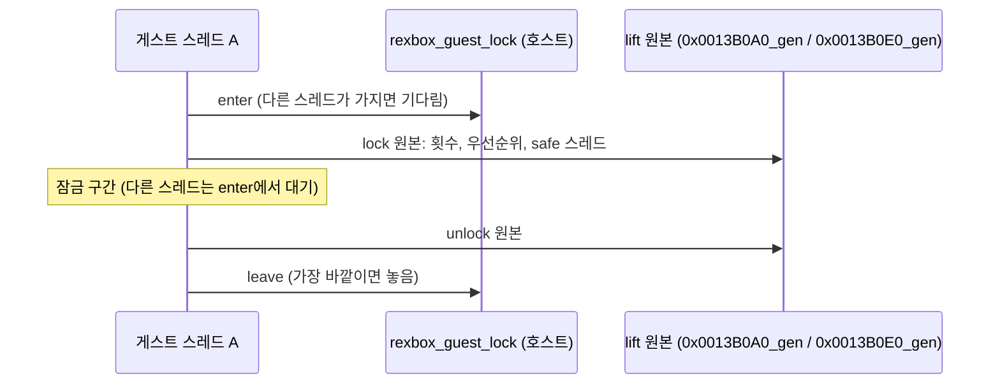

# 설계: CRI ADXM 잠금의 상호 배제 (issue #68)

## 1. 문제

* v0.0.29로 플레이하다 게임이 멈췄다. 정지 보고([i060](20261015-i060-stall-report.md))로 본 상태:
  * present 스레드(thread 2)가 `running`이고, 마지막 HLE `ObfDereferenceObject`가 방금 호출됐다. 기본 우선순위는 16(TIME_CRITICAL)이다.
  * 추정 스택 맨 안쪽은 `0x001437BA`, `0x001437C4`, `0x00140C8D`다.
* `0x001437B0`(**확인됨**, 디스어셈블):

  ```c
  int n = 0;
  while (GetThreadPriority(GetCurrentThread()) == THREAD_PRIORITY_TIME_CRITICAL) { SVM_Unlock(); n++; }
  return n;   // 0x001437D0이 나중에 SVM_Lock()을 n번 부른다
  ```

  "TIME_CRITICAL이면 잠금을 가진 것"이라고 보고, 잠금을 다 풀어 놓고(`0x00145585`) 다시 잡는다.
* 잠금 본체는 CRI 미들웨어(ADXXB 1.14, SVM/XB 1.06; 문자열로 **확인됨**)다.
  * `ADXM_SetupThrd`(`0x0013B330`, 이름은 **추정**)가 `SVM_SetCbLock`(`0x00141DB0`)과 `SVM_SetCbUnlock`(`0x00141DD0`)으로 콜백 두 개를 건다.
  * `SVM_Lock`(`0x00141B60`)과 `SVM_Unlock`(`0x00141B80`)은 그 콜백을 부른다.

  | 콜백 | 동작(**확인됨**) |
  |---|---|
  | `0x0013B0A0` lock | 전역 횟수 `[0x25EFA0]`가 0이면: 자기 우선순위를 `[0x27D0F8]`에 저장, 자기를 TIME_CRITICAL로, safe 스레드(`[0x27D0E0]`, 시작 `0x0013B180`)를 `ResumeThread`. 그다음 횟수 +1 |
  | `0x0013B0E0` unlock | 횟수 −1. 0이 되면: safe 스레드를 `SuspendThread`, 자기 우선순위를 저장값으로 |

* 횟수와 저장 우선순위는 **전역 하나**다. 상호 배제는 "단일 코어 + 엄격한 우선순위 스케줄링에서 TIME_CRITICAL 스레드는 다른 스레드에 밀리지 않는다"는 사실에서만 나온다.
* 우리 런타임은 게스트 스레드를 호스트 스레드로 **동시에** 실행한다. 그래서 두 스레드가 함께 잠금 안에 들어갈 수 있고, 횟수와 저장 우선순위가 섞인다.
  * 예: A가 들어감(횟수 1, A의 우선순위 저장). B는 횟수가 1이라 우선순위를 올리지 않고 2로 만든다. A가 나감(1). B가 나감(0) → B가 **A의 저장값**으로 바뀐다.
  * 결국 잠금이 없는데 TIME_CRITICAL로 남은 스레드가 생긴다. 이 스레드가 `0x001437B0`에 들어가면, unlock은 횟수를 음수로만 내리고 우선순위를 되돌리지 않으므로 루프가 끝나지 않는다(보고된 상태와 일치, **추정**).
* 덧붙여: safe 스레드(`0x0013B180`, 우선순위 2)는 HLE 호출 없이 카운터만 올리는 루프다. 단일 코어에서 우선순위 2 아래 스레드를 막는 용도로 보인다(**추정**). 다른 스레드에 대한 `NtSuspendThread`는 횟수만 세므로, 이 스레드는 한 번 재개된 뒤로 호스트 코어 하나를 계속 쓴다(보고에서 마지막 HLE가 253초 전).

## 2. 설계

Xbox의 우선순위 스케줄링 전체를 흉내 내지는 않는다. lift 코드에는 선점할 안전 지점이 없어서다. 대신 **이 잠금이 기대하는 상호 배제를 호스트 잠금으로 직접 준다.**



### 2.1 런타임 계약: 게스트 잠금 (`rexbox`, 타이틀 무관)

* `include/rexbox/runtime/guest_lock.h`(C에서 부를 수 있는 헤더), `src/rexbox/runtime/guest_lock.cpp`.
* "게스트가 단일 코어 스케줄링으로 얻던 상호 배제"를 호스트에서 주는 이름 붙은 재귀 잠금이다.

  ```c
  typedef struct RexboxGuestLock { const char* name; void* impl; } RexboxGuestLock;  // 0으로 초기화, impl은 첫 사용 때 만든다
  void rexbox_guest_lock_enter(RexboxGuestLock* lock);
  void rexbox_guest_lock_leave(RexboxGuestLock* lock);
  ```

* **재귀**: 가진 스레드가 다시 들어오면 깊이만 늘린다. 가장 바깥 leave에서 놓는다.
* **대기 표시**: 바로 잡지 못하면 `NoteWaitBegin("guest lock <name>")`으로 기다린다. 정지 보고에 보인다.
* **교착 안전장치**: Xbox에서는 잠금을 가진 스레드가 대기하면 낮은 스레드가 실행되고, 그 스레드는 잠금 안으로 들어올 수 있다(횟수만 오름). 호스트 잠금은 이를 막으므로 원본에 없던 교착이 생길 수 있다.
  * 그래서 기다림에 시한(기본 2초, `REXBOX_GUEST_LOCK_TIMEOUT_MS`, `0`은 무한)을 둔다.
  * 시한이 지나면 잠금 이름과 가진 스레드를 한 번 보고하고, **배제 없이** 들어간다(원본 Xbox와 같은 동작).
* **가지지 않은 스레드의 leave**: 배제 없이 들어온 스레드나 짝이 맞지 않는 leave는 아무것도 하지 않는다.
* **비용**: 경합이 없을 때는 원자 연산 몇 개다. 이 잠금은 프레임마다 수십~수백 번 불린다(**추정**).

### 2.2 타이틀: ADXM 잠금 콜백 감싸기

* `src/game/jsrf/decomp/adxm_lock.c`. 디컴파일 대체 방식(같은 심볼 + `_gen`)으로 두 콜백을 감싼다. 직접 호출과 간접 호출(`call eax`, dispatch 표)이 모두 이 정의로 온다.
  * `sub_0013B0A0`: `rexbox_guest_lock_enter` 다음에 `sub_0013B0A0_gen`.
  * `sub_0013B0E0`: `sub_0013B0E0_gen` 다음에 `rexbox_guest_lock_leave`.
* 게임 로직은 바꾸지 않는다. 원본 본문을 그대로 실행하고, 그 앞뒤에 호스트 동시성 보정만 더한다. 이 파일은 "디컴파일"이 아니라 **호스트 동시성 어댑터**이며, 주석에 그렇게 적는다.
* 잠금이 지켜지면 "TIME_CRITICAL ⇔ 잠금을 가짐"이 스레드마다 다시 성립한다. 그래서 `0x001437B0`이 원래대로 끝난다.

### 2.3 하지 않는 것(미확정, 후속)

* safe 스레드의 계속 도는 루프. 다른 스레드를 멈추는 `NtSuspendThread`에는 안전 지점이 필요하다. 같은 문제가 다시 보이면 그때 다룬다.

## 3. 검증

| 검증 | 기대 |
|---|---|
| 재생성(`regenerate.py`) | `sub_0013B0A0_gen`, `sub_0013B0E0_gen`이 생기고 두 심볼이 수동 정의로 빠짐 |
| Release/Debug 빌드 | 경고 0 |
| 회귀 도구(`rejsrf_decomp_check`, `rejsrf_d3d8_check`, probe들) | 통과 |
| 데모 실행 | 정지·시한 보고 없음, 프레임 시간 변화 없음 |
| 사용자 플레이(멈췄던 구간) | 멈추지 않음. 시한 보고가 나오면 그 내용을 이 issue에 남김 |

---

# Design: mutual exclusion for the CRI ADXM lock (issue #68)

## 1. Problem

* The game hung in play on v0.0.29. The stall report ([i060](20261015-i060-stall-report.md)) showed:
  * The presenting thread (thread 2) is `running`, its last HLE call `ObfDereferenceObject` is current, and its base priority is 16 (TIME_CRITICAL).
  * The innermost guessed stack entries are `0x001437BA`, `0x001437C4` and `0x00140C8D`.
* `0x001437B0` (**confirmed**, disassembly) loops `while (GetThreadPriority(GetCurrentThread()) == TIME_CRITICAL) { SVM_Unlock(); n++; }` and returns n; `0x001437D0` later calls `SVM_Lock()` n times. It treats "TIME_CRITICAL" as "holding the lock": it drops the lock entirely around `0x00145585` and takes it back.
* The lock is CRI middleware (ADXXB 1.14, SVM/XB 1.06; **confirmed** by strings).
  * `ADXM_SetupThrd` (`0x0013B330`, name **inferred**) installs two callbacks through `SVM_SetCbLock` (`0x00141DB0`) and `SVM_SetCbUnlock` (`0x00141DD0`).
  * `SVM_Lock` (`0x00141B60`) and `SVM_Unlock` (`0x00141B80`) call them.
  * Lock `0x0013B0A0` (**confirmed**): if the global count `[0x25EFA0]` is 0, save its own priority in `[0x27D0F8]`, raise itself to TIME_CRITICAL and `ResumeThread` the safe thread (`[0x27D0E0]`, start `0x0013B180`); then count +1.
  * Unlock `0x0013B0E0` (**confirmed**): count −1; at 0, `SuspendThread` the safe thread and set its own priority to the saved value.
* The count and the saved priority are **single globals**. The exclusion comes only from a TIME_CRITICAL thread not being preempted on a single core with strict priority scheduling.
* Our runtime runs guest threads **in parallel** as host threads. Two threads can be inside together, and the count and saved priority mix.
  * For example: A enters (count 1, A's priority saved). B sees 1, does not raise itself, and makes it 2. A leaves (1). B leaves (0) and takes **A's saved value**.
  * A thread is left at TIME_CRITICAL holding no lock. In `0x001437B0` the unlock only drives the count negative and never restores the priority, so the loop never ends (matches the report, **inferred**).
* Also: the safe thread (`0x0013B180`, priority 2) is a counter loop with no HLE calls. On a single core it apparently keeps threads below priority 2 off the CPU (**inferred**). `NtSuspendThread` of another thread only counts, so once resumed it keeps a host core busy (its last HLE call was 253 s old in the report).

## 2. Design

Xbox priority scheduling as a whole is not emulated, because lifted code has no safe points to preempt at. Instead, **the exclusion this lock expects is given directly by a host lock.** The diagram above shows the order: enter the host lock (waiting while another thread has it), run the original lock body, run the section while other threads wait at enter, run the original unlock body, and leave (releasing at the outermost level).

### 2.1 Runtime contract: guest locks (`rexbox`, title-agnostic)

* `include/rexbox/runtime/guest_lock.h` (a header C can include) and `src/rexbox/runtime/guest_lock.cpp`.
* A named recursive lock that gives on the host the exclusion a guest got from single-core scheduling: `RexboxGuestLock { name, impl }` (zero-initialized; `impl` is made on first use), `rexbox_guest_lock_enter` and `rexbox_guest_lock_leave`.
* **Recursive**: the owning thread entering again only deepens; the outermost leave releases.
* **Wait note**: when the lock is not free at once, the wait is noted as `guest lock <name>` and shows in the stall report.
* **Deadlock guard**: on the Xbox, when the holder waits, lower threads run and can enter (only the count rises). A host lock blocks them, which could deadlock where the original did not.
  * So the wait has a limit (default 2 s, `REXBOX_GUEST_LOCK_TIMEOUT_MS`, `0` for none).
  * When it passes, the lock's name and owner are reported once, and the thread enters **without exclusion**, as on the original Xbox.
* **Leave by a non-owner**: from a thread that entered without exclusion, or an unpaired leave, it does nothing.
* **Cost**: a few atomic operations when uncontended. The lock is taken tens to hundreds of times per frame (**inferred**).

### 2.2 Title: wrapping the ADXM lock callbacks

* `src/game/jsrf/decomp/adxm_lock.c` wraps both callbacks in the decompiled-replacement form (same symbol plus `_gen`). Direct calls and indirect calls (`call eax`, the dispatch table) both reach these definitions.
  * `sub_0013B0A0` calls `rexbox_guest_lock_enter`, then `sub_0013B0A0_gen`.
  * `sub_0013B0E0` calls `sub_0013B0E0_gen`, then `rexbox_guest_lock_leave`.
* No game logic changes: the original bodies run as they are, with a host-concurrency correction around them. The file is a **host-concurrency adapter**, not decompilation, and its comment says so.
* With the lock held, "TIME_CRITICAL ⇔ holding the lock" holds again per thread, so `0x001437B0` ends as intended.

### 2.3 Not done (unresolved, later)

* The safe thread's endless loop. Stopping another thread with `NtSuspendThread` needs safe points; this is taken up if it shows again.

## 3. Verification

| Check | Expected |
|---|---|
| Regeneration (`regenerate.py`) | `sub_0013B0A0_gen` and `sub_0013B0E0_gen` exist; both symbols are manual definitions |
| Release/Debug builds | no warnings |
| Regression tools (`rejsrf_decomp_check`, `rejsrf_d3d8_check`, the probes) | pass |
| Demo run | no stall or timeout reports; frame time unchanged |
| User play (where it hung) | no hang; a timeout report, if any, is recorded in this issue |
