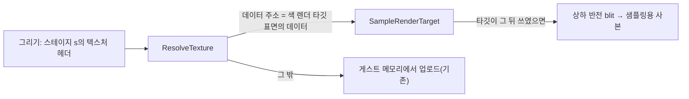

# 설계: 렌더 타깃을 텍스처로 샘플링, 픽셀 셰이더와 고정 기능 정점 처리 (issue #69)

## 1. 문제

* 플레이 중 부스트 대시를 쓰면 화면 전체가 흐려져야 하는데 검게 변한다.
* 그 장면의 미구현 보고 두 줄(사용자 로그, **확인됨**):
  * `render target 03F7F520 (512x512) is not a back buffer: drawn into its own GL texture, not yet visible to texture sampling`
  * `DrawIndexedVertices with pixel shader 0000000A and fixed-function vertex processing is not drawn yet`
* 지금 구현:
  * 오프스크린 표면에 그린 결과는 GL 텍스처에만 있다. 같은 메모리를 가리키는 텍스처 헤더를 묶으면 `ResolveTexture`가 게스트 메모리(비어 있음)를 올려 검게 샘플링된다.
  * 픽셀 셰이더는 정점 셰이더 프로그램과 함께일 때만 그리고, 고정 기능 정점 처리와 함께이면 그리기를 건너뛴다.
* 블러는 장면을 512×512 타깃에 그리고(축소), 그것을 픽셀 셰이더 10(`0x0A`)으로 화면에 합성하는 것으로 본다(**추정**). 픽셀 셰이더 10은 데모에서도 만들어지지만 데모는 그것으로 그리지 않는다.

## 2. 설계

### 2.1 렌더 타깃 샘플링 (`d3d8_gl_targets`, `d3d8_gl_textures`)

* **찾기**: 텍스처 헤더의 데이터 주소(물리 마스크 적용)가 색 렌더 타깃으로 쓰인 표면의 데이터 주소와 같으면, 그 타깃을 샘플링한다.
  * 렌더 타깃은 몇 개뿐이라(백 버퍼 2~3개, 오프스크린 몇 개) 매번 표면 헤더를 다시 읽어 비교한다.
  * 백 버퍼도 포함한다. 게임이 화면을 텍스처로 읽는 경우도 같은 길로 처리된다.
* **사본**: GL 타깃은 GL의 아래-왼쪽 원점으로 저장된다(D3D 맨 윗줄이 GL 맨 윗줄). 반면 업로드한 텍스처는 D3D 0행이 GL 0행이다.
  * 그래서 타깃마다 샘플링용 사본 텍스처를 두고, `glBlitFramebuffer`로 상하를 뒤집어 복사한다.
  * 셰이더(고정 기능, 레지스터 조합기)는 바꾸지 않는다.
* **언제 복사하나**: 그 타깃이 마지막 복사 뒤 렌더 타깃으로 묶인 적이 있거나 지금 묶여 있으면 복사한다. 그리기와 Clear는 묶인 타깃에만 쓰기 때문이다. 512×512 복사 한 번은 GPU에서 무시할 만한 비용이다.
* **좌표**: 선형(linear) 헤더면 지금처럼 텍셀 좌표로 샘플링한다(`unnormalized`). 크기는 타깃 크기를 쓴다.
* **보고**: 처음 샘플링될 때 `texture <헤더> samples render target <표면> (WxH)`을 한 번 출력한다. 미구현 보고 문구에서 "not yet visible to texture sampling"을 뺀다.

### 2.2 픽셀 셰이더 + 고정 기능 정점 처리 (`d3d8_draw`, `d3d8_gl_programs`)

* 정점 쪽은 고정 기능 정점 셰이더, 조각 쪽은 기존 레지스터 조합기 셰이더(`psh::GenerateFragmentShader`)로 링크한다.
* 픽셀 셰이더가 있으면 텍스처 스테이지 연산은 쓰이지 않는다. 하지만 텍스처 좌표의 선택(`TEXCOORDINDEX`), 생성, 변환은 정점 처리에 속하므로 그대로 적용한다(D3D8 의미, **추정**).
  * 그래서 키를 만들 때 네 스테이지를 모두 활성으로 본다. 정점 셰이더가 `v_tex0..3`을 모두 쓰고, 조각 셰이더도 넷을 모두 읽는다.
  * 이를 위해 `BuildKey`에 "픽셀 셰이더용" 인자를 더한다. 스테이지 연산 필드는 고정값으로 두어, 같은 정점 처리면 같은 키가 되게 한다.
* 새 프로그램 캐시 `GetFixedFunctionPixelProgram(key, pixel_key)`를 둔다. 결과는 `FixedFunctionProgram`에 조합기 상수 위치(`u_c0`, `u_c1`, `u_final_c0`, `u_final_c1`, `u_fog_color`)를 더한 것이다.
* 그리기에서는 고정 기능 uniform(변환, 조명, 텍스처 행렬)과 픽셀 셰이더 상수를 함께 설정한다.

### 2.3 하지 않는 것(미확정)

* X8 형식 타깃의 알파를 1로 읽게 하는 것. 필요해 보이면 사본에 swizzle을 둔다.
* 텍스처 헤더와 타깃의 크기·형식이 다른 경우(일부만 보는 헤더 등). 보이면 보고를 보고 다룬다.

## 3. 검증

| 검증 | 기대 |
|---|---|
| Release/Debug 빌드, 회귀 도구 | 경고 0, 통과 |
| `rexbox_d3d8_probe` | 기존 검사 통과(키 생성 변경) |
| 데모 실행 | 화면과 프레임 시간이 이전과 같음 |
| 사용자 플레이(부스트 대시) | 화면이 흐려짐. `samples render target` 보고 한 줄 |

---

# Design: sampling render targets as textures; pixel shaders with fixed-function vertex processing (issue #69)

## 1. Problem

* Using the boost dash in play should blur the whole screen; it goes black instead.
* The scene's two not-implemented reports (user log, **confirmed**):
  * `render target 03F7F520 (512x512) is not a back buffer: drawn into its own GL texture, not yet visible to texture sampling`
  * `DrawIndexedVertices with pixel shader 0000000A and fixed-function vertex processing is not drawn yet`
* Current implementation:
  * What is drawn into an off-screen surface exists only in a GL texture. A texture header over the same memory makes `ResolveTexture` upload guest memory (empty), which samples black.
  * Pixel shaders are drawn only with vertex-shader programs; with fixed-function vertex processing the draw is skipped.
* The blur is taken to draw the scene into the 512×512 target (scaled down) and composite it on screen with pixel shader 10 (`0x0A`) (**inferred**). Pixel shader 10 is created in the demo too, but the demo does not draw with it.

## 2. Design

The diagram above shows the flow: `ResolveTexture` sends a header whose data is a color render target's surface data to `SampleRenderTarget`, which refreshes a flipped sampling copy by blit when the target was written since; any other header is uploaded from guest memory as before.

### 2.1 Render-target sampling (`d3d8_gl_targets`, `d3d8_gl_textures`)

* **Lookup**: when a texture header's data address (physical mask applied) equals the data address of a surface used as a color render target, that target is sampled.
  * There are few targets (2–3 back buffers and a few off-screen ones), so the surface headers are re-read and compared each time.
  * Back buffers are included, so a game reading the screen as a texture takes the same path.
* **Copy**: GL targets keep GL's bottom-left origin (D3D's top row is GL's top row), while uploaded textures have D3D row 0 at GL row 0.
  * So each target gets a sampling copy, filled by `glBlitFramebuffer` flipped vertically.
  * The shaders (fixed function, register combiners) stay unchanged.
* **When to copy**: when the target was bound as a render target since the last copy, or is bound now. Draws and clears write only the bound target. One 512×512 copy is a negligible GPU cost.
* **Coordinates**: a linear header is sampled with texel coordinates as now (`unnormalized`). The size is the target's.
* **Report**: the first time, `texture <header> samples render target <surface> (WxH)` is printed once. The not-implemented report drops "not yet visible to texture sampling".

### 2.2 Pixel shaders with fixed-function vertex processing (`d3d8_draw`, `d3d8_gl_programs`)

* The fixed-function vertex shader is linked with the existing register-combiner fragment shader (`psh::GenerateFragmentShader`).
* With a pixel shader the texture-stage operations do not apply. Texture-coordinate selection (`TEXCOORDINDEX`), generation and transforms belong to vertex processing and still apply (D3D8 semantics, **inferred**).
  * So the key treats all four stages as active. The vertex shader writes all of `v_tex0..3`, which the fragment shader reads.
  * For this, `BuildKey` gains a "for a pixel shader" argument. It fixes the stage-operation fields, so equal vertex processing gives equal keys.
* A new program cache, `GetFixedFunctionPixelProgram(key, pixel_key)`, returns a `FixedFunctionProgram` with the combiner constant locations added (`u_c0`, `u_c1`, `u_final_c0`, `u_final_c1`, `u_fog_color`).
* The draw sets both the fixed-function uniforms (transforms, lighting, texture matrices) and the pixel-shader constants.

### 2.3 Not done (unresolved)

* Reading alpha as 1 from X8-format targets. If it turns out to matter, the copy gets a swizzle.
* Headers whose size or format differs from the target's (a header over part of it, say). The report will show them.

## 3. Verification

| Check | Expected |
|---|---|
| Release/Debug builds, regression tools | no warnings; pass |
| `rexbox_d3d8_probe` | existing checks pass (key building changed) |
| Demo run | picture and frame time as before |
| User play (boost dash) | the screen blurs; one `samples render target` line |
