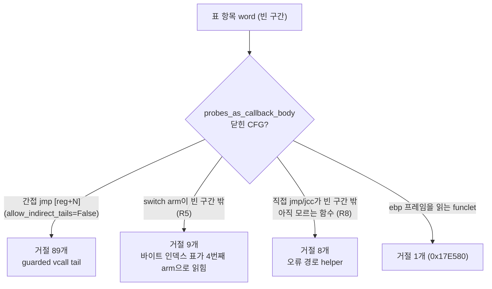
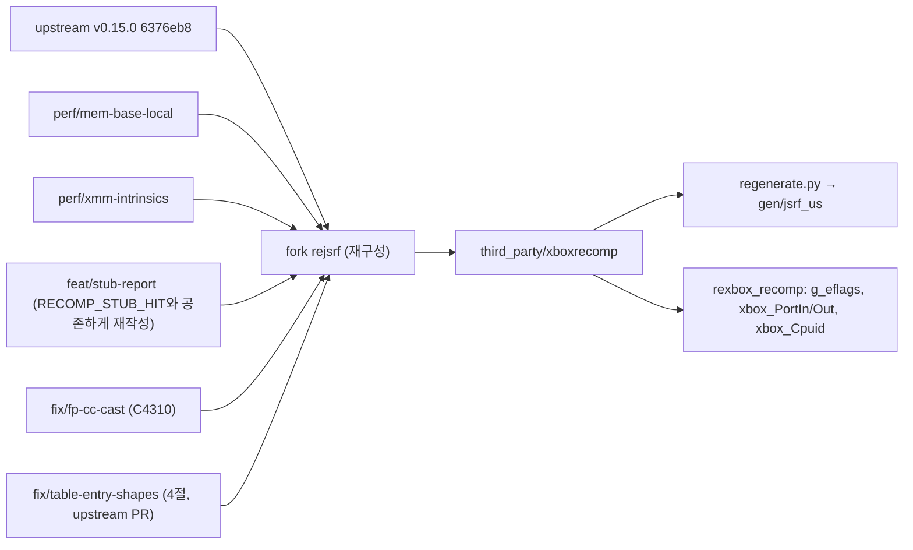
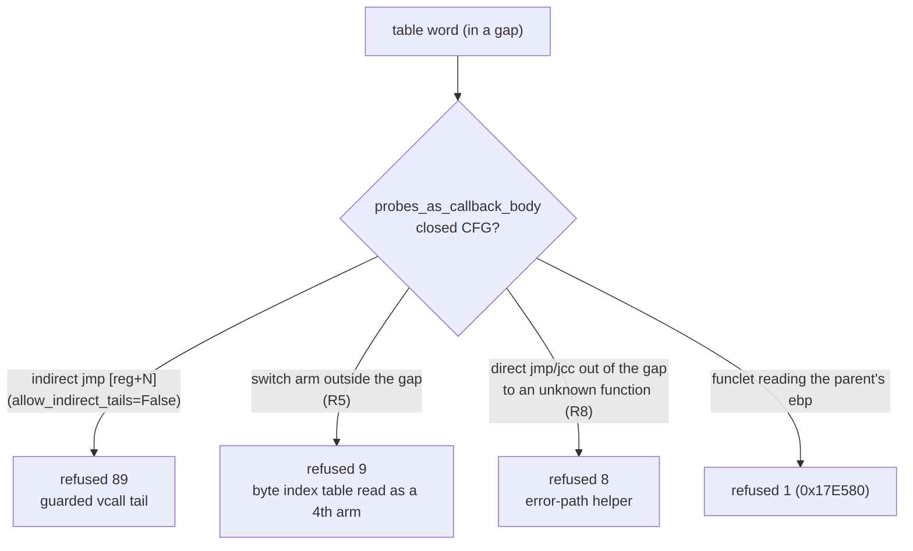

# 설계: xboxrecomp v0.15.0 전환과 표 항목(vtable 메서드) 복구 (issue #93)

선행: [i055 미해결 스텁](20261014-i055-unresolved-stubs.md), [i058 늦은 본문의 조건 분기](20261014-i058-late-cond-branches.md), [분석 function-discovery](../analysis/function-discovery.md)

## 1. 배경

* 포크 `rejsrf`(`1991221`)는 v0.13.1 위에 있다. upstream은 v0.14.0(2026-10)과 v0.15.0 "Second Reading"(2026-10-19, `6376eb8`)을 냈다.
* [#93](https://github.com/nworkers/reJSRF/issues/93)은 v0.14.0 전환을 보류했다. v0.14.0의 표 항목 검사(`3033a5e`, `_pass_data_ptr_targets`의 `probes_as_callback_body`)가 JSRF의 진짜 vtable 메서드 113개를 버렸기 때문이다.
* 이 설계는 v0.15.0을 같은 방법으로 다시 측정하고, 누락의 원인을 사유별로 분류해 upstream에 낼 수정을 정한다.

## 2. v0.15.0 측정 (확인됨)

같은 XBE(US, MD5 `f4e366bf…`)와 같은 seed로 v0.15.0 `tools.disasm`만 돌려 현재 핀의 `gen/jsrf_us/disasm/functions.json`과 비교했다.

| 항목 | 현재 핀(v0.13.1 포크) | v0.15.0 그대로 |
|---|---|---|
| 함수·alias 항목 | 9,063 | 9,372 |
| #93의 113개 중 항목으로 있는 것 | 113 | 10 |
| 113개 중 어떤 본문에도 안 덮이는 것 | 0 | 41 |
| 데모 정지 주소 `0x162490`, `0x1780D0`, `0x7BDD0` | 있음 | 없음 |

* v0.15.0의 변경(즉시값 꼬리 점프 보강 `_tail_calls_known_function`, `this` 조정 vcall 썽크, 스위치 표 뒤 함수 `_pass_jump_table_followers`, 코드 섹션 빈 구간의 포인터 표 검색)은 JSRF의 두 모양에 닿지 않는다.
* 새로 잡힌 735개는 대부분 `imm_ref_target`(449)과 `tail_jump_alias`(279)로 이득이지만, 113개 누락을 상쇄하지 않는다.

## 3. 누락 사유 (확인됨)

v0.15.0의 `_pass_data_ptr_targets`에 계측을 넣어 107개(113개 중 누락 103개 + 데모 주소 4개)가 어느 검사에서 떨어지는지 한 번의 실행으로 기록했다. 모든 주소는 **표 항목으로 참조되고, 빈 구간에 있고, 명령 경계**까지는 통과한다. 떨어지는 곳은 `probes_as_callback_body`다.

| 사유 | 수 | 모양 | 예 |
|---|---|---|---|
| 간접 꼬리 | 89 | `test eax,eax; je done; …; mov eax,[ecx]; jmp [eax+N]` 또는 `jmp [ecx+N]`. `probes_as_callback_body`는 측정된 표가 아닌 간접 `jmp`를 무조건 거절한다(`allow_indirect_tails`는 `cc_boundary` pass만 켠다). `probes_as_vcall_thunk`는 첫 두 명령이 `mov eax,[ecx]; jmp [eax+N]`일 때만 받는다 | `0x45DB0`, `0x162490`, `0x1780D0`, `0x7BDD0`, `0x1773E0` |
| 표 arm이 빈 구간 밖 | 9 | `mov eax,[ecx+N]; jmp [eax*4+T]`. `resync_jump_tables`가 dword 표 바로 뒤의 **바이트 인덱스 표**(`00 02 02 00` = `0x20200`, .text 범위 안)를 4번째 arm으로 센다. 그 가짜 arm이 빈 구간 밖이라 거절 | `0x70C90`(표 `0x70E10`), `0xF7F00`, `0xFC370`, `0x102490`, `0x1199C0` |
| 직접 분기가 빈 구간 밖 | 8 | 오류 경로가 아직 함수가 아닌 helper로 `jmp`/`jcc`. `_probes_as_tail_body`는 첫 직선 블록의 `jmp`만 따라가므로 `jcc` 뒤의 `jmp`를 못 본다 | `0x72760`→`0x72830`, `0xC7D40`→`0xC7D99`, `0x71100`→`0x6FE40` |
| funclet | 1 | `mov esi,[ebp+8]; mov edi,[ebp-0x1c]; …` 부모 프레임을 읽는 SEH/EH funclet. 6바이트 빈 구간 | `0x17E580` |

* **확인됨**: 계측에서 `allow_indirect_tails=True`로 다시 탐침하면 89개가 그대로 통과한다.
* **확인됨**: `0x129180`은 i058의 사례로, `gap_prologue` `0x129367`이 빈 구간을 잘라 switch 표(`0x12A588`…)가 밖에 놓인다. 이 설계의 대상이 아니다(seed 유지).

## 4. 수정 설계 (xboxrecomp, upstream PR 대상)

원칙: v0.14.0의 "닫힌 CFG" 규칙을 유지한다. 탈출을 **증명된 진입점**으로 넓히고, 증명 못 하는 탈출은 여전히 거절한다. 즉시값 pass의 기본 동작은 바꾸지 않는다.

### 4.1 엔진 `probes_as_callback_body`

* `escapes: Optional[Set[int]]` 출력 인자. 빈 구간 밖으로 가는 **직접** 분기(`jmp`/`jcc`)의 목적지를 모아 주고 그 간선을 exit로 센다. 호출자가 목적지를 따로 증명해야 몸이 닫힌 것이다(4.2). `escapes=None`(기본)이면 지금처럼 거절한다.
* 측정된 표의 arm이 빈 구간 밖이어도 `tail_targets`(함수 시작, 증명된 alias)면 exit로 센다. 밖이면서 증명 안 된 arm이 하나라도 있으면 지금처럼 거절한다. 표 점프의 간선 검사도 같은 규칙을 쓴다(지금은 `jump_target`이 있는 직접 점프만 `tail_targets`를 본다).

### 4.2 `_pass_data_ptr_targets` 빈 구간 분기

* 새 helper `_probes_as_escaping_body(target)`: `allow_indirect_tails=True`, `escapes`로 탐침하고, 탈출 목적지를 **각자의 빈 구간**에서 같은 방법으로 증명한다(깊이 8). 목적지가 다른 본문 안이면 거절한다. 모두 증명되면 받는다.
* 간접 꼬리를 받는 대가로 자료를 코드로 읽는 길이 생긴다. 두 가지로 막는다.
  * `target in engine.byte_tables`(어떤 `movzx byte ptr [reg + target]`이 이름 붙인 바이트 표)면 거절.
  * 첫 바이트가 `0x0F` 미만(`add`, `or`, 세그먼트 push)이면 거절. upstream `_pass_jump_table_followers`가 쓰는 규칙과 같다.
  * 이 두 거절은 helper뿐 아니라 빈 구간 분기 전체에 건다. 바이트 표 `0xEC090`, `0xFFB60`, `0x11A1DC`가 다른 경로(`movzx`의 displacement가 빈 구간 word로 스캔됨)로 들어온 것을 시험에서 확인했다.

### 4.3 `resync_jump_tables`

* dword 표의 앞으로 걷기를 `self.byte_tables`가 이름 붙인 주소 앞에서 멈춘다. 두 단계 switch의 바이트 인덱스 표는 dword 표 바로 뒤에 붙고, 그 첫 네 바이트가 .text 안 주소로 읽힌다.
* lifter(`tools/recomp/lifter.py` `_read_jump_table`)는 표를 따로 읽는다. 같은 가짜 arm을 읽는지 작업 지시에서 확인한다.

### 4.4 시험 결과 (확인됨, 임시 worktree)

| 단계 | 항목 수 | 113개 복구 | 데모 주소 4개 | 새로 생긴 의심 항목 | upstream pytest |
|---|---|---|---|---|---|
| v0.15.0 그대로 | 9,372 | 10 | 0 | – | 133 + 574 통과(1건은 cp949, `PYTHONUTF8=1`로 통과) |
| 4.1 + 4.2(거절 규칙 없이) | 9,483 | 104 | 4 | 9개 중 `0xEC090`이 바이트 표(오탐) | 708 통과 |
| + 4.2 거절 규칙(helper만) + 4.3 | 9,489 | 111 | 4 | `0xFFB60`, `0x11A1DC` 바이트 표(오탐) | 708 통과 |
| + 4.2 거절 규칙을 빈 구간 분기 전체에 (trial 3, fork 브랜치 `fix/table-entry-shapes` `1540eb0`) | 9,481 | 111 | 4 | 바이트 표 0개. nop 패딩에서 시작하는 alias 2개(`0x30114`, `0x30117`; 아래) | 708 통과 |

* trial 3은 v0.15.0 그대로가 받아들이던 자료 항목 8개(`0x20F04`, `0x37434`, `0xD7EA0`, `0xE0A08`, `0xF0D9C`, `0x10C254`, `0x112441`, `0x115F88`: 바이트 표, 0 채움, nop 런)도 거절한다. upstream 자체의 오탐이라 PR 본문에 적는다.
* `0x30100` 부근은 순서 효과가 있다. 자료 항목 `0x3010F`가 `tail_jump_alias`에서 `imm_ref_target`으로 바뀌고, 그 뒤 nop 패딩 `0x30114`·`0x30117`이 alias가 되며, 진짜 함수 `0x30120`이 `jump_table_follower` 시작에서 `tail_jump_alias`로 바뀐다. 본문을 자르지는 않지만 작업 지시 A-4에서 원인을 분류한다.
* 남는 2개: `0x129180`(i058, seed), `0x17E580`(funclet; 설계 밖).
* 의심 항목 중 바이트 표가 아닌 것은 `[ebp+8]`을 읽는 EH funclet(`0x2C940`, `0x34DE0`)과 switch arm 조각(`0x34FB8` 등)으로, 빈 구간의 alias라 다른 본문을 자르지 않는다.
* v0.15.0 그대로와 비교해 사라지는 항목 6개(`0x5FD84` 등)는 복구된 메서드의 본문 안으로 들어간 `jcc` 고아 alias다.
* 복구된 메서드 앞 함수 4개의 끝이 메서드 시작으로 당겨진다(`0x70BE0`: `0x70E30`→`0x70C90`). 전에는 메서드를 삼키고 있었다.

## 5. upstream 회귀 방지

PR #200이 #182의 테스트와 충돌해 닫힌 일을 되풀이하지 않는다.

* 탈출 목적지는 디코드된 CFG의 **직접 분기 대상**만이다. #182의 도달성 규칙(측정 범위의 패딩·자료를 따라가지 않음)과 어긋나지 않는다.
* `allow_indirect_tails`의 엔진 기본값은 그대로 `False`다. `test_callback_cfg.py`의 "unresolved indirect jump" 거절은 유지된다.
* 즉시값 pass(`_pass_imm_ref_targets`)와 `cc_boundary`는 건드리지 않는다.
* PR에는 모양마다 합성 테스트를 넣는다: guarded vcall tail(받음), 다른 함수로 가는 switch dispatcher(받음), 빈 구간 밖 helper로의 `jcc` 뒤 `jmp`(helper가 증명되면 받음, 아니면 거절), 바이트 인덱스 표 word(거절), `resync_jump_tables`가 바이트 표 앞에서 멈춤.
* 보내기 전 `PYTHONUTF8=1 pytest tools/disasm tools/recomp` 전부 통과, JSRF lift의 함수 수·디스패치 표·스텁 수를 PR 본문에 적는다. upstream 관리자가 HL2·Fallout BoS로 다시 돌릴 수 있게 변경을 세 커밋(4.1+4.2, 4.2 거절 규칙, 4.3)으로 나눈다.

## 6. reJSRF 쪽 전환 설계

* 포크 `rejsrf`를 v0.15.0 위에 다시 만든다. `rejsrf-v0.14`의 커밋 11개 중 PR #200 계열 6개(`10f2f96`…`20a269e`)는 v0.14.0이 대신 해결했으므로 **뺀다**(v0.15.0에서 출력이 같은지 작업 지시에서 확인). 나머지: `perf/mem-base-local`, `perf/xmm-intrinsics`(2), `fix/fp-cc-cast`(v0.15.0의 `recomp_fp_trig_in_range`에 C4310이 그대로 있음), `feat/stub-report`.
* `feat/stub-report`는 upstream `d8e24ad`(`RECOMP_STUB_HIT`, `RECOMP_STUB_LOG`)와 `translator.py`에서 충돌한다. upstream의 `RECOMP_STUB_HIT`를 두고, `RECOMP_STUB_REPORT`가 정의되면 `RECOMP_STUB_HIT`가 `recomp_unresolved_stub_log(va)`로 가도록 생성 코드의 매크로 정의를 바꾸는 방향으로 재작성한다. 런타임 `recomp_unresolved_stub_log`와 [unresolved-stubs](../analysis/unresolved-stubs.md)의 보고 형식은 그대로다.
* `templates/runtime/recomp_types.h`가 요구하는 런타임 심볼(JSRF lift 기준):
  * `g_eflags`(TLS, 리셋 `0x202`): `pushfd` 84건, `popfd` 66건이 `g_eflags`를 쓴다. `recomp_abi.c`에 정의하고 `rexbox_recomp_reset_thread`가 리셋한다.
  * `xbox_PortIn`/`xbox_PortOut`: `in` 57건, `out` 56건(현재 lift는 `RECOMP_UNIMPL`). 읽기 0, 쓰기 무시, 포트별 첫 접근 보고. 필드 핀 `0x80C0`은 upstream처럼 토글할지 작업 지시에서 결정.
  * `xbox_Cpuid`: JSRF에 `cpuid` 없음. 선언만 있고 참조 없으면 링크 불필요.
  * `g_xbox_guest_cpu_preempt`/`xbox_GuestCpuPreempt`: `--back-edge-yield`를 쓰지 않으므로 불필요.
* `--entry-stubs`: 현재 미해결 스텁 74개 중 68개가 알려진 함수 안이다. 켜면 그 함수의 사본으로 진입한다. 코드 크기 증가를 재고 별도 issue로 결정한다.
* ABI 헤더 해시가 바뀌므로 재생성이 강제된다(`src/game/jsrf/CMakeLists.txt`).

## 7. 검증

| 검증 | 기대 |
|---|---|
| upstream `PYTHONUTF8=1 pytest tools/disasm tools/recomp` | 전부 통과, 새 테스트 포함 |
| v0.15.0 + 4절 수정으로 JSRF disasm | 113개 중 111개 항목, 데모 주소 4개 항목, 바이트 표 항목 0개 |
| PR #200 계열 커밋을 얹어도 출력 같음 | 함수 수·디스패치 표 동일 |
| 재생성 후 lift 요약 | 미해결 스텁 수 기록(현재 74), `RECOMP_UNIMPL` 중 `in/out/popfd` 사라짐 |
| Debug/Release 빌드 | 경고 0, C4310 없음 |
| 데모 프레임 6장, 회귀 도구 | 같음, 통과 |
| 데모 95초 + New Game 첫 장면(사용자) | 스텁 보고 0건, 간접 호출 실패 0건 |

---

# Design: moving to xboxrecomp v0.15.0 and recovering table-entry (vtable) methods (issue #93)

Prerequisites: [i055 unresolved stubs](20261014-i055-unresolved-stubs.md), [i058 conditional branches from late bodies](20261014-i058-late-cond-branches.md), [analysis function-discovery](../analysis/function-discovery.md)

## 1. Background

* The fork's `rejsrf` (`1991221`) sits on v0.13.1. Upstream has released v0.14.0 (October 2026) and v0.15.0 "Second Reading" (2026-10-19, `6376eb8`).
* [#93](https://github.com/nworkers/reJSRF/issues/93) put the move to v0.14.0 on hold: its table-entry check (`3033a5e`, `probes_as_callback_body` in `_pass_data_ptr_targets`) dropped 113 real vtable methods of JSRF.
* This design measures v0.15.0 the same way, classifies the misses by the check that refuses them, and sets the fix to propose upstream.

## 2. Measuring v0.15.0 (confirmed)

v0.15.0's `tools.disasm` alone was run on the same XBE (US, MD5 `f4e366bf…`) with the same seeds, and its output compared with the current pin's `gen/jsrf_us/disasm/functions.json`.

| Item | Current pin (v0.13.1 fork) | Plain v0.15.0 |
|---|---|---|
| Function and alias entries | 9,063 | 9,372 |
| Of #93's 113 methods, present as entries | 113 | 10 |
| Of the 113, covered by no body at all | 0 | 41 |
| Demo stop addresses `0x162490`, `0x1780D0`, `0x7BDD0` | present | absent |

* v0.15.0's changes (the immediate pass's `_tail_calls_known_function`, this-adjusting vcall thunks, `_pass_jump_table_followers`, pointer tables in code-section gaps) do not reach JSRF's two shapes.
* The 735 entries it finds anew are mostly `imm_ref_target` (449) and `tail_jump_alias` (279): a gain, but not one that offsets the 113.

## 3. Why they are refused (confirmed)

Instrumentation in v0.15.0's `_pass_data_ptr_targets` recorded, in one run, which check refuses each of 107 addresses (the 103 missing of the 113 plus the four demo addresses). Every one is referenced from a table, lies in a gap and is an instruction boundary. The refusal is `probes_as_callback_body`.

| Reason | Count | Shape | Examples |
|---|---|---|---|
| Indirect tail | 89 | `test eax,eax; je done; …; mov eax,[ecx]; jmp [eax+N]` or `jmp [ecx+N]`. `probes_as_callback_body` refuses every indirect `jmp` that is not a measured table (only the `cc_boundary` pass sets `allow_indirect_tails`). `probes_as_vcall_thunk` takes only `mov eax,[ecx]; jmp [eax+N]` as the first two instructions | `0x45DB0`, `0x162490`, `0x1780D0`, `0x7BDD0`, `0x1773E0` |
| Table arm outside the gap | 9 | `mov eax,[ecx+N]; jmp [eax*4+T]`. `resync_jump_tables` counts the **byte index table** packed right after the dword table (`00 02 02 00` = `0x20200`, inside .text's range) as a fourth arm, and that false arm lies outside the gap | `0x70C90` (table `0x70E10`), `0xF7F00`, `0xFC370`, `0x102490`, `0x1199C0` |
| Direct branch out of the gap | 8 | An error path `jmp`s or `jcc`s to a helper that is not a function yet. `_probes_as_tail_body` follows only the first straight block's `jmp`, so it never sees one after a `jcc` | `0x72760`→`0x72830`, `0xC7D40`→`0xC7D99`, `0x71100`→`0x6FE40` |
| Funclet | 1 | `mov esi,[ebp+8]; mov edi,[ebp-0x1c]; …`: an SEH/EH funclet reading its parent's frame, in a 6-byte gap | `0x17E580` |

* **Confirmed**: probed again with `allow_indirect_tails=True`, the 89 pass as they are.
* **Confirmed**: `0x129180` is i058's case: `gap_prologue` `0x129367` cuts its gap, leaving its switch tables (`0x12A588`…) outside. Not this design's target (the seed stays).

## 4. The fix (xboxrecomp, for an upstream PR)

Principle: keep v0.14.0's closed-CFG rule. Widen its exits to **proven entries**, and keep refusing an exit that cannot be proven. The immediate pass's default behaviour is unchanged.

### 4.1 Engine `probes_as_callback_body`

* An `escapes: Optional[Set[int]]` out-parameter: destinations of **direct** branches (`jmp`/`jcc`) that leave the gap are collected and the edge counts as an exit. The body is closed only once the caller proves each destination (4.2). With `escapes=None` (the default) it refuses as it does now.
* A measured table's arm outside the gap counts as an exit when it is in `tail_targets` (a function start or a proven alias). Any outside arm that is not proven still refuses. The edge check for table jumps follows the same rule (today only a direct jump with a `jump_target` consults `tail_targets`).

### 4.2 The gap branch of `_pass_data_ptr_targets`

* New helper `_probes_as_escaping_body(target)`: probes with `allow_indirect_tails=True` and `escapes`, then proves each escape destination the same way **in its own gap** (depth 8). A destination inside another body refuses. Accepted when all are proven.
* Taking indirect tails opens a way for data to read as code. Two refusals close it:
  * `target in engine.byte_tables` (a `movzx byte ptr [reg + target]` names it as a byte table): refuse.
  * A first byte below `0x0F` (`add`, `or`, segment pushes): refuse. The same rule upstream's `_pass_jump_table_followers` uses.
  * Both apply to the whole gap branch, not only the helper. The trials showed the byte tables `0xEC090`, `0xFFB60` and `0x11A1DC` arriving by another route (the `movzx`'s own displacement scanned as a gap word).

### 4.3 `resync_jump_tables`

* The forward walk of a dword table stops in front of an address that `self.byte_tables` names. A two-level switch packs its byte index table right after the dword table, and its first four bytes read as an address inside .text.
* The lifter (`tools/recomp/lifter.py`, `_read_jump_table`) reads tables on its own; whether it reads the same false arm is checked in the work order.

### 4.4 Trial results (confirmed, scratch worktree)

| Step | Entries | 113 recovered | 4 demo addresses | New suspect entries | Upstream pytest |
|---|---|---|---|---|---|
| Plain v0.15.0 | 9,372 | 10 | 0 | – | 133 + 574 pass (one cp949 failure passes under `PYTHONUTF8=1`) |
| 4.1 + 4.2 without the refusals | 9,483 | 104 | 4 | 9, of which `0xEC090` is a byte table (false) | 708 pass |
| + 4.2 refusals (helper only) + 4.3 | 9,489 | 111 | 4 | `0xFFB60`, `0x11A1DC` byte tables (false) | 708 pass |
| + 4.2 refusals on the whole gap branch (trial 3, fork branch `fix/table-entry-shapes` `1540eb0`) | 9,481 | 111 | 4 | no byte tables; two aliases starting in nop padding (`0x30114`, `0x30117`; below) | 708 pass |

* Trial 3 also refuses eight data entries plain v0.15.0 accepted (`0x20F04`, `0x37434`, `0xD7EA0`, `0xE0A08`, `0xF0D9C`, `0x10C254`, `0x112441`, `0x115F88`: byte tables, zero fill, nop runs). Those are upstream's own false entries and go into the PR description.
* Around `0x30100` there is an ordering effect: the data entry `0x3010F` changes from `tail_jump_alias` to `imm_ref_target`, the nop padding `0x30114` and `0x30117` after it become aliases, and the real function `0x30120` changes from a `jump_table_follower` start to a `tail_jump_alias`. No body is cut, but work-order step A-4 classifies the cause.
* Two remain: `0x129180` (i058, seeded) and `0x17E580` (funclet; outside this design).
* The suspects that are not byte tables are EH funclets reading `[ebp+8]` (`0x2C940`, `0x34DE0`) and switch-arm fragments (`0x34FB8` …): gap aliases that cut no other body.
* The six entries that disappear against plain v0.15.0 (`0x5FD84` …) are `jcc` orphan aliases now inside a recovered method's body.
* Four functions before recovered methods end at the method now (`0x70BE0`: `0x70E30`→`0x70C90`); they used to swallow it.

## 5. No upstream regression

PR #200 was closed after it collided with #182's test. Not again.

* Escape destinations are only the **direct branch targets** of a decoded CFG. That agrees with #182's reachability rule (never follow padding or data inside a measured range).
* The engine default of `allow_indirect_tails` stays `False`; `test_callback_cfg.py`'s refusal of an unresolved indirect jump holds.
* The immediate pass (`_pass_imm_ref_targets`) and `cc_boundary` are untouched.
* The PR carries a synthetic test per shape: a guarded vcall tail (accepted), a switch dispatcher into other functions (accepted), a `jmp` after a `jcc` to a helper outside the gap (accepted once the helper is proven, refused otherwise), a byte index table word (refused), `resync_jump_tables` stopping in front of a byte table.
* Before sending: `PYTHONUTF8=1 pytest tools/disasm tools/recomp` all green, and the JSRF lift's function count, dispatch table and stub count in the PR description. The change is split into three commits (4.1+4.2, the 4.2 refusals, 4.3) so the maintainer can rerun HL2 and Fallout BoS per piece.

## 6. The reJSRF side

* The fork's `rejsrf` is rebuilt on v0.15.0. Of `rejsrf-v0.14`'s eleven commits, the six of the PR #200 family (`10f2f96`…`20a269e`) are **dropped**, since v0.14.0 covers them (the work order confirms the output is identical on v0.15.0). Kept: `perf/mem-base-local`, `perf/xmm-intrinsics` (2), `fix/fp-cc-cast` (v0.15.0's `recomp_fp_trig_in_range` still has the C4310 cast), `feat/stub-report`.
* `feat/stub-report` conflicts in `translator.py` with upstream `d8e24ad` (`RECOMP_STUB_HIT`, `RECOMP_STUB_LOG`). It is rewritten to keep upstream's `RECOMP_STUB_HIT` and, when `RECOMP_STUB_REPORT` is defined, route it to `recomp_unresolved_stub_log(va)`. The runtime function and the report format in [unresolved-stubs](../analysis/unresolved-stubs.md) stay.
* Runtime symbols `templates/runtime/recomp_types.h` now needs (from the JSRF lift):
  * `g_eflags` (TLS, reset `0x202`): 84 `pushfd` and 66 `popfd` go through it. Defined in `recomp_abi.c`, reset by `rexbox_recomp_reset_thread`.
  * `xbox_PortIn` / `xbox_PortOut`: 57 `in`, 56 `out` (today `RECOMP_UNIMPL`). Reads 0, writes ignored, first access per port reported. Whether the field pin `0x80C0` toggles as upstream's does is decided in the work order.
  * `xbox_Cpuid`: JSRF has no `cpuid`; declared but unreferenced, so no definition is needed to link.
  * `g_xbox_guest_cpu_preempt` / `xbox_GuestCpuPreempt`: not needed without `--back-edge-yield`.
* `--entry-stubs`: 68 of the 74 unresolved stubs lie inside known functions, and the option enters a copy of that function. The code-size cost is measured and decided in a separate issue.
* The ABI header hash changes, so regeneration is forced (`src/game/jsrf/CMakeLists.txt`).

## 7. Verification

| Check | Expected |
|---|---|
| Upstream `PYTHONUTF8=1 pytest tools/disasm tools/recomp` | all pass, new tests included |
| JSRF disasm on v0.15.0 + section 4 | 111 of the 113 as entries, the four demo addresses as entries, no byte-table entries |
| The PR #200 family on top changes nothing | same function count and dispatch table |
| Lift summary after regeneration | unresolved stub count recorded (74 today); `in/out/popfd` gone from `RECOMP_UNIMPL` |
| Debug and Release builds | 0 warnings, no C4310 |
| Six demo frames, regression tools | identical, pass |
| 95 s demo and the first New Game scene (user) | 0 stub reports, 0 failed indirect calls |
