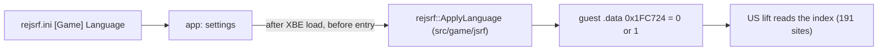

# 설계: English / Japanese 언어 선택 (issue #104)

상태: **확정, 구현 전**. 작업 지시: [20261020-i104](../work-orders/20261020-i104-language-option.md)

분석: [docs/analysis/language.md](../analysis/language.md)

## 1. 요구

* 설정에서 English / Japanese를 고른다.
* 일판 XBE를 분석해 근거를 만든다.

## 2. 확인한 것

* 언어는 각 빌드에 박힌 전역 상수다. US `0x1FC724` = 1(영어, `.data`), 일본판 `0x251F58` = 0(일본어, bss). 게임 코드는 이 값을 쓰지 않는다([language §4](../analysis/language.md)).
* 두 빌드가 다르게 시작하는 값은 **이 인덱스 하나**다. `.rdata`는 같고 `.data`의 차이는 이 객체와 정렬 패딩뿐이다(§6).
* 코드 차이도 언어와 무관하다. US 전용으로 보였던 `0x694A0`는 일본판 `0x69690`에 같은 함수가 있고 호출 91곳이 같다(§5).
* 191곳의 읽기는 대부분 쓸 때마다 다시 읽는다. 다만 객체 세 곳(`[+0x74C]` 둘, `[+0xB0]` 하나)이 만들 때의 값을 저장한다(§7).
* **실행 시험(확인됨)**: US 빌드를 로드한 직후 진입 전에 `0x1FC724`를 0으로 쓰고 50초 실행했다. 파일 열기 168개 중 다른 것은 언어별 자산 6개였다(`LogoJ.dat`, `Title.dat/.bin`, `se_ppl_j.dat`, `SprNorm.bin/.dat`, 영어는 `LogoE`, `TitleE`, `se_pple`, `SprNorm1`). 화면은 SEGA 로고(일본판 색), 낙서 경고문(일본어, 형법 조문), 타이틀 로고(가타카나 부제)가 일본판으로 나왔다. 진단 출력은 파일 열기 말고는 같았다(새 경고·오류 없음).

## 3. 방안 (확정: A)

| 방안 | 내용 | 판단 |
|---|---|---|
| **A. US 빌드 + 언어 전역 설정** | XBE를 올린 뒤 진입 전에 `0x1FC724`에 0(일본어) 또는 1(영어)을 쓴다. lift는 US 하나 | **채택**. 실행 시험으로 일본어 자산과 화면을 확인했다 |
| B. 일본판을 두 번째 variant로 lift | `jsrf_jp`를 따로 재컴파일 | 기각. 언어별 차이가 인덱스 하나뿐이라 seed·바인딩·디컴파일을 나눌 이유가 없다 |

### 3.1 레이어

* 주소 `0x1FC724`와 값의 뜻(0 일본어, 1 영어)은 타이틀 사실이므로 `src/game/jsrf/jsrf_profile.cpp`에 둔다. 공개 함수는 `include/rejsrf/jsrf_profile.h`의 `ApplyLanguage(const XbeImage&, GuestMemory&, Language)`.
* 기본(primary) variant일 때만 쓴다. 다른 빌드는 주소가 다르고 어차피 실행하지 않는다.
* `rexbox`는 바꾸지 않는다. 이미 공개된 `GuestMemory::Write32`로 충분하다.

### 3.2 설정

* `rejsrf.ini`에 새 절 `[Game]`, 키 `Language = English | Japanese`(기본 English, 대소문자 무시, 모르는 값은 기본값).
* 설정 메뉴에 **Game 탭**을 새로 둔다(Info, Graphics, Input 다음). 콤보 `Language`와 "Applies from the next start." 안내, 실행 중 값과 저장된 값이 다르면 "(restart to apply)" 표시.
* 적용 시점: **다음 실행부터**. 객체가 만들 때의 언어를 저장하고 이미 읽은 자산은 바뀌지 않으므로 실행 중 전환은 하지 않는다(§2).
* 환경 변수 `REJSRF_LANGUAGE=english|japanese`가 있으면 그 실행에만 ini보다 우선하고 저장하지 않는다(다른 `REXBOX_RENDER_SCALE`류와 같은 규칙). 스크립트 실행·검증용이다.

### 3.3 범위 밖 (후속 후보)

* 덤프에는 프랑스어·독일어·스페인어 자산(`LogoF/G/S`, `TitleF/G/S`, `tex_Frn/Ger/Spa` ...)도 있다. 인덱스 2~4로 동작할 가능성이 높지만(**추정**) 시험하지 않았고 요구 범위가 아니다. 필요하면 같은 구조에 값만 늘린다.
* 한국어 패치 검토는 #105에서 한다. 이 설계의 일본어 실행이 그 출발점이다.

## 4. 게임 데이터 규칙

* 일본판 XBE나 자산을 저장소에 넣지 않는다. 일본어 자산은 사용자 덤프의 `Media`에 이미 있다(US 디스크에 다섯 언어가 다 있다).

## 5. 검증

| 검증 | 기대 |
|---|---|
| Language = English(기본, ini 없음) | 지금과 같은 파일 열기 순서, 같은 데모 프레임(300, 600, 1500, 1800 ... 바이트 단위) |
| Language = Japanese | 파일 열기에서 `LogoJ`, `Title.dat`, `se_ppl_j`, `SprNorm`; 프레임 300(로고), 1800(경고문), 3000(타이틀)이 일본판 |
| 설정 저장 | `[Game] Language` 왕복, 모르는 값은 English, Game 탭에서 바꾸면 저장되고 "(restart to apply)" 표시 |
| `REJSRF_LANGUAGE` | ini보다 우선, 저장 안 됨 |
| 회귀 도구 | `rejsrf_decomp_check`, `rejsrf_d3d8_check`, probe들 그대로 |

---

# Design: English / Japanese language choice (issue #104)

Status: **settled, not implemented**. Work order: [20261020-i104](../work-orders/20261020-i104-language-option.md)

Analysis: [docs/analysis/language.md](../analysis/language.md)

## 1. Requirement

* Choose English or Japanese in the settings.
* Ground it in an analysis of the Japanese XBE.

## 2. What was established

* The language is a global constant built into each build: US `0x1FC724` = 1 (English, `.data`), Japanese `0x251F58` = 0 (Japanese, bss). No game code writes it ([language §4](../analysis/language.md)).
* It is the **only value** the two builds start with differently: `.rdata` is identical, and `.data` differs only in this object and alignment padding (§6).
* The code differences are unrelated to language: `0x694A0`, which looked US-only, is the same function as the Japanese build's `0x69690`, with the same 91 callers (§5).
* Most of the 191 reads read the value again each time. Three objects, though, keep the value they were created with (two at `[+0x74C]`, one at `[+0xB0]`) (§7).
* **Run test (confirmed)**: the US build with `0x1FC724` set to 0 after load and before the entry, run for 50 s. Of 168 file opens, six differed, all per-language assets (`LogoJ.dat`, `Title.dat/.bin`, `se_ppl_j.dat`, `SprNorm.bin/.dat`; English opens `LogoE`, `TitleE`, `se_pple`, `SprNorm1`). The screens showed the Japanese SEGA logo (its colour), the graffiti warning in Japanese (citing the Penal Code articles) and the title logo with its katakana subtitle. Diagnostics were the same apart from the file opens (no new warnings or errors).

## 3. Options (settled: A)

| Option | What | Verdict |
|---|---|---|
| **A. US build + set the language global** | After the XBE is loaded and before its entry, write 0 (Japanese) or 1 (English) to `0x1FC724`. One lift, the US one | **Adopted**; the run test showed the Japanese assets and screens |
| B. Lift the Japanese build as a second variant | Recompile `jsrf_jp` separately | Rejected: the only per-language difference is the index, so there is no reason to split seeds, bindings and decompilation |

### 3.1 Layering

* The address `0x1FC724` and its values (0 Japanese, 1 English) are title facts, so they live in `src/game/jsrf/jsrf_profile.cpp`, exposed as `ApplyLanguage(const XbeImage&, GuestMemory&, Language)` in `include/rejsrf/jsrf_profile.h`.
* It writes only for the primary variant; other builds have other addresses and are not run anyway.
* `rexbox` does not change; the public `GuestMemory::Write32` is enough.

### 3.2 Settings

* A new `[Game]` section in `rejsrf.ini` with `Language = English | Japanese` (default English, case-insensitive, unknown values keep the default).
* A new **Game tab** in the settings menu (after Info, Graphics and Input): a `Language` combo with "Applies from the next start.", and "(restart to apply)" while the running language differs from the saved one.
* When it applies: **from the next start**. Objects keep the language they were created with and loaded assets do not change, so there is no switch while running (§2).
* `REJSRF_LANGUAGE=english|japanese`, when set, wins over the ini for that run and is not saved (the same rule as `REXBOX_RENDER_SCALE` and the like); for scripted runs and verification.

### 3.3 Out of scope (follow-up candidates)

* The dump also has French, German and Spanish assets (`LogoF/G/S`, `TitleF/G/S`, `tex_Frn/Ger/Spa` ...). Indices 2-4 likely work (**inferred**) but were not tried and are not asked for; if wanted, the same structure only takes more values.
* The Korean patch review is #105; this design's Japanese run is its starting point.

## 4. Game data rule

* No Japanese XBE or assets go into the repository. The Japanese assets are already in the user's `Media` (the US disc carries all five languages).

## 5. Verification

| Check | Expected |
|---|---|
| Language = English (default, no ini) | the same file-open order and demo frames as today (300, 600, 1500, 1800 ..., byte for byte) |
| Language = Japanese | file opens of `LogoJ`, `Title.dat`, `se_ppl_j`, `SprNorm`; frames 300 (logo), 1800 (warning), 3000 (title) Japanese |
| Settings saved | `[Game] Language` round trip, unknown values read as English, a change in the Game tab is saved and shows "(restart to apply)" |
| `REJSRF_LANGUAGE` | wins over the ini, not saved |
| Regression tools | `rejsrf_decomp_check`, `rejsrf_d3d8_check` and the probes unchanged |
