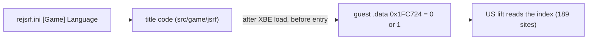

# 설계(초안): English / Japanese 언어 선택 (issue #104)

상태: **초안**. 분석 중이며 구현 전이다. 다음 세션은 §4부터 이어간다.

분석: [docs/analysis/language.md](../analysis/language.md)

## 1. 요구

* 설정에서 English / Japanese를 고른다.
* 일판 XBE를 분석해 근거를 만든다.

## 2. 지금까지 확인한 것 (요약)

* 언어는 각 빌드에 박힌 전역 상수다. US `0x1FC724` = 1(영어, `.data`), 일본판 `0x251F58` = 0(일본어, bss).
* 두 빌드 모두 다섯 언어의 자산 이름을 알고, 같은 `Media` 폴더를 쓴다.
* 라이브러리 섹션은 같고, `.text`의 실제 코드 차이는 US 전용 함수 `0x694A0` 하나와 옮겨진 함수 하나다.

## 3. 방안

| 방안 | 내용 | 판단 |
|---|---|---|
| **A. US 빌드 + 언어 전역 설정**(권장) | XBE를 올린 뒤 진입 전에 `0x1FC724`에 0(일본어) 또는 1(영어)을 쓴다. lift는 US 하나 | 단순하다. §4의 확인이 통과하면 채택 |
| B. 일본판을 두 번째 variant로 lift | `jsrf_jp`를 따로 재컴파일 | seed·바인딩·디컴파일이 모두 빌드별로 갈라진다. 코드 차이가 위 두 곳뿐이라 이득이 없다 |

* 레이어 규칙: 주소 `0x1FC724`는 타이틀 사실이므로 `src/game/jsrf/`(또는 타이틀 프로파일)에 둔다. `rexbox`는 "로드 직후 guest 메모리에 값을 쓰는 훅" 같은 일반 계약만 제공한다.
* 설정: `rejsrf.ini`에 `[Game] Language = English | Japanese`(기본 English). 설정 메뉴의 위치(새 탭 또는 기존 탭)는 기존 메뉴 코드를 보고 정한다.
* 적용 시점: 언어를 언제 읽는지 확인하기 전까지는 **다음 실행부터 적용**으로 하고 메뉴에 그렇게 표시한다.
* 게임 데이터 규칙: 일본판 XBE나 자산을 저장소에 넣지 않는다. 일본어 자산은 사용자 덤프의 `Media`에 이미 있다.

## 4. 다음 세션에서 할 일 (구현 전 확인)

1. **실행 시험**: 임시로 `0x1FC724`를 0으로 쓰고(예: 진단용 환경 변수) 로고, 타이틀, 메뉴, 첫 대화 장면이 일본어로 나오는지 본다. 파일 열기 추적(`REXBOX_TRACE_FILES=1`)으로 `_j`·`jpn` 자산이 열리는지 확인한다.
2. **`.data` dword 비교**: 주소 대응(`-0x20`/`-0x18`/`-0x8`/`+0x55834`)을 적용해 값이 다른 dword를 찾는다. 언어별 초기값이 더 있는지 본다.
3. **`0x694A0`**: 호출자와 쓰임을 찾는다. 영어 전용 동작이면 일본어일 때 일본판처럼 막아야 하는지 판단한다.
4. **읽는 시점**: 189곳 중 부팅 때 한 번 읽어 저장하는 곳이 있는지 본다. 실행 중 전환 가능 여부를 정한다.
5. 위 결과로 이 설계를 확정하고 작업 지시서를 쓴다.

## 5. 검증 (계획)

| 검증 | 기대 |
|---|---|
| Language = English | 지금과 바이트 단위로 같은 데모 프레임 |
| Language = Japanese | 일본판 XBE를 같은 설정으로 실행한 화면과 비교(일본판은 lift가 없으므로 사용자가 실기·에뮬레이터 화면과 대조) |
| 설정 저장 | `rejsrf.ini` 왕복 |

---

# Design (draft): English / Japanese language choice (issue #104)

Status: **draft**, analysis in progress, nothing implemented. The next session continues from §4.

Analysis: [docs/analysis/language.md](../analysis/language.md)

## 1. Requirement

* Choose English or Japanese in the settings.
* Ground it in an analysis of the Japanese XBE.

## 2. Confirmed so far (summary)

* The language is a global constant built into each build: US `0x1FC724` = 1 (English, `.data`), Japanese `0x251F58` = 0 (Japanese, bss).
* Both builds know the asset names of five languages and use the same `Media` folder.
* The library sections are identical; the real `.text` differences are one US-only function, `0x694A0`, and one moved function.

## 3. Options

| Option | What | Verdict |
|---|---|---|
| **A. US build + set the language global** (recommended) | After the XBE is loaded and before its entry, write 0 (Japanese) or 1 (English) to `0x1FC724`. One lift, the US one | Simple; adopted if the checks of §4 pass |
| B. Lift the Japanese build as a second variant | Recompile `jsrf_jp` separately | Seeds, bindings and decompilation all split per build; nothing to gain with only two code differences |

* Layering: the address `0x1FC724` is a title fact, so it lives in `src/game/jsrf/` (or the title profile). `rexbox` offers only a generic contract, such as a hook that writes guest memory right after load.
* Setting: `[Game] Language = English | Japanese` in `rejsrf.ini` (default English). Where it goes in the settings menu (a new tab or an existing one) is decided after reading the menu code.
* When it applies: until it is known when the game reads the language, **from the next start**, and the menu says so.
* Game data rule: no Japanese XBE or assets go into the repository; the Japanese assets are already in the user's `Media`.

## 4. Next session (checks before implementing)

1. **Run test**: temporarily write 0 to `0x1FC724` (for example through a diagnostic environment variable) and see whether the logos, title, menus and the first dialogue scene come out in Japanese. With `REXBOX_TRACE_FILES=1`, check that the `_j` and `jpn` assets are opened.
2. **`.data` dword comparison**: apply the address map (`-0x20`/`-0x18`/`-0x8`/`+0x55834`) and find dwords whose values differ, to see whether there are more per-language initial values.
3. **`0x694A0`**: find its callers and what it is for; if it is English-only behaviour, decide whether Japanese must skip it as the Japanese build does.
4. **When it is read**: see whether any of the 189 sites reads it once at boot and keeps it; decide whether switching while running is possible.
5. With those results, settle this design and write the work order.

## 5. Verification (planned)

| Check | Expected |
|---|---|
| Language = English | demo frames byte-identical to today |
| Language = Japanese | compared with the Japanese XBE's screens under the same settings (there is no Japanese lift, so the user compares with hardware or an emulator) |
| Setting saved | `rejsrf.ini` round trip |
