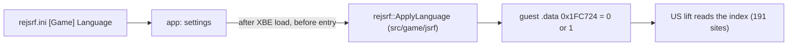

# 설계: 게임 언어 선택 (issue #104)

상태: **구현됨**(화면 확인은 사용자 대기). 작업 지시: [20261020-i104](../work-orders/20261020-i104-language-option.md) · 작업 로그: [20261020-i104](../work-logs/20261020-i104-language-option.md)

분석: [docs/analysis/language.md](../analysis/language.md)

## 1. 요구

* 설정에서 게임 언어로 **English와 Japanese** 가운데 하나를 고른다.
* 설정 메뉴에 마땅한 탭이 없으므로 **Game 탭을 새로 두고** 거기에 넣는다(사용자 결정).
* 일판 XBE를 분석해 근거를 만든다.
* 경과: 한때 French, German, Spanish까지 다섯 언어로 넓혔다가, 실행·자산·XBE 문자열을 확인한 뒤 두 언어로 되돌렸다(사용자 결정, 이유는 §3.4).

## 2. 확인한 것

* 언어는 각 빌드에 박힌 전역 상수다. US `0x1FC724` = 1(영어, `.data`), 일본판 `0x251F58` = 0(일본어, bss). 게임 코드는 이 값을 쓰지 않는다([language §4](../analysis/language.md)).
* 두 빌드가 다르게 시작하는 값은 **이 인덱스 하나**다. `.rdata`는 같고 `.data`의 차이는 이 객체와 정렬 패딩뿐이다(§6).
* 코드 차이도 언어와 무관하다. US 전용으로 보였던 `0x694A0`는 일본판 `0x69690`에 같은 함수가 있고 호출 91곳이 같다(§5).
* 191곳의 읽기는 대부분 쓸 때마다 다시 읽는다. 다만 객체 세 곳(`[+0x74C]` 둘, `[+0xB0]` 하나)이 만들 때의 값을 저장한다(§7).
* **실행 시험(확인됨)**: US 빌드를 로드한 직후 진입 전에 `0x1FC724`를 0으로 쓰고 50초 실행했다. 파일 열기 168개 중 다른 것은 언어별 자산 6개였다(`LogoJ.dat`, `Title.dat/.bin`, `se_ppl_j.dat`, `SprNorm.bin/.dat`, 영어는 `LogoE`, `TitleE`, `se_pple`, `SprNorm1`). 화면은 SEGA 로고(일본판 색), 낙서 경고문(일본어, 형법 조문), 타이틀 로고(가타카나 부제)가 일본판으로 나왔다. 진단 출력은 파일 열기 말고는 같았다(새 경고·오류 없음).

## 3. 방안 (확정: A)

| 방안 | 내용 | 판단 |
|---|---|---|
| **A. US 빌드 + 언어 전역 설정** | XBE를 올린 뒤 진입 전에 `0x1FC724`에 0(일본어) 또는 1(영어)을 쓴다. lift는 US 하나 | **채택**. 실행 시험으로 일본어 자산과 화면을 확인했다 |
| B. 일본판을 두 번째 variant로 lift | `jsrf_jp`를 따로 재컴파일 | 기각. 언어별 차이가 인덱스 하나뿐이라 seed·바인딩·디컴파일을 나눌 이유가 없다 |

### 3.1 언어와 인덱스

엔딩 텍스처 switch에서 확인한 대응([language §3](../analysis/language.md))을 쓴다.

| 인덱스 | 언어 | ini 값 | 메뉴 표시 | 이 설정 |
|---|---|---|---|---|
| 0 | 일본어 | `Japanese` | Japanese | 제공 |
| 1 | 영어(US 빌드 기본) | `English` | English | 제공 |
| 2 | 프랑스어 | - | - | 제공 안 함(§3.4) |
| 3 | 독일어 | - | - | 제공 안 함(§3.4) |
| 4 | 스페인어 | - | - | 제공 안 함(§3.4) |
| 5 | 이탈리아어로 추정 | - | - | 제공 안 함(§3.4) |

* 메뉴 표시는 영어 이름이다. 메뉴 글꼴(ImGui 기본)에 일본어 글리프가 없기 때문이다.

### 3.2 레이어

* 주소 `0x1FC724`와 인덱스의 뜻은 타이틀 사실이므로 `src/game/jsrf/jsrf_profile.cpp`에 둔다. `include/rejsrf/jsrf_profile.h`에 `enum class Language`(`kJapanese` = 0, `kEnglish` = 1), 이름 변환(`LanguageName`, `ParseLanguage`), `ApplyLanguage(const XbeImage&, GuestMemory&, Language)`를 둔다.
* 기본(primary) variant일 때만 쓴다. 다른 빌드는 주소가 다르고 어차피 실행하지 않는다.
* `rexbox`는 바꾸지 않는다. 이미 공개된 `GuestMemory::Write32`로 충분하다.
* app의 설정과 메뉴는 프로파일의 이름 변환을 써서 언어 목록을 한 곳(프로파일)에만 둔다.

### 3.3 설정

* `rejsrf.ini`에 새 절 `[Game]`, 키 `Language = English | Japanese`(기본 English, 대소문자 무시, 모르는 값은 기본값). 다섯 언어 시절에 저장된 `French` 등은 모르는 값이 되어 English로 읽힌다.
* 설정 메뉴에 **Game 탭**을 새로 둔다. 위치는 Info 바로 다음이다(탭 순서 Info, Game, Graphics, Input, 사용자 결정). 콤보 `Language`, "Applies from the next start." 안내, 실행 중 언어와 저장된 값이 다르면 "Restart to apply." 표시.
* 적용 시점: **다음 실행부터**. 객체가 만들 때의 언어를 저장하고 이미 읽은 자산은 바뀌지 않으므로 실행 중 전환은 하지 않는다(§2).
* 환경 변수 `REJSRF_LANGUAGE=<ini 값>`이 있으면 그 실행에만 ini보다 우선하고 저장하지 않는다(`REXBOX_RENDER_SCALE`류와 같은 규칙). 스크립트 실행·검증용이다.

### 3.4 프랑스어·독일어·스페인어를 뺀 이유

다섯 언어로 구현해 실행하고, 디스크 자산과 XBE 문자열을 확인한 결과([language §8](../analysis/language.md)):

1. **자산이 사실상 영어다.** 세 언어의 로고, 엔딩 텍스처, 마크 목록·텍스처는 영어 파일과 바이트 단위로 같다. 영어와 다른 것은 `TitleF/G/S.dat`와 `SprNorm2/3/4.dat` 둘뿐이고, 이것도 세 언어가 한 파일을 공유한다. `Media` 전체에 세 언어의 텍스트가 없다.
2. **실행해도 영어와 같다.** 인덱스 2~4로 55초씩 실행하면 각 언어의 파일 이름을 열지만, 로고·경고문·타이틀 화면이 영어와 바이트 단위로 같다(독일어 프레임 3000만 데모 진행 시각 차이).
3. **번역은 일부 화면뿐이다.** XBE 안에 번역된 텍스트는 그래피티 편집기와 저장·불러오기 안내문 정도다. 멀티플레이 메뉴는 영어 문장 뒤에 `(Fr)`, `(Gr)`, `(Esp)`를 붙인 미완성 자리표시자다. 스토리·대사는 번역본이 없어 영어로 나올 것으로 보인다.
4. **화면으로 확인하지 못했다.** 번역이 보일 화면(그래피티 편집기, 멀티플레이 메뉴)은 입력이 필요해 확인하지 못했다. 확인되지 않은 선택지를 메뉴에 두지 않는다.

그래서 메뉴에 French, German, Spanish를 두면 이름만 다르고 거의 영어인 선택지 셋이 생긴다. 인덱스 5(이탈리아어로 추정, 자산 파일 없음)도 같은 이유로 넣지 않는다. 다시 넣으려면 그래피티 편집기·멀티플레이 메뉴를 화면으로 확인하고 `Language`에 값을 더하면 된다(구조는 그대로 쓸 수 있다).

### 3.5 범위 밖

* 한국어 패치 검토는 #105에서 한다. 이 설계의 일본어 실행이 그 출발점이다.
* 저장 데이터: US판과 일본판은 title ID가 같아 같은 저장 폴더를 쓴다. 저장 데이터에 언어가 들어 있는지는 확인하지 않았다(**미확정**). 언어를 바꿔도 같은 저장을 그대로 읽는다.

## 4. 게임 데이터 규칙

* 일본판 XBE나 자산을 저장소에 넣지 않는다. 일본어 자산은 사용자 덤프의 `Media`에 이미 있다(US 디스크에 일본어 자산이 들어 있다).

## 5. 검증

| 검증 | 기대 |
|---|---|
| Language = English(기본, ini 없음) | 지금과 같은 파일 열기 순서, 같은 데모 프레임(300, 600, 1500, 1800 ... 바이트 단위) |
| Language = Japanese | 파일 열기에서 `LogoJ`, `Title.dat`, `se_ppl_j`, `SprNorm`; 프레임 300(로고), 1800(경고문), 3000(타이틀)이 일본판 |
| `French` 등 다른 값 | ini는 English로 읽고, `REJSRF_LANGUAGE`는 경고 후 ini 값 |
| 설정 저장 | `[Game] Language` 왕복, 모르는 값은 English, Game 탭에서 바꾸면 저장되고 "Restart to apply." 표시 |
| `REJSRF_LANGUAGE` | ini보다 우선, 저장 안 됨 |
| 회귀 도구 | `rejsrf_decomp_check`, `rejsrf_d3d8_check`, probe들 그대로 |

---

# Design: game language choice (issue #104)

Status: **implemented** (on-screen checks wait for the user). Work order: [20261020-i104](../work-orders/20261020-i104-language-option.md) · Work log: [20261020-i104](../work-logs/20261020-i104-language-option.md)

Analysis: [docs/analysis/language.md](../analysis/language.md)

## 1. Requirement

* Choose the game's language, **English or Japanese**, in the settings.
* The settings menu has no fitting tab, so **a new Game tab** holds it (the user's decision).
* Ground it in an analysis of the Japanese XBE.
* History: it was widened for a while to five languages, with French, German and Spanish, and narrowed back to two after the runs, the assets and the XBE strings were checked (the user's decision; reasons in §3.4).

## 2. What was established

* The language is a global constant built into each build: US `0x1FC724` = 1 (English, `.data`), Japanese `0x251F58` = 0 (Japanese, bss). No game code writes it ([language §4](../analysis/language.md)).
* It is the **only value** the two builds start with differently: `.rdata` is identical, and `.data` differs only in this object and alignment padding (§6).
* The code differences are unrelated to language: `0x694A0`, which looked US-only, is the same function as the Japanese build's `0x69690`, with the same 91 callers (§5).
* Most of the 191 reads read the value again each time. Three objects, though, keep the value they were created with (two at `[+0x74C]`, one at `[+0xB0]`) (§7).
* **Run test (confirmed)**: the US build with `0x1FC724` set to 0 after load and before the entry, run for 50 s. Of 168 file opens, six differed, all per-language assets (`LogoJ.dat`, `Title.dat/.bin`, `se_ppl_j.dat`, `SprNorm.bin/.dat`; English opens `LogoE`, `TitleE`, `se_pple`, `SprNorm1`). The screens showed the Japanese SEGA logo (its colour), the graffiti warning in Japanese (citing the Penal Code articles) and the title logo with its katakana subtitle. Diagnostics were the same apart from the file opens (no new warnings or errors).

## 3. Options (settled: A)

| Option | What | Verdict |
|---|---|---|
| **A. US build + set the language global** | After the XBE is loaded and before its entry, write 0 (Japanese) or 1 (English) to `0x1FC724`. One lift, the US one | **Adopted**; the run test showed the Japanese assets and screens |
| B. Lift the Japanese build as a second variant | Recompile `jsrf_jp` separately | Rejected: the only per-language difference is the index, so there is no reason to split seeds, bindings and decompilation |

### 3.1 Languages and indices

The mapping confirmed in the ending-texture switch ([language §3](../analysis/language.md)):

| Index | Language | ini value | Menu label | In this setting |
|---|---|---|---|---|
| 0 | Japanese | `Japanese` | Japanese | offered |
| 1 | English (the US build's default) | `English` | English | offered |
| 2 | French | - | - | not offered (§3.4) |
| 3 | German | - | - | not offered (§3.4) |
| 4 | Spanish | - | - | not offered (§3.4) |
| 5 | probably Italian | - | - | not offered (§3.4) |

* The menu shows English names: the menu font (ImGui's default) has no Japanese glyphs.

### 3.2 Layering

* The address `0x1FC724` and the indices' meaning are title facts, so they live in `src/game/jsrf/jsrf_profile.cpp`. `include/rejsrf/jsrf_profile.h` gets `enum class Language` (`kJapanese` = 0, `kEnglish` = 1), name conversion (`LanguageName`, `ParseLanguage`) and `ApplyLanguage(const XbeImage&, GuestMemory&, Language)`.
* It writes only for the primary variant; other builds have other addresses and are not run anyway.
* `rexbox` does not change; the public `GuestMemory::Write32` is enough.
* The app's settings and menu use the profile's name conversion, so the language list lives in one place (the profile).

### 3.3 Settings

* A new `[Game]` section in `rejsrf.ini` with `Language = English | Japanese` (default English, case-insensitive, unknown values keep the default). `French` and the like, saved while there were five languages, become unknown values and read as English.
* A new **Game tab** in the settings menu, right after Info (tab order Info, Game, Graphics, Input; the user's decision): a `Language` combo, "Applies from the next start.", and "Restart to apply." while the running language differs from the saved one.
* When it applies: **from the next start**. Objects keep the language they were created with and loaded assets do not change, so there is no switch while running (§2).
* `REJSRF_LANGUAGE=<ini value>`, when set, wins over the ini for that run and is not saved (the same rule as `REXBOX_RENDER_SCALE` and the like); for scripted runs and verification.

### 3.4 Why French, German and Spanish were left out

After implementing all five and checking the runs, the disc's assets and the XBE's strings ([language §8](../analysis/language.md)):

1. **The assets are English in practice.** The three languages' logos, ending textures and mark lists and textures equal English's files byte for byte. Only `TitleF/G/S.dat` and `SprNorm2/3/4.dat` differ from English, and the three languages share one file for each. `Media` holds no text in any of them.
2. **Running them looks like English.** Run for 55 s with indices 2-4, each opens its language's file names, but the logo, warning and title screens equal English's byte for byte (only German frame 3000 differs, by the demo's timing).
3. **Only a few screens are translated.** The translated text in the XBE covers about the graffiti editor and the save and load messages. The multiplayer menus are unfinished placeholders, the English text with `(Fr)`, `(Gr)` or `(Esp)` appended. Story and dialogue have no translation and would come out in English.
4. **Nothing was seen on screen.** The screens where the translation would show (graffiti editor, multiplayer menus) need input and were not checked; the menu does not offer choices nobody has seen work.

So French, German and Spanish in the menu would be three choices that differ in name only and are mostly English. Index 5 (probably Italian, with no asset files) is left out for the same reasons. Bringing them back means checking the graffiti editor and multiplayer menus on screen and adding values to `Language`; the structure stays usable as it is.

### 3.5 Out of scope

* The Korean patch review is #105; this design's Japanese run is its starting point.
* Save data: the US and Japanese builds share the title ID and so the save folder. Whether save data records the language was not checked (**unresolved**); a changed language reads the same saves.

## 4. Game data rule

* No Japanese XBE or assets go into the repository. The Japanese assets are already in the user's `Media` (the US disc carries them).

## 5. Verification

| Check | Expected |
|---|---|
| Language = English (default, no ini) | the same file-open order and demo frames as today (300, 600, 1500, 1800 ..., byte for byte) |
| Language = Japanese | file opens of `LogoJ`, `Title.dat`, `se_ppl_j`, `SprNorm`; frames 300 (logo), 1800 (warning), 3000 (title) Japanese |
| `French` and other values | the ini reads them as English; `REJSRF_LANGUAGE` warns and keeps the ini's value |
| Settings saved | `[Game] Language` round trip, unknown values read as English, a change in the Game tab is saved and shows "Restart to apply." |
| `REJSRF_LANGUAGE` | wins over the ini, not saved |
| Regression tools | `rejsrf_decomp_check`, `rejsrf_d3d8_check` and the probes unchanged |
