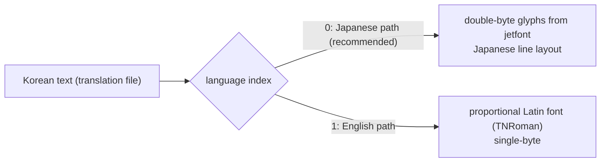

# 검토: 한국어 패치 (issue #105)

상태: **검토 완료**. 이 issue는 검토와 문서화만 하며, 구현은 필요하면 별도 프로젝트로 한다(사용자 결정). 작업 로그: [20261020-i105](../work-logs/20261020-i105-korean-patch-review.md)

근거 분석: [text-and-font](../analysis/text-and-font.md), [language](../analysis/language.md)

## 1. 결론

* **가능하다.** 게임 문장은 Shift-JIS 문자열로 몇 군데에 모여 있고, 글꼴은 교체 가능한 비트맵 아틀라스다. 일본어 실행(#104)이 되므로 2바이트 문자 경로를 그대로 쓸 수 있다.
* **권장 방법은 reJSRF 런타임 안에서 바꾸는 것(§4 방안 B)이다.** 원본 파일을 고치지 않고, 번역문과 한글 글꼴을 따로 두고, 문장을 가져오고 그리는 함수를 디컴파일해 바꾼다. 게임 자산을 하나도 배포하지 않는다.
* **막는 것**은 둘이다. (1) 문자 코드에서 글리프 위치로 가는 대응을 아직 모른다. 텍스트 렌더러를 디컴파일해야 한다. (2) 그림 속 글자(로고, 경고문, 메뉴 스프라이트)는 그림을 새로 그려야 한다.
* **작업량에서 가장 큰 것은 번역 자체**다. 일본어 약 27,000자(영어 약 40,000글자)다.

## 2. 확인한 것 (요약)

| 질문 | 답 | 상태 |
|---|---|---|
| 텍스트는 어디에 있나 | 이벤트 대사 `Event/Event/e###.dat`, 미션 `Mission/mssn####.bin`, 대화 `TalkEvent`, 메뉴·시스템·이름 `default.xbe` | 확인됨 |
| 분량 | 일본어 약 27,000자. 서로 다른 글자 800자(XBE 제외) | 확인됨 |
| 인코딩 | Shift-JIS(CP932). 자체 코드표 아님. 제어 코드 `$n`(줄바꿈), `$r`(페이지), `$e`(메시지 끝) 외 몇 개 | 확인됨(일부 코드 뜻 미확정) |
| 언어 배치 | 이벤트·미션 파일 하나에 일본어와 영어가 함께 있고, 언어 인덱스로 고른다 | 추정 |
| 글꼴 | `Font/jetfont.dat`: DXT3 512×2304 아틀라스, 글리프 약 1,500개(한자·가나·영숫자·기호), 아래쪽 약 24줄 빈 공간 | 확인됨 |
| 글리프 한도 | 아틀라스 칸 약 1,500개. 한국어 대본은 서로 다른 음절 약 1,000~1,300개면 충분할 것으로 본다. 영숫자·기호 칸을 남기면 빠듯하다. 텍스처를 키우거나 두 장으로 나누면 여유가 생긴다 | 추정 |
| 문자 코드 → 글리프 | 순서표가 파일에 없다. 코드 안에 있다 | 미확정 |
| 그림 속 글자 | `Title/LogoJ.dat`, `Title/Title.dat`(경고문, 타이틀), `Disp/SprNorm`(메뉴 스프라이트 추정), `Ending/tex_Jpn.dat`, `Mark/*_jpn` | 파일 확인, 내용 추정 |
| 음성·자막 | 일본어 음성 `Z_ADX/MUSENJ`(116개), `Sounds/SE/*_j.dat`. 영어는 `MUSEN`. 한국어 음성은 없으므로 자막만 번역한다. 자막과 음성의 시간 관계는 미확정 | 일부 확인 |

## 3. 어느 언어 경로를 쓸까

* **일본어 경로(인덱스 0)를 권한다.** 렌더러가 이 경로에서 2바이트 글자를 `jetfont` 아틀라스로 그린다. 한글도 고정폭 2바이트 글자로 다루면 된다(**추정**).
* 영어 경로는 1바이트 비례 글꼴(`TNRoman.bin`)을 쓰는 것으로 보여 한글을 넣기 어렵다(**추정**).
* 따라서 한국어는 #104의 언어 설정에 값을 하나 더하는 형태가 된다. 게임에는 인덱스 0을 쓰고, 문장과 글꼴만 한국어로 바꾼다.

## 4. 방안

| 방안 | 내용 | 장점 | 단점 | 판단 |
|---|---|---|---|---|
| A. 자산 패치 | 사용자 덤프의 `e###.dat`·`mssn####.bin`·`jetfont.dat`·XBE 문자열을 고친다. 차분(xdelta 류)으로 배포 | 원래 게임·다른 에뮬레이터에도 적용 | 레코드 오프셋·크기를 다시 맞춰야 한다. XBE를 고치면 MD5 확인과 재컴파일 기준이 깨진다. 차분이 원본 바이트를 담을 수 있다 | 비권장 |
| **B. 런타임 대체(reJSRF)** | 문장을 가져오는 함수와 그리는 함수를 디컴파일한다. 언어가 한국어이면 (파일, 레코드) 또는 원문 해시로 번역 파일에서 한국어를 찾는다. 한글 글리프는 호스트에서 만든 아틀라스로 그린다 | 원본을 고치지 않는다. 게임 자산을 배포하지 않는다. 문장 길이 제한이 없다 | reJSRF에서만 동작. 렌더러 디컴파일이 먼저다 | **권장** |
| C. 런타임 파일 대체 | `rexbox` 파일 계층에 대체 폴더를 두고, 고친 `e###.dat` 등을 읽게 한다 | 디컴파일 없이 시작 가능 | 고친 파일은 원본에서 나온 것이라 배포할 수 없다(사용자가 직접 만드는 도구가 필요). 글리프 대응 문제는 그대로 | 보조 수단 |

### 4.1 방안 B의 구성 (구현은 별도 프로젝트)

1. **텍스트 렌더러 디컴파일**: `$` 코드 해석, 글리프 위치 계산, 줄·페이지 처리. 글리프 대응(§2의 미확정)을 여기서 확정한다.
2. **문장 추출 도구**: 이벤트·미션·XBE 문장을 (위치, 원문 일본어, 원문 영어)로 뽑아 번역 작업용 파일을 만든다. 저장소에는 도구만 두고 뽑은 문장은 넣지 않는다.
3. **번역 파일**: 원문 위치 → 한국어(UTF-8). 사람이 쓴 번역만 담는다.
4. **한글 글꼴**: SIL OFL 같은 허용 라이선스 글꼴(예: Noto Sans KR, 또는 픽셀 글꼴)로 시작할 때 아틀라스를 만든다. 쓰는 음절만 굽는다.
5. **그림 속 글자**: D3D8 HLE에서 텍스처를 해시로 바꿔 끼우는 장치를 두고, 새로 그린 그림만 배포한다. 선택 사항이다(그림은 일본어 또는 영어로 둘 수도 있다).
6. **설정**: #104의 `Language`에 `Korean`을 더한다(게임 인덱스 0, 문장과 글꼴만 대체).

## 5. 배포와 권리

* 저장소와 배포물에는 **게임 자산과 원문 문장을 넣지 않는다**(AGENTS.md의 게임 데이터 규칙). 추출 도구는 사용자의 덤프에서 돌린다.
* 번역문은 원작 대본의 2차적 저작물이다. 팬 번역은 관행적으로 배포되지만 권리자의 허락이 없는 한 법적 위험이 있다. 배포 여부와 방식(별도 저장소, 별도 라이선스)은 **사용자가 정한다**. 이 문서는 법률 자문이 아니다.
* 글꼴은 OFL 등 재배포가 허용된 것만 쓰고 `THIRD_PARTY_NOTICES.md`에 적는다.

## 6. 작업량 (대략)

| 일 | 규모 | 비고 |
|---|---|---|
| 텍스트 렌더러·문장 접근 디컴파일 | 중 | 방안 B의 전제. 글리프 대응 확정 |
| 추출·번역 파일 도구 | 소 | |
| 한글 아틀라스 생성과 렌더러 연결 | 소~중 | |
| 번역 | **대** | 일본어 약 27,000자. 사람이 한다 |
| 그림 속 글자 | 중 | 그림 수 확인부터. 선택 사항 |

## 7. 다음 단계 (사용자 결정)

* 별도 프로젝트로 진행할지 정한다. 진행하면 첫 작업은 **텍스트 렌더러 디컴파일**이다(글리프 대응과 `$` 코드의 뜻을 확정한다).

---

# Review: a Korean patch (issue #105)

Status: **review done**. This issue is review and documentation only; implementation, if wanted, is a separate project (the user's decision). Work log: [20261020-i105](../work-logs/20261020-i105-korean-patch-review.md)

Analysis it rests on: [text-and-font](../analysis/text-and-font.md), [language](../analysis/language.md)

## 1. Conclusion

* **It can be done.** The game's text is Shift-JIS strings gathered in a few places, and the font is a replaceable bitmap atlas. Japanese runs (#104), so the double-byte path is there to use.
* **The recommended way is to replace inside the reJSRF runtime (§4, option B).** The original files stay untouched; the translation and a Hangul font live apart, and the functions that fetch and draw text are decompiled and replaced. No game asset is distributed.
* **Two things block it**: (1) the character code → glyph slot mapping is not known yet and needs the text renderer decompiled; (2) lettering inside pictures (logos, the warning, menu sprites) has to be redrawn.
* **The largest piece of work is the translation itself**: about 27,000 Japanese characters (about 40,000 English letters).

## 2. Findings (summary)

| Question | Answer | Status |
|---|---|---|
| Where the text lives | event dialogue `Event/Event/e###.dat`, missions `Mission/mssn####.bin`, talk `TalkEvent`, menus, system and names in `default.xbe` | confirmed |
| Volume | about 27,000 Japanese characters; 800 distinct (XBE not counted) | confirmed |
| Encoding | Shift-JIS (CP932), no custom table; control codes `$n` (line), `$r` (page), `$e` (end of message) and a few more | confirmed (some codes unresolved) |
| Language layout | event and mission files hold Japanese and English together; the language index picks one | inferred |
| Font | `Font/jetfont.dat`: DXT3 512×2304 atlas, about 1,500 glyphs (kanji, kana, digits and letters, symbols), about 24 empty rows at the bottom | confirmed |
| Glyph limit | about 1,500 atlas cells; a Korean script likely needs about 1,000-1,300 distinct syllables, tight once digits and symbols keep their cells; a larger texture or a second one gives room | inferred |
| Character code → glyph | no order table in the files; it is in the code | unresolved |
| Lettering in pictures | `Title/LogoJ.dat`, `Title/Title.dat` (warning, title), `Disp/SprNorm` (menu sprites, inferred), `Ending/tex_Jpn.dat`, `Mark/*_jpn` | files confirmed, content inferred |
| Voice and subtitles | Japanese voice `Z_ADX/MUSENJ` (116), `Sounds/SE/*_j.dat`; English is `MUSEN`. There is no Korean voice, so only subtitles are translated; how subtitles are timed to voice is unresolved | partly confirmed |

## 3. Which language path

* **The Japanese path (index 0) is recommended.** On it the renderer draws double-byte characters from the `jetfont` atlas; Hangul can be handled as fixed-width double-byte characters too (**inferred**).
* The English path appears to use a single-byte proportional font (`TNRoman.bin`), a poor fit for Hangul (**inferred**).
* Korean thus becomes one more value of #104's language setting: the game runs index 0, with only the text and the font replaced by Korean.

## 4. Options

| Option | What | For | Against | Verdict |
|---|---|---|---|---|
| A. Asset patch | edit the user's `e###.dat`, `mssn####.bin`, `jetfont.dat` and XBE strings; ship a diff (xdelta and the like) | works on the original game and other emulators too | record offsets and sizes must be rebuilt; editing the XBE breaks the MD5 check and the recompilation baseline; a diff can carry original bytes | not recommended |
| **B. Runtime replacement (reJSRF)** | decompile the functions that fetch and draw text; with Korean selected, look the Korean up in a translation file by (file, record) or a hash of the original; draw Hangul from an atlas built on the host | originals untouched; no game assets shipped; no length limits | reJSRF only; the renderer must be decompiled first | **recommended** |
| C. Run-time file override | an override folder in `rexbox`'s file layer serving edited `e###.dat` and the like | can start without decompiling | edited files derive from the originals and cannot be shipped (users would need a tool to make them); the glyph mapping problem remains | a fallback |

### 4.1 What option B consists of (implemented as a separate project)

1. **Decompile the text renderer**: `$` code handling, glyph slot lookup, lines and pages; this settles the glyph mapping (unresolved in §2).
2. **Extraction tool**: pull the event, mission and XBE text as (place, Japanese original, English original) into a working file for translators. The repository keeps the tool only, never the extracted text.
3. **Translation file**: original place → Korean (UTF-8), holding only human-written translation.
4. **Hangul font**: build the atlas at start from a permissively licensed font (SIL OFL, for example Noto Sans KR or a pixel font), baking only the syllables used.
5. **Lettering in pictures**: a D3D8 HLE hook that swaps textures by hash, shipping only newly drawn pictures. Optional (pictures may stay Japanese or English).
6. **Setting**: add `Korean` to #104's `Language` (game index 0, with text and font replaced).

## 5. Distribution and rights

* Neither the repository nor any release carries **game assets or original text** (the game-data rule of AGENTS.md); the extraction tool runs on the user's dump.
* A translation is a derivative of the original script. Fan translations are commonly distributed, but without the rights holder's permission there is legal risk. Whether and how to distribute (a separate repository, a separate license) is **the user's decision**; this document is not legal advice.
* Only fonts that allow redistribution (OFL and the like) are used, listed in `THIRD_PARTY_NOTICES.md`.

## 6. Effort (rough)

| Work | Size | Note |
|---|---|---|
| Decompile the text renderer and text access | medium | the premise of option B; settles the glyph mapping |
| Extraction and translation-file tools | small | |
| Hangul atlas generation and renderer hookup | small to medium | |
| Translation | **large** | about 27,000 Japanese characters, by people |
| Lettering in pictures | medium | starts with counting the pictures; optional |

## 7. Next step (the user's decision)

* Decide whether to pursue it as a separate project. If so, the first task is **decompiling the text renderer** (it settles the glyph mapping and the meaning of the `$` codes).
