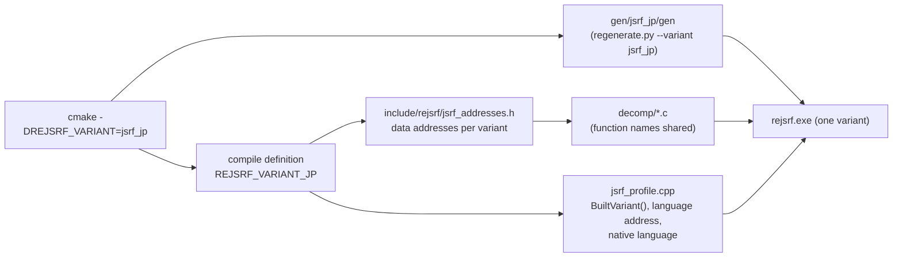

# 설계: 일본판 XBE를 빌드 변형으로 지원 (issue #108)

상태: **설계, 구현 전**(사용자 승인 대기). 작업 지시: [20261020-i108](../work-orders/20261020-i108-japanese-variant.md)

분석: [language §5~§7, §10](../analysis/language.md)

## 1. 요구

* 일본판 디스크만 가진 사용자를 지원한다. 일본판 `default.xbe`(MD5 `d8490cdb75bd47b36c62effdf1461ae0`, 지역 2)를 실행한다.
* **실행 파일 하나로 두 판을 지원하지 않는다.** CMake configure 때 미국판(`jsrf_us`, 기본) 또는 일본판(`jsrf_jp`) 하나를 고른다(사용자 결정).

## 2. 확인한 것

* 두 빌드의 코드 배치가 같다. 손으로 적은 미국판 함수 주소 225개(seed 188개, `xdk_symbols_extra.json` 5개, 디컴파일 함수 31개, 프로파일의 `D3D_InitializeDeviceState` 1개)가 **모두 일본판의 같은 주소**에 같은 코드로 있다(`variant_addresses.py`, 앞 12개 명령을 분기·이미지 주소를 가리고 비교).
* 자료 주소는 조금씩 다르다. 같은 주소의 명령이 담은 피연산자를 짝지어 일본판 값을 얻었다.

| 미국판 | 쓰는 곳 | 일본판 | 차이 |
|---|---|---|---|
| `0x001FC724` | 언어 인덱스(`jsrf_profile.cpp`) | `0x00251F58` | `+0x55834`(bss로 옮겨짐) |
| `0x0022E5B0` | `mmatrix.c` `kWorkVector` | `0x0022E590` | `-0x20` |
| `0x00264BA4`, `0x00264BD8`, `0x00264C04`, `0x00264C08` | `mmatrix.c` | 각각 `-0x18` | `-0x18` |
| `0x00264E78`~`0x00264E94` | `camera_frustum.c` 프러스텀 상수 | 같음 | `0` |

* 언어 인덱스 말고는 두 빌드가 다르게 시작하는 값이 없다([language §6](../analysis/language.md)). 따라서 일본판 빌드는 미국판 빌드 + `Language = Japanese`와 같은 화면을 낼 것으로 본다(**추정**, §6에서 확인).
* `regenerate.py`는 이미 `--variant`를 받고 `gen/<variant>/`에 쓴다. 미국판만 `variants.json`에 있고, CMake는 `gen/jsrf_us/gen`만 본다. 앱과 `rejsrf_d3d8_check`는 `PrimaryVariant()`(미국판)이 아니면 실행하지 않는다.

## 3. 방안 비교

| 방안 | 내용 | 판단 |
|---|---|---|
| **A. 빌드 변형(configure 선택)** | `-DREJSRF_VARIANT=jsrf_jp`. 생성 코드, 주소 표, 프로파일 값이 그 변형 하나로 빌드된다 | **채택**. 두 lift가 한 실행 파일에 들어가지 않아 심볼 충돌(`sub_XXXXXXXX`)이 없고, 디컴파일 함수 이름도 그대로 쓸 수 있다 |
| B. 실행 파일 하나에 두 lift | 생성 코드 심볼에 변형별 접두사, 실행 중 선택 | 기각(사용자 결정). 생성기 수정, 크기·빌드 시간 두 배 |
| C. 미국판 lift로 일본판 XBE 실행 | 생성 코드가 절대 자료 주소를 담아 다른 빌드에 맞지 않는다 | 불가 |

## 4. 구조



### 4.1 CMake와 빌드 스크립트

* `REJSRF_VARIANT`(캐시 문자열, `jsrf_us` 기본, `jsrf_us|jsrf_jp`만 허용). 다른 값은 configure 오류.
* `REJSRF_RECOMP_GEN_DIR` 기본값이 `gen/${REJSRF_VARIANT}/gen`이 된다.
* `rejsrf_game`과 `rejsrf_recomp`(디컴파일 소스가 생성 코드 옆에서 컴파일되므로)에 `REJSRF_VARIANT_JP` 정의(일본판일 때만)를 준다. 앱과 도구는 `rejsrf_game`의 공개 정의로 같은 값을 본다.
* `scripts/build_win32_x86.ps1`·`.bat`에 `-Variant jp`를 더한다. 빌드 디렉터리는 변형마다 따로 둔다: 미국판 `build/win32_x86`(지금과 같음), 일본판 `build/win32_x86_jp`. 같은 디렉터리에서 변형을 바꾸면 생성 코드 전체를 다시 컴파일하므로 나눈다.

### 4.2 재생성

* `variants.json`에 `jsrf_jp`(라벨 "Japan (region 2)", MD5 `d8490cdb…`)를 더한다.
* `regenerate.py --variant jsrf_jp --xbe <일본판>`. seed, `hle_libraries.json`, `xdk_symbols_extra.json`, 디컴파일 소스는 **공유**한다(함수 주소가 같으므로).
* 공유가 맞는지 재생성 때 확인한다: 미국판이 아닌 변형이면 `variant_addresses.py`의 함수 비교(seed, 추가 심볼, 디컴파일 함수가 그 XBE의 같은 주소에 미국판과 같은 코드로 있는지)를 돌리고, 어긋나면 멈춘다. 이를 위해 함수 비교 부분을 `scripts/recomp/`의 모듈로 옮긴다. 미국판 XBE가 없는 사용자는 미국판과 직접 비교할 수 없으므로, 비교 기준은 미국판 XBE가 아니라 **커밋한 지문**(주소별 가린 명령 바이트의 해시, `src/game/jsrf/recomp/function_fingerprints.json`)으로 한다. 원본 바이트가 아니라 해시만 커밋한다.

### 4.3 자료 주소

* 새 헤더 `include/rejsrf/jsrf_addresses.h`(C, 디컴파일 소스와 프로파일이 함께 쓴다)에 변형별 자료 주소를 둔다.

```c
#if defined(REJSRF_VARIANT_JP)
#define JSRF_LANGUAGE_INDEX 0x00251F58u
#define JSRF_MMATRIX_WORK_VECTOR 0x0022E590u
...
#else
#define JSRF_LANGUAGE_INDEX 0x001FC724u
...
#endif
```

* `mmatrix.c`의 `kWorkVector`·`kSinCosTable`·`kWorkScalar`·`kStackCell`·`kWorkMatrix`, `camera_frustum.c`의 상수 주소, 프로파일의 언어 인덱스가 이 헤더를 쓴다. 각 값 옆에 미국판과 일본판을 어떻게 짝지었는지(피연산자 대응) 적는다.
* 함수 이름(`sub_XXXXXXXX`, `_gen`)은 두 변형에서 같으므로 바꾸지 않는다. 앞으로 디컴파일 소스에 자료 주소를 쓸 때는 이 헤더를 거친다(`CODING_STYLE.md`에 규칙 추가).

### 4.4 타이틀 프로파일과 앱

* `PrimaryVariant()`를 `BuiltVariant()`로 바꾼다(빌드한 변형). `kVariants`의 두 항목은 그대로 두어 다른 판을 넣으면 알아보고 안내한다.
* 앱: 넣은 XBE가 빌드한 변형과 다르면 실행하지 않고 "이 빌드는 미국판(일본판)용이다. 일본판(미국판)은 `-DREJSRF_VARIANT=jsrf_jp`(`jsrf_us`)로 빌드하라"고 알린다. `rejsrf_d3d8_check`도 같다.
* 언어(#104): `ApplyLanguage`가 변형의 언어 인덱스 주소에 쓴다. `Settings::language`의 기본값은 그 변형의 원래 언어(미국판 English, 일본판 Japanese)로 한다(`NativeLanguage()`). 일본판 빌드에서도 English를 고를 수 있다(일본판도 영어 자산과 문장을 담고 있다).
* 빌드 정보: 창 제목과 Info 탭의 빌드 식별에 변형을 넣는다(예: `Win32/x86 Release, JP`).

### 4.5 CI

* CI에는 게임 데이터와 생성 코드가 없다. 일본판 configure와 생성 코드 없는 빌드를 한 작업(또는 기존 작업의 한 단계)으로 더해, `REJSRF_VARIANT_JP` 분기가 컴파일되는지만 확인한다.

## 5. 범위 밖

* 실행 파일 하나에 두 판(§3 B).
* 한국어 패치(JSRF-kr-patch)는 일본판 XBE를 기준으로 한다. 이 변형이 생기면 그 패치를 reJSRF 일본판 빌드에서 바로 시험할 수 있다.
* 일본판에만 있는 다른 차이: 없다고 보지만, 일본판 lift의 미해결 스텁·건너뛴 함수 수를 미국판과 비교해 확인한다(§6).

## 6. 검증

| 검증 | 기대 |
|---|---|
| `jsrf_us` configure·빌드 | 지금과 같음(생성 코드, 바이너리 동작, 회귀 도구 결과) |
| `regenerate.py --variant jsrf_jp` | 지문 확인 통과. 함수 수·미해결 스텁 수가 미국판과 같거나 차이를 설명할 수 있다 |
| `jsrf_jp` 빌드 | 경고 0. `rejsrf_decomp_check` 차이 0, `rejsrf_d3d8_check` 차이 0, probe 통과 |
| 일본판 데모 | 로고·경고문·타이틀이 일본판. 파일 열기가 미국판 빌드 + `Language = Japanese`와 같다. 프레임 300~2400이 그 실행과 바이트 단위로 같다(**추정**을 확인) |
| 변형 불일치 | 미국판 빌드에 일본판 XBE, 일본판 빌드에 미국판 XBE를 넣으면 안내하고 멈춘다 |
| CI | 두 변형 모두 생성 코드 없이 빌드 |

---

# Design: the Japanese XBE as a build variant (issue #108)

Status: **design, not implemented** (waiting for the user's approval). Work order: [20261020-i108](../work-orders/20261020-i108-japanese-variant.md)

Analysis: [language §5-§7, §10](../analysis/language.md)

## 1. Requirement

* Support users who only have the Japanese disc: run the Japanese `default.xbe` (MD5 `d8490cdb75bd47b36c62effdf1461ae0`, region 2).
* **One executable does not run both.** CMake configure picks either the US (`jsrf_us`, default) or the Japanese (`jsrf_jp`) build (the user's decision).

## 2. What was established

* The two builds lay out their code the same. All 225 hand-written US function addresses (188 seeds, 5 in `xdk_symbols_extra.json`, 31 decompiled functions, the profile's `D3D_InitializeDeviceState`) hold **the same code at the same address in the Japanese build** (`variant_addresses.py`, comparing the first 12 instructions with branches and image addresses masked).
* Data addresses differ a little. Pairing the operands of the instruction at the same address gives the Japanese values:

| US | Used by | Japanese | Shift |
|---|---|---|---|
| `0x001FC724` | language index (`jsrf_profile.cpp`) | `0x00251F58` | `+0x55834` (moved to bss) |
| `0x0022E5B0` | `mmatrix.c` `kWorkVector` | `0x0022E590` | `-0x20` |
| `0x00264BA4`, `0x00264BD8`, `0x00264C04`, `0x00264C08` | `mmatrix.c` | each `-0x18` | `-0x18` |
| `0x00264E78`-`0x00264E94` | `camera_frustum.c` frustum constants | the same | `0` |

* Apart from the language index the builds start with no different values ([language §6](../analysis/language.md)), so a Japanese build should show the same screens as the US build with `Language = Japanese` (**inferred**, checked in §6).
* `regenerate.py` already takes `--variant` and writes `gen/<variant>/`. Only the US build is in `variants.json`, CMake looks only at `gen/jsrf_us/gen`, and the app and `rejsrf_d3d8_check` refuse anything but `PrimaryVariant()` (the US build).

## 3. Options

| Option | What | Verdict |
|---|---|---|
| **A. Build variant (chosen at configure)** | `-DREJSRF_VARIANT=jsrf_jp`; generated code, address tables and profile values are built for that one variant | **Adopted**: two lifts never meet in one executable, so the generated symbols (`sub_XXXXXXXX`) do not clash and the decompiled function names stay as they are |
| B. Both lifts in one executable | per-variant symbol prefixes, chosen at run time | rejected (the user's decision); a generator change, twice the size and build time |
| C. Run the Japanese XBE on the US lift | the generated code embeds absolute data addresses that do not fit another build | impossible |

## 4. Structure

### 4.1 CMake and the build script

* `REJSRF_VARIANT` (a cache string, default `jsrf_us`, only `jsrf_us|jsrf_jp`); any other value fails the configure.
* `REJSRF_RECOMP_GEN_DIR` defaults to `gen/${REJSRF_VARIANT}/gen`.
* `rejsrf_game` and `rejsrf_recomp` (decompiled sources compile next to the generated code) get the definition `REJSRF_VARIANT_JP` for the Japanese build only; the app and tools see it through `rejsrf_game`'s public definitions.
* `scripts/build_win32_x86.ps1` and `.bat` take `-Variant jp`. Each variant has its own build directory: US `build/win32_x86` (as today), Japanese `build/win32_x86_jp`, because switching the variant in one directory recompiles all generated code.

### 4.2 Regeneration

* `variants.json` gains `jsrf_jp` (label "Japan (region 2)", MD5 `d8490cdb…`).
* `regenerate.py --variant jsrf_jp --xbe <Japanese>`. The seeds, `hle_libraries.json`, `xdk_symbols_extra.json` and the decompiled sources are **shared** (the function addresses are the same).
* Regeneration checks that sharing holds: for a variant other than the US one it runs `variant_addresses.py`'s function comparison (do the seeds, extra symbols and decompiled functions hold the US code at the same address in that XBE?) and stops on a mismatch; the comparison moves into a module under `scripts/recomp/`. A user without the US XBE cannot compare against it, so the reference is not the US XBE but **committed fingerprints** (a hash of the masked instruction bytes per address, `src/game/jsrf/recomp/function_fingerprints.json`): only hashes are committed, never original bytes.

### 4.3 Data addresses

* A new header `include/rejsrf/jsrf_addresses.h` (C, shared by the decompiled sources and the profile) holds the data addresses per variant (`#if defined(REJSRF_VARIANT_JP)` ... `#else` ... `#endif`).
* `mmatrix.c`'s `kWorkVector`, `kSinCosTable`, `kWorkScalar`, `kStackCell` and `kWorkMatrix`, `camera_frustum.c`'s constant addresses, and the profile's language index use it, each value annotated with how the US and Japanese values were paired (operand pairing).
* Function names (`sub_XXXXXXXX`, `_gen`) are the same in both variants and stay. From now on decompiled sources name data addresses through this header (a rule added to `CODING_STYLE.md`).

### 4.4 Title profile and app

* `PrimaryVariant()` becomes `BuiltVariant()` (the variant built). Both `kVariants` entries stay, so the other build is recognized and explained.
* App: an XBE that is not the built variant is not run; the message says this build is for the US (Japanese) disc and that the Japanese (US) one is built with `-DREJSRF_VARIANT=jsrf_jp` (`jsrf_us`). `rejsrf_d3d8_check` does the same.
* Language (#104): `ApplyLanguage` writes the variant's language index address. `Settings::language` defaults to the variant's native language (US English, Japanese Japanese, `NativeLanguage()`). The Japanese build can choose English too (it carries the English assets and text).
* Build information: the window title and the Info tab's build identity name the variant (for example `Win32/x86 Release, JP`).

### 4.5 CI

* CI has no game data or generated code. A Japanese configure and a build without generated code are added (a job, or a step of the existing one) to check that the `REJSRF_VARIANT_JP` branches compile.

## 5. Out of scope

* Both builds in one executable (§3 B).
* The Korean patch (JSRF-kr-patch) targets the Japanese XBE; with this variant, its patches can be tried directly in a reJSRF Japanese build.
* Other Japanese-only differences: none expected, confirmed by comparing the Japanese lift's unresolved stubs and skipped functions with the US lift's (§6).

## 6. Verification

| Check | Expected |
|---|---|
| `jsrf_us` configure and build | unchanged (generated code, behaviour, regression tools) |
| `regenerate.py --variant jsrf_jp` | the fingerprint check passes; function and unresolved-stub counts equal the US lift's, or the difference is explained |
| `jsrf_jp` build | zero warnings; `rejsrf_decomp_check` 0 differences, `rejsrf_d3d8_check` 0 differences, the probes pass |
| Japanese demo | logo, warning and title Japanese; file opens equal the US build with `Language = Japanese`; frames 300-2400 equal that run byte for byte (checking the **inference**) |
| Variant mismatch | a Japanese XBE in a US build, or a US XBE in a Japanese build, is explained and stopped |
| CI | both variants build without generated code |
