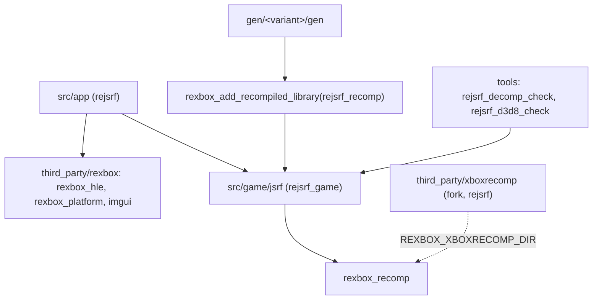

# 설계: 공용 런타임 rexbox를 submodule로 쓰기 (issue #102)

상태: **구현됨**(사용자 승인). 작업 로그: [20261022-i102](../work-logs/20261022-i102-rexbox-submodule.md) · 작업 지시: [20261022-i102](../work-orders/20261022-i102-rexbox-submodule.md)

## 1. 요구

* 타이틀을 모르는 Xbox 런타임(`src/rexbox/`, `src/platform/`, `include/rexbox/`, rexbox 도구와 probe)은 [reexec/rexbox](https://github.com/reexec/rexbox)로 이력째 분리되었고, reCT3가 함께 쓴다. reJSRF도 그 저장소를 `third_party/rexbox` submodule로 쓰고, 저장소 안의 사본을 지운다.
* reJSRF에 남는 것: 타이틀 계층(`src/game/jsrf/`, `include/rejsrf/`), 앱(`src/app/`), 타이틀 도구(`rejsrf_decomp_check`, `rejsrf_d3d8_check`), 재생성 wrapper.
* xboxrecomp는 reJSRF의 fork(`rejsrf` 브랜치) 고정을 그대로 쓴다(issue 본문). 생성 코드는 바뀌지 않는다. upstream v0.15.0으로 옮기는 것은 나중 일이다.

## 2. 확인한 것

* **분리 뒤 reJSRF가 런타임에 더한 변경은 rexbox에 모두 있다.** 분리 시점(reJSRF v0.0.41 `cdd5904`) 뒤 reJSRF가 런타임 경로에서 바꾼 것은 다음 둘뿐이다.
  * #93의 `recomp_abi.c`(EFLAGS 이미지)와 `recomp_bridge.cpp`(포트 I/O). rexbox v0.0.1에 들어 있다.
  * #108의 재생성 스크립트(MD5로 판 판단, 함수 지문). 이것은 타이틀 쪽 일이라 wrapper에 남긴다(§4).
* **rexbox가 분리 뒤 더한 것**(v0.0.2~v0.0.9). reJSRF 실행에 닿을 수 있는 것은 다음과 같다.

| rexbox | 내용 | reJSRF에 미치는 영향(추정, §6에서 확인) |
|---|---|---|
| v0.0.3 #8 | 물리 메모리 창 `0x80000000` | `GuestMemory::Options::physical_window` 기본 꺼짐. 바뀌지 않음 |
| v0.0.3 #12 | 커널 타이머·DPC·`KeWaitForMultipleObjects` | JSRF가 부르지 않았으면 바뀌지 않음 |
| v0.0.4 #7 | D3D8 안개, 정점 블렌딩 | **화면이 바뀔 수 있다.** 지금까지 보고만 하던 안개가 그려진다 |
| v0.0.6 #16 | P8 텍스처를 팔레트별로 캐시 | 결과는 같고 속도만 다름 |
| v0.0.7 #18 | `D3DDevice_Swap`이 flip을 줄에 넣고 바로 돌아옴 | 프레임 진행 시점이 바뀔 수 있다 |
| v0.0.8 #19 | fence export | JSRF가 부르지 않았으면 바뀌지 않음 |
| v0.0.9 #22 | trace 문자열은 trace 중에만 | 결과 같음 |

* **공개 API는 더하기만 했다.** 앱이 할 일은 `platform::SetApplicationIdentity("reJSRF", "reJSRF")` 호출 하나다. 이 호출이 없으면 rexbox는 사용자 설정 폴더(`SDL_GetPrefPath`)를 쓰지 않아, 셰이더 캐시와 `rejsrf.ini` 위치가 바뀐다. 지금 reJSRF는 이 이름을 `paths_sdl.cpp`에 고정해 두었다.
* **재생성 파이프라인 단계가 같다.** rexbox `regenerate.run(...)`은 parse → disasm → func_id → abi → HLE override → lift 순서이고, reJSRF 스크립트와 같은 인자로 같은 xboxrecomp 도구를 부른다. 따라서 같은 xboxrecomp 체크아웃이면 생성 코드도 같아야 한다(§6에서 비교).
* reCT3가 이미 같은 계약으로 rexbox를 쓰고 있다(`third_party/rexbox`, 자기 xboxrecomp 고정, wrapper `regenerate.py`).

## 3. 방안 비교

| 방안 | 내용 | 판단 |
|---|---|---|
| **A. submodule + 소비자 계약** | `third_party/rexbox`를 `add_subdirectory`, `REXBOX_XBOXRECOMP_DIR`는 reJSRF의 fork | **채택**. reCT3와 같은 방식이고, 런타임 수정은 rexbox에서 한 번만 한다 |
| B. 사본 유지, 변경을 손으로 따라가기 | 두 저장소에 같은 코드 | 기각. 이미 v0.0.2~v0.0.9 변경이 갈라졌다 |
| C. 설치된 패키지(`find_package`) | rexbox를 따로 빌드·설치 | 기각. `/EHa` 같은 프로그램 전체 설정과 생성 코드 해시 확인이 같은 빌드 트리를 전제한다 |

## 4. 구조

* **submodule**
  * `third_party/rexbox`는 `https://github.com/reexec/rexbox`의 v0.0.9 커밋 `b2f2653`에 고정한다.
  * SDL, imgui, smaa, XbSymbolDatabase는 rexbox의 submodule로 온다. 그래서 reJSRF가 따로 두던 submodule 네 개를 지운다.
  * `third_party/xboxrecomp`(fork)는 남긴다.
* **CMake**
  * 루트는 `REXBOX_XBOXRECOMP_DIR`와 `REXBOX_BUILD_TOOLS=ON`을 정하고 `add_subdirectory(third_party/rexbox)`, `rexbox_apply_host_flags()`를 부른다.
  * 생성 코드는 `rexbox_add_recompiled_library(rejsrf_recomp GEN_DIR ${REJSRF_RECOMP_GEN_DIR} TITLE rejsrf_game)`로 만든다.
  * `REJSRF_VARIANT` 선택과 검사(#108)는 그대로 둔다.
  * 우리 타깃(`rejsrf_game`, `rejsrf`, 타이틀 도구)에 `rexbox_check_license`, `rexbox_strict_warnings`를 건다.
  * 라이선스 가드와 xboxrecomp 경로 검사는 rexbox 함수가 맡는다.
* **지우는 것**
  * `src/rexbox/`, `src/platform/`, `include/rexbox/`, `cmake/embed_text.cmake`
  * `tools/{kernel_probe,dsound_probe,d3d8_probe,xbe_info,xdk_symbols}`
  * `scripts/recomp/check_hle_pops.py`, `scripts/perf/resolve_samples.py`
  * 이것들은 rexbox 쪽 판을 쓴다.
* **재생성 스크립트**(`scripts/recomp/`)
  * `regenerate.py`는 wrapper가 된다.
    1. XBE의 MD5로 판을 정한다(`xbe_variant.identify_xbe`, `variants.json`).
    2. 미국판이 아니면 함수 지문을 확인한다(`variant_fingerprints.py`).
    3. rexbox `regenerate.run(...)`을 reJSRF 경로와 fork xboxrecomp로 부른다.
  * `xbe_variant.py`(판 판단)와 `variant_fingerprints.py`는 JSRF의 함수 이름과 판을 알기 때문에 reJSRF에 남는다.
  * `find_pointer_targets.py`는 rexbox 판에 경로를 넘기는 wrapper가 된다.
* **앱**: `SetApplicationIdentity("reJSRF", "reJSRF")`를 부른다. 나머지 계약(`SetDisplayTitle`, `SetOverlayBuilder`, `SetDisplayDefaults`, `SetRumbleStrength`)은 이미 쓰고 있다.
* **CI**: checkout을 `submodules: recursive`로 바꾸고, probe 세 개는 rexbox가 등록한 CTest 이름 또는 경로로 돌린다.
* **문서**
  * `ARCHITECTURE.md`의 런타임 내부 설명은 rexbox의 ARCHITECTURE를 가리키게 줄이고, reJSRF 고유 계층만 남긴다.
  * 가이드(빌드, submodule), `THIRD_PARTY_NOTICES.md`, `AGENTS.md`의 레이어 경로(`include/rexbox/`, `src/rexbox/` → `third_party/rexbox/`)를 고친다.

## 5. 고려한 위험

* **rexbox의 동작 변경**(§2 표)으로 데모 화면이나 진행 시점이 이전 빌드와 달라질 수 있다. 차이가 나면 각 차이가 rexbox의 어느 변경 때문인지 밝히고 작업 로그에 적는다. 원본 동작에서 벗어나는 회귀라면 rexbox에 issue를 내고 그쪽에서 고친다(AGENTS: 가져온 코드의 문제는 upstream에서 고친다).
* **생성 코드 차이**: 같은 fork 체크아웃에서 rexbox wrapper로 재생성한 `gen/jsrf_us`, `gen/jsrf_jp`를 지금 것과 파일 단위로 비교한다. 다르면 원인을 찾기 전에는 진행하지 않는다.
* **`RECOMP_STUB_REPORT`**: rexbox는 이 정의를 항상 건다. reJSRF fork가 이 정의를 쓰므로 미해결 stub 보고는 그대로다.
* **빌드 출력 경로**: rexbox 타깃의 출력은 `build/win32_x86/third_party/rexbox/...`로 옮겨진다. 빌드 스크립트, 가이드, probe 실행 경로, `regenerate.py`의 `rexbox_xdk_symbols` 후보를 함께 고친다.

## 6. 검증

1. 재생성: `gen/jsrf_us`, `gen/jsrf_jp`를 rexbox wrapper로 다시 만들고 지금 것과 비교한다. 같아야 한다.
2. 미국판과 일본판 Release 빌드
   * 경고 0
   * rexbox probe(kernel, dsound, d3d8) 실패 0
   * `rejsrf_decomp_check` 차이 0
   * `rejsrf_d3d8_check` 차이 0
3. 데모 비교(미국판 기본, 일본판 기본): 파일 열기 목록과 프레임 300~1800 BMP를 v0.0.46 빌드와 비교한다. 다르면 §5대로 원인을 밝힌다.
4. 사용자 설정 폴더(`rejsrf.ini`, 셰이더 캐시)가 이전과 같은 위치에 있다.
5. CI(Debug, Release, 일본판 단계) 통과.

---

# Design: use the shared runtime rexbox as a submodule (issue #102)

Status: **implemented** (user approval). Work log: [20261022-i102](../work-logs/20261022-i102-rexbox-submodule.md) · Work order: [20261022-i102](../work-orders/20261022-i102-rexbox-submodule.md)

## 1. Requirement

* The title-agnostic Xbox runtime (`src/rexbox/`, `src/platform/`, `include/rexbox/`, the rexbox tools and probes) was split, history included, into [reexec/rexbox](https://github.com/reexec/rexbox), which reCT3 shares. reJSRF uses that repository as the `third_party/rexbox` submodule and deletes its in-tree copy.
* reJSRF keeps the title layer (`src/game/jsrf/`, `include/rejsrf/`), the app (`src/app/`), the title tools (`rejsrf_decomp_check`, `rejsrf_d3d8_check`) and the regeneration wrappers.
* xboxrecomp stays pinned to reJSRF's fork (`rejsrf` branch) as the issue says, so the generated code does not change; moving to upstream v0.15.0 is later work.

## 2. Findings

* **Everything reJSRF added to the runtime after the split is already in rexbox.** Since the split (reJSRF v0.0.41, `cdd5904`) reJSRF changed only these in the runtime paths:
  * #93's `recomp_abi.c` (the EFLAGS image) and `recomp_bridge.cpp` (port I/O), both in rexbox v0.0.1.
  * #108's regeneration scripts (the build by MD5, function fingerprints). These are title work and stay in the wrapper (§4).
* **What rexbox added after the split** (v0.0.2-v0.0.9). The changes that can reach a reJSRF run:

| rexbox | Change | Effect on reJSRF (inferred; checked in §6) |
|---|---|---|
| v0.0.3 #8 | physical memory window at `0x80000000` | `GuestMemory::Options::physical_window` defaults to off; no change |
| v0.0.3 #12 | kernel timers, DPCs, `KeWaitForMultipleObjects` | none if JSRF never called them |
| v0.0.4 #7 | D3D8 fog and vertex blending | **the picture can change**: fog that was only reported is now drawn |
| v0.0.6 #16 | P8 textures cached per palette | same result, different speed |
| v0.0.7 #18 | `D3DDevice_Swap` queues the flip and returns | frame timing can move |
| v0.0.8 #19 | fence exports | none if JSRF never called them |
| v0.0.9 #22 | trace text built only while tracing | same result |

* **The public API only grew.** The app's one new duty is `platform::SetApplicationIdentity("reJSRF", "reJSRF")`. Without that call rexbox uses no user settings folder (`SDL_GetPrefPath`), so the shader cache and `rejsrf.ini` would move. Today reJSRF hard-codes that name in `paths_sdl.cpp`.
* **The regeneration pipeline has the same steps.** rexbox's `regenerate.run(...)` runs parse → disasm → func_id → abi → HLE overrides → lift with the same xboxrecomp tools and arguments as reJSRF's script. With the same xboxrecomp checkout the generated code should therefore be identical (compared in §6).
* reCT3 already uses rexbox through the same contract: `third_party/rexbox`, its own xboxrecomp pin and a wrapper `regenerate.py`.

## 3. Options

| Option | Content | Decision |
|---|---|---|
| **A. Submodule + consumer contract** | `add_subdirectory(third_party/rexbox)` with `REXBOX_XBOXRECOMP_DIR` at reJSRF's fork | **chosen**: the same as reCT3, and a runtime fix is made once, in rexbox |
| B. Keep the copy and follow changes by hand | the same code in two repositories | rejected: v0.0.2-v0.0.9 have already diverged |
| C. An installed package (`find_package`) | build and install rexbox separately | rejected: whole-program settings such as `/EHa` and the generated-header hash check assume one build tree |

## 4. Structure

(Diagram above.)

* **Submodule**
  * `third_party/rexbox` is pinned to `https://github.com/reexec/rexbox` v0.0.9, commit `b2f2653`.
  * SDL, imgui, smaa and XbSymbolDatabase come through rexbox's submodules, so reJSRF's own four submodules are removed.
  * `third_party/xboxrecomp` (the fork) stays.
* **CMake**
  * The root sets `REXBOX_XBOXRECOMP_DIR` and `REXBOX_BUILD_TOOLS=ON`, then calls `add_subdirectory(third_party/rexbox)` and `rexbox_apply_host_flags()`.
  * The generated code builds through `rexbox_add_recompiled_library(rejsrf_recomp GEN_DIR ${REJSRF_RECOMP_GEN_DIR} TITLE rejsrf_game)`.
  * The `REJSRF_VARIANT` choice and its checks (#108) stay as they are.
  * Our targets (`rejsrf_game`, `rejsrf`, the title tools) get `rexbox_check_license` and `rexbox_strict_warnings`.
  * rexbox's functions take over the license guard and the xboxrecomp path check.
* **Removed**
  * `src/rexbox/`, `src/platform/`, `include/rexbox/`, `cmake/embed_text.cmake`
  * `tools/{kernel_probe,dsound_probe,d3d8_probe,xbe_info,xdk_symbols}`
  * `scripts/recomp/check_hle_pops.py`, `scripts/perf/resolve_samples.py`
  * rexbox's versions are used instead.
* **Regeneration scripts** (`scripts/recomp/`)
  * `regenerate.py` becomes a wrapper:
    1. It picks the build from the XBE's MD5 (`xbe_variant.identify_xbe`, `variants.json`).
    2. For a build other than the US one, it checks the function fingerprints (`variant_fingerprints.py`).
    3. It calls rexbox's `regenerate.run(...)` with reJSRF's paths and the fork xboxrecomp.
  * `xbe_variant.py` (build identification) and `variant_fingerprints.py` know JSRF's function names and builds, so they stay in reJSRF.
  * `find_pointer_targets.py` becomes a wrapper that passes paths to rexbox's version.
* **App**: calls `SetApplicationIdentity("reJSRF", "reJSRF")`. It already uses the other contracts (`SetDisplayTitle`, `SetOverlayBuilder`, `SetDisplayDefaults`, `SetRumbleStrength`).
* **CI**: checkout with `submodules: recursive`; the three probes run under the CTest names or paths rexbox registers.
* **Documents**
  * `ARCHITECTURE.md` cuts its runtime internals down to a pointer at rexbox's ARCHITECTURE and keeps only reJSRF's own layers.
  * The guides (build, submodules), `THIRD_PARTY_NOTICES.md` and the layer paths in `AGENTS.md` (`include/rexbox/` and `src/rexbox/` → `third_party/rexbox/`) are updated.

## 5. Risks considered

* **rexbox's behavior changes** (§2 table) can make the demo's pictures or timing differ from the previous build. Any difference is traced to the rexbox change behind it and recorded in the work log. A regression away from the original behavior is filed against rexbox and fixed there (AGENTS: problems in code we took are fixed upstream).
* **Generated-code differences**: `gen/jsrf_us` and `gen/jsrf_jp` are regenerated through the rexbox wrapper from the same fork checkout and compared file by file with today's. Work stops at any difference until its cause is found.
* **`RECOMP_STUB_REPORT`**: rexbox always sets it, and reJSRF's fork uses it, so unresolved-stub reports are unchanged.
* **Build output paths**: rexbox's targets now land under `build/win32_x86/third_party/rexbox/...`. The build script, the guides, the probe paths and `regenerate.py`'s `rexbox_xdk_symbols` candidates change with them.

## 6. Verification

1. Regeneration: rebuild `gen/jsrf_us` and `gen/jsrf_jp` through the rexbox wrapper and compare them with today's; they must be identical.
2. US and Japanese Release builds:
   * zero warnings
   * the rexbox probes (kernel, dsound, d3d8) with 0 failures
   * `rejsrf_decomp_check` with 0 differences
   * `rejsrf_d3d8_check` with 0 differences
3. Demo comparison (US default, Japanese default): the file-open list and the BMPs of frames 300-1800 against the v0.0.46 build; any difference is explained as §5 says.
4. The user settings folder (`rejsrf.ini`, shader cache) stays where it was.
5. CI (Debug, Release, the Japanese step) passes.
