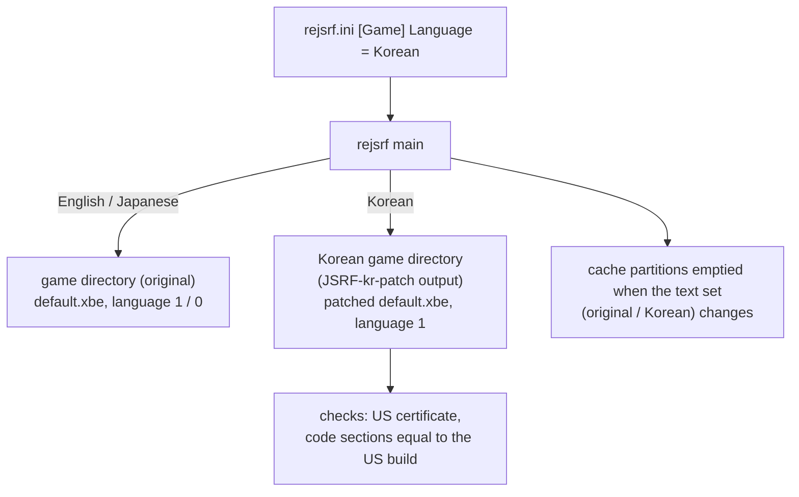

# 설계: 영어·일본어와 함께 한국어 (issue #113)

상태: **구현됨**(사용자 결정 §7). 작업 로그: [20261023-i113](../work-logs/20261023-i113-korean-language.md) · 작업 지시: [20261023-i113](../work-orders/20261023-i113-korean-language.md)

근거: [JSRF-kr-patch](https://github.com/nworkers/JSRF-kr-patch) v0.0.12의 [reJSRF 인계 문서](https://github.com/nworkers/JSRF-kr-patch/blob/main/docs/handoff-rejsrf.md)와 [영문 모드 기반 설계 i020](https://github.com/nworkers/JSRF-kr-patch/blob/main/docs/design/20261023-i020-english-base.md), reJSRF [언어 설정 i104](20261020-i104-language-option.md), [한국어 패치 검토 i105](20261020-i105-korean-patch-review.md).

## 1. 요구

* 게임 언어에 **한국어**를 더한다. 영어와 일본어는 그대로 고를 수 있어야 한다(사용자 요청).
* 한국어 문장과 글꼴은 JSRF-kr-patch가 만든다. reJSRF 저장소에는 게임 데이터, 원문, 패치된 결과물을 넣지 않는다.

## 2. 확인한 것

* **패치는 영어 모드 기반이다**(JSRF-kr-patch v0.0.12, issue #20). US판 `default.xbe`를 언어 1(영어)로 돌리고, 영어 문장 자리에 한국어를 쓴다. 그림 자산은 영어판이다. 결과물은 사용자 덤프에 `tools/patch.py`를 돌려 만드는 **패치된 게임 폴더**다.
* **패치된 XBE는 데이터만 바뀐다**(우리 비교, `out/jsrf-kr-en/default.xbe`과 US판 원본):

| 섹션 | 차이 |
|---|---|
| `.text`, `D3D`, `DSOUND`, `MMATRIX`, `XGRPH`, `XPP`, `DOLBY`, `$$XTIMAGE`, `$$XSIMAGE` | 0바이트 |
| `.rdata` | 12,507바이트(683곳): 한국어 문자열 |
| `.data` | 3,704바이트(1,911곳): 문자열 포인터 칸, 글리프 표 `0x1F7088`, 부류 순번 `0x1F8B80` |
| `KRTEXT`(새 섹션, VA `0x289000`, 0x47C바이트) | 길어진 문자열 |

  * reJSRF는 원본 US판에서 lift한 코드를 실행하므로, 코드가 바뀌는 패치는 반영되지 않는다. 지금 패치는 코드를 바꾸지 않으므로 **패치된 XBE를 그대로 올리면 lift된 코드가 한국어 데이터를 읽는다**.
  * 인증서가 US판과 같아서 reJSRF가 US판으로 알아보고 실행한다. 패치 저장소에서 확인된 사실이다(`rejsrf.exe out/jsrf-kr-en`).
* **글꼴은 언어별로 갈린다.** 한국어 패치는 2바이트 글리프 표와 `jetfont.dat`의 2바이트 칸을 한글로 바꾼다. 그래서 같은 데이터로 일본어(한자·가나)를 보일 수 없다. 한국어는 패치된 XBE와 `Media`, 영어·일본어는 원본을 써야 한다.
* **`Media`는 HDD에 캐시된다.** 게임은 `Media` 파일을 처음 읽을 때 `Z:\Media\…`(`hdd/Partition5`, 지금 약 99 MB, 248개 파일)에 복사하고, 그 뒤로는 캐시를 읽는다. 한국어 패치는 이벤트·대화·미션 파일을 바꾸므로, 캐시를 나누지 않으면 언어를 바꾼 뒤에도 이전 언어의 파일이 읽힌다. 저장 데이터는 `Partition1`(E:)에 있어 영어 모드끼리 같은 형식이다.
* **패치 폴더의 디스크 비용**: `patch.py --link`는 바뀌지 않은 파일을 하드 링크로 두고, 바뀐 566개 파일만 새로 쓴다.
* 일본판 빌드(`REJSRF_VARIANT=jsrf_jp`)는 일본판 XBE에서 lift했다. 한국어 패치는 US판 기반이므로 일본판 빌드에서는 한국어를 낼 수 없다.

## 3. 방안 비교

| 방안 | 내용 | 판단 |
|---|---|---|
| **A. 패치된 게임 폴더를 한국어로 실행** | Language = Korean이면 앱이 한국어 폴더(패치 결과)를 디스크(D:)로 쓰고 그 `default.xbe`를 올린다. 언어 인덱스는 1(영어) | **권장**. reJSRF에 패치 로직이 없다. 패치 저장소가 바뀌어도(번역 수정) 폴더만 다시 만들면 된다 |
| B. 패치 데이터(`patch/*.tsv` 등)를 reJSRF가 실행 중에 적용 | 메시지 스크립트 재구성, 미션 포인터, XBE 칸, 글꼴 생성을 C++로 다시 구현 | 기각. 패치 도구 전체를 둘로 유지하게 된다 |
| C. 바뀐 파일만 담은 폴더 + 파일 계층 overlay | rexbox VFS에 덮어쓰기 폴더 기능을 더한다 | 지금은 기각. `--link`로 디스크 비용이 거의 없어 rexbox를 바꿀 이유가 약하다 |

## 4. 구조(방안 A)

* **언어**
  * `Language`에 `Korean`을 더한다. 게임에 쓰는 인덱스는 1(영어)이고, 한국어 폴더를 쓴다는 점만 다르다.
  * 설정 메뉴 Game 탭과 `REJSRF_LANGUAGE`에 `Korean`을 더한다. 메뉴 글꼴(ImGui 기본)에 한글이 없으므로 표기는 영어(`Korean`)로 한다.
  * 일본판 빌드에서는 고를 수 없다(위 §2).
* **한국어 폴더**(§7-1): 명령줄 `--korean <폴더>`, 없으면 `rejsrf.ini [Game] KoreanGameDirectory`, 둘 다 없으면 게임 폴더 옆의 `<게임 폴더 이름>-kr`. 앱은 시작할 때 다음을 확인한다. 하나라도 어긋나면 그 실행은 영어로 시작하고, stderr와 설정 메뉴에 이유를 보인다.
  1. 폴더와 `default.xbe`가 있다.
  2. 인증서가 US판이다(`IdentifyXbe`).
  3. 실행 섹션(`.text`와 XDK 라이브러리 섹션)의 바이트가 US판과 같다. 섹션 원시 바이트의 64비트 FNV-1a 해시를 프로파일에 적어 둔 US판 값과 비교한다(해시만, 원본 바이트 없음). 머리의 요약값은 패치 도구가 다시 쓰는 값이므로 쓰지 않는다. 코드가 바뀐 패치는 lift된 코드와 맞지 않으므로 거부한다.
  4. 데이터 섹션(`.rdata`, `.data`) 해시가 원본과 **다르다**. 같으면 패치하지 않은 폴더다.
* **거꾸로 된 경우**: 사용자가 패치된 폴더를 바로 게임 폴더로 주면(지금도 가능), 앱이 그 XBE를 한국어 패치로 알아본다(위 검사 2~4를 통과). 그 실행은 언어를 Korean으로 정하고, 일본어는 고를 수 없다고 메뉴에 보인다. 글꼴이 바뀐 상태에서 일본어를 고르면 글자가 깨지기 때문이다.
* **HDD 캐시**(§7-2): 앱이 `<hdd root>/rejsrf_cache_text.txt`에 캐시를 채운 문장 세트(`original` 또는 `korean`)를 적는다. 시작할 때 이번 실행의 세트와 다르거나 표시 파일이 없으면, 커널을 초기화하기 전에 캐시 파티션 `Partition3`~`Partition5`의 내용을 비우고 표시 파일을 고친다. 이 세 파티션은 Xbox에서 타이틀 캐시 전용이고, 게임이 비어 있으면 다시 채운다. 저장 데이터(`Partition1`)는 건드리지 않는다. 영어↔일본어는 같은 원본 파일을 쓰므로 비우지 않는다.
  * 실제 기기·에뮬레이터에서 사용자가 캐시를 지우는 것과 같은 일이다. 캐시 드라이브는 타이틀 ID로 나뉘는데, 패치판과 원본은 타이틀 ID가 같기 때문이다.
  * 전환한 뒤 첫 실행은 다시 캐시한다(지금 약 99 MB).
* **바꾸지 않는 것**: lift된 코드, 생성 파이프라인, rexbox.

## 5. 검증

1. 설정
   * Game 탭에 English / Japanese / Korean이 있다.
   * Korean을 고르면 "Restart to apply."가 보이고 `rejsrf.ini`에 `Language = Korean`이 저장된다.
   * 일본판 빌드에는 Korean이 없다.
2. 한국어 실행(패치 폴더는 JSRF-kr-patch v0.0.12 `tools/patch.py --link`로 만든다)
   * 부팅하고 데모가 돈다.
   * Press Start 뒤 메뉴, 차고의 로보이 대사, 첫 미션 목표가 한국어로 나온다(창 캡처, 사용자 확인).
3. 전환: 영어 → 한국어 → 영어 → 일본어 순서로 실행했을 때, 각 실행의 이벤트 문장이 그 언어로 나온다(캐시 분리 확인). 저장 데이터는 그대로 남는다.
4. 거부
   * 한국어 폴더가 없으면 영어로 시작하고 이유를 보인다.
   * 코드 섹션이 다른 XBE(시험용으로 `.text` 1바이트를 바꾼 사본)를 거부한다.
5. 회귀: 영어·일본어 기본 실행의 데모 프레임 300~1800이 v0.0.48과 바이트 단위로 같다. rexbox probe, `rejsrf_decomp_check`, `rejsrf_d3d8_check`를 돌린다.

## 6. 위험

* 패치 저장소가 앞으로 코드(`.text`)를 바꾸는 패치를 만들면 §4의 검사가 그 폴더를 거부한다. 그때는 해당 함수를 reJSRF에서 디컴파일해 바꾸는 방식(패치 계획 §8)이 필요하다.
* 영어 모드의 문장 배치(줄 폭, 그래피티 이름 배율)는 패치 저장소의 화면 확인 범위를 따른다. reJSRF 쪽 문제가 아닌 표시 문제는 패치 저장소에 issue로 넘긴다.
* 한국어 폴더도 게임 데이터이므로 사용자가 직접 만든다. 저장소와 배포물에는 넣지 않는다.

## 7. 결정(2026-10-23, 사용자)

1. **한국어 폴더 위치: (c)**
   * (a) `rejsrf.ini [Game] KoreanGameDirectory`. 비어 있으면 게임 폴더 옆의 `<게임 폴더 이름>-kr`을 찾는다.
   * (b) 명령줄 `--korean <폴더>`만 쓴다.
   * (c) 둘 다 쓰고 명령줄이 우선한다.
2. **HDD 캐시 분리: (B)**. (A)는 Xbox 동작을 재현하는 기능이 아니고 이 게임 하나의 사정으로 공용 런타임에 호스트 쪽 조정 장치를 더하는 일이라 고르지 않았다(사용자 지적).
   * (A) rexbox 커널 설정에 파티션별 폴더 지정을 더하고(rexbox 저장소 작업), 한국어는 캐시 파티션을 `hdd/Partition5-ko`로 쓴다. 언어를 바꿔도 다시 캐시하지 않는다.
   * (B) 앱이 캐시에 표시 파일을 두고, 문장 세트(원본/한국어)가 바뀌면 `Partition5/Media`를 비운다. rexbox 변경은 없지만, 언어를 바꾼 뒤 첫 실행은 다시 캐시한다(약 99 MB 복사).

---

# Design: Korean beside English and Japanese (issue #113)

Status: **implemented** (user decisions, §7). Work log: [20261023-i113](../work-logs/20261023-i113-korean-language.md) · Work order: [20261023-i113](../work-orders/20261023-i113-korean-language.md)

Basis: [JSRF-kr-patch](https://github.com/nworkers/JSRF-kr-patch) v0.0.12's [handoff to reJSRF](https://github.com/nworkers/JSRF-kr-patch/blob/main/docs/handoff-rejsrf.md) and [English-mode design i020](https://github.com/nworkers/JSRF-kr-patch/blob/main/docs/design/20261023-i020-english-base.md); reJSRF's [language setting i104](20261020-i104-language-option.md) and [Korean patch review i105](20261020-i105-korean-patch-review.md).

## 1. Requirement

* Add **Korean** to the game languages; English and Japanese stay selectable (user request).
* JSRF-kr-patch makes the Korean text and font. reJSRF's repository holds no game data, original text or patched output.

## 2. Findings

* **The patch is English-mode based** (JSRF-kr-patch v0.0.12, issue #20): the US `default.xbe` runs with language 1 (English), and Korean is written where English text sits; picture assets are the English ones. The deliverable is a **patched game folder**, made by running `tools/patch.py` on the user's dump.
* **The patched XBE changes data only** (our comparison of `out/jsrf-kr-en/default.xbe` with the US original):
  * `.text` and the library sections (`D3D`, `DSOUND`, `MMATRIX`, `XGRPH`, `XPP`, `DOLBY`, `$$XTIMAGE`, `$$XSIMAGE`): 0 bytes differ.
  * `.rdata`: 12,507 bytes in 683 places, the Korean strings.
  * `.data`: 3,704 bytes in 1,911 places: string pointer slots, the glyph table `0x1F7088` and the class first indexes `0x1F8B80`.
  * A new section `KRTEXT` (VA `0x289000`, 0x47C bytes) holds the strings that grew.

  reJSRF runs code lifted from the original US build, so a patch that changes code would not take effect. This patch changes none, so **loading the patched XBE as it is makes the lifted code read the Korean data**. Its certificate is the US build's, so reJSRF identifies and runs it; the patch repository confirmed this (`rejsrf.exe out/jsrf-kr-en`).
* **The font splits by language.** The Korean patch replaces the double-byte glyph table and `jetfont.dat`'s double-byte cells with Hangul, so the same data cannot show Japanese (kanji, kana). Korean needs the patched XBE and `Media`; English and Japanese need the originals.
* **`Media` is cached on the HDD.** The game copies a `Media` file to `Z:\Media\…` (`hdd/Partition5`, now about 99 MB in 248 files) the first time it reads it, and reads the cache afterwards. The Korean patch changes event, talk and mission files, so without separate caches a run after a language change would read the previous language's files. Saves live in `Partition1` (E:) and share one format in English mode.
* **The patch folder's disk cost**: `patch.py --link` hard-links unchanged files and writes only the 566 changed ones.
* The Japanese build (`REJSRF_VARIANT=jsrf_jp`) is lifted from the Japanese XBE. The Korean patch is based on the US build, so the Japanese build cannot show Korean.

## 3. Options

| Option | Content | Decision |
|---|---|---|
| **A. Run the patched game folder for Korean** | with Language = Korean the app serves the Korean folder (the patch output) as the disc (D:) and loads its `default.xbe`; the language index is 1 (English) | **recommended**: reJSRF holds no patch logic, and a new translation only means rebuilding the folder |
| B. Apply the patch data (`patch/*.tsv` and so on) at run time | reimplement the message-script rebuild, mission pointers, XBE slots and font generation in C++ | rejected: two copies of the whole patcher to maintain |
| C. A folder of changed files only + a file-layer overlay | add an overlay folder to rexbox's VFS | rejected for now: with `--link` the disk cost is near zero, so there is little reason to change rexbox |

## 4. Structure (option A)

(Diagram above.)

* **Language**
  * `Language` gains `Korean`. The index it writes into the game is 1 (English); what differs is that it uses the Korean folder.
  * The settings menu's Game tab and `REJSRF_LANGUAGE` gain `Korean`. The menu font (ImGui's default) has no Hangul, so the label is English (`Korean`).
  * Not available in the Japanese build (§2).
* **Korean folder** (§7-1): the command line `--korean <folder>`, else `rejsrf.ini [Game] KoreanGameDirectory`, else `<game folder name>-kr` beside the game folder. At start the app checks the following. If any check fails, that run starts in English and the reason shows on stderr and in the settings menu.
  1. The folder and its `default.xbe` exist.
  2. The certificate is the US build's (`IdentifyXbe`).
  3. The executable sections (`.text` and the XDK library sections) hold the US build's bytes: a 64-bit FNV-1a hash of each section's raw bytes is compared with the US value kept in the profile (hashes only, no original bytes). The header digests are not used, since the patcher rewrites them. A patch that changes code would not match the lifted code, so it is refused.
  4. The data sections' (`.rdata`, `.data`) hashes **differ** from the original's; equal ones mean an unpatched folder.
* **The other way round**: if the user passes the patched folder as the game folder directly (possible today), the app recognizes its XBE as the Korean patch (it passes checks 2-4 above). That run's language becomes Korean, and the menu shows that Japanese is unavailable, because Japanese would show broken characters with the font replaced.
* **HDD cache** (§7-2): the app records in `<hdd root>/rejsrf_cache_text.txt` which text set (`original` or `korean`) filled the cache. At start, when this run's set differs or the marker is missing, it empties the cache partitions `Partition3`-`Partition5` before the kernel starts and updates the marker. On the Xbox these three partitions hold title caches only, and the game refills them when empty. Saves (`Partition1`) are left alone. English and Japanese read the same original files, so switching between them empties nothing.
  * This is what users do by hand on hardware and emulators: cache drives are assigned by title ID, and the patched and original builds share one.
  * The first run after a switch caches again (about 99 MB today).
* **Unchanged**: the lifted code, the generation pipeline and rexbox.

## 5. Verification

1. Settings
   * The Game tab offers English, Japanese and Korean.
   * Choosing Korean shows "Restart to apply." and saves `Language = Korean` to `rejsrf.ini`.
   * The Japanese build has no Korean.
2. A Korean run (the patch folder made with JSRF-kr-patch v0.0.12 `tools/patch.py --link`)
   * It boots and the demo runs.
   * The menus after Press Start, Roboy's line in the garage and the first mission objective show Korean (window captures, user check).
3. Switching: run English → Korean → English → Japanese; each run's event text is in its language (the caches are separate), and the saves remain.
4. Refusals
   * Without a Korean folder the run starts in English and says why.
   * An XBE whose code sections differ (a test copy with one `.text` byte changed) is refused.
5. Regression: the English and Japanese default runs' demo frames 300-1800 equal v0.0.48 byte for byte; run the rexbox probes, `rejsrf_decomp_check` and `rejsrf_d3d8_check`.

## 6. Risks

* If the patch repository later patches code (`.text`), §4's check refuses that folder. Then the affected function must be decompiled and replaced in reJSRF (the patch plan's §8).
* English-mode text layout (line widths, the graffiti-name scale) follows the patch repository's screen checks. A display problem that is not reJSRF's goes to the patch repository as an issue.
* The Korean folder is game data too, so users make it themselves; it never goes into the repository or a release.

## 7. Decisions (2026-10-23, user)

1. **Where the Korean folder is: (c)**
   * (a) `rejsrf.ini [Game] KoreanGameDirectory`; when empty, `<game folder name>-kr` beside the game folder.
   * (b) The command line `--korean <folder>` only.
   * (c) Both, the command line winning.
2. **Separating the HDD cache: (B)**. (A) was not chosen: it reproduces no Xbox behavior, and would add a host-side knob to the shared runtime for one game's sake (the user's point).
   * (A) Add per-partition folders to rexbox's kernel configuration (a rexbox repository task), and give Korean the cache partition `hdd/Partition5-ko`; switching languages never re-caches.
   * (B) The app keeps a marker file in the cache and empties `Partition5/Media` when the text set (original/Korean) changes; no rexbox change, but the first run after a switch caches again (about 99 MB copied).
