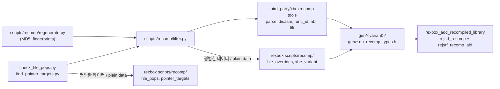

# 설계: lifter 파이프라인을 reJSRF로 (issue #117)

상태: **구현됨**. 작업 지시: [20261024-i117](../work-orders/20261024-i117-lifter-pipeline.md) · 작업 로그: [20261024-i117](../work-logs/20261024-i117-lifter-pipeline.md)

선행: [rexbox 설계 i026 xboxrecomp 의존 제거](../../third_party/rexbox/docs/design/20261024-i026-drop-xboxrecomp.md), [i115 xboxrecomp v0.16.0](20261023-i115-xboxrecomp-v0.16.md), [i102 rexbox submodule](20261022-i102-rexbox-submodule.md)

## 1. 요구

* rexbox issue [reexec/rexbox#26](https://github.com/reexec/rexbox/issues/26)을 따른다. rexbox는 xboxrecomp를 갖지도 알지도 않는다.
  * 지워진 것: CMake 변수 `REXBOX_XBOXRECOMP_DIR`, ABI 헤더 해시 확인, 라이선스 가드(`rexbox_check_license`, `REXBOX_COPYLEFT_PATHS`, `cmake/rexbox_license.cmake`), rexbox의 xboxrecomp submodule, `scripts/recomp/regenerate.py`, `check_hle_pops.py`, `find_pointer_targets.py`.
  * 바뀐 것: `rexbox_add_recompiled_library`가 `src/recomp/recomp_abi.c`를 OBJECT 타깃 `<target>_abi`에서 lifter가 `GEN_DIR`에 쓴 `recomp_types.h`로 컴파일한다.
  * 남은 것(평범한 데이터만 받는 도우미, `third_party/rexbox/scripts/recomp/`): `hle_overrides.py`, `hle_pops.py`, `pointer_targets.py`, `xbe_variant.py`.
* reJSRF는 lifter를 실행하고 그 출력을 읽는 코드를 가진다. 생성 코드는 바뀌지 않아야 한다.

## 2. 설계

### 2.1 `scripts/recomp/lifter.py`와 rexbox 도우미

| 곳 | 가진 것 |
|---|---|
| `lifter.py`(reJSRF) | xboxrecomp 다섯 단계(parse, disasm, func_id, abi, lift)를 이 저장소의 `third_party/xboxrecomp`(fork `nworkers/xboxrecomp`, `rejsrf`)로 실행. 출력 읽기: `disasm/functions.json` → 함수 시작(`function_starts`), `/* ret N */` → `lifted_rets`, `recomp_dispatch.c` → `lifted_addresses`. 심볼 이름: `entry_name` `sub_%08X`, `lifted_name` `sub_%08X_gen`. seed 수집, 덮어쓰기 소스 수집(`--exclude-manual`), 체크아웃 깨끗함 확인, CLI |
| `hle_overrides.py`(rexbox) | `find_symbol_tool`, `identify_symbols`(`rexbox_xdk_symbols` 실행), `write_hle_overrides(symbols, function_starts, out_dir, hle_libraries, entry_name, lifted_name)` |
| `hle_pops.py`(rexbox) | `xdk_function_names`, `hle_pop_counts`(HLE export의 pop 수), `compare_pops` |
| `pointer_targets.py`(rexbox) | `scan`(XBE 휴리스틱), `print_candidates`, `merge_seeds` |
| `xbe_variant.py`(rexbox) | XBE MD5로 판 확인 |

* `regenerate.py`는 판 식별과 지문 확인 뒤 rexbox `regenerate.run` 대신 `lifter.run`을 부른다.
* `check_hle_pops.py`는 `lifter.lifted_rets` + rexbox `hle_pops`, `find_pointer_targets.py`는 `lifter.lifted_addresses` + rexbox `pointer_targets`, `xbe_variant`를 쓴다.

### 2.2 CMake

* 루트 `CMakeLists.txt`에서 `REXBOX_XBOXRECOMP_DIR`를 지운다. `third_party/xboxrecomp`의 존재 확인은 경로로 남긴다(파이프라인이 쓴다).
* `rexbox_check_license` 호출을 `CMakeLists.txt`(`rejsrf_game`, `rejsrf`)와 `tools/CMakeLists.txt`(`rejsrf_decomp_check`, `rejsrf_d3d8_check`)에서 지운다. 그대로 두면 configure가 실패한다.
* `recomp_abi.c`는 `rejsrf_recomp_abi`에서 `gen/<변형>/gen/recomp_types.h`로 컴파일된다. 생성 코드와 같은 헤더라 해시 확인이 필요 없다.

### 2.3 라이선스 규칙

* reJSRF에 가드 코드를 두지 않는다(결정).
* 우리 타깃이 컴파일하는 xboxrecomp 유래 파일은 생성 코드와 그 옆의 MIT 헤더(`gen/.../recomp_types.h`)뿐이다. xboxrecomp 체크아웃은 Python 파이프라인으로만 쓰고, 어떤 타깃도 그 안의 경로를 include하거나 컴파일하지 않는다.
* 규칙(AGENTS.md): LGPL 파일(`src/apu/*`, `src/nv2a/nv2a_core.c`, `src/nv2a/nv2a_regs.h`, `src/nv2a/nv2a_state.h`, `include/xbox/xboxrecomp.h`)은 어떤 소스 목록에도 넣지 않는다.

## 3. 범위 밖

* 생성 코드 내용과 ABI: 바뀌지 않는다. 사용자는 다시 생성할 필요가 없다.
* xboxrecomp fork와 그 핀: 그대로다.

## 4. 검증

| 검증 | 기대 |
|---|---|
| 재생성(미국판, 일본판) | 변경 전 기준 출력과 lift된 C가 바이트 단위로 같다. 다른 것은 경로·시각·생성기 이름뿐이다 |
| `check_hle_pops.py --all`, `find_pointer_targets.py` | 기준 출력과 같다 |
| Release 빌드 | `rejsrf_recomp_abi` 경고 0, `rejsrf.exe`와 검사 도구 링크 |
| 검사 도구 | `rejsrf_decomp_check`, `rejsrf_d3d8_check` 차이 0 |
| 실행 | 부팅하고 프레임 루프가 돈다 |

---

# Design: the lifter pipeline moves to reJSRF (issue #117)

Status: **implemented**. Work order: [20261024-i117](../work-orders/20261024-i117-lifter-pipeline.md) · Work log: [20261024-i117](../work-logs/20261024-i117-lifter-pipeline.md)

Before: [rexbox design i026, dropping xboxrecomp](../../third_party/rexbox/docs/design/20261024-i026-drop-xboxrecomp.md), [i115 xboxrecomp v0.16.0](20261023-i115-xboxrecomp-v0.16.md), [i102 rexbox submodule](20261022-i102-rexbox-submodule.md)

## 1. Requirement

* Follow rexbox issue [reexec/rexbox#26](https://github.com/reexec/rexbox/issues/26): rexbox neither holds nor knows xboxrecomp.
  * Removed: the CMake variable `REXBOX_XBOXRECOMP_DIR`, the ABI header hash check, the license guard (`rexbox_check_license`, `REXBOX_COPYLEFT_PATHS`, `cmake/rexbox_license.cmake`), rexbox's xboxrecomp submodule, `scripts/recomp/regenerate.py`, `check_hle_pops.py` and `find_pointer_targets.py`.
  * Changed: `rexbox_add_recompiled_library` compiles `src/recomp/recomp_abi.c` in the OBJECT target `<target>_abi` against the `recomp_types.h` the lifter wrote into `GEN_DIR`.
  * Kept (helpers that take plain data only, `third_party/rexbox/scripts/recomp/`): `hle_overrides.py`, `hle_pops.py`, `pointer_targets.py`, `xbe_variant.py`.
* reJSRF holds the code that runs the lifter and reads its output. The generated code must not change.

## 2. Design

### 2.1 `scripts/recomp/lifter.py` and the rexbox helpers

| Where | What |
|---|---|
| `lifter.py` (reJSRF) | runs xboxrecomp's five steps (parse, disasm, func_id, abi, lift) from this repository's `third_party/xboxrecomp` (fork `nworkers/xboxrecomp`, `rejsrf`). Reads its output: `disasm/functions.json` → function starts (`function_starts`), `/* ret N */` → `lifted_rets`, `recomp_dispatch.c` → `lifted_addresses`. Owns the symbol names: `entry_name` `sub_%08X`, `lifted_name` `sub_%08X_gen`. Seed collection, override sources (`--exclude-manual`), the clean-checkout check, the CLI |
| `hle_overrides.py` (rexbox) | `find_symbol_tool`, `identify_symbols` (runs `rexbox_xdk_symbols`), `write_hle_overrides(symbols, function_starts, out_dir, hle_libraries, entry_name, lifted_name)` |
| `hle_pops.py` (rexbox) | `xdk_function_names`, `hle_pop_counts` (the HLE exports' pop counts), `compare_pops` |
| `pointer_targets.py` (rexbox) | `scan` (the XBE heuristic), `print_candidates`, `merge_seeds` |
| `xbe_variant.py` (rexbox) | the build check by XBE MD5 |

* After build identification and the fingerprint check, `regenerate.py` calls `lifter.run` instead of rexbox's `regenerate.run`.
* `check_hle_pops.py` uses `lifter.lifted_rets` with rexbox's `hle_pops`; `find_pointer_targets.py` uses `lifter.lifted_addresses` with rexbox's `pointer_targets` and `xbe_variant`.

The diagram above applies.

### 2.2 CMake

* The root `CMakeLists.txt` drops `REXBOX_XBOXRECOMP_DIR`; the existence check of `third_party/xboxrecomp` stays, by path (the pipeline uses it).
* The `rexbox_check_license` calls go from `CMakeLists.txt` (`rejsrf_game`, `rejsrf`) and `tools/CMakeLists.txt` (`rejsrf_decomp_check`, `rejsrf_d3d8_check`); left in place they would fail the configure.
* `recomp_abi.c` compiles in `rejsrf_recomp_abi` against `gen/<variant>/gen/recomp_types.h`, the generated code's own header, so no hash check is needed.

### 2.3 The license rule

* No guard code in reJSRF (the decision).
* The only xboxrecomp-derived files our targets compile are the generated code and the MIT header next to it (`gen/.../recomp_types.h`). The xboxrecomp checkout is used only as the Python pipeline; no target includes or compiles a path inside it.
* The rule (AGENTS.md): the LGPL files (`src/apu/*`, `src/nv2a/nv2a_core.c`, `src/nv2a/nv2a_regs.h`, `src/nv2a/nv2a_state.h`, `include/xbox/xboxrecomp.h`) are never added to a source list.

## 3. Out of scope

* The generated code and the ABI: unchanged. Users need not regenerate.
* The xboxrecomp fork and its pin: unchanged.

## 4. Verification

| Check | Expected |
|---|---|
| Regeneration (US, Japanese) | the lifted C equals a baseline made before the change byte for byte; only paths, times and generator names differ |
| `check_hle_pops.py --all`, `find_pointer_targets.py` | output equals the baseline |
| Release build | `rejsrf_recomp_abi` with zero warnings; `rejsrf.exe` and the check tools link |
| Check tools | `rejsrf_decomp_check`, `rejsrf_d3d8_check` with 0 differences |
| Run | boots, and the frame loop runs |
