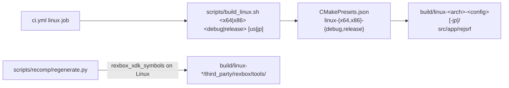

# 설계: Linux x64 / x86 앱 (issue #119)

상태: **승인됨**(사용자 결정 §6). 작업 지시: [20261025-i119](../work-orders/20261025-i119-linux.md)

근거: rexbox [설계 i004 Linux 준비](../../third_party/rexbox/docs/design/20261020-i004-linux-preparation.md)(POSIX 플랫폼 계층, 프리셋, Linux CI), [프로젝트 헌장](../PROJECT_CHARTER.md)(Win32 x86 다음 Win64, Linux x86/x64).

## 1. 요구

* reJSRF를 Linux x64와 x86(`-m32`)에서 빌드하고 실행한다(사용자 요청).
* Win32와 같은 절차를 갖춘다: 재생성, 빌드, 검사 도구, CI, 가이드.

## 2. 확인한 것(시험, 코드 수정 없음)

환경: WSL2 Ubuntu 24.04, GCC 13.3, CMake 3.28, Ninja. 소스는 `/mnt/e/…`, 빌드 폴더는 WSL 쪽 디스크. `gen/`은 Windows에서 만든 것을 그대로 썼다.

| 확인 | x64 Release | x86(`-m32`) Release |
|---|---|---|
| configure·빌드 | 오류 0, 경고 2(둘 다 rexbox: `kernel_timer.cpp:145` `-Wformat-truncation`, `tools/xdk_symbols/main.cpp:10` `-Wunused-variable`) | 같음 |
| rexbox probe | 94/55/220 실패 0 | (빌드됨) |
| `rejsrf_decomp_check` / `rejsrf_d3d8_check` | 129 차이 0 / 14,018 차이 0 | (빌드됨) |
| 데모(숨긴 창, 45초) | 파일 열기 2,315개가 Windows 기준과 순서까지 같다. 프레임 300~1800은 픽셀값 차이 평균 0.04 이하, 최대 6/255(렌더러 반올림) | 파일 열기 처음 2,315개가 같다. 프레임은 x64 Linux와 바이트 단위로 같다 |

* 생성 코드의 ABI 헤더는 이미 GCC·Clang 분기(`__thread`, `__atomic`, `__sync`)를 갖고 있다. reJSRF 쪽 Windows 전용 코드는 `src/app`의 `_WIN32` 분기 두 곳뿐이고, 둘 다 Linux 분기가 있다.
* WSL의 기본 GL은 소프트웨어 렌더러(llvmpipe)다. `GALLIUM_DRIVER=d3d12`를 주면 Mesa의 D3D12 드라이버로 GPU(RTX 4090)를 쓴다. 일반 Linux 데스크톱은 자기 드라이버를 쓴다.
* `.gitattributes`가 `*.sh`를 LF로 고정하므로 Windows 체크아웃의 셸 스크립트도 Linux에서 돈다.

## 3. 할 일

* **빌드 진입점**
  * `CMakePresets.json`: `linux-x64-debug`, `linux-x64-release`, `linux-x86-debug`, `linux-x86-release`(rexbox와 같은 이름과 플래그, Ninja). 빌드 폴더는 `build/<preset>/`.
  * `scripts/build_linux.sh <x64|x86> <debug|release> [us|jp] [target…]`: configure와 빌드. `jp`는 `-DREJSRF_VARIANT=jsrf_jp`, 빌드 폴더 `build/<preset>-jp/`(Win32의 `build\win32_x86_jp`와 같은 규칙).
* **재생성**: `regenerate.py`의 `rexbox_xdk_symbols` 후보에 Linux 빌드 폴더를 더한다. Linux에서 재생성한 결과가 Windows 결과와 같은지 확인한다(`--gen-root`로 다른 폴더에 만들어 비교).
* **CI**: `ci.yml`에 `linux` 작업을 더한다. 생성 코드 없는 빌드, rexbox probe(`ctest`), 앱 smoke(잘못된 인자에 종료 코드 1). 범위는 x64·x86 × Debug·Release(§6-1).
* **문서**
  * 가이드 `docs/guides/linux-setup-and-build.md`(새): 패키지, 재생성, 빌드, 실행, 검사 도구, WSL의 GPU(`GALLIUM_DRIVER=d3d12`), 설정 파일 위치(실행 파일 옆, 안 되면 `~/.local/share/reJSRF/reJSRF/`)
  * `README.md` 플랫폼 상태, `ARCHITECTURE.md` 빌드 구성
* **rexbox 경고 2개**: rexbox에서 고치고 submodule을 올린다(§6-2).
* **바꾸지 않는 것**: 앱·게임·생성 코드(시험에서 수정이 필요 없었다). 문제가 나오면 그때 고친다.

## 4. 검증

1. Linux x64·x86 Debug/Release 빌드: 오류 0, 경고는 §6-2 결정대로.
2. probe, `rejsrf_decomp_check`, `rejsrf_d3d8_check`: x64·x86 모두 실패·차이 0.
3. 재생성(Linux): 미국판·일본판 결과가 Windows 결과와 같다(xboxrecomp 경로 문자열 같은 환경 차이는 원인을 적는다).
4. 데모: 미국판·일본판 빌드의 파일 열기 순서가 Windows 기준과 같다. 프레임은 렌더러 차이만(반올림 수준).
5. 보이는 창(WSLg, `GALLIUM_DRIVER=d3d12`): 창, 설정 메뉴(Tab), 키보드 입력으로 메인 메뉴와 차고 대화까지, 소리(PulseAudio). 한국어 폴더로 한국어 실행.
6. CI: PR에서 Linux 작업과 기존 Win32 작업 통과.

## 5. 위험

* `RaiseStop`(C++ 예외)이 생성 C 코드 프레임을 지나가려면 C 코드에 unwind 표가 있어야 한다. x86-64와 i386 Linux의 GCC는 기본으로 만든다. 데모 동안 게스트 스레드 종료가 문제 없었지만, 스레드가 끝나는 장면에서 다시 확인한다.
* WSLg와 실제 Linux 데스크톱(X11, Wayland)은 창·입력·오디오 경로가 다르다. 실제 Linux 하드웨어 확인은 이 작업 범위 밖이며 가이드에 적는다.
* 샘플링 프로파일러(`REXBOX_SAMPLE`)는 rexbox Linux에 아직 없다(진단 기능).

## 7. 태그 릴리스(사용자 추가 요청, 2026-10-25)

* `.github/workflows/release.yml`(rexbox의 것을 따름): `v*` 태그 push → 태그가 `VERSION`과 같고 `main` 위에 있는지 확인 → Win32 Debug·Release와 Linux x64·x86 × debug·release에서 CI와 같은 빌드·probe → `docs/release-notes/<tag>.md`가 있으면 그 본문으로 GitHub Release 생성. 소스만 붙인다(재생 가능한 빌드에는 사용자 게임 데이터가 필요하다).
* `AGENTS.md`에 규칙을 더했다: 릴리스 노트는 태그 push 전에 `main`에 있어야 한다.
* 확인: 워크플로는 태그 push로만 돌므로 PR의 CI로는 검증되지 않는다. 이 버전의 태그 `v0.0.52`를 사용자가 push할 때 첫 실행이 된다.

## 6. 결정(2026-10-25, 사용자)

1. **CI 범위: (a)**
   * (a) rexbox처럼 x64·x86 × Debug·Release 4개 작업. 일본판은 x64 Release에서 앱만 한 번 더 빌드한다.
   * (b) x64 Release 하나와 일본판 앱 빌드.
2. **rexbox의 GCC 경고 2개: (a)**
   * (a) rexbox 저장소에 issue를 내고 고친 뒤 submodule을 올린다(이 작업 안에서).
   * (b) rexbox issue만 남기고 이 작업은 경고를 기록만 한다.

---

# Design: the Linux x64 / x86 app (issue #119)

Status: **approved** (user decisions, §6). Work order: [20261025-i119](../work-orders/20261025-i119-linux.md)

Basis: rexbox [design i004, Linux preparation](../../third_party/rexbox/docs/design/20261020-i004-linux-preparation.md) (POSIX platform layer, presets, Linux CI); the [project charter](../PROJECT_CHARTER.md) (after Win32 x86: Win64, Linux x86/x64).

## 1. Requirement

* Build and run reJSRF on Linux x64 and x86 (`-m32`) (user request).
* Give it the same procedures as Win32: regeneration, build, check tools, CI, a guide.

## 2. Findings (trial, no code changed)

Environment: WSL2 Ubuntu 24.04, GCC 13.3, CMake 3.28, Ninja; sources on `/mnt/e/…`, build folders on WSL's own disk; the `gen/` made on Windows used as it is.

* **x64 Release**
  * Build: 0 errors, 2 warnings, both in rexbox (`kernel_timer.cpp:145` `-Wformat-truncation`, `tools/xdk_symbols/main.cpp:10` `-Wunused-variable`).
  * Tests: probes 94/55/220 with 0 failures; decomp check 129 and d3d8 check 14,018 cases with 0 differences.
  * Demo (hidden window, 45 s): the 2,315 file opens equal the Windows baseline in order. Frames 300-1800 differ by a mean pixel difference of 0.04 or less and at most 6/255 (renderer rounding).
* **x86 (`-m32`) Release**
  * The same build result.
  * Demo: the first 2,315 file opens are equal, and the frames are byte-identical to x64 Linux.
* The generated code's ABI header already has GCC/Clang branches (`__thread`, `__atomic`, `__sync`). reJSRF's only Windows-specific code is two `_WIN32` branches in `src/app`, both with Linux branches.
* WSL's default GL is a software renderer (llvmpipe). With `GALLIUM_DRIVER=d3d12`, Mesa's D3D12 driver uses the GPU (RTX 4090). A normal Linux desktop uses its own driver.
* `.gitattributes` pins `*.sh` to LF, so shell scripts from a Windows checkout run on Linux.

## 3. Work

(Diagram above.)

* **Build entry**
  * `CMakePresets.json`: `linux-x64-debug`, `linux-x64-release`, `linux-x86-debug`, `linux-x86-release` (the same names and flags as rexbox, Ninja); build folders `build/<preset>/`.
  * `scripts/build_linux.sh <x64|x86> <debug|release> [us|jp] [target…]`: configure and build. `jp` sets `-DREJSRF_VARIANT=jsrf_jp` with the build folder `build/<preset>-jp/` (the same rule as Win32's `build\win32_x86_jp`).
* **Regeneration**: `regenerate.py`'s `rexbox_xdk_symbols` candidates gain the Linux build folders. A regeneration on Linux is compared with the Windows one (made into another folder with `--gen-root`).
* **CI**: `ci.yml` gains a `linux` job: the build without generated code, the rexbox probes (`ctest`), the app smoke checks (exit code 1 for bad arguments). Its scope is x64 and x86 × Debug and Release (§6-1).
* **Documents**
  * A new guide, `docs/guides/linux-setup-and-build.md`: packages, regeneration, build, running, check tools, the GPU in WSL (`GALLIUM_DRIVER=d3d12`), where settings live (next to the executable, else `~/.local/share/reJSRF/reJSRF/`).
  * `README.md` platform status, `ARCHITECTURE.md` build configuration.
* **The two rexbox warnings**: fixed in rexbox, then the submodule moves (§6-2).
* **Unchanged**: the app, game and generated code (the trial needed no change); any problem found is fixed then.

## 4. Verification

1. Linux x64 and x86 Debug/Release builds: 0 errors; warnings as decided in §6-2.
2. The probes, `rejsrf_decomp_check` and `rejsrf_d3d8_check` on x64 and x86: 0 failures and differences.
3. Regeneration on Linux: the US and Japanese results equal the Windows ones (any environment difference, such as path strings, is explained).
4. The demo: the US and Japanese builds' file-open sequences equal the Windows baselines; frames differ only by renderer rounding.
5. A visible window (WSLg, `GALLIUM_DRIVER=d3d12`): the window, the settings menu (Tab), keyboard input through the main menu to the garage dialogue, sound (PulseAudio); a Korean run with the Korean folder.
6. CI: the Linux jobs and the existing Win32 jobs pass on the pull request.

## 5. Risks

* For `RaiseStop` (a C++ exception) to pass through generated C frames, the C code needs unwind tables. GCC emits them by default on x86-64 and i386 Linux. Guest threads ended without trouble during the demo; a scene where threads end is checked again.
* WSLg and a real Linux desktop (X11, Wayland) take different window, input and audio paths. Real Linux hardware is outside this task and is noted in the guide.
* The sampling profiler (`REXBOX_SAMPLE`) does not exist on rexbox's Linux yet (a diagnostic).

## 7. Tag releases (added at the user's request, 2026-10-25)

* `.github/workflows/release.yml`, after rexbox's: a pushed `v*` tag → the tag must equal `VERSION` and sit on `main` → the CI build and probes on Win32 Debug/Release and Linux x64/x86 × debug/release → when `docs/release-notes/<tag>.md` exists, a GitHub Release with it as the body. Source only (a playable build needs the user's game data).
* `AGENTS.md` gains the rule: the release note must be on `main` before the tag is pushed.
* Verification: the workflow runs only on a tag push, so a pull request's CI does not exercise it; its first run is when the user pushes this version's tag `v0.0.52`.

## 6. Decisions (2026-10-25, user)

1. **CI scope: (a)**
   * (a) Four jobs like rexbox: x64 and x86 × Debug and Release, plus one more app build of the Japanese variant on x64 Release.
   * (b) x64 Release only, plus the Japanese app build.
2. **The two GCC warnings in rexbox: (a)**
   * (a) File a rexbox issue, fix it there and move the submodule (within this task).
   * (b) File the rexbox issue only and record the warnings here.
