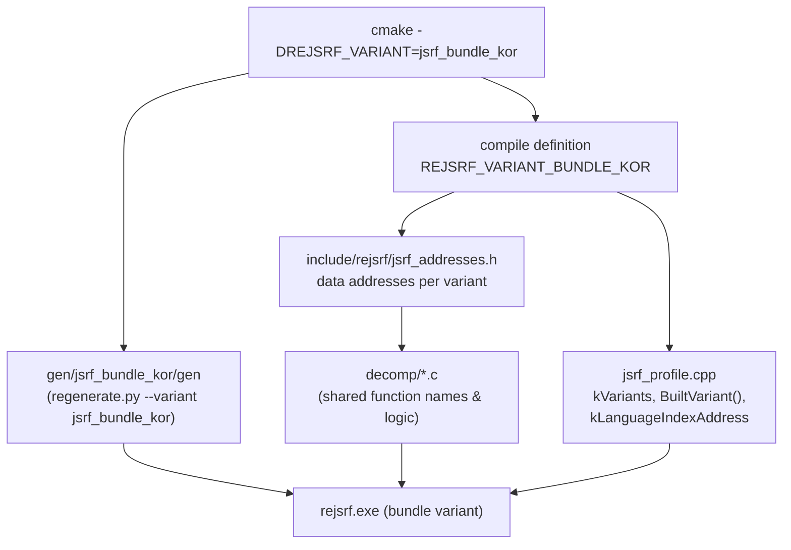

# 설계: 한국 정발 번들 SegaJSRF.xbe 지원 (issue #124)

상태: **검토 중**(사용자 승인 대기). 작업 지시: [20261026-i124](../work-orders/20261026-i124-bundle-variant.md)

분석: [jsrf-xbe-overview §1](../analysis/jsrf-xbe-overview.md), [language](../analysis/language.md)

## 1. 요구

* 한국에서 정식 발매된 "Sega GT 2002 + JSRF - Jet Set Radio Future" 콤보 디스크에 포함된 `SegaJSRF.xbe` (MD5 `8bf3c450e9c1cc39730d4025ef987e2c`)를 지원한다.
* 이 디스크는 한국에서 판매되었으나 게임 내부는 영문(English, Language index 1)으로 구성되어 있다.
* 기존 `jsrf_us`(기본값), `jsrf_jp`에 이어 새 빌드 변형(variant) 또는 지원 체계를 정의한다.

## 2. 확인한 것

* **바이너리 정체**:
  * 파일 크기: 2,281,472 바이트 (US, JP와 동일)
  * Title ID: `0x5345000A` (동일)
  * 인증서 버전: `0x00000007` (US, JP는 `0x00000001`)
  * 인증서 시각: `0x3E44325E` (2003-02-07 22:15:26 UTC)
  * 이미지 시각: `0x3C44170F` (2002-01-15 11:37:19 UTC, US/JP보다 약 2주 전)
  * 진입점: `0x00147FF3` (US `0x00148023`에서 `-0x30`)
  * 커널 import: 120개 (동일)
  * XDK 라이브러리: 7개 모두 1.0.4134 (동일)
* **섹션 및 주소 분석**:
  * `.text` 섹션 크기가 `0x17BB00`으로 US판(`0x17BB30`)보다 정확히 `0x30` 바이트 작다.
  * `.text` 내부 `0x00074EC3` 이전은 US판과 동일 주소이며, `0x00074EC3` 이후의 함수/코드는 `-0x30` 주소 이동이 발생한다.
  * 섹션 정렬(Section Alignment)에 의해 `D3D`, `DSOUND`, `MMATRIX`, `XGRPH`, `XPP`, `.rdata`, `.data`, `DOLBY` 등 `.text` 이후의 모든 섹션의 가상 주소가 정확히 `-0x40` 이동한다 (`D3D` va `0x0018CB00`, `.data` va `0x001EB720`). 섹션 raw 크기는 US판과 완전히 일치한다.
* **함수 지문(Fingerprint) 전수 검증**:
  * 프로젝트에서 관리하는 225개 named function(seed 188개, extra symbols 5개, decompiled functions 31개, profile internal 1개)을 전수 비교한 결과:
    * `va < 0x00074EC3` (41개): 원래 주소와 지문 **100% 일치**
    * `0x00074EC3 <= va < 0x0018CB40` (148개): `va - 0x30` 위치와 지문 **100% 일치**
    * `va >= 0x0018CB40` (36개): `va - 0x40` 위치와 지문 **100% 일치**
    * 불일치(Mismatch): **0개**
  * 결론: 게임 로직 코드는 US/JP와 100% 동일하며, 컴파일/링크 배치에 따른 오프셋만 달라진 빌드다.
* **언어 설정**:
  * 언어 인덱스 전역 변수 주소는 `0x001FC6E4` (US판 `0x001FC724`에서 `-0x40`).
  * 바이너리 기본값은 `1` (English).

## 3. 방안 비교

| 방안 | 내용 | 장단점 및 판단 |
|---|---|---|
| **A. 빌드 변형 추가 (`jsrf_bundle_kor`)** | CMake `-DREJSRF_VARIANT=jsrf_bundle_kor`. `variants.json`에 등록하고 주소 매핑을 통해 lift 생성 및 빌드 분리 | **권장**. 기존 `jsrf_us`, `jsrf_jp` 구조를 그대로 따르며 심볼 충돌이나 런타임 분기 오버헤드가 없다. |
| B. 앱 실행 시 XBE 자동 감지 및 단일 바이너리 지원 | 단일 실행 파일에서 US lift를 돌리고 주소를 동적 변환 | 기각. lift된 C 코드가 고정 게스트 가상 주소를 직접 참조하므로 불가. |

## 4. 구조 (방안 A)

### 4.1 파이프라인 및 주소 매핑

* `src/game/jsrf/recomp/variants.json`:
  * `jsrf_bundle_kor` 추가 (MD5 `8bf3c450e9c1cc39730d4025ef987e2c`, Label `"Korea bundle (SegaJSRF.xbe)"`).
* `scripts/recomp/variant_fingerprints.py`:
  * 변형별 주소 오프셋 규칙(`translate_variant_address(va, variant)`)을 정의하여 `check()` 시 `jsrf_bundle_kor`의 함수 지문을 올바른 위치에서 검사.
* `scripts/recomp/regenerate.py` / `lifter.py`:
  * `jsrf_bundle_kor`의 경우 US 기준 seed 주소 및 extra symbols를 대응하는 XBE 주소로 변환하여 파이프라인에 전달.
  * 생성되는 C 함수의 심볼명은 decomp 함수와의 일관성을 위해 US 기준 주소명(`sub_XXXXXXXX`)을 유지하거나 적절히 매핑.

### 4.2 C++ 타이틀 프로파일 및 헤더

* `include/rejsrf/jsrf_addresses.h`:
  * `REJSRF_VARIANT_BUNDLE_KOR` 정의 시 언어 인덱스 `0x001FC6E4`, `mmatrix` 관련 주소(`-0x40`) 정의.
* `src/game/jsrf/jsrf_profile.cpp`:
  * `kVariants`에 `jsrf_bundle_kor` 항목 추가.
  * 인증서: title ID `0x5345000A`, cert_time `0x3E44325E`, version `7`, image_time `0x3C44170F`.
  * 기본 언어: `Language::kEnglish`.
* `src/app/main.cpp`:
  * 게임 폴더를 인자로 주었을 때 `default.xbe` 외에도 `SegaJSRF.xbe`가 존재하면 자동으로 탐색하여 로드할 수 있도록 보완.

## 5. 검증 계획

1. `variant_fingerprints.py`로 `SegaJSRF.xbe`에 대한 지문 검증이 225개 전체 통과하는지 확인.
2. `regenerate.py --xbe "roms/Sega GT 2002 + JSRF - Jet Set Radio Future (Kor)/SegaJSRF.xbe"` 실행하여 `gen/jsrf_bundle_kor/` 생성 코드 추출.
3. CMake configure (`-DREJSRF_VARIANT=jsrf_bundle_kor`) 및 컴파일 검증.
4. 실행 검증: `rejsrf.exe`로 `SegaJSRF.xbe` 부팅, 타이틀 화면, 데모 재생 확인.

---

# Design: Support SegaJSRF.xbe from Korean Bundle (issue #124)

Status: **Under Review** (awaiting user approval). Work order: [20261026-i124](../work-orders/20261026-i124-bundle-variant.md)

Analysis: [jsrf-xbe-overview §1](../analysis/jsrf-xbe-overview.md), [language](../analysis/language.md)

## 1. Requirements

* Support `SegaJSRF.xbe` (MD5 `8bf3c450e9c1cc39730d4025ef987e2c`) included in the official Korean combo disc "Sega GT 2002 + JSRF - Jet Set Radio Future".
* The disc was sold in Korea, but the game is configured in English (Language index 1).
* Define a new build variant following the existing `jsrf_us` (default) and `jsrf_jp`.

## 2. Confirmed Facts

* **Binary Identity**:
  * File size: 2,281,472 bytes (same as US and JP)
  * Title ID: `0x5345000A` (identical)
  * Certificate version: `0x00000007` (US and JP are `0x00000001`)
  * Certificate time: `0x3E44325E` (2003-02-07 22:15:26 UTC)
  * Image time: `0x3C44170F` (2002-01-15 11:37:19 UTC, ~2 weeks earlier than US/JP)
  * Entry point: `0x00147FF3` (`-0x30` from US `0x00148023`)
  * Kernel imports: 120 (identical)
  * Linked XDK libraries: all 7 are 1.0.4134 (identical)
* **Section and Address Analysis**:
  * `.text` section size is `0x17BB00`, exactly `0x30` bytes smaller than the US build (`0x17BB30`).
  * Before `0x00074EC3` in `.text`, code shares exact US addresses; after `0x00074EC3`, functions are shifted by `-0x30`.
  * Due to section alignment, all sections following `.text` (`D3D`, `DSOUND`, `MMATRIX`, `XGRPH`, `XPP`, `.rdata`, `.data`, `DOLBY`) are shifted by `-0x40` in virtual address (`D3D` va `0x0018CB00`, `.data` va `0x001EB720`). Raw section sizes match the US build exactly.
* **Full Function Fingerprint Verification**:
  * Testing all 225 named functions across seeds, extra symbols, decompiled functions, and profile internals:
    * `va < 0x00074EC3` (41): exact address match, **100% match**
    * `0x00074EC3 <= va < 0x0018CB40` (148): `va - 0x30`, **100% match**
    * `va >= 0x0018CB40` (36): `va - 0x40`, **100% match**
    * Mismatch count: **0**
  * Conclusion: Game logic is 100% identical to the US/JP builds; only compiler/linker layout offsets differ.
* **Language Configuration**:
  * Language index variable address: `0x001FC6E4` (`-0x40` from US `0x001FC724`).
  * Default binary value: `1` (English).

## 3. Options Considered

| Option | Details | Assessment |
|---|---|---|
| **A. Add build variant (`jsrf_bundle_kor`)** | CMake `-DREJSRF_VARIANT=jsrf_bundle_kor`. Register in `variants.json`, map addresses, lift and build separately | **Recommended**. Follows existing architecture (`jsrf_us`, `jsrf_jp`) with zero runtime overhead or symbol conflicts. |
| B. Dynamic address translation in single binary | Single binary running US lift with runtime translation | Rejected. Lifted C code references fixed guest addresses directly. |

## 4. Architecture (Option A)

See Korean section §4 for details and diagrams.

## 5. Verification Plan

1. Verify all 225 function fingerprints pass for `SegaJSRF.xbe`.
2. Extract lifted C code using `regenerate.py` into `gen/jsrf_bundle_kor/`.
3. Configure CMake with `-DREJSRF_VARIANT=jsrf_bundle_kor` and build.
4. Runtime test: Boot `rejsrf.exe` with `SegaJSRF.xbe`, verify intro/demo and English text.
