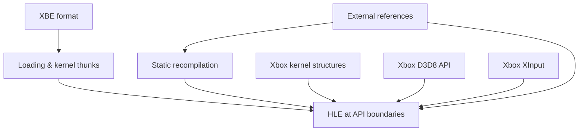

# reJSRF 기술 지식 기반 색인

이 디렉터리는 프로젝트를 이해하는 데 필요한 일반 기술 지식을 정리한다. JSRF 바이너리에서 직접 확인한 사실은 `docs/analysis/`에 기록한다. 외부 자료에서 얻은 정의와 규약에는 원문 링크를 함께 둔다.

## 문서

* [XBE 실행 형식](xbe-format.md)
* [정적 재컴파일, 디컴파일, HLE](static-recompilation-and-hle.md)
* [외부 참조 프로젝트와 라이선스](external-references.md)
* [Xbox 커널 구조와 서비스: KPCR, KTHREAD, TLS, 디스패처 객체, 객체 이름공간](xbox-kernel-structures.md)
* [Xbox D3D8 API: PC와 다른 점, 구조체 레이아웃, 상수](xbox-d3d8-api.md)
* [Xbox XInput: 장치 종류, 구조체, 오류 코드, 키보드 대응](xbox-xinput.md)

---

# reJSRF Knowledge Base Index

This directory holds general technical knowledge needed to understand the project. Facts confirmed from the JSRF binary go to `docs/analysis/`. Definitions and conventions from outside sources carry links to the originals.

## Documents

* [The XBE executable format](xbe-format.md)
* [Static recompilation, decompilation and HLE](static-recompilation-and-hle.md)
* [External reference projects and licenses](external-references.md)
* [Xbox kernel structures and services: KPCR, KTHREAD, TLS, dispatcher objects, object namespace](xbox-kernel-structures.md)
* [The Xbox D3D8 API: differences from the PC, structure layouts, constants](xbox-d3d8-api.md)
* [Xbox XInput: device types, structures, error codes, keyboard mapping](xbox-xinput.md)
