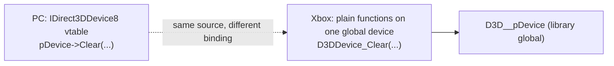

# Xbox D3D8 API: PC Direct3D 8과 다른 점, 구조체 레이아웃, 상수

Xbox의 Direct3D 8은 XDK에 정적 링크되는 라이브러리(`D3D8.lib`, LTCG 빌드는 `D3D8LTCG.lib`)로, PC의 `d3d8.dll`과 API 모양이 비슷하지만 다음이 다르다. 여기 적은 값은 XbSymbolDatabase(MIT), xboxrecomp의 `src/d3d/d3d8_xbox.h`(MIT), 그리고 우리 바이너리 측정([analysis: d3d8-adapter](../analysis/d3d8-adapter.md))에서 왔다.

Xbox Direct3D 8 is a library statically linked by the XDK (`D3D8.lib`, or `D3D8LTCG.lib` for LTCG builds). Its API resembles the PC `d3d8.dll` but differs as follows. Values here come from XbSymbolDatabase (MIT), xboxrecomp's `src/d3d/d3d8_xbox.h` (MIT) and measurements on our binary ([analysis: d3d8-adapter](../analysis/d3d8-adapter.md)).

## 1. COM이 아니다 / Not COM

* 디바이스 메서드는 `this`가 없는 일반 함수(`D3DDevice_*`)이며 라이브러리 전역 디바이스 하나에 작용한다. `IDirect3DDevice8_Clear(p, …)` 같은 매크로가 `D3DDevice_Clear(…)`로 펼쳐진다. `Direct3D_*`는 `IDirect3D8` 수준의 함수다.
* 그래서 HLE는 vtable이 아니라 **함수 주소**(XbSymbolDatabase로 식별)에 바인딩한다([design i006](../design/20261012-i006-xdk-symbol-binding.md)).
* 라이브러리 전역(`D3D__pDevice`, `D3D__RenderState` …)이 있고, 일부 XDK 헤더 inline은 그 전역을 게임 코드에서 직접 읽는다(우리 빌드에서 확인 전).

* Device methods are plain functions without `this` (`D3DDevice_*`) acting on one library-global device; macros such as `IDirect3DDevice8_Clear(p, …)` expand to `D3DDevice_Clear(…)`. `Direct3D_*` are the `IDirect3D8`-level functions.
* The HLE therefore binds **function addresses** (identified with XbSymbolDatabase), not vtables ([design i006](../design/20261012-i006-xdk-symbol-binding.md)).
* Library globals exist (`D3D__pDevice`, `D3D__RenderState`, …) and some XDK header inlines read them straight from game code (not yet confirmed in our build).

## 2. 호출 규약 / Calling conventions

대부분 `__stdcall`(callee가 `ret n`으로 인자를 제거)이며, 일부 LTCG 함수는 `__fastcall`(ecx, edx)이다. 심볼 데이터베이스의 인자 수가 코드와 다를 수 있으므로(예: `D3D_GetAdapterModeCount`는 2개로 적혀 있지만 `ret 4`), HLE의 `Return(value, n)`은 실행 비교로 확인한다.

Most are `__stdcall` (the callee removes its arguments with `ret n`); some LTCG functions are `__fastcall` (ecx, edx). The database's parameter count can differ from the code (for example `D3D_GetAdapterModeCount` is listed with 2 but does `ret 4`), so the HLE's `Return(value, n)` is confirmed by running comparisons.

## 3. 구조체 / Structures

| 구조체 / Structure | Xbox 레이아웃 (오프셋) / Xbox layout (offsets) | 비고 / Note |
|---|---|---|
| `D3DDISPLAYMODE` | `Width` 0x00, `Height` 0x04, `RefreshRate` 0x08, **`Flags` 0x0C**, **`Format` 0x10** (20 bytes) | PC는 `Format`이 0x0C이고 `Flags`가 없다 / the PC has `Format` at 0x0C and no `Flags` |
| `D3DPRESENT_PARAMETERS` | `BackBufferWidth` 0x00, `BackBufferHeight` 0x04, `BackBufferFormat` 0x08, `BackBufferCount` 0x0C, `MultiSampleType` 0x10, `SwapEffect` 0x14, `hDeviceWindow` 0x18, `Windowed` 0x1C, `EnableAutoDepthStencil` 0x20, `AutoDepthStencilFormat` 0x24, `Flags` 0x28, `FullScreen_RefreshRateInHz` 0x2C, `FullScreen_PresentationInterval` 0x30 | 앞부분은 PC와 같다. Xbox는 뒤에 `BufferSurfaces[3]`, `DepthStencilSurface`를 더 가진다(**추정**, xboxrecomp 헤더에는 없음) / leading part as on the PC; Xbox appends `BufferSurfaces[3]` and `DepthStencilSurface` (**inferred**) |
| `D3DCAPS8` | PC와 같은 필드 순서, 라이브러리는 53 DWORD(212바이트)를 쓴다 / same field order as the PC; the library writes 53 DWORDs (212 bytes) | [analysis §4](../analysis/d3d8-adapter.md) |

## 4. 상수 / Constants

| 이름 / Name | 값 / Value |
|---|---|
| `D3D_OK` | `0x00000000` |
| `D3DERR_NOTAVAILABLE` | `0x8876086A` |
| `D3DERR_INVALIDDEVICE` | `0x8876086B` |
| `D3DERR_INVALIDCALL` | `0x8876086C` |
| `D3DDEVTYPE_HAL` | `1` |
| `D3DCREATE_HARDWARE_VERTEXPROCESSING` | `0x40` |
| `D3DMULTISAMPLE_NONE` | `0x0011` (Xbox 인코딩: 샘플 수·필터가 비트로 들어감 / Xbox encoding with sample count and filter bits) |
| `D3DUSAGE_RENDERTARGET`, `D3DUSAGE_DEPTHSTENCIL` | `0x1`, `0x2` |

`D3DFORMAT`은 PC와 번호가 다르다. 스위즐 텍스처 포맷(`D3DFMT_A8R8G8B8` = 0x06 등)과 **선형(`LIN_`) 포맷**(`D3DFMT_LIN_A8R8G8B8` = 0x12, `LIN_R5G6B5` = 0x11, `LIN_X1R5G5B5` = 0x1C, `LIN_X8R8G8B8` = 0x1E, `LIN_D24S8` = 0x2E …)이 있으며 백버퍼는 선형 포맷을 쓴다. 전체 표는 xboxrecomp `src/d3d/d3d8_xbox.h`(MIT).

`D3DFORMAT` numbering differs from the PC: there are swizzled texture formats (`D3DFMT_A8R8G8B8` = 0x06, …) and **linear (`LIN_`) formats** (`D3DFMT_LIN_A8R8G8B8` = 0x12, `LIN_R5G6B5` = 0x11, `LIN_X1R5G5B5` = 0x1C, `LIN_X8R8G8B8` = 0x1E, `LIN_D24S8` = 0x2E, …); back buffers use linear formats. The full table is in xboxrecomp `src/d3d/d3d8_xbox.h` (MIT).

## 5. 하드웨어 접근 지점 / Where the hardware is touched

`Direct3D_CreateDevice` → `CMiniport_InitHardware`가 NV2A MMIO(`0xFD000000` 이상)를 읽는 첫 지점이다([boot-frontier](../analysis/boot-frontier.md)). 그 앞의 어댑터·모드·Caps 질의는 라이브러리 안의 표와 커널 AV 서비스만 쓴다. 그리기 명령은 라이브러리가 push buffer에 쌓아 GPU가 소비하므로, API 수준 HLE는 push buffer를 만들지 않고 각 `D3DDevice_*` 호출을 호스트 그래픽 API로 바꾼다.

`Direct3D_CreateDevice` → `CMiniport_InitHardware` is the first point that reads NV2A MMIO (`0xFD000000` and up) ([boot-frontier](../analysis/boot-frontier.md)); the adapter, mode and caps queries before it use only tables inside the library and the kernel's AV services. Drawing commands are queued by the library into a push buffer the GPU consumes, so an API-level HLE never builds a push buffer and translates each `D3DDevice_*` call to the host graphics API instead.

## 출처 / Sources

* XbSymbolDatabase, `src/OOVPADatabase/D3D8_OOVPA.c` (MIT): 심볼 이름, 규약, 인자 / symbol names, conventions, parameters
* xboxrecomp, `src/d3d/d3d8_xbox.h` (MIT): `D3DFORMAT`, `D3DMULTISAMPLE_TYPE`, `D3DPRESENT_PARAMETERS`
* 우리 바이너리 측정 / measurements on our binary: [analysis: d3d8-adapter](../analysis/d3d8-adapter.md)
