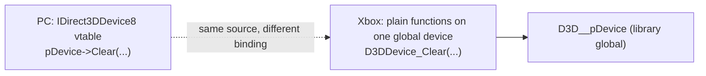
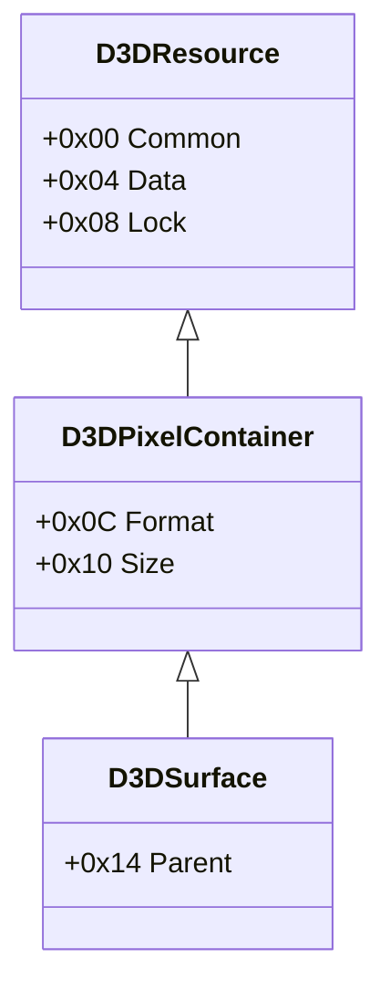

# Xbox D3D8 API: PC Direct3D 8과 다른 점, 구조체 레이아웃, 상수

Xbox의 Direct3D 8은 XDK에 정적 링크되는 라이브러리(`D3D8.lib`, LTCG 빌드는 `D3D8LTCG.lib`)로, PC의 `d3d8.dll`과 API 모양이 비슷하지만 다음이 다르다. 여기 적은 값은 XbSymbolDatabase(MIT), xboxrecomp의 `src/d3d/d3d8_xbox.h`(MIT), 그리고 우리 바이너리 측정([analysis: d3d8-adapter](../analysis/d3d8-adapter.md))에서 왔다.

Xbox Direct3D 8 is a library statically linked by the XDK (`D3D8.lib`, or `D3D8LTCG.lib` for LTCG builds). Its API resembles the PC `d3d8.dll` but differs as follows. Values here come from XbSymbolDatabase (MIT), xboxrecomp's `src/d3d/d3d8_xbox.h` (MIT) and measurements on our binary ([analysis: d3d8-adapter](../analysis/d3d8-adapter.md)).

## 1. COM이 아니다 / Not COM

* 디바이스 메서드는 `this`가 없는 일반 함수(`D3DDevice_*`)이며 라이브러리 전역 디바이스 하나에 작용한다. `IDirect3DDevice8_Clear(p, …)` 같은 매크로가 `D3DDevice_Clear(…)`로 펼쳐진다. `Direct3D_*`는 `IDirect3D8` 수준의 함수다.
* 그래서 HLE는 vtable이 아니라 **함수 주소**(XbSymbolDatabase로 식별)에 바인딩한다([design i006](../design/20261012-i006-xdk-symbol-binding.md)).
* 라이브러리 전역(`D3D__pDevice`, `D3D__RenderState` …)이 있고, 일부 XDK 헤더 inline은 그 전역을 게임 코드에서 직접 읽는다(우리 빌드에서 확인 전).

* Device methods are plain functions without `this` (`D3DDevice_*`) acting on one library-global device; macros such as `IDirect3DDevice8_Clear(p, …)` expand to `D3DDevice_Clear(…)`. `Direct3D_*` are the `IDirect3D8`-level functions.
* The HLE therefore binds **function addresses** (identified with XbSymbolDatabase), not vtables ([design i006](../design/20261012-i006-xdk-symbol-binding.md)).
* Library globals exist (`D3D__pDevice`, `D3D__RenderState`, …) and some XDK header inlines read them straight from game code (not yet confirmed in our build).

## 2. 호출 규약 / Calling conventions

대부분 `__stdcall`(callee가 `ret n`으로 인자를 제거)이며, 일부 LTCG 함수는 `__fastcall`(ecx, edx)이다. 심볼 데이터베이스의 인자 수가 코드와 다를 수 있으므로(예: `D3D_GetAdapterModeCount`는 2개로 적혀 있지만 `ret 4`), HLE의 `Return(value, n)`은 실행 비교로 확인한다.

Most are `__stdcall` (the callee removes its arguments with `ret n`); some LTCG functions are `__fastcall` (ecx, edx). The database's parameter count can differ from the code (for example `D3D_GetAdapterModeCount` is listed with 2 but does `ret 4`), so the HLE's `Return(value, n)` is confirmed by running comparisons.

## 3. 구조체 / Structures

| 구조체 / Structure | Xbox 레이아웃 (오프셋) / Xbox layout (offsets) | 비고 / Note |
|---|---|---|
| `D3DDISPLAYMODE` | `Width` 0x00, `Height` 0x04, `RefreshRate` 0x08, **`Flags` 0x0C**, **`Format` 0x10** (20 bytes) | PC는 `Format`이 0x0C이고 `Flags`가 없다 / the PC has `Format` at 0x0C and no `Flags` |
| `D3DPRESENT_PARAMETERS` | `BackBufferWidth` 0x00, `BackBufferHeight` 0x04, `BackBufferFormat` 0x08, `BackBufferCount` 0x0C, `MultiSampleType` 0x10, `SwapEffect` 0x14, `hDeviceWindow` 0x18, `Windowed` 0x1C, `EnableAutoDepthStencil` 0x20, `AutoDepthStencilFormat` 0x24, `Flags` 0x28, `FullScreen_RefreshRateInHz` 0x2C, `FullScreen_PresentationInterval` 0x30 | 앞부분은 PC와 같다. Xbox는 뒤에 `BufferSurfaces[3]`, `DepthStencilSurface`를 더 가진다(**추정**, xboxrecomp 헤더에는 없음) / leading part as on the PC; Xbox appends `BufferSurfaces[3]` and `DepthStencilSurface` (**inferred**) |
| `D3DCAPS8` | PC와 같은 필드 순서, 라이브러리는 53 DWORD(212바이트)를 쓴다 / same field order as the PC; the library writes 53 DWORDs (212 bytes) | [analysis §4](../analysis/d3d8-adapter.md) |

## 4. 상수 / Constants

| 이름 / Name | 값 / Value |
|---|---|
| `D3D_OK` | `0x00000000` |
| `D3DERR_NOTAVAILABLE` | `0x8876086A` |
| `D3DERR_INVALIDDEVICE` | `0x8876086B` |
| `D3DERR_INVALIDCALL` | `0x8876086C` |
| `D3DDEVTYPE_HAL` | `1` |
| `D3DCREATE_HARDWARE_VERTEXPROCESSING` | `0x40` |
| `D3DMULTISAMPLE_NONE` | `0x0011` (Xbox 인코딩: 샘플 수·필터가 비트로 들어감 / Xbox encoding with sample count and filter bits) |
| `D3DUSAGE_RENDERTARGET`, `D3DUSAGE_DEPTHSTENCIL` | `0x1`, `0x2` |

`D3DFORMAT`은 PC와 번호가 다르다. 스위즐 텍스처 포맷(`D3DFMT_A8R8G8B8` = 0x06 등)과 **선형(`LIN_`) 포맷**(`D3DFMT_LIN_A8R8G8B8` = 0x12, `LIN_R5G6B5` = 0x11, `LIN_X1R5G5B5` = 0x1C, `LIN_X8R8G8B8` = 0x1E, `LIN_D24S8` = 0x2E …)이 있으며 백버퍼는 선형 포맷을 쓴다. 전체 표는 xboxrecomp `src/d3d/d3d8_xbox.h`(MIT).

`D3DFORMAT` numbering differs from the PC: there are swizzled texture formats (`D3DFMT_A8R8G8B8` = 0x06, …) and **linear (`LIN_`) formats** (`D3DFMT_LIN_A8R8G8B8` = 0x12, `LIN_R5G6B5` = 0x11, `LIN_X1R5G5B5` = 0x1C, `LIN_X8R8G8B8` = 0x1E, `LIN_D24S8` = 0x2E, …); back buffers use linear formats. The full table is in xboxrecomp `src/d3d/d3d8_xbox.h` (MIT).

## 5. 하드웨어 접근 지점 / Where the hardware is touched

`Direct3D_CreateDevice` → `CMiniport_InitHardware`가 NV2A MMIO(`0xFD000000` 이상)를 읽는 첫 지점이다([boot-frontier](../analysis/boot-frontier.md)). 그 앞의 어댑터·모드·Caps 질의는 라이브러리 안의 표와 커널 AV 서비스만 쓴다. 그리기 명령은 라이브러리가 push buffer에 쌓아 GPU가 소비하므로, API 수준 HLE는 push buffer를 만들지 않고 각 `D3DDevice_*` 호출을 호스트 그래픽 API로 바꾼다.

`Direct3D_CreateDevice` → `CMiniport_InitHardware` is the first point that reads NV2A MMIO (`0xFD000000` and up) ([boot-frontier](../analysis/boot-frontier.md)); the adapter, mode and caps queries before it use only tables inside the library and the kernel's AV services. Drawing commands are queued by the library into a push buffer the GPU consumes, so an API-level HLE never builds a push buffer and translates each `D3DDevice_*` call to the host graphics API instead.

## 6. 리소스 헤더 / Resource headers

Xbox D3D8의 리소스는 게스트 메모리의 작은 헤더 하나로 표현되며, 타이틀이 직접 만들어(`XGSetSurfaceHeader`, `XGSetTextureHeader`…) `D3DResource_Register`로 넘길 수도 있다. 레이아웃과 비트는 우리 바이너리의 lift 본문(`D3DResource_AddRef/Release/GetType`, `Get2DSurfaceDesc`, XGRAPHC 인코더 `0x001BBAFB`)에서 확인했다(**확인됨**, [analysis: d3d8-adapter §6](../analysis/d3d8-adapter.md)).

An Xbox D3D8 resource is one small header in guest memory; a title may build it itself (`XGSetSurfaceHeader`, `XGSetTextureHeader`, …) and hand it to `D3DResource_Register`. The layout and bits below were confirmed from the lifted bodies in our binary (`D3DResource_AddRef/Release/GetType`, `Get2DSurfaceDesc`, the XGRAPHC encoder at `0x001BBAFB`) (**confirmed**, [analysis: d3d8-adapter §6](../analysis/d3d8-adapter.md)).

| 필드 / Field | 비트 / Bits |
|---|---|
| `Common` | bits 15:0 refcount; bits 18:16 type (0 VERTEXBUFFER, 1 INDEXBUFFER, 2 PUSHBUFFER, 3 PALETTE, 4 TEXTURE, 5 SURFACE, 6 FIXUP); bits 22:19 internal refcount; bit 24 D3DCREATED(라이브러리가 만든 객체, 마지막 Release에서 파괴 / created by the library, destroyed on the last Release) |
| `Data` | 픽셀·정점 메모리 주소. `Register`는 `Data += pBase`, push buffer가 아니면 `& 0x03FFFFFF` / address of the pixel or vertex memory; `Register` adds `pBase` and, except for push buffers, masks with `0x03FFFFFF` |
| `Format` | bits 1:0 DMA 채널(XGSetSurfaceHeader는 2), bit 2 큐브맵, bit 3 border color, bits 7:4 차원(2 = 2D, 3 = 3D), bits 15:8 `D3DFORMAT`, bits 19:16 밉 레벨 수, bits 23:20 log2 폭, bits 27:24 log2 높이, bits 31:28 log2 깊이(스위즐·2의 거듭제곱 리소스) / DMA channel (2 from XGSetSurfaceHeader), cube map, border color, dimension, `D3DFORMAT`, mip levels, log2 width, log2 height, log2 depth (swizzled power-of-two resources) |
| `Size` | 선형 리소스만: bits 11:0 폭−1, bits 23:12 높이−1, bits 31:24 pitch/64−1; 스위즐 리소스는 0 / linear resources only: width−1, height−1, pitch/64−1; 0 for swizzled ones |

* `D3DSURFACE_DESC`(Xbox): `{Format 0x00, Type 0x04, Usage 0x08, Size 0x0C, MultiSampleType 0x10, Width 0x14, Height 0x18}` 28바이트. `Usage`는 포맷 능력 바이트(§3의 표)에서 RENDERTARGET(bit 7) 또는 DEPTHSTENCIL(bit 6)로 정해진다. / 28 bytes; `Usage` comes from the format capability byte (render target bit 7, depth/stencil bit 6).
* 포맷 능력 바이트의 bits 5:2는 픽셀당 비트 수다(레벨 크기 계산에 쓰임). / Bits 5:2 of the capability byte are the bits per pixel, used for level sizes.
* `AddRef`는 refcount를 1 올려 돌려주고, refcount가 0인 서피스의 `Parent`도 AddRef한다. `Release`는 refcount 1·내부 refcount 0이면 파괴(`D3D_DestroyResource`)하고 0을 돌려준다. / `AddRef` increments and returns the count (also AddRef'ing a zero-count surface's `Parent`); `Release` destroys at count 1 with no internal count and returns 0.

## 7. 상태 번호 (XDK 4134) / State numbering (XDK 4134)

렌더 상태는 라이브러리 전역 `D3D__RenderState[번호]`에, 텍스처 스테이지 상태는 `D3D__TextureState[스테이지][번호]`(스테이지당 32칸)에 있다. 게임 inline이 이 배열에 직접 쓰므로 HLE도 같은 배열을 상태의 원본으로 쓴다([design i023 §2](../design/20261012-i023-d3d8-fixed-function-draw.md), [analysis §8](../analysis/d3d8-adapter.md)). 번호는 PC와 다르다.

Render states live in the library global `D3D__RenderState[number]`, texture-stage states in `D3D__TextureState[stage][number]` (32 slots per stage). The title's inlines write these arrays directly, so the HLE uses them as the source of truth too ([design i023 §2](../design/20261012-i023-d3d8-fixed-function-draw.md), [analysis §8](../analysis/d3d8-adapter.md)). The numbers differ from the PC's.

| 범위 / Range | 내용 / Contents | 근거 / Evidence |
|---|---|---|
| 0–56 | 픽셀 셰이더(레지스터 컴바이너) 상태 / pixel-shader (register combiner) states | 추정 / inferred |
| 57–75 | simple: 57 `ZFUNC`, 58 `ALPHAFUNC`, 59 `ALPHABLENDENABLE`, 60 `ALPHATESTENABLE`, 61 `ALPHAREF`, 62 `SRCBLEND`, 63 `DESTBLEND`, 64 `ZWRITEENABLE`, 65 `DITHERENABLE`, 66 `SHADEMODE`, 67 `COLORWRITEENABLE`, 68 `STENCILZFAIL`, 69 `STENCILPASS`, 70 `STENCILFUNC`, 71 `STENCILREF`, 72 `STENCILMASK`, 73 `STENCILWRITEMASK`, 74 `BLENDOP`, 75 `BLENDCOLOR` | 확인됨: 칸 값 = 게임이 같은 NV2A method와 넘기는 값 / confirmed: the slot value equals what the title passes with that NV2A method |
| 76 | `SWATHWIDTH` | 추정 / inferred |
| 77–81 | `POLYGONOFFSETZSLOPESCALE`, `POLYGONOFFSETZOFFSET`, `POINTOFFSETENABLE`, `WIREFRAMEOFFSETENABLE`, `SOLIDOFFSETENABLE` | 확인됨: `ZBias` setter가 쓰는 칸 / confirmed: the slots `ZBias` writes |
| 82–116 | deferred: 82 `FOGENABLE`, 83 `FOGTABLEMODE`, 84 `FOGSTART`, 85 `FOGEND`, 86 `FOGDENSITY`, 87 `RANGEFOGENABLE`, 88–91 `WRAP0..3`, 92 `LIGHTING`, 93 `SPECULARENABLE`, 94 `LOCALVIEWER`, 95 `COLORVERTEX`, 96–99 뒷면 재질 소스 / back material sources, 100–103 재질 소스 / material sources (101 `DIFFUSEMATERIALSOURCE`), 104 `BACKAMBIENT`, 105 `AMBIENT`, 106–113 점 크기·스프라이트·스케일 / point size, sprite and scale, 114 `PATCHEDGESTYLE`, 115 `PATCHSEGMENTS`, 116 `SWAPFILTER` | 블록 경계 82는 확인됨(`D3D_g_DeferredRenderState`), 순서는 추정 / boundary 82 confirmed (`D3D_g_DeferredRenderState`), order inferred |
| 117–145 | complex: 117 `PSTEXTUREMODES`, 118 `VERTEXBLEND`, 119 `FOGCOLOR`, 120 `FILLMODE`, 121 `BACKFILLMODE`, 122 `TWOSIDEDLIGHTING`, 123 `NORMALIZENORMALS`, 124 `ZENABLE`, 125 `STENCILENABLE`, 126 `STENCILFAIL`, 127 `FRONTFACE`, 128 `CULLMODE`, 129 `TEXTUREFACTOR`, 130 `ZBIAS`, 131 `LOGICOP`, 132 `EDGEANTIALIAS`, 133 `MULTISAMPLEANTIALIAS`, 134 `MULTISAMPLEMASK`, 135 `MULTISAMPLEMODE`, 136 `MULTISAMPLERENDERTARGETMODE`, 137 `SHADOWFUNC`, 138 `LINEWIDTH`, 139 `DXT1NOISEENABLE`, 140 `YUVENABLE`, 141 `OCCLUSIONCULLENABLE`, 142 `STENCILCULLENABLE`, 143 `ROPZCMPALWAYSREAD`, 144 `ROPZREAD`, 145 `DONOTCULLUNCOMPRESSED` | 확인됨: 각 setter가 쓰는 칸 / confirmed: the slot each setter writes |

* 값은 NV2A/GL 인코딩이다. 비교 함수는 0x200 `NEVER` … 0x207 `ALWAYS`, 블렌드 계수는 `ZERO` 0·`ONE` 1·0x300 `SRCCOLOR` …, 블렌드 연산은 0x8006 `ADD` …, 스텐실 연산은 0x1E00 `KEEP` …이다. `CULLMODE`/`FRONTFACE`는 0x900 `CW`·0x901 `CCW`(0은 컬링 없음), `FILLMODE`는 0x1B00 점·0x1B01 선·0x1B02 면, `SHADEMODE`는 0x1D00 flat·0x1D01 Gouraud다. `COLORWRITEENABLE`은 채널마다 1바이트다(A R G B, 0x01010101 = 전부, 추정).
* Values are in NV2A/GL encoding: comparisons 0x200 `NEVER` … 0x207 `ALWAYS`; blend factors `ZERO` 0, `ONE` 1, 0x300 `SRCCOLOR` …; blend operations 0x8006 `ADD` …; stencil operations 0x1E00 `KEEP` …; `CULLMODE`/`FRONTFACE` 0x900 `CW`, 0x901 `CCW` (0 = no culling); `FILLMODE` 0x1B00 point, 0x1B01 line, 0x1B02 solid; `SHADEMODE` 0x1D00 flat, 0x1D01 Gouraud. `COLORWRITEENABLE` has one byte per channel (A R G B; 0x01010101 = all, inferred).

텍스처 스테이지 칸은 다음과 같다. 대부분 추정이고, 28 `TEXCOORDINDEX`·29 `BORDERCOLOR`·30 `COLORKEYCOLOR`·22–27 bump env는 확인됨이다. / Texture-stage slots (mostly inferred; 28 `TEXCOORDINDEX`, 29 `BORDERCOLOR`, 30 `COLORKEYCOLOR` and 22–27 bump env confirmed): 0 `ADDRESSU`, 1 `ADDRESSV`, 2 `ADDRESSW`, 3 `MAGFILTER`, 4 `MINFILTER`, 5 `MIPFILTER`, 6 `MIPMAPLODBIAS`, 7 `MAXMIPLEVEL`, 8 `MAXANISOTROPY`, 9 `COLORKEYOP`, 10 `COLORSIGN`, 11 `ALPHAKILL`, 12 `COLOROP`, 13–15 `COLORARG0..2`, 16 `ALPHAOP`, 17–19 `ALPHAARG0..2`, 20 `RESULTARG`, 21 `TEXTURETRANSFORMFLAGS`, 22–27 `BUMPENVMAT00/01/11/10`, `BUMPENVLSCALE`, `BUMPENVLOFFSET`.

## 8. 텍스처 포맷 / Texture formats

NV2A 색 포맷이다(추정, xboxrecomp `d3d8_xbox.h`(MIT)의 원래 Xbox 항목과 일치). 게임이 지금 쓰는 것은 DXT1 0x0C뿐이다. / NV2A color formats (inferred, matching the original-Xbox entries of xboxrecomp `d3d8_xbox.h` (MIT); the title uses only DXT1 0x0C so far):

| 스위즐 / Swizzled | 선형 / Linear | 압축 / Compressed |
|---|---|---|
| 0x00 `L8`, 0x01 `AL8`, 0x02 `A1R5G5B5`, 0x03 `X1R5G5B5`, 0x04 `A4R4G4B4`, 0x05 `R5G6B5`, 0x06 `A8R8G8B8`, 0x07 `X8R8G8B8`, 0x0B `P8`, 0x19 `A8`, 0x1A `A8L8`, 0x3A `A8B8G8R8`, 0x3B `B8G8R8A8`, 0x3C `R8G8B8A8` | 0x10 `LIN_A1R5G5B5`, 0x11 `LIN_R5G6B5`, 0x12 `LIN_A8R8G8B8`, 0x13 `LIN_L8`, 0x1B `LIN_AL8`, 0x1C `LIN_X1R5G5B5`, 0x1D `LIN_A4R4G4B4`, 0x1E `LIN_X8R8G8B8`, 0x1F `LIN_A8`, 0x20 `LIN_A8L8`, 0x3F `LIN_A8B8G8R8`, 0x40 `LIN_B8G8R8A8`, 0x41 `LIN_R8G8B8A8` | 0x0C `DXT1`, 0x0E `DXT2/3`, 0x0F `DXT4/5` |

* 스위즐 텍스처는 Morton 순서다. x·y(·z) 주소 비트를 x부터 번갈아 놓고, 작은 차원이 끝나면 큰 차원의 남은 비트가 이어진다. DXT는 4×4 블록의 raster 순서다(스위즐 없음). 선형 텍스처는 pitch를 가진 행 순서이고, NV2A에서 텍셀 단위 좌표로 샘플링된다(rectangle 텍스처, 추정).
* Swizzled textures are in Morton order: the x and y (and z) address bits interleave starting with x, and once the smaller dimension runs out the larger one's remaining bits follow. DXT is 4×4 blocks in raster order (not swizzled). Linear textures are rows with a pitch, sampled by the NV2A with texel coordinates (rectangle textures, inferred).

## 9. FVF, 프리미티브, Clear / FVF, primitives, Clear

* FVF 비트는 PC D3D8과 같다. 위치는 `0x00E`(`XYZ` 2, `XYZRHW` 4, `XYZB1..4` 6..C), `NORMAL` 0x10, `PSIZE` 0x20, `DIFFUSE` 0x40, `SPECULAR` 0x80, 텍스처 수는 bits 11:8, 좌표 크기는 bits 16+2i(0→2, 1→3, 2→4, 3→1)다. 정점 셰이더 핸들의 bit 0이 1이면 `CreateVertexShader`의 프로그램이다. 확인된 것은 게임의 `0x1C4`(stride 32)뿐이다.
* The FVF bits are the PC D3D8 ones (position `0x00E`: `XYZ` 2, `XYZRHW` 4, `XYZB1..4` 6..C; `NORMAL` 0x10, `PSIZE` 0x20, `DIFFUSE` 0x40, `SPECULAR` 0x80; texture count bits 11:8; coordinate sizes bits 16+2i: 0→2, 1→3, 2→4, 3→1). A vertex-shader handle with bit 0 set is a `CreateVertexShader` program. Only the title's `0x1C4` (stride 32) is confirmed.
* `D3DPRIMITIVETYPE`(추정, 5는 확인됨) / (inferred; 5 confirmed): 1 `POINTLIST`, 2 `LINELIST`, 3 `LINELOOP`, 4 `LINESTRIP`, 5 `TRIANGLELIST`, 6 `TRIANGLESTRIP`, 7 `TRIANGLEFAN`, 8 `QUADLIST`, 9 `QUADSTRIP`, 10 `POLYGON`.
* `D3DCLEAR`(확인됨, PC와 다름) / (confirmed, differs from the PC): `ZBUFFER` 1, `STENCIL` 2, `TARGET_R` 0x10, `TARGET_G` 0x20, `TARGET_B` 0x40, `TARGET_A` 0x80, `TARGET` 0xF0.
* 정점·인덱스·텍스처의 `Data`는 NV2A가 보는 물리 주소다(`& 0x03FFFFFF`). / Vertex, index and texture `Data` fields are physical addresses as the NV2A sees them (`& 0x03FFFFFF`).

## 10. 고정 기능 텍스처 스테이지 / Fixed-function texture stages

`D3DTOP`(1 `DISABLE` … 26 `BUMPENVMAPLUMINANCE`)과 `D3DTA`는 PC 번호와 같다. `D3DTA`는 0 `DIFFUSE`, 1 `CURRENT`, 2 `TEXTURE`, 3 `TFACTOR`, 4 `SPECULAR`, 5 `TEMP`이고 수식어는 0x10 `COMPLEMENT`, 0x20 `ALPHAREPLICATE`다(추정). 게임이 쓰는 4 `MODULATE`, 2 `TEXTURE`, 0 `DIFFUSE`, 1 `CURRENT`는 화면으로 확인했다. Xbox 기본값은 모든 스테이지가 `MODULATE`(`TEXTURE`, `CURRENT`)이므로, 텍스처가 없는 스테이지는 흰색을 읽는 것으로 다룬다(추정, 로고 화면이 그렇게 맞게 나온다).

`D3DTOP` (1 `DISABLE` … 26 `BUMPENVMAPLUMINANCE`) and `D3DTA` keep the PC numbers. `D3DTA` is 0 `DIFFUSE`, 1 `CURRENT`, 2 `TEXTURE`, 3 `TFACTOR`, 4 `SPECULAR`, 5 `TEMP`, with the modifiers 0x10 `COMPLEMENT` and 0x20 `ALPHAREPLICATE` (inferred). The title's 4 `MODULATE`, 2 `TEXTURE`, 0 `DIFFUSE` and 1 `CURRENT` are confirmed on screen. The Xbox default is `MODULATE` (`TEXTURE`, `CURRENT`) on every stage, so a stage without a texture is treated as reading white (inferred; the logo screen comes out right that way).

## 11. 감마 램프 / Gamma ramp

* `D3DGAMMARAMP`(Xbox, **확인됨**: lift된 `SetGammaRamp` `0x0018CB60`)는 `BYTE red[256], green[256], blue[256]`, 768바이트다(PC는 WORD). `SetGammaRamp(Flags, pRamp)`는 이 표를 디바이스에 두고, `D3DSGR_IMMEDIATE`(bit 0)이면 RAMDAC 팔레트에 R, G, B 순서로 바로 쓰며, 아니면 다음 vblank에 반영한다. 게임은 로고 페이드를 이 표로 하며, 로고가 다 보이는 동안에는 단위 램프를 매 프레임 다시 설정한다.
* The Xbox `D3DGAMMARAMP` (**confirmed** from the lifted `SetGammaRamp` at `0x0018CB60`) is `BYTE red[256], green[256], blue[256]`, 768 bytes (the PC's is WORD). `SetGammaRamp(Flags, pRamp)` keeps the table in the device and, with `D3DSGR_IMMEDIATE` (bit 0), writes it to the RAMDAC palette at once, R, G, B per entry; otherwise at the next vertical blank. The game fades its logos with it, and re-sets an identity ramp every frame while a logo is fully shown.
## 12. 정점 셰이더 프로그램 / Vertex-shader programs

* `CreateVertexShader(pDeclaration, pFunction, pHandle, Usage)`의 `pFunction`은 헤더 DWORD(하위 16비트 형식: `0x2078` 보통, `0x7778` 상수 쓰기, `0x7378` 상태 셰이더; 상위 16비트 명령 수) 뒤에 16바이트 명령이 이어진다. 마지막 명령은 final 비트를 가진다(**확인됨**).
* 명령은 MAC(벡터: `nop mov mul add mad dp3 dph dp4 dst min max slt sge arl`)와 ILU(스칼라: `nop mov rcp rcc rsq exp log lit`)를 동시에 돌린다. 소스 A, B, C는 temp(R0..R11, R12 = oPos)·입력(v0..v15)·상수(c[0..191], a0.x 상대 가능) 중 하나다. `ADD`는 A+C, ILU는 C만 읽는다. MAC와 짝지은 ILU는 R1에만 쓴다. 출력은 temp 마스크 둘(MAC, ILU)과 o[]/c[] 하나다. 필드 배치는 `src/rexbox/hle/d3d8/d3d8_vsh.h`.
* o[] 주소: 0 oPos, 3 oD0, 4 oD1, 5 oFog, 6 oPts, 7 oB0, 8 oB1, 9..12 oT0..oT3. D3D 레지스터 r은 c[r + 96]이다.
* XDK가 끝에 붙이는 화면 공간 epilogue: `mul oPos.xyz, R12, c[58]` + `rcc R1.x, R12.w`, `mad oPos.xyz, R12, R1.x, c[59]`. c[58]/c[59](D3D −38/−37)는 뷰포트 배율과 오프셋이다.
* 선언 토큰(`D3DVSD`, PC와 같은 꼴): `STREAM(n)` = `0x20000000 | n`, `REG(r, t)` = `0x40000000 | t << 16 | r`, `SKIP(n)` = `0x50000000 | n << 16`, `END` = `0xFFFFFFFF`. Xbox 레지스터 형식 `D3DVSDT`는 상위 nibble이 성분 수, 하위 nibble이 종류다: 2 float(`0x12`..`0x42`), 1 정규화 short, 5 short, 4 정규화 byte(`PBYTE`), D3DCOLOR `0x40`, NORMPACKED3 `0x16`, NONE `0x02`.

* `CreateVertexShader`'s `pFunction` is a header DWORD (low 16 bits the type: `0x2078` ordinary, `0x7778` constant-writing, `0x7378` state shader; high 16 bits the instruction count) followed by 16-byte instructions, the last with the final bit (**confirmed**). An instruction runs the MAC (vector ops above) and the ILU (scalar ops above) together. Sources A, B, C are a temp (R0..R11; R12 reads oPos), an input (v0..v15) or a constant (c[0..191], optionally a0.x-relative); `ADD` is A+C and the ILU reads C only; an ILU paired with a MAC writes R1 only. Outputs are two temp masks (MAC, ILU) and one o[]/c[] write; the field layout is in `src/rexbox/hle/d3d8/d3d8_vsh.h`. o[] addresses: 0 oPos, 3 oD0, 4 oD1, 5 oFog, 6 oPts, 7 oB0, 8 oB1, 9..12 oT0..oT3; D3D register r is c[r + 96]. The XDK's screen-space epilogue and the declaration tokens are as above.

## 13. 픽셀 셰이더(레지스터 컴바이너) / Pixel shaders (register combiners)

* `D3DPIXELSHADERDEF`는 60 DWORD(0xF0)다(**확인됨**: 게임 정의 11개의 필드가 맞아떨어짐): `PSAlphaInputs[8]` 0, `PSFinalCombinerInputsABCD` 8, `EFG` 9, `PSConstant0[8]` 10, `PSConstant1[8]` 18, `PSAlphaOutputs[8]` 26, `PSRGBInputs[8]` 34, `PSCompareMode` 42, `PSFinalCombinerConstant0/1` 43/44, `PSRGBOutputs[8]` 45, `PSCombinerCount` 53, `PSTextureModes` 54, `PSDotMapping` 55, `PSInputTexture` 56, `PSC0Mapping` 57, `PSC1Mapping` 58, `PSFinalCombinerConstants` 59(DWORD 번호).
* 입력 바이트: 하위 nibble 레지스터(0 zero, 1 c0, 2 c1, 3 fog, 4 v0, 5 v1, 8..11 t0..t3, 12 r0, 13 r1, 최종 전용 14 V1+R0, 15 E·F), 0x10 알파 채널, 상위 3비트 매핑(0x00 unsigned identity, 0x20 unsigned invert, 0x40 expand normal, 0x60 expand negate, 0x80 half-bias normal, 0xA0 half-bias negate, 0xC0 signed identity, 0xE0 signed negate). 입력 DWORD는 A·B·C·D가 상위 바이트부터.
* 출력 DWORD: 비트 0-3 CD 목적지, 4-7 AB, 8-11 합, 12 이상 플래그(0x01 CD 내적, 0x02 AB 내적, 0x04 mux, 0x08 bias, 0x10 ×2, 0x18 bias×2, 0x20 ×4, 0x30 ÷2, 0x40 CD blue→alpha, 0x80 AB blue→alpha).
* `PSCombinerCount`: 하위 바이트 스테이지 수, 0x100 mux MSB, 0x1000 스테이지별 c0, 0x10000 스테이지별 c1. `PSTextureModes`: 스테이지당 5비트(0 none, 1 2D, 2 3D, 3 cube, 4 pass-through, 5 clip plane, 6 bump env, 7 bump env lum, …). `PSC0/C1Mapping`: 스테이지당 nibble로 `SetPixelShaderConstant` 레지스터(0xF 없음). `EFG` 하위 바이트: 0x80 합 clamp, 0x40 V1 보수, 0x20 R0 보수.

* The 60-DWORD (0xF0) `D3DPIXELSHADERDEF` layout, the input bytes, the output words, `PSCombinerCount`, `PSTextureModes` and the constant mappings are as listed above (**confirmed** for the layout: the 11 game definitions fit it). The combiner model is OpenGL's `NV_register_combiners`.

## 출처 / Sources

* XbSymbolDatabase, `src/OOVPADatabase/D3D8_OOVPA.c` (MIT): 심볼 이름, 규약, 인자 / symbol names, conventions, parameters
* xboxrecomp, `src/d3d/d3d8_xbox.h` (MIT): `D3DFORMAT`, `D3DMULTISAMPLE_TYPE`, `D3DPRESENT_PARAMETERS`
* envytools rnndb (MIT): NV2A Kelvin(NV097) method 번호 / method numbers, https://github.com/envytools/envytools
* Cxbx-Reloaded (GPL): XDK 4134 상태 번호 순서를 지식으로만 참고(코드 미사용) / XDK 4134 state ordering, consulted as knowledge only (no code)
* 우리 바이너리 측정 / measurements on our binary: [analysis: d3d8-adapter](../analysis/d3d8-adapter.md)
* OpenGL `NV_register_combiners` 명세 / specification: https://registry.khronos.org/OpenGL/extensions/NV/NV_register_combiners.txt
* xboxrecomp `src/kernel/nv2a_vsh_interp.c` (MIT): 정점 명령 필드 배치 표를 지식으로 참고(코드 미사용) / the vertex instruction field table, consulted as knowledge (no code)
